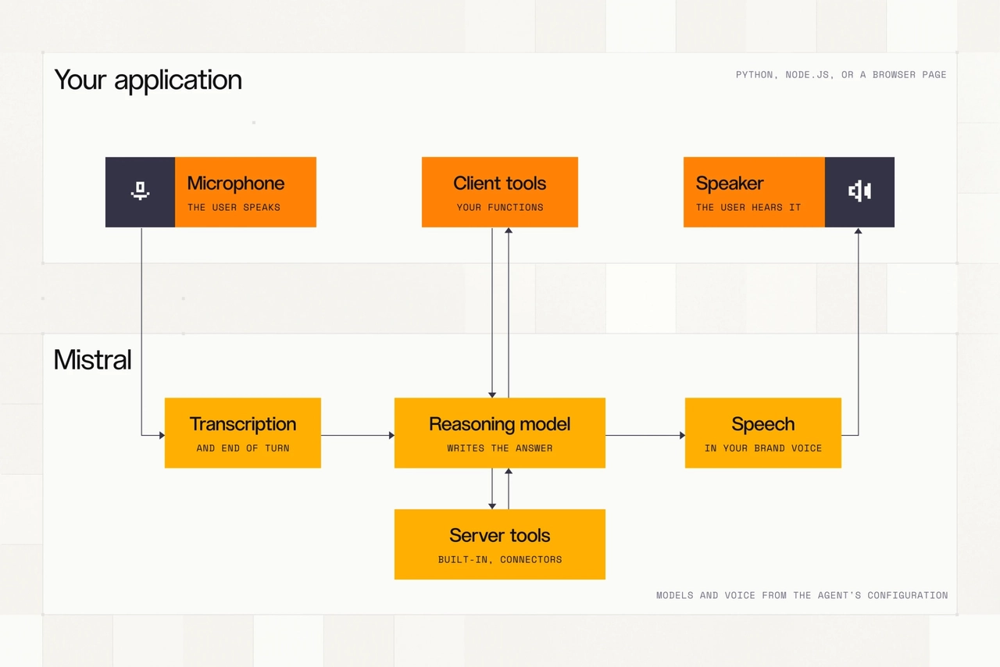
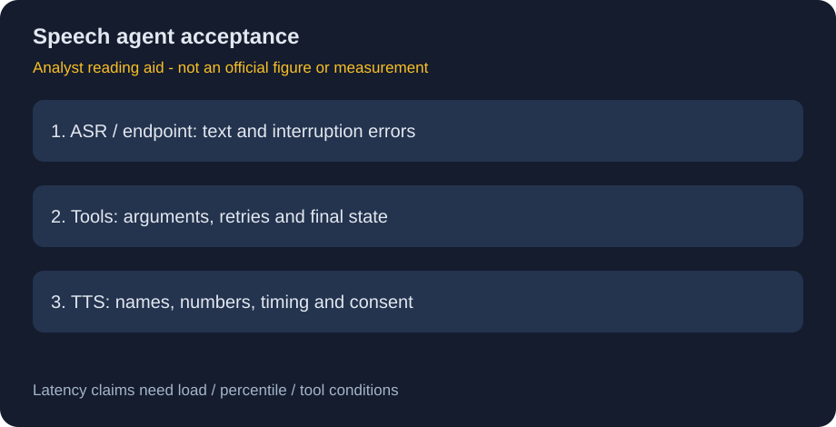

# Voxtral 3：从转写到可执行的流式语音 Agent

> [!tldr] 我的判断
> Voxtral 3 的产品变化不是“一个模型包办听说行动”，而是把独立 ASR、推理模型、工具和 TTS 做成可并行、可打断的语音闭环。语音指标和任务最终状态必须分别验收。

> [!warning] 原始资料不足
> 已完整读取并保存官方发布博客、原始 HTML 和官方流水线图。当前未在官方 HF inventory 中发现该 family 的公开模型卡，也未核实独立训练 Tech Report。训练数据配比、完整架构、RL 配方和消融尚不足，本文未达到完整技术报告精读深度；博客写支持私有部署不等于公开权重。

## 一手资料与发布日期

- [官方 Tech Blog](https://mistral.ai/news/voxtral-3/)；官方新闻索引明确标注 **2026-10-20**。10月21日是本轮归档日，不是首发日。
- 原文：[[src/tech_blog.html]]、[[src/tech_blog.txt]]；资源来源见 [[src/retrieval_manifest.json]]。
- 按一个语音 family 收录；Small、Mini、Realtime、Speech 是同次发布的组件/服务变体，不拆成多个聊天正代。

## 发布了哪些组件

| 组件 | 已披露能力 | 不能混同的边界 |
|---|---|---|
| Small Transcribe 3 | 50+语言，转写、说话人区分、context bias | 不等于语音合成模型 |
| Mini Transcribe 3 | 4B，离线转写 | 4B只适用于这个明确披露的变体 |
| Mini Transcribe Realtime 3 | 流式转写、原生end-of-turn检测 | 延迟预算影响准确率 |
| Mini TTS / Speech 3 | 35+语言、50+方言，语气/节奏/重音控制 | 不等于支持同样语言数量的ASR |
| Voice Agent SDK | LiveKit串联ASR→LLM与工具→TTS，可打断 | 推理模型可替换，不是新的统一权重 |

博客在Realtime语言范围上分别写“over35”和卡片“40+”，本文保留口径差异，不把它们自动改成全部50+语言。Pro Voice要求获得音频授权；本文不提供冒充他人的声音操作。

## 核心机制：并行流水线而非顺序等待

ASR持续接收音频，用声学和语义共同判断用户何时结束；LLM处理已到达的内容、检索或调用工具；TTS尽早合成可播放片段。用户插话时停止当前播放。它减少的是链路等待，不保证所有外部工具都在亚秒返回。

后台工具已经产生副作用时，停止声音也不会撤销业务动作。真正的Agent评测应记录听到的文本、推理决策、工具参数、执行结果与播报承诺，检查“说已完成但状态没变”或“重复执行”的错误，而不只算转写WER。

## 评估：按基准、语言和延迟分别读

| 官方展示 | 协议 | 可支持的结论 |
|---|---|---|
| FLEURS45 | 共同支持45语言macro-average；部分语言用CER而非WER；forced/inferred分开 | 不代表所有50+语言逐一领先 |
| Diarization | AMI-IHM/SDM、Switchboard/CallHome、AISHELL-4；部分切成30分钟 | cpWER测说话人归属与转写组合误差 |
| Context bias | Earnings22，术语含0–100个干扰项 | 应同时检查错把干扰术语写进去的风险 |
| Realtime FLEURS35 | 同一family展示240/480/960/2400ms配置 | 不把离线Mini成绩当240ms流式成绩 |
| TTS Voice Code Bench | 300英文prompts、每系统2voice、Gemini3.8Flash judge | 是特定数字/专名场景，不是普适人类偏好 |
| TTS多语种 | 发布选定377prompts、11语言，按语言均值等权 | 不代表35+语言完整覆盖，评委偏差未消除 |

博客的“每轮under1s”和ASR“sub500ms”是不同层的声明，没有给完整工具负载下的P95/P99分解。TTS主观分数、价格和错误率也是不同量纲；不能把质量/美元曲线当统一准确率排名。

## 部署与成本的约束

截至原文发布：Mini离线$0.0035/min、Small$0.004/min、Realtime$0.008/min、Speech$13/百万字符；Voice Agent依推理模型为$0.04或$0.08/min。这些是**发布时标价，不是本地成本实测**。还需计工具、电话、带宽、并发、缓存与重试。博客同时提到EU/US/global API端点；必须具体选择数据地域与保留策略，不能因“主权部署”宣传自动认为所有请求都在EU。

## 对 Agent Training 的启发

> [!insight] 把语音约束加入轨迹，而不是给文本轨迹加音频壳
> 长停顿、口误纠正、插话、工具未返回和播报中断会改变行动时序。训练/评测应保存事件时间线、实际状态与补偿动作，单列“识别正确但执行错误”的样本；最终状态验证不能被流畅声音替代。

建议区分ASR错、端点判断错、工具计划错、执行失败和TTS误读；保持同工具环境、同音频和同延迟预算后再比较。这里是基于公开机制的研究建议，非已完成实验。

关联：[[Mistral_AI/Variants/261015_Timestral/Timestral]]；[[NVIDIA_Nemotron/Variants/2610_Flora/Flora]]。

> 📊 中文 Poster：[[voxtral_3_poster_zh.html]]
