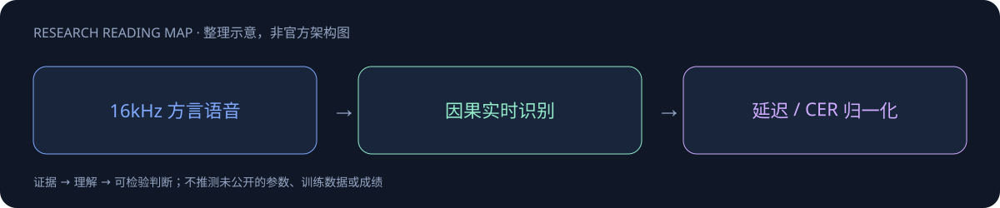
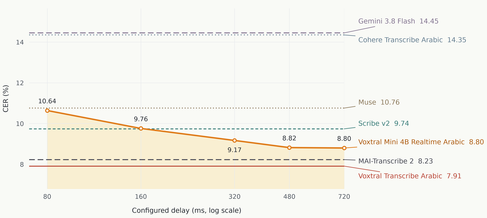

# Voxtral Realtime Arabic

> [!tldr]
> Voxtral Mini 4B 实时阿拉伯语转写，配合 LIDstral Arabic 语言识别。 语言识别与流式转写是两个接口，应保持family内两个成员可追溯。阿拉伯语方言与标准语的差异会掩盖在总体WER里，需要按口音与code switching分桶。

## 一页速览

| 维度 | 当前证据 |
|---|---|
| 发布时间 | 2026-10（确切日期待核实，未计入精确30日表） |
| 类型 | 专项支线 / family · Speech |
| 关键事实 1 | 4B realtime ASR |
| 关键事实 2 | 阿拉伯语专项 |
| 关键事实 3 | LIDstral Arabic配套模型 |
| 检查日期 | 2026-10-13；官方原始资料在同级src/ |

## 方言与 Code-switching 的专项微调

从VoxtralMini4BRealtime2602微调，约4.4B、BF16，16kHz音频经因果encoder与语言decoder，面向现代标准阿拉伯语及地区方言。此处是专项识别支线，不能当Mistral通用模型的新正代。

480ms配置延迟下，七个Arabic benchmark平均CER8.82%，离线VoxtralTranscribeArabic7.91%，差0.91个百分点。CER是字符错误率，不能换成WER；配置延迟也不是包含网络和应用缓冲的端到端延迟。

## 归一化是评测的一部分

官方与MTNRA共同定义方言拼写、附着词、外来词和口语数字归一化，提供normalization.py。改变归一化可能改变得分。Gemini部分FLEURS音频被安全过滤，不能把这类拒绝混入声学识别能力并省略解释。

支持vLLM实时WebSocket及Transformers≥5.2路径；阿拉伯语外任务应使用原始模型，而非假定这一专项版本全面提升多语种。授权Apache2.0，但HF权重入口可能要求用户同意资料共享，不能自动接受协议。

> [!warning] 发布日期待核实
> 仓库createdAt为10月8日，尚未找到独立、明确的首次发布日。暂只知10月，不计入日期明确的30日表；不可把createdAt当发布日期。

## 对 Agent Training 的启发

> [!insight]
> 记录实时处理预算、词错误率和字错误率，同时验收端点检测与时间戳。公共卡提供的部署接口可用性不等于各方言均有充分证据。

以上是基于已读官方资料的研究判断，不是官方保证，也没有在本机运行模型推理或复现论文成绩。下一步优先补独立验证器、固定任务/版本和完整失败轨迹，避免只保存最好样例。

## 一手资料与导航

- [S1] [HF Model Card](https://huggingface.co/mistralai/Voxtral-Mini-4B-Realtime-Arabic)

原始下载文件与SHA-256见 [[src/retrieval_manifest.json|抓取记录]]。报告保留链接，不抓PDF；动态网页响应若只有壳文件，不将其标成完整离线正文。

- [[Topics/13_base_model/Base Model MOC|基模主题索引]]
- [[voxtral-realtime-arabic_poster_zh.html|中文Poster]]

> 📊 相关可视化: [[voxtral-realtime-arabic_poster_zh.html|Voxtral Realtime Arabic 中文Poster]]
