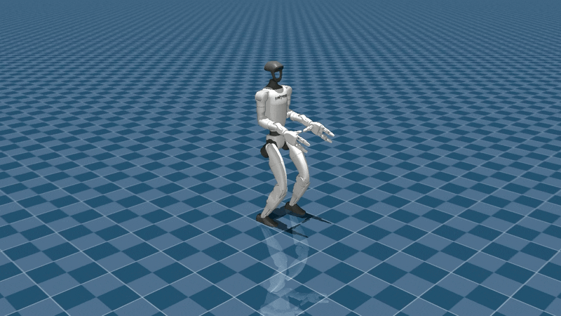

# AGILE WBC H2 Plus：数值状态到腿腰控制

> [!tldr]
> 这不是语言或视觉基模，而是166030参数的PPO locomotion控制器专项。输入本体状态与历史，输出腿腰14关节位置目标及PD增益；保留上身、手和头给另一个控制器，与GR00T上层策略互补。

## 发布与模型接口

> [!tldr]
> 卡声明HF10/1发布，本轮11/13新观察到，createdAt8/12均不证明首个公开日。暂列2026-10月份待核；不把11/12 lastModified当新训练或新首发。

网络MLP为255→256→256→128→14、ELU。导出Velocity-H2-History-v0含agile_velocity.onnx、YAML和initial_values.safetensors；后者是反馈初始状态，不能丢弃。本轮只存README和框架说明，没有下载或加载这些二进制。

|输入/输出|卡列形态与含义|
|---|---|
|原始本体|root angular velocity[1,3]、quaternion[1,4]、base velocity[1,3]、关节位置/速度各[1,31]|
|历史|角速度、投影重力、速度命令、受控关节位置/速度/动作的五步历史与前动作[1,14]|
|主要输出|joint_pos、kp、kd各[1,14]，12腿+腰roll/pitch|
|反馈输出|历史张量与previous-action，下一控制步必须回写|
|运行|ONNX Runtime，opset20；LinuxUbuntu，L40/RTX6000/JetsonThor|

255是网络特征维数，不是把所有卡列输入shape机械相加；初始值、joint ordering、反馈图的具体拼接应查导出配置。未读取图，不虚构控制频率、kp/kd数值或推理延迟。

## PPO、框架与证据强度

> [!tldr]
> 使用Isaac Lab在线PPO，数据为数值状态/命令/动作/仿真reward，没有语言或收集的演示集。训练末期误差不是独立真实机器人benchmark。

卡报告XY速度误差.125m/s、yaw误差.313rad/s，称测试同训练仿真环境、评估还含H2 Plus硬件，但未给物理测试样本数/分布/置信区间。本轮不把末期telemetry推广到真实成功率。

AGILE框架README列IsaacLab3.0.0-beta2、IsaacSim6、Python3.12、RSL-RL5.4.1及patch，支持teacher/student、privileged observation、sim-to-MuJoCo、OSMO调度、HTML评估。它主要展示BoosterT1与UnitreeG1验证，**不能据此声称本H2导出也使用相同蒸馏流程或已复现所有动作**。

## 许可、限制与Agent训练判断

> [!tldr]
> 模型采用NVIDIA Open Model License；框架大部Apache2、RSL-RL patch BSD3-Clause。不同资产分别看许可，不能把代码开源许可覆盖模型。

可能在低摩擦地面、外部扰动、高动态上身动作和不兼容上身控制器下失效。卡明确非mission-critical功能安全用途。没有公开足够训练步数、reward权重、地面分布和真实评测协议；这里显著保留资料不足，不用框架功能清单填成实际模型训练记录。

> [!insight]
> 上层agent/VLA动作成功取决于底层稳定控制。比较VLA时必须冻结WBC版本和时序/动作映射；比较WBC则固定上身扰动和地面条件。跨sim稳定是中间证据，不能替代实机分布外验证。

来源：[官方模型卡](https://huggingface.co/nvidia/agile_wbc_unitree_h2)、[框架README](https://github.com/nvidia-isaac/WBC-AGILE)、[报告链接](https://arxiv.org/abs/2603.20147)仅链接未精读，未抓PDF。日期、实际H2训练run与硬件测试规模待核。

> 📊 中文Poster：[[Topics/13_base_model/NVIDIA_Nemotron/Variants/2610_AGILE_H2/agile-h2_poster_zh.html]]
