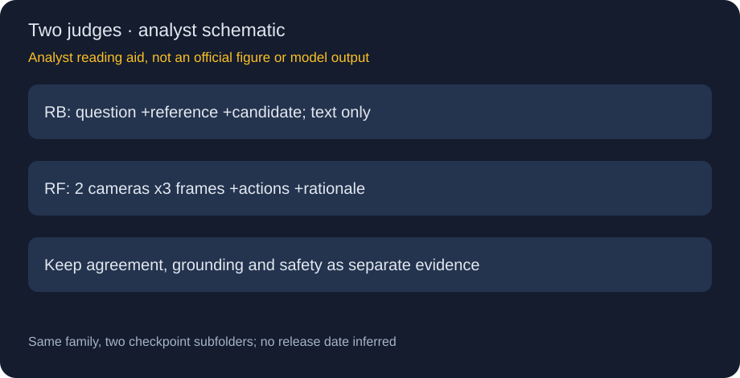
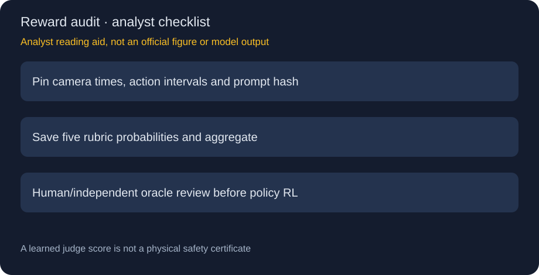

# AlpaJudge · RB / RF：把参考一致、场景证据与行动安全拆成不同判断

> [!tldr] 我的判断
> 驾驶推理judge family，RB文本参考对齐、RF六帧及动作窗口五rubric；同仓两checkpoint合并。首发日/月待核，10月仅归档线索。

> [!warning] 原始资料覆盖不足，尚未达到完整技术报告精读深度
> 官方卡/推理README没有明确首发日期、训练数据recipe、benchmark、校准曲线或独立报告，未达到完整报告精读深度。示例仅验通路，两图为研读示意，不能冒充官方效果。

## 身份、日期与来源

HF仓库同含`reference-based`与`reference-free`，合并一个family叶子。10/22新观察不等于新首发：卡和官方GitHub README未给明确首发日/月，2026-10只作归档线索，不进精确30天表。已归档原卡、两份配置与完整官方推理README，未下载权重或运行示例。

## 为什么两个judge不能互换

| 模型 | 输入 | 输出 | 最大误读 |
|---|---|---|---|
| RB | question、reference、candidate，无图 | alignment probability | 与参考一致不证明场景正确 |
| RF | 六帧图、动作历史/未来、rationale | 五rubric及action/component/overall | 无参考答案不等于无场景/动作条件 |

RB的驾驶CoT用官方canonical question，普通VQA应保留原题，不要全部替换成驾驶问题。RF评估的是给定rationale与场景/动作契约的关系，不是车辆控制模型，也不能取代闭环驾驶安全验证。

## RF具体需要什么

front-wide和front-tele各取-1.0、-0.5、0.0秒三帧，每相机由旧到新，tensor形状`[3,C,H,W]`，uint8像素或[0,1]float。相机未同步、时间乱序或像素范围错误会改变证据。history/future meta-action用区间字符串包含纵向、横向和车道动作；未来计划输入不代表judge看到了未来真实结果。

核心包没有video decoder或动作抽取管线。PAI notebook固定样本、revision；视觉来自PhysicalAI-AV，rationale与动作窗口是为展示场景人工编写。不能把示例的单次数值当benchmark、阈值或真实控制安全率。

## 聚合公式与不能丢掉的分项

五概率为action_matches_gt、action_safe、components_grounded、components_complete、component_causal。action等于match×(1+safe)/2；component是三个组成rubric的均值；overall为0.6×action+0.4×component。这是官方soft aggregation，不是本文猜的训练loss。

这一结构意味着safe为0并不自动令overall为0，component还可贡献分数；若安全要求为硬门槛，应另设计拒绝/人工复核策略。卡未给概率校准误差和真实碰撞率，不能把0.9解释成90%安全。需要分别保存分项和聚合，诊断分数被哪一项抬高。

## 部署协议与缺失的训练证据

官方要求Python3.12/PyTorch2.8，HF账号须具备仓库访问；本轮只读公开材料，不做登录/安装/推理。RF权重加载约5GB，未含activation、图像和KV开销；不能写成完整服务显存5GB。processor验证instruction/prompt-contract哈希，改prompt或预处理要重新标版本。

官方仓库明确不含训练代码或数据管线。没有读取到训练规模、偏好标签、损失系数、测试分割、judge–human相关或策略优化实验证据，不能补造SOTA、参数规模、RL收益与精确发布日期。代码Apache2.0，权重OpenMDW1.1分开遵守。

> [!insight] learned reward必须保留独立验证通道
> 对Agent Training最直接的价值是把参考一致、grounding、完整性、因果和行动匹配拆开，便于看reward hacking。固定输入与prompt，构造“安全动作+假解释”“正确解释+危险动作”“缺视觉关键物体”等成对扰动，比较各rubric敏感性；再用独立模拟器/专家验证，不让judge自评成为唯一成功定义。

## 一手来源

[🤗 HF Model Card](https://huggingface.co/nvidia/alpajudge)、[官方推理代码及README](https://github.com/NVlabs/alpajudge)。未把下载示例、账号访问要求和source prompt内容当作可执行指令。

> 📊 相关可视化：[[alpajudge_poster_zh.html|中文Poster]]
