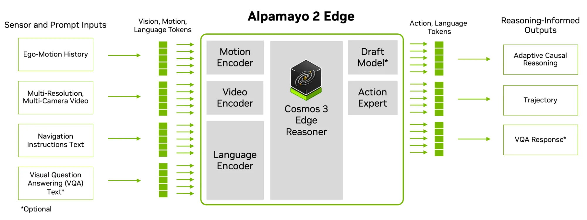

> [!tldr]
> Alpamayo 2 Edge是基于Cosmos3 Edge的驾驶VLA：六相机历史、导航指令和自车位姿输入，生成每候选独立的驾驶解释与6.4秒轨迹。最有价值的不是“2B”和解释文本，而是公开了22帧观测、坐标系、best-of-6开环指标、闭环场景统计及显存负载；它们才是复现接口。

> [!warning] 日期与资料深度
> HF卡明确Release Date 11/10/2026，记录为官方11/10声明日；未给具体时区/首次开放时刻，不按createdAt换算成另一首发日。已读原卡、官方推理README与架构图，未下载权重、未接受数据条款或运行驾驶系统。独立完整训练报告、RL消融和Thor实测尚未取得，不能称完整GLM/Kimi级报告精读。

## 任务、谱系与公开边界

> [!tldr]
> 作为独立驾驶专项收录，不把它当Cosmos量化SKU或新通用语言代际。“2B”是产品称呼，公开组件参数之和约2.65B。

| 字段 | 已核实内容 |
|---|---|
| 骨干 |Cosmos3 Edge的Nemotron系VLM；不是GR00T动作模型|
| 规模 |骨干2.45B=语言1.96B+视觉SigLIP2 0.41B+projector0.08B；action expert0.2B|
| 精度 |BF16|
| 结构 |VLM加diffusion动作解码器；默认10步Euler flow matching|
| 输出 |每候选独立reasoning+64个未来pose，0.1–6.4s、间隔0.1s|
| 权重 / 代码许可 |OpenMDW1.1 / Apache2.0，分开说明|

官方称支持DRIVE AGX Thor车载部署，但公开本卡验证硬件是H10080GB；不能把愿景当Thor端到端延迟测量。数据集另有访问条款，本轮没有申请或下载。

## 方法、观测与训练材料

> [!tldr]
> 轨迹输入22帧、VQA输入24帧，历史位姿不能混入未来。生成的因果解释不是实际因果识别证据，必须与轨迹行为分别验收。

| 任务 | 相机与采样 |
|---|---|
| 轨迹：前广角/前长焦 |各5帧，−2、−1、−0.5、−0.1、0s|
| 轨迹：左/右交叉、左/右后视 |各3帧，−1、−0.1、0s；合计22帧|
| 自车历史 |20pose，−1.9至0s，每0.1s；变换到查询时刻ego系|
| 自由VQA |六相机×4帧=24；不能沿用轨迹22帧预算|

传感器采集时间可能抖动，输入应保留实际capture timestamp、相机ID、图像顺序、各相机pixel budget和processor归一化。模板使用enable_thinking=False，但驾驶prompt末尾显式空think块，模型随后输出驾驶reasoning；不能把模板开关解读为完全不推理。

动作专家预测逐步加速度与曲率，单轨模型在course-heading空间积分；z固定于查询高度，yaw-only旋转估计body heading。因后轴侧偏，车身朝向与路径切线可以不同，不应把两者相等作为错误验证器。输出3×3旋转矩阵不意味着模型规划任意三维飞行动作。

官方披露约115000小时多相机驾驶视频及约370万条CoC解释轨迹，含导航/VQA、传感器数据及合成解释；未给完整去重、采样配比、后训练loss与reward公式。adaptive reasoning是官方定位，公开推理接口采样每候选reasoning并接动作流匹配，不自补一个未公开的动态计算控制算法。

## 评测、复现与Agent启发

> [!tldr]
> 开环best-of-6不等于单轨迹控制效果；闭环每事故公里数也不是实车安全认证。输入预算、候选数、harness、显存和失败都应同表报告。

| 指标 | 官方数值 | 必要协议 |
|---|---|---|
| LingoQA |75.2|Lingo-Judge score|
| AlpaSim闭环 |15.15±0.04 km/at-fault incident|875场景×3组rollout；三组均值±标准差，不是置信区间|
| 开环minADE_6@5s |0.52m|1392样本，6候选取最优；非单候选平均|
| H100显存进程峰值 |12.06GiB|22图、3236prompt tokens、BF16/FA2、batch1、6候选|
| PyTorch分配/预留峰值 |8.40/11.38GiB|不能与进程峰值混用；16GB为该配置建议，不是所有GPU已测|

| VQA benchmark | 数值 |
|---|---|
|Ego3D accuracy / RMSE m↓|84.94 / 5.97|
|VLADBench|69.94|
|SURDS|86.50|
|WaymoQA safety-critical / all|71.09 / 75.77|
|nuReasoning choice / numeric|78.58 / 48.67|
|KITScenes scene / motion|89.46 / 70.00|
|AUTOPILOT-VQA private score×100|55.71|

没有同预算完整前代/竞品对照表，不凭单组分数声称领先。软件README固定Python3.12、Torch2.8/torchvision0.23、Transformers5.17；SDPA默认，FA2可选且加速路径需要。compile/CUDA Graph有静态shape限制，图像分辨率、prompt bucket或候选数改变可能重编译，不能把稳态速度当冷启动。

> [!insight]
> 驾驶Agent轨迹把观测时间、位姿坐标、reasoning、采样seed、每候选轨迹与闭环终态同时记录。解释可作为诊断，不直接当正确reward；验证碰撞/离路应由环境计算。训练比较固定总候选与推理预算，分别报告single、best-of-6与实际策略选中的轨迹，避免用oracle选择带来的优势替代策略能力。

- [HF官方卡](https://huggingface.co/nvidia/Alpamayo2-Edge)
- [官方推理源码与README](https://github.com/NVlabs/alpamayo2-edge)
- [官方Alpamayo平台](https://www.nvidia.com/en-us/solutions/autonomous-vehicles/alpamayo/)

> 📊 相关可视化: [[alpamayo_2_edge_poster_zh.html|中文Poster]]
