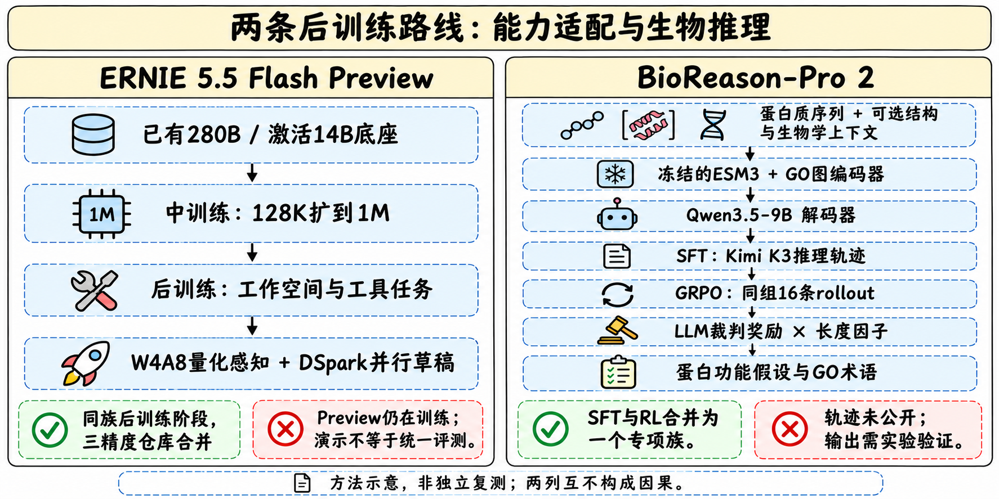
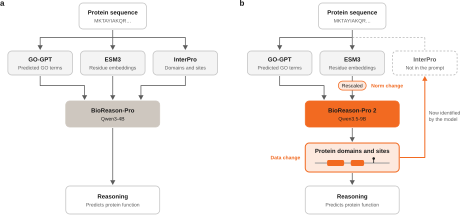
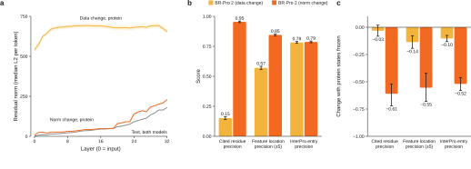

# BioReason-Pro 2 — 让生物推理真正使用蛋白输入

> [!tldr]
> 我的判断：比“加GRPO后分数更高”更关键的是，解释性分析揭示文本捷径和模态尺度失配，然后反过来改变训练输入与表示归一化。可读的推理既能承载真实蛋白信息，也会编造中间事实；一个湿实验验证的结论不代表整段CoT都正确。

> [!warning] 首发、版本与复现边界
> 官方Goodfire/NVIDIA合作博客与HF卡日期为2026-11-24；SFT公开publish事件11/23 23:01UTC→北京11/24 07:01，RL事件11/24 16:47UTC→北京11/25 00:47。同族SFT/RL合并，保留跨时区差异，不把RL仓库创建当首发。当前论文仍in preparation；本次精读博客、GitHub训练/评测说明、模型卡及GRPO裁判细则，不宣称读到尚未公开论文。SFT目标轨迹未释放，公开代码无法完整重现SFT。

## 输入链路与模型

> [!tldr]
> 9.1B发布checkpoint不包含另下载的1.4B冻结ESM3。它生成蛋白功能假设与GO术语，不生成序列/结构，也不用于临床决策。

蛋白序列/可选结构由冻结ESM3 open small第37层表示；经protein projector与GO图编码/投影接入Qwen3.5-9B。文本侧包括物种、GO-GPT预测、可选InterPro和交互伙伴。蛋白截断到2000残基，文本窗16384、最多8000输出token。推理建议单80GBGPU；vLLM内存配额外还要计ESM3和GO编码器。权重OpenMDW1.1、代码MIT，依赖许可分别保留。

推理用GO-GPT ep75以匹配训练/评测，后来的ep89不能无说明替换。在线InterPro版本会变，只有本地5.78-109.0匹配原训练。结构与序列不匹配时回退序列。训练80%样本屏蔽partners、50%屏蔽结构，故缺这些字段在训练分布内；这不等于所有缺输入都无性能代价。

## 如何从解释性发现改造训练

> [!tldr]
> 去除文本捷径、增加位置级监督、按整个蛋白统一缩放，比只给更多CoT更有诊断性。

旧BR-Pro能从InterPro文字直接恢复大量功能结论，移除ESM3影响很小。新版先去掉训练输入中的InterPro，把识别域/位点变为模型必须完成的任务；KimiK3目标轨迹增加具体区域和残基位置。然后发现蛋白表示幅度远高于文本，层更新相对过小。逐残基LayerNorm虽缩小尺度却抹掉幅度差异，出现长度错误与越界位置；block RMSNorm给整个蛋白用同一个缩放因子，保留残基间相对幅度。示意为 \(\tilde H=cH/\mathrm{RMS}(H)\)，准确实现与norm_target以归档源码/配置为准。

| 博客消融量尺 | data change | norm change | 不应混淆 |
|---|---:|---:|---|
|引用残基身份/位置正确率|15.1%|95.5%|不是GO Fmax|
|特征位置在真值±5残基内|57.0%|84.5%|不是全部特征召回|
|移除IPR后→更细训练的特征召回|44%→83%|最终约84%|不同阶段与量尺分开|

博客data-change说over230K轨迹，当前发布README说272688；分别归因，不伪造同一数据revision。冻结各层蛋白位置状态、屏蔽/置换/打乱ESM3、重放固定前缀等干预表明新版更依赖蛋白信息；这能证明输入影响，不能证明每一条功能结论正确。SAE共享激活只能提供关联特征，不能自动升格成因果机制。

## SFT与GRPO实际配置

> [!tldr]
> 发布代码把可复现范围写得很清楚：SFT轨迹缺，RL从公开SFT起点可重建；训练环境与已发权重环境也有差异。

| 阶段 | 配置 |
|---|---|
|SFT数据|272688蛋白记录/轨迹；约2%验证；另6112测试；1321质量不合格训练蛋白排除|
|SFT1|冻结LLM，仅protein/GO projectors及GO encoder，1epoch|
|SFT2|全linear层LoRA r128/α256，10epochs；实际发布epoch07|
|SFT优化|lr1e-4，5%warmup+cosine，有效batch32；4×8H100|
|RL|2905个SFT验证蛋白，1epoch90steps；32prompts×16rollouts，LoRA r64/α128|
|RL优化|lr2e-5、KL0.001；半数提示带InterPro；1×8H100；SkyRL带项目patch|
|reward|KimiK3 low按五轴评分，再乘长度因子；不是GO标签直接reward|
|独立测试裁判|Nemotron3.5SuperVL max，1000蛋白固定子集|

RL说明进一步限定只有LLM的新LoRA与protein projector训练，ESM3用预缓存、GO block烘入embedding表。生成预算4096token；裁判temperature0，长度因子13000字符前全额、16000字符处为0，无可解析GO term直接0。原1442/2905条带InterPro，两个超长样本保留无特征提示以免被静默丢弃。

当前README训练esm3.4.0，但已发checkpoint用了3.2.1.post1；有结构时embedding均值cos0.9989、最低残基0.93，不能声称完全相同。公开eval修复了444个无结构蛋白被批处理为零backbone的问题，重新生成使GO/残基/InterPro/span量尺最多变化0.002。复测必须冻结依赖、GO-GPT版本、结构分支、测试蛋白集合和judge。

## 结果与生物验证分别读

> [!tldr]
> 官方表每格是“不带/带InterPro”，SFT→RL是另一维；不能把跨输入提升算成RL收益。

| 6112测试 / 1000裁判子集 | SFT 无/有IPR | RL 无/有IPR |
|---|---:|---:|
|五轴judge均分|7.24 / 7.72|7.74 / 8.43|
|可靠性|3.92 / 5.06|5.34 / 6.97|
|GO Fmax|0.629 / 0.640|0.662 / 0.667|
|IA加权Fmax|0.551 / 0.566|0.590 / 0.597|
|残基正确率|0.955 / 0.957|0.976 / 0.977|
|InterPro precision|0.787 / 0.945|0.853 / 0.984|
|feature presence F1|0.857 / 0.890|0.856 / 0.896|
|span±5|0.845 / 0.871|0.886 / 0.917|

无IPR的feature presence F1从0.857微降0.856，不能写全指标提升。GO预测包含confident和speculated、向祖先传播，每term分数1，所谓Fmax只有一个阈值；不是常见连续置信度扫阈值的解释。博客best-of10 6.8→8.4与RL单样本6.8→7.6属于另一组实验，不与发布表7.24→7.74硬接。

SMIM32每条件300次：原蛋白31%提出Cys75 S-acylation；去蛋白或C75S突变均0/300；移动Cys到78降13%，到20为2.7%。零次不代表概率严格为0。固定前缀中直接提供Cys75文字，即使突变仍可诱发63.7%提出，说明文本可覆盖真实证据。湿实验支持测试条件下Cys75依赖的S-acylation，但脂肪酸、酶及尾部效应仍未定，原CoT含错误家族和不合理信号肽判断。RCDG1与RAB5A由co-IP支持关联，不等于证明直接结合机制；RCDG1在训练蛋白中，但训练轨迹未提该伙伴，不能叫完全未见蛋白泛化。

## 对Agent Training的启发

> [!insight]
> 先测模型有没有用Workspace/图像/工具返回，再决定加什么轨迹。可做保留问题与文本背景、只替换关键证据的反事实；若答案不变，继续堆“正确CoT”可能只是加强捷径。把输入归因、事实grounding、终态验证与裁判分开，避免用流畅解释当真实执行证据。这里的norm修复与删除IPR是具体可检验的两项干预，不是泛称“解释性有帮助”。

当前模型对其他回答格式的请求较弱，原始轨迹和完整run缺口仍在。未独立执行模型或湿实验；不得将这份笔记用作生物学或医疗验证结论。

## 官方来源与关联资料

- [bio-README.md](https://huggingface.co/nvidia/BioReason-Pro-2-9B-RL/resolve/main/README.md)
- [biosft-README.md](https://huggingface.co/nvidia/BioReason-Pro-2-9B-SFT/resolve/main/README.md)
- [bio-github-README.md](https://raw.githubusercontent.com/NVIDIA-BioNeMo/BioReason-Pro-2/main/README.md)
- [bio-blog.html](https://www.goodfire.com/research/building-stronger-biological-reasoning-models/)
- [bio-rl-README.md](https://raw.githubusercontent.com/NVIDIA-BioNeMo/BioReason-Pro-2/main/scripts/rl/README.md)
- [bio-judge-rubric.md](https://raw.githubusercontent.com/NVIDIA-BioNeMo/BioReason-Pro-2/main/scripts/rl/judge_rubric.md)

> 📊 中文Poster：[[Topics/13_base_model/NVIDIA_Nemotron/Variants/261124_BioReason_Pro_2/bioreason2_poster_zh.html|中文Poster]]

## 官方原图与机制对照

