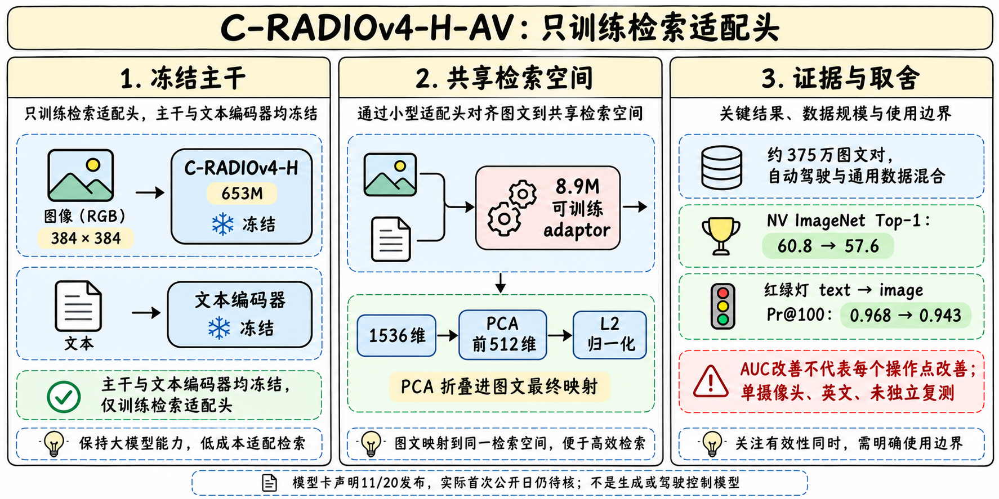

> [!tldr]
> 模型只训练8.9M检索适配头，图像主干和文本编码器保持不变。它将驾驶场景映射到共享向量空间，适合筛数据；不生成图文，也不负责驾驶控制。

> [!warning] 首日仍待核
> 卡明确写11/20 HF Release，但旧权重/README提交不证明何时首次公开；本轮活动页未找到可闭合的public事件。收录2026-11待核具体首日，保留11/20官方声明，不用10/28创建或11/3权重提交冒充首发。模型不是Transformers通用config结构，404不代表缺少权重；本轮未下载或运行。

## 检索结构与推理路径

> [!tldr]
> 固定主干、PCA压缩与归一化共同定义向量。直接拿1536维未压缩输出与512维索引混用会破坏比较。

C-RADIOv4-H基座653M，只有SigLIP2-g adaptor head的8.9M参与训练。图像RGB直接resize384×384、不保持宽高比。图文adaptor先输出1536维，共用PCA，取前512分量；官方示例将PCA折叠进图文最终head的权重/偏置，再L2归一化，用cosine或dot排序。不能将8.9M当完整模型总参数。

PCA超过约500分量特征值接近零、压缩损失很小是卡的经验结论；实际分布改变时仍要检验。torch.hub代码、checkpoint与PCA矩阵需要固定同版；本轮仅静态读取卡，不执行示例。

## 训练数据、选择与泄漏边界

> [!tldr]
> 训练混合AV与通用数据；H3隔离按类别实施，不自动意味着所有场景全局空间独立。

3,747,347图文对、3,369,193独立图片。其中AV1,850,979对，caption由KimiK3和模板构造；NVClip1,896,368对。约274GB私有训练数据，没有开放完整样本/清洗审计。单120°camera、英文限制保留。

val131,604对（AV116,221、NVClip15,383）用于选epoch。训练/验证/评测按类别无H3cell重叠；不能推导跨类别或所有相邻地理信息完全隔离。优化器、训练步数和超参未完整披露，8.9M轻量并不排除过拟合。

## 全部结果与退化操作点

> [!tldr]
> AV主要指标有提升，通用ImageNet退步；红绿灯文本检索的AUC改善，同时Pr@100和Recall@100下降。

AVObjects gallery73,961张（intersection5,466、markings10,162、lights7,209、signs51,124），843查询图片、93文本查询。NVImageNet为1000类、每类最多100张。没有独立重复种子或置信区间。

| Model                              | Top-1 (%) | Top-5 (%) |
|------------------------------------|-----------|-----------|
| C-RADIOv4-H (base, no fine-tuning) | 60.8      | 84.5      |
| C-RADIOv4-H-AV                     | 57.6      | 82.2      |

| Dataset       | Model              | Pr@100 | Recall@100 | AUROC | PR_AUC |
|---------------|--------------------|--------|------------|-------|--------|
| Intersection  | C-RADIOv4-H (base) | 0.875  | 0.081      | 0.790 | 0.619  |
|               | C-RADIOv4-H-AV     | 0.902  | 0.083      | 0.880 | 0.736  |
| Road Markings | C-RADIOv4-H (base) | 0.437  | 0.035      | 0.584 | 0.236  |
|               | C-RADIOv4-H-AV     | 0.696  | 0.055      | 0.774 | 0.480  |
| Traffic Light | C-RADIOv4-H (base) | 0.632  | 0.036      | 0.594 | 0.356  |
|               | C-RADIOv4-H-AV     | 0.951  | 0.057      | 0.840 | 0.703  |
| Traffic Sign  | C-RADIOv4-H (base) | 0.574  | 0.119      | 0.855 | 0.304  |
|               | C-RADIOv4-H-AV     | 0.762  | 0.169      | 0.973 | 0.623  |

| Dataset       | Model              | Pr@100 | Recall@100 | AUROC | PR_AUC |
|---------------|--------------------|--------|------------|-------|--------|
| Intersection  | C-RADIOv4-H (base) | 0.926  | 0.086      | 0.881 | 0.749  |
|               | C-RADIOv4-H-AV     | 0.944  | 0.087      | 0.937 | 0.834  |
| Road Markings | C-RADIOv4-H (base) | 0.469  | 0.036      | 0.603 | 0.274  |
|               | C-RADIOv4-H-AV     | 0.577  | 0.046      | 0.772 | 0.464  |
| Traffic Light | C-RADIOv4-H (base) | 0.968  | 0.058      | 0.842 | 0.702  |
|               | C-RADIOv4-H-AV     | 0.943  | 0.056      | 0.875 | 0.726  |
| Traffic Sign  | C-RADIOv4-H (base) | 0.650  | 0.145      | 0.913 | 0.433  |
|               | C-RADIOv4-H-AV     | 0.762  | 0.175      | 0.977 | 0.624  |

通用Top1从60.8→57.6、Top5从84.5→82.2。TrafficLight text→image的AUC .842→.875、PRAUC .702→.726，而Pr@100 .968→.943、Recall .058→.056；全局曲线指标更好不代表业务操作点更好。应按目标召回/误报/标注预算选阈值，不能只摘最佳指标。

## 研究启发与限制

> [!tldr]
> 这是“冻结表征+小头适配”的可检验路线。收益要和caption来源、地理隔离及压缩误差分开验证。

适合测试Agent数据检索、场景挖掘与难例筛选，不能把检索相似度当安全驾驶或ground-truth verifier。建议固定主干，分别控制AV/NVClip比例、合成caption来源、PCA与embedding归一化；分地理/天气/相机/语言报告召回，给通用能力回归和置信区间。当前无开放训练账本及独立复测。

许可为NVIDIA Open Model License，官方PDF条款仅保留链接，本轮未抓取；实际部署前仍需按使用场景读取条款，不能由“商业可用”一句替代全部条件。

## 官方来源

> [!tldr]
> 卡内所有表格与原始说明离线保存；基础报告和许可PDF仅保留链接。

- [官方HF卡](https://huggingface.co/nvidia/C-RADIOv4-H-AV)
- [基础模型](https://huggingface.co/nvidia/C-RADIOv4-H)
- [RADIO源码](https://github.com/NVlabs/RADIO)
- [基础报告页面](https://arxiv.org/abs/2601.17237)

## 关联与交付

> [!tldr]
> 一手材料、研读判断和展示分别保存；图为机制示意，原表保留原量尺。

> 📊 相关可视化: [[cradio_av_poster_zh.html]]
