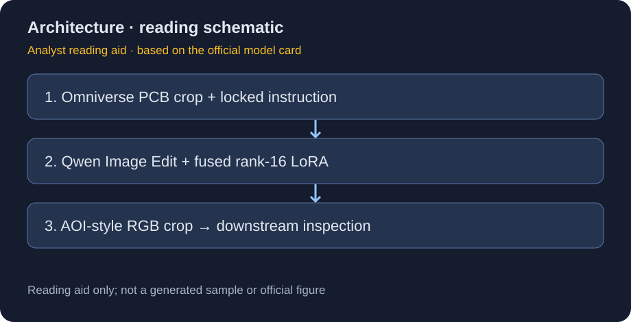
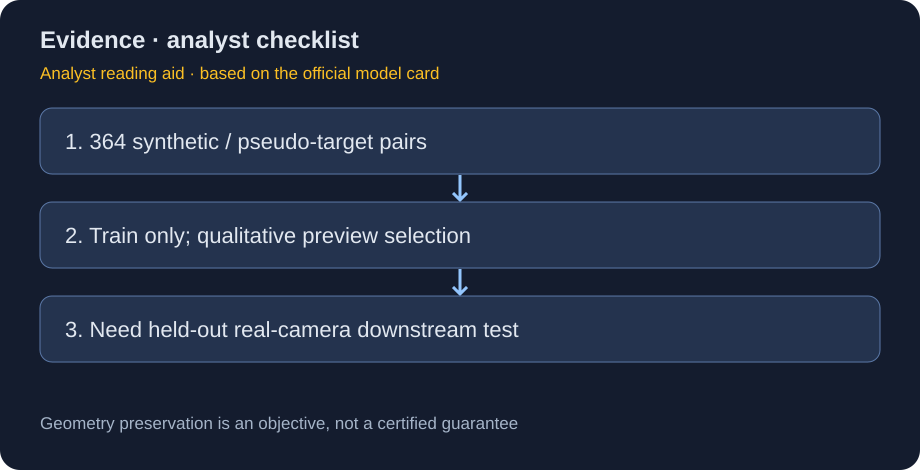

# CDF Sim2Real Solderlight：364 对伪目标驱动的 PCB 风格迁移

> [!tldr] 我的判断
> 这是 NVIDIA 基于 Qwen-Image-Edit 做的 PCB 渲染图→solder-light AOI 风格专项适配，不是 Qwen 新正代，也不是已经证明跨真实相机域泛化的质检器。训练目标来自机器生成的伪照片，而非真实 AOI 相机配对真值，理解这个区别比“sim-to-real”名字更重要。

> [!warning] 原始资料不足，达不到完整实证研究深度
> 已完整研读官方模型卡和训练披露；没有独立 Tech Report、公开的本模型生成效果图、留出测试分数、真实相机评估或几何保持量化消融。由于原始资料较少，无法达到 GLM-5.3-Flash 式完整实验分析深度。两张图是依据官方卡整理的研读示意，不是官方图，也不是实际模型输出。

## 一手资料、日期与分类

[🤗 HF Model Card](https://huggingface.co/nvidia/cdf-sim2real-smt-solderlight) 写明 **2026-10-20** GitHub 发布，v1.0.0。卡所指 `NVIDIA/paidf-augmentation` 当前重定向到 [NVIDIA/cdf-augmentation](https://github.com/NVIDIA/cdf-augmentation)。保存原始卡 `src/hf_model_card.md` 与官方 README，不把上层流水线说明当成本 checkpoint 的独立实验报告。

该模型归 NVIDIA 专项支线，底座 Qwen-Image-Edit；OpenMDW-1.1 为本发布条款，上游组件的 Apache-2.0 仍应分别核对。整套 diffusers pipeline 存在 `model/`；本轮只抓文档，未下载权重、加载 pipeline 或运行示例。

## 解决的问题：把渲染输入约束成特定工业照明风格

Omniverse 渲染可以获得几何、部件与标签，但材质 / 光照分布和真实 AOI 输入不同。模型将单个 PCB 元件 crop 转成克制的斜射焊锡照明风格：只在已有焊盘、引脚、金属端帽等处产生橙红与钴蓝高光，塑料 / 陶瓷主体保持暗、平、非自发光；不能新增文字、logo、边框或装饰。

这些是训练指令与目标约束，不等于模型输出已被数学保证。它是数据翻译步骤；最终 pass/fail 必须由下游检测系统和人工审核承担。

## 结构、参数与训练细节

| 项目 | 官方卡披露 |
|---|---|
| 底座 | Qwen/Qwen-Image-Edit 图像编辑 diffusion / flow-matching pipeline |
| 语言 / 视觉条件 | Qwen2.5-VL；Qwen-Image VAE |
| 训练模块 | transformer attention、cross-attention、img_mlp / txt_mlp 投影 |
| LoRA | rank16、alpha16、dropout0；约170M训练参数 |
| 优化设置 | 3000步、batch1、LR1e−4、seed0、bf16、gradient checkpointing |
| 调度 | Qwen-Image 的 resolution-aware time-shift |
| 发布方式 | scale1.0 融合到 bf16 transformer；推理无需另加 adapter 文件 |
| 卡中总参数口径 | 约20B；与170M训练模块不要相加当成新增容量 |

`model/` 包含 transformer、text_encoder、vae、tokenizer、processor、scheduler 与 model_index.json。LoRA训练后融合发布，与 AnomalyGen 只发适配模块的打包方式不同。部署规划不能根据“LoRA170M”就假设只需加载170M。

## 数据：真的是 real ground truth 吗？

训练集合为 **364 对**按文件名匹配的 Omniverse synthetic crop 与 Qwen-Image-Edit 生成的 solder-light pseudo-target；收集于2026年9–10月。九张视觉不合适的样本被排除。固定英文指令是全数据共享条件，不是364个自由编辑任务。

未打包独立 validation / test split；评估是 side-by-side preview 与内部目视审核。clean目标面积262144像素，对应约512×512，即 **0.262MP**。原卡同一段把它称为“~0.5MP”，这是算术口径不一致；这里保留原数值并指出差异，不照抄错误。其他分辨率虽底座接受，但未由这套微调验证。

## 使用契约与安全解释

用户输入单张与训练分布相近的 Omniverse RGB crop；训练英文 prompt 被固定，不开放任意自由文本。输出 PNG RGB，预处理后分辨率对应训练面积。固定 prompt 有助于减少接口自由度，但不能把卡中的“cannot be a vector for misuse”理解为完整安全证明；图像输入、系统接入与依赖仍可有风险。

“保持几何、标记、外形”是预期行为，实际需逐样本核验。特别是焊盘位移、引脚缺失或凭空生成高光，会改变检测标签，甚至让下游学习合成伪影。不要直接拿风格化结果判定物理缺陷，也不要把伪照片写成真实摄像照片。

## 我会如何验收，而不是只看 demo

1. 按真实生产批次 / PCB设计划分留出集，禁止与伪目标筛选共用。
2. 对照原渲染、未微调 Qwen-Image-Edit、本模型；固定源图与推理预算。
3. 单独量化几何保持、文字 / 标记一致、部件轮廓、非金属误高光率；美观不能覆盖标签破坏。
4. 固定下游检测器训练量，在真实 AOI 测召回、误报、分割质量与跨相机 / 光照退化。
5. 保存被剔除样本及原因，防止只挑好图的选择偏差。报告生成成本与每个有效训练样本成本，而非仅批量产量。

> [!insight] 对 Agent Training 的启发
> 这类“教师生成伪目标→小数据适配”的闭环很像轨迹修复与蒸馏。关键不是修复后的输出更像目标，而是它是否保持原任务不变量。应把几何 / 字段 / 最终状态验证器独立于生成器，训练集筛选奖励和真实下游目标也要分开。

## 关联与交付

- [[Topics/13_base_model/NVIDIA_Nemotron/Variants/261020_Cosmos_AnomalyGen_Nano/Cosmos-AnomalyGen-Nano|Cosmos AnomalyGen Nano]]：基于 mask 的缺陷生成，与照明迁移互补但不可混称。
- 📊 中文 Poster：[[cdf_sim2real_solderlight_poster_zh.html]]。
