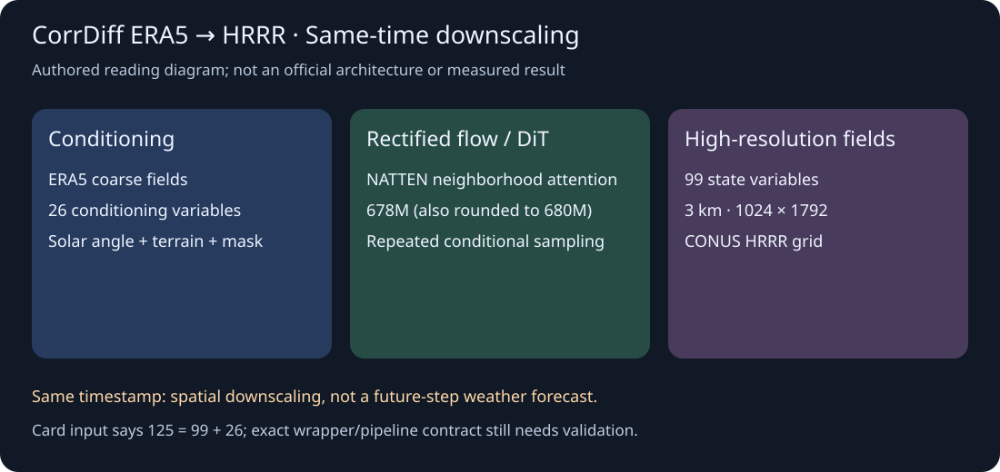
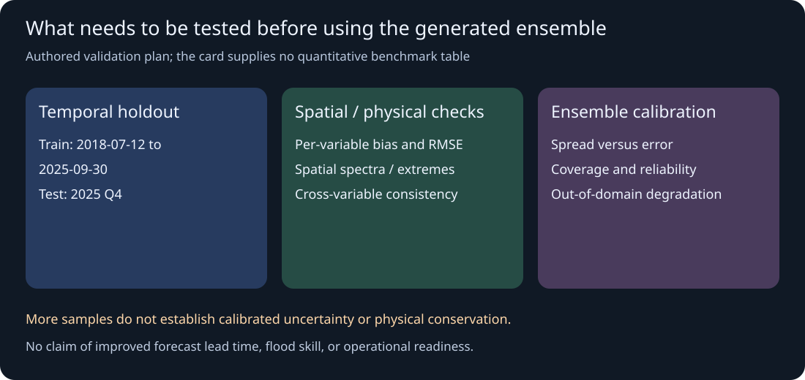

# CorrDiff ERA5–HRRR：同时刻条件降尺度与集合不确定性

> [!tldr] 我的判断
> 这是把 ERA5 粗分辨率再分析映射到美国本土 HRRR 网格的条件生成器。重复采样可表达与粗尺度条件相容的细节分布，但集合多样性并不自动说明概率校准，更不能等同于预测未来天气。

> [!warning] 原始资料较少，达不到完整技术报告精读深度
> 已读本版完整官方 HF Model Card。卡给了结构、变量、数据区间与用途，却没有本 checkpoint 的定量成绩表、训练超参、消融或官方实验图；四份被链接的 safety/privacy/bias/explainability 子卡本轮均返回 404。仅保留两篇背景报告链接，没有将旧版 CorrDiff/StormCast 论文冒充本版完整报告。因此**未达到 GLM-5.3-Flash 参考笔记的训练与实验依据深度**；两张配图均为本文整理示意。

## 日期与收录身份

本轮才观察到仓库，但原卡 `Release Date` 明确写 **Hugging Face 09/28/2026**，故使用 **2026-09-28**，而非今天发现日或仓库 lastModified。它是 NVIDIA 天气/科学计算专项支线，作为历史补漏收录；北京时间 9/29–10/28 的近30天表不包含 9/28，谱系仍然可查。

它与 StormCast-CONUS 共享变量、条件、网格与 DiT/NATTEN 架构定位；此版是 **同一时刻** ERA5→HRRR 超分辨率，不应因为关联 StormCast 名称就写成时序预报。模型从成对数据训练，并非由某个已训练基座继续微调。

## 输入输出要核到包装器层面

| 项目 | 原卡披露 | 解读与边界 |
|---|---|---|
| 输入 | 4D tensor `(batch, variable, latitude, longitude)` 与1D DateTime | 数据顺序、单位和时间对齐都是接口契约 |
| 输入变量 | 125（99 state +26 conditioning） | 原卡如此列出；如何在具体推理包装器中准备初始状态/噪声，仍需读实现核验，不能默认99个高分辨率真值在部署时已知 |
| 其他条件 | 太阳天顶角余弦，地形均值/标准差，陆水掩码 | 时间和地形是有信息的条件，不是无条件生成 |
| 输出 | 99个surface/model-level变量 | 包含10米风、2米温度、海平面压强、多层风/温/湿/高度/压强及refc |
| 空间 | HRRR Lambert Conformal，3km，1024×1792，CONUS | 不等于全球3km产品，更不等于任意地区直接泛化 |

26个粗尺度条件为 `u10m/v10m/t2m/tcwv/mslp/sp` 加 `u/v/z/t/q` 各自1000、850、500、250四个压强层。99个状态中的 `_hl` 指自然/混合model levels，不应把它们误当成所有变量都使用相同的等压层。

海平面压强、表面压强、层压强不是同一个量；同样，模型层位势与海拔常量也不能混用。正式使用前应对照 Earth2Studio HRRR Lexicon 验证变量名称、顺序、单位和缺测处理。

## 方法：条件采样与降尺度不是插值的同义词

原卡描述 Diffusion Transformer 配合 neighborhood attention（NATTEN），678M 参数；另一字段写6.8×10^8，属于约680M的舍入，不能拆成两个尺寸。训练使用 **rectified flow matching**，对相同 ERA5 条件重复采样得到一组公里级状态。

从理解上看，粗场限定大尺度天气形势，生成过程负责补充训练分布支持的细尺度结构。局部 attention 是结构信息，不能仅凭名称给出完整的token化、patch size、层数或显存复杂度；原卡没有完整披露这些实现。

“生成合理细节”也不是“恢复唯一真实细节”。粗分辨率条件丢掉的信息本来可能存在多解，所以应同时检查单样本误差与集合统计。以下只解释学习目标的通常含义，不冒充本版未公开的具体loss权重、路径设计或采样器配置。

## 数据划分与潜在评价陷阱

| 数据 | 训练窗口与规模 | 公开测试窗口 |
|---|---|---|
| ERA5 | 2018-07-12—2025-09-30，150GB子集；原始约30km、137层 | 2025-10-01—2025-12-31 |
| HRRR | 同一训练日期范围，15TB子集；NOAA3km、逐小时更新 | 同一2025Q4区间 |
| ASTER GDEM/ASTWBD | 120MB处理后静态数据；原生约30m，变换到HRRR网格 | 作为地形/陆水条件 |

这些是存储规模，不是独立样本数或经过清洗去重后的有效token数。相邻小时高度相关，不能将随机打散的时间点视作真正独立测试；官方按时间切分是重要信息，但Q4的短窗口也不足以覆盖全年天气与极端事件。HRRR本身是数值模式分析/预报系统，不是每个网格点都直接有传感器地面真值。

## 没有结果表时，应该怎样诚实验收

本卡没有给RMSE、CRPS、可靠性曲线、极端事件召回、空间谱、计算耗时或相对基线提升。不能为了让笔记“完整”去填类似模型的数字；旧报告里的加速倍数也不能移植到本 checkpoint。

可建立四组独立检验：各变量/高度层和季节分布下的误差；锋面、降水与refc等局部结构和尾部分布；温湿压风之间的一致性与守恒偏差；重复采样集合的覆盖率、spread–skill和校准。上述是本文评估建议，没有实际跑模型、下载权重或宣称完成实验。

同一粗场生成多个样本，只证明能采样；若样本都遗漏极端强度，集合仍会过度自信。只看平均图像锐利程度也可能奖励虚假细节。对下游洪水或风能评估，还要另验任务敏感指标，不能直接从“3km”推出业务收益。

## 部署、许可与研究启发

官方列 PyTorch/Earth2Studio、Linux，兼容 Ampere/Hopper/Blackwell，测试硬件 H10080GB。它没有给出“最低需80GB”的证明，也没有吞吐/采样步数表；不把测试卡型号当最低显存需求。OpenMDW1.1 是模型许可，ERA5/HRRR/ASTER数据自身的使用条款应分别追溯。

> [!insight] 用可见分布约束生成器，而不是让它定义真值
> 若用这类科学模拟训练决策代理，应保留粗条件、随机种子、生成状态和独立高分辨率参照，分开审计环境误差与策略误差。由生成器学习到的相关性不是物理定律；“在生成环境中收益更高”不足以证明真实极端天气决策更可靠。

## 一手来源

- [🤗 HF Model Card](https://huggingface.co/nvidia/corrdiff-era5-hrrr)；原始MD在 `src/hf_model_card.md`。
- [📄 CorrDiff背景报告：Residual Diffusion Modeling…（2023）](https://arxiv.org/abs/2309.15214)。不是本checkpoint专属报告；本轮不下载PDF。
- [📄 StormCast v1背景报告（2024）](https://arxiv.org/abs/2408.10958)。共享方法脉络不等于同一训练或评测。
- [PhysicsNeMo](https://github.com/NVIDIA/physicsnemo)、[Earth2Studio](https://github.com/NVIDIA/earth2studio)、[HRRR变量字典](https://github.com/NVIDIA/earth2studio/blob/main/earth2studio/lexicon/hrrr.py)。这些是卡引用的实现入口，不声称本轮已逐行复现。

> 📊 相关可视化：[[corrdiff_era5_hrrr_poster_zh.html|CorrDiff ERA5–HRRR 中文Poster]]
