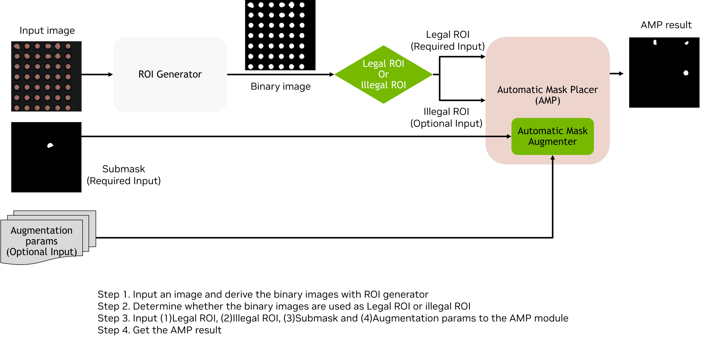
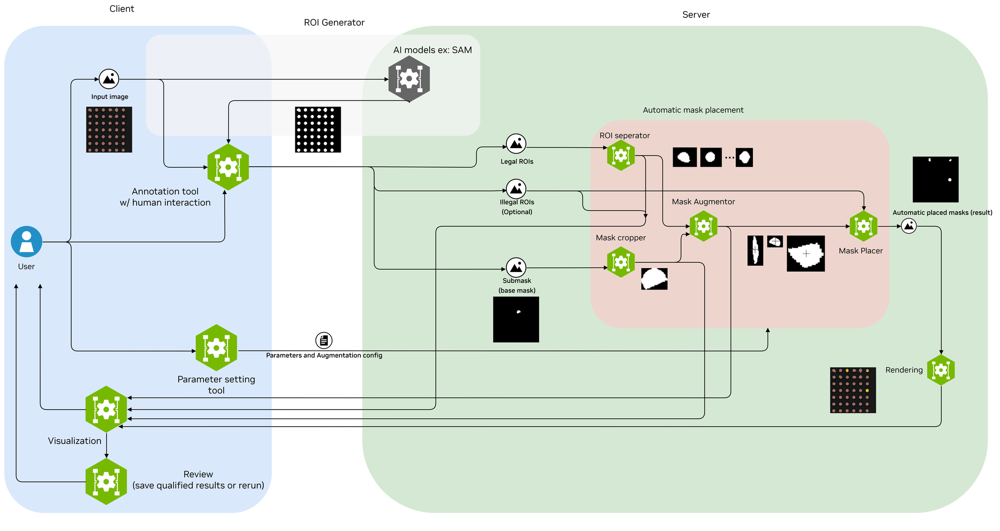

# Cosmos AnomalyGen Nano：少样本缺陷生成的三场景 family

> [!tldr] 我的判断
> 这不是新的通用 Cosmos 正代，而是冻结 Cosmos3-Nano、按缺陷类型训练 LoRA 的工业数据生成专项。PCB、Metal、Glass 三个公开仓库共用方法，作为一个 family 横向比较；“Glass”卡正文实际描述手机屏幕场景。它的价值是把少量真缺陷扩成带 mask 的训练候选，不是直接承担工厂合格判定。

> [!warning] 原始资料不足：不能达到独立实验报告的结论深度
> 已完整研读三张官方卡和官方仓库 README，结构、少样本数量与 checkpoint 信息明确，但三卡均没有独立 held-out test / validation split，也未公布下游检测收益数值。由于原始资料不足，本笔记不能达到 GLM-5.3-Flash 式完整定量结果与消融分析深度。保留官方流程图，不用漂亮样例替代泛化证据。

## 一手资料与收录口径

三张卡均写 GitHub **2026-10-20** 发布。按明确发布字段收录，不从仓库创建 / 修改时间推断首发。

- [🤗 PCB Model Card](https://huggingface.co/nvidia/Cosmos-AnomalyGen-PCB-Nano)：UC1，三类 PCB 缺陷。
- [🤗 Metal Model Card](https://huggingface.co/nvidia/Cosmos-AnomalyGen-Metal-Nano)：UC2，五类磁瓦表面缺陷。
- [🤗 Glass Model Card](https://huggingface.co/nvidia/Cosmos-AnomalyGen-Glass-Nano)：UC3，手机屏幕 oil / scratch / stain。
- [官方 GitHub · CDF AnomalyGen](https://github.com/NVIDIA/cdf-anomalygen)：七阶段数据流水线与复现入口。

本地 `src/` 保存三卡、原始 README 与官方图。模型模块使用 OpenMDW-1.1；框架的 Apache-2.0 不自动覆盖上游全部权重与数据条款。未下载基座权重或 PDF，也未执行项目脚本。

## 问题：真实缺陷稀少，普通文生图又不服从检测标签

工业数据不仅要“看起来有裂纹”，还要缺陷类型、落点、区域和掩码一致。用干净实物图作为背景、mask 作为位置约束、类型字符串作为条件，比自由文本生成更贴近下游检测训练。少样本适配负责缺陷外观，mask placement 负责合法位置；两者不能混为一个模型的能力。

## 三套模型的差异完整列清

| 项目 | UC1 · PCB | UC2 · Metal | UC3 · Glass / Phone Screen |
|---|---|---|---|
| 类型 | IC+bridge；passive_component+excess_solder；passive_component+missing | MT_Blowhole；MT_Break；MT_Crack；MT_Fray；MT_Uneven | oil；scratch；stain |
| 异常图 / 配套 mask | 86 / 86 | 25 / 25 | 15 / 15 |
| 各类样本数 | 8 / 16 / 62 | 各5 | 各5 |
| 干净参考图 | 5 | 20 | 20 |
| 参考图用途 | 推理背景，非监督目标 | 推理背景，非监督目标 | 推理背景，非监督目标 |
| 可训练模块参数 | 23,003,136 | 38,338,560 | 23,003,136 |
| 发布 checkpoint 步数 | 15000 | 14000 | 12000 |
| 总训练迭代 | 15000 | 15000 | 15000 |
| 留出验证 / 测试 | 无 | 无 | 无 |

UC1 的8/16/62明显不均衡，应按缺陷类验收，不能只看整体平均。UC2 是磁瓦来源，不要把“Metal”误写成已覆盖所有金属工业材质；UC3 仓库名 Glass 不等于已验证所有玻璃制品。

## 结构：真正发布的是哪一部分

冻结 Cosmos3-Nano 的 36层、hidden4096 Mixture-of-Transformers 扩散主干，约16B；另用冻结 Wan2.2 VAE（16倍空间压缩、48潜通道）及 Qwen3-VL 文本编码组件。发布物仅含适配模块、摘要 sidecar 和训练 recipe，**不包含整个16B基座**。

每个 texture+anomaly pair 有 rank8 / alpha8 LoRA，落在所有36层的四个 generation-expert attention 投影 q/k/v/o。每类约7.67M参数；三类约23M、五类约38.3M。不能把可训练模块体积当作完整推理显存，基座、VAE、编码器仍需加载。

干净图与同尺寸 mask 输入后，对目标区域加噪 / 编码，再结合文本条件去噪；解码出的 patch 贴回原图。因此非 mask 区域默认维持原像素，启用 Poisson blending 时要另外检查融合边界。mask 二值化阈值127，训练几何允许256/512/1024/1536等裁切尺度。类型字符串必须精确属于该 checkpoint recipe，不能靠自由改 prompt 获得未训练缺陷。

## 七阶段流水线与 Agent 的实际位置

1. 整理 anomaly_image、mask、clean_image。
2. 生成合法位置掩码与 testcase.jsonl：默认 AMG 为 propose→judge→refine VLM 循环；经典 AMP 仍可选。
3. 用异常图与 mask 对微调缺陷 LoRA。
4. 依据 checkpoint + recipe 合成缺陷图。
5. 对照真实参考图计算质量 KPI。
6. 搜索每样本生成参数，默认 NN 目标；可选 aq_rank 综合 NN、completeness、precision、boundary IoU，筛选 keep 集。
7. 导出 COCO 实例标注、分类目录及可选 caption。

这里的“Agentic”首先是数据生产控制环，不等于扩散模型用了 Agent RL。README 描述 AMG 的提案–评判–修订，但没有给这三套 LoRA 的 RL 奖励或强化学习算法；不能据此编造 GRPO 训练。

## 结果为什么不能写成“质检泛化已证明”

原卡说 ValidationKPI 在训练中生成样例，记录 FID、最近邻以及异常区域质量等指标，但未给独立测试结果表。训练中的 validation callback 名字含 validation，不代表存在数据独立的留出集。反复按同一参考集挑参数与 checkpoint，还会引入选择偏差。

真正的验收应将真实测试产品 / 生产批次留在生成与筛选之外；固定下游检测器、训练步数和真实训练量，对比真数据、简单复制增强、AnomalyGen增强。按缺陷类型报告召回、误报、分割边界与置信区间；检查最近邻是否只是复制训练缺陷。没有这些，就只能说发布了可用数据生成模块，不能承诺提高真实产线准确率。

生成结果也可能出现非法缺陷位置、微小几何改变、伪标签错配；`guardrail_blocked.csv` 只是安全过滤记录，不是质量证明。保留 seed、guidance、crop_ratio、mask、recipe hash 和筛选历史，比只保存最终好看的图更有研究价值。

> [!insight] 对 Agent Training / 数据闭环的启发
> 将“提案器”和“判定器”拆开能让失败更可定位，但两者共享偏好时会形成自证循环。生成–打分–再生成的系统应另设不可见的真实下游测试；Verifier 可以奖励 mask 一致、ROI 合法、非目标区保真，但这些局部奖励不自动等于真实缺陷可检测性。

## 关联与交付

- [[Topics/13_base_model/NVIDIA_Nemotron/Variants/261020_CDF_Sim2Real_Solderlight/CDF-Sim2Real-Solderlight|CDF Sim2Real Solderlight]]：风格迁移，不是缺陷生成。
- 📊 中文 Poster：[[cosmos_anomalygen_nano_poster_zh.html]]。
