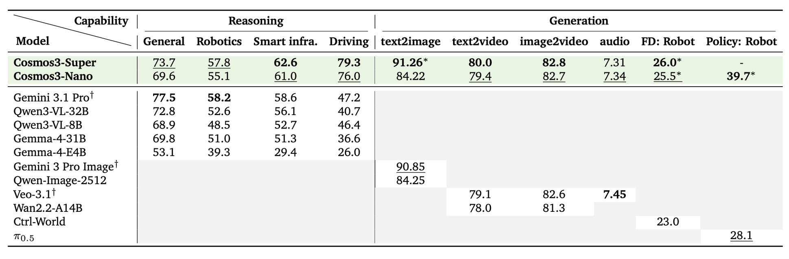
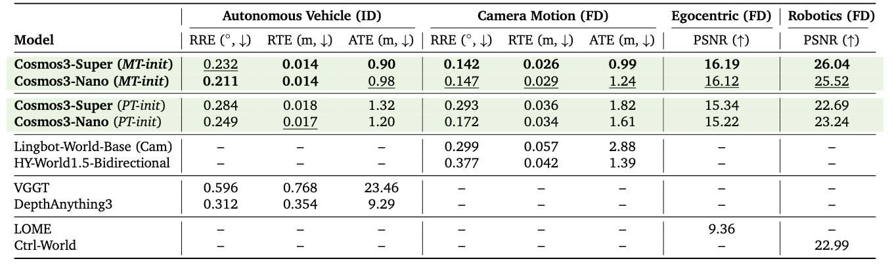

# Cosmos3：把世界理解与多模态生成放进一个家族

> [!tldr] 核心判断
> Cosmos3 的关键不是“能生成视频”，而是用 MoT 框架容纳自回归文本推理和连续模态去噪。Nano 16B、Super 64B 是同一正代的两个尺寸，合并研读。它可以成为环境观察和轨迹合成器，但没有显式物理引擎，不能直接成为任务成功验证器。

> [!warning] 原始资料与阅读深度
> 本轮亲自阅读 Nano / Super 完整 HF 模型卡，保存官方评估原图与项目网页。基础 Tech Report 存在，按“不下载 PDF”的要求仅保留链接；完整报告本轮未读。原卡对 loss、消融和评估统计协议披露有限，因此**未达到完整技术报告精读深度**，不补造图中无法可靠读取的数字，也不声称已复现。

## 身份、日期与来源

两张模型卡的 Release Date 都明确写 HF / GitHub **2026-05-31**。HF 仓库创建于更早时间不能替代首发日；本次是历史补收，不是 10 月的新模型。

| 项目 | Nano | Super |
|---|---|---|
| 参数量（卡片字段） | 16B | 64B |
| 架构 | MoT：自回归塔 + 扩散塔 | 同一产品族 |
| 首发 | 2026-05-31 | 2026-05-31 |
| 许可证 | OpenMDW1.1 | OpenMDW1.1 |
| 已测试精度 | BF16 | BF16 |

- 🤗 HF Model Card：[Nano](https://huggingface.co/nvidia/Cosmos3-Nano)、[Super](https://huggingface.co/nvidia/Cosmos3-Super)
- 📄 [Tech Report（PDF 链接，未下载）](https://research.nvidia.com/labs/cosmos-lab/cosmos3/technical-report.pdf)
- 🌐 [官方项目页](https://research.nvidia.com/labs/cosmos-lab/cosmos3/)、[官方代码](https://github.com/NVIDIA/cosmos)
- 本地原件：[[src/hf_model_card.md|Nano 原始 MD]]、[[src/Cosmos3-Super.md|Super 原始 MD]]；抓取时间、URL、SHA256 见 `src/retrieval_manifest.json`。

## 为什么需要双生成机制

文本推理天然是离散 token 的自回归过程；视频、音频和连续动作通常通过迭代去噪生成。Cosmos3 不是强迫所有模态都用同一种输出机制，而是把两类 transformer 放进 Mixture-of-Transformers 框架。Reasoner 负责文字解释与图像/视频推理，Generator 负责图像、视频、音频、动作等连续输出。

这能统一输入语义，却不意味着每个接口共享相同上下文、吞吐、身体表征或验证标准。一个模型会解释物体关系，不自动证明它预测的接触动力学正确。

## 输入输出：最容易混淆的两套长度

| 接口 | 原卡边界 | 不能推断什么 |
|---|---|---|
| Reasoner | 最多 256K tokens；视频推荐 4fps | 不代表生成器可以吃 256K 文本 |
| Generator 文本 | 4096 tokens | 不等于多模态总容量无限 |
| Generator 视频输入 | 最多 5 帧，限定分辨率/比例 | 不代表任意长视频续写 |
| 音频条件 | 最多 0.5 秒 | 不代表长语音上下文 |
| 动作输入 | 16–400 视频帧；形状 `(T,D)` | D 随身体变化，不是统一通用动作空间 |
| 生成视频 | 5–400 帧，默认 189 帧 | 播放 FPS 由请求指定，不是推理吞吐 |
| 音频输出 | MP4 内 48kHz 双声道 AAC | 不等于所有后端均已支持 |

输入 RGB 为 8-bit sRGB，灰度不支持。动作只支持明确列出的 embodiment：如相机 9D、AV 9D、AgiBot 29D、单/双 Franka 10D/20D 等。不能把输出 JSON 的一维列表示意照抄成实际无时间维的控制向量。

## 数据：数量与去重口径分开

原卡列出 1.3B data points、393 dataset entries，时间范围 2024–2026。以下是模态分类计数，不是互斥、独立、可直接求和的 episode 数：

| 模态 | Reasoning 样本 | Generation 样本 |
|---|---:|---:|
| Text | 22M | 不适用 |
| Image | 19M | 767M |
| Video | 1M | 348M |
| Audio | 不适用 | 139M |
| Action | 不适用 | 8M |

公共来源包括 OpenImage、Coyo、YouTube、UMI；私有来源含 Egocentric、Nexar、AgiBot、HOI；合成图像使用 HiDream-I1、Qwen-Image-2512，caption 来源包含 Qwen3-VL。原卡公开来源和过滤流程，不等于公开了完整采样权重、去重清单或训练配方。

## 官方评估图：保持原图完整

图为官方整体评估面板，保留完整比较对象和标签。跨任务指标量纲不同，不合成为一个“平均领先百分比”。

可直接从完整原图核对：General reasoning 中 Super / Nano 为 73.7 / 69.6，Gemini3.1 Pro 为 77.5；Robotics reasoning 为 57.8 / 55.1，Gemini 为 58.2。不能据此写成基础 Cosmos3 在所有理解任务上领先。Robot policy 面板 Nano 为 39.7*、π0.5 为 28.1，星号对应的适配/评估条件必须继续查报告；这里不把它等同于开箱真实机器人成功率。

正向动态预测、逆向动作推断、在线策略是不同条件下的问题。逆向推断能看完整轨迹，不能把其误差当作在线执行成功率。其他 reasoning / visual-audio 原图仍可从原卡查看；本地保留的是以上两张，不把局部存档描述成全部附件离线镜像。

动作图还区分 MT-init / PT-init。以 Robotics forward-dynamics PSNR 为例：Super 为 26.04 / 22.69，Nano 为 25.52 / 23.24，Ctrl-World 为 22.99；这些初始化条件不是新增尺寸 SKU，也不能混合选最好数字代表同一个未经适配 checkpoint。AV inverse-dynamics 的 RTE/ATE 与图像 PSNR 量纲不同，不能合并排名。

## 工程与能力边界

vLLM 的 Reasoner、vLLM-Omni、Diffusers、SGLang 不能混为同一后端。原卡明确 SGLang 当前不支持 video-to-video、带声音视频及动作生成；支持服务 API 不等于该模态已经通过实测。仅 BF16 精度被官方测试，不能根据通用框架支持 FP8 就宣布该模型 FP8 无回归。

模型明确没有显式物理求解器：接触、碰撞、对象恒常性、长程状态可能出错；Reasoner 也可能误判因果、时序、几何或意图。安全关键部署需外部约束与系统级验证。本轮仅归档和研读，没有加载权重、执行容器、运行推理或设备控制。

> [!insight] 对 Agent Training 的启发
> 适合研究“更丰富的观察生成能否改善策略”，但必须保存状态账本与观察账本。生成器负责扩充环境分布，独立 verifier 负责动作后真实目标是否达成；否则策略可能学会讨好一个视觉上自洽、物理上错误的世界。比较时固定 policy、初始状态、任务分布与预算，分开测理解、生成、策略三个环节。

## 家族与相关阅读

10 月出现的 Auto、Sim-Transfer、Sim-Bimanual 是 Cosmos3 派生专项，不是 Cosmos4；它们的后训练数据不能与本基础家族训练量混写。

- [[Topics/13_base_model/NVIDIA_Nemotron/Variants/2610_Cosmos3_Nano_Auto/Cosmos3-Nano-Auto-Family|驾驶 Transfer / Sim-Auto]]
- [[Topics/13_base_model/NVIDIA_Nemotron/Variants/2610_Cosmos3_Nano_Sim_Transfer/Cosmos3-Nano-Sim-Transfer|视觉迁移 Sim-Transfer]]
- [[Topics/13_base_model/NVIDIA_Nemotron/Variants/2610_Cosmos3_Nano_Sim_Bimanual/Cosmos3-Nano-Sim-Bimanual|双臂与相机交互]]

> 📊 相关可视化：[[cosmos3_family_poster_zh.html|中文 Poster]]
