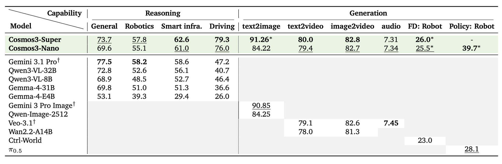
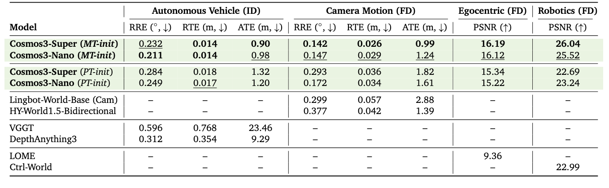
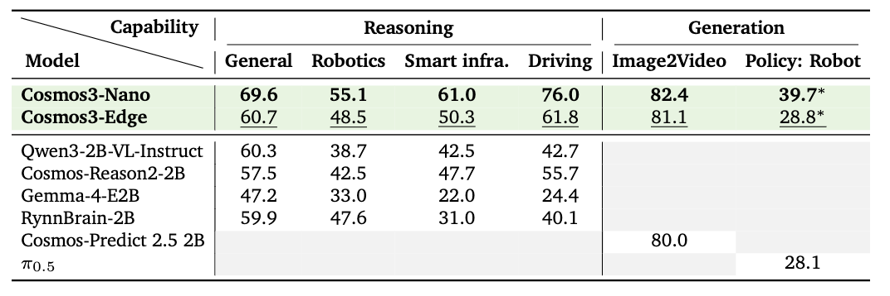
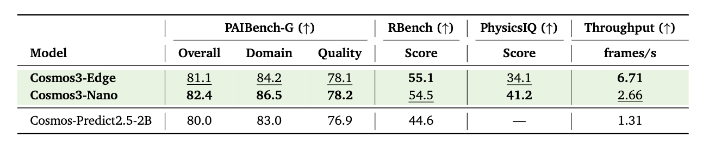
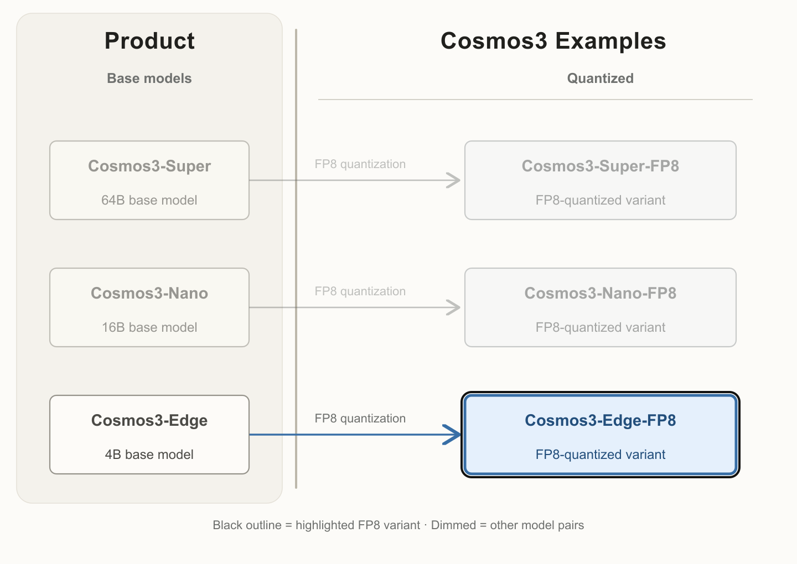
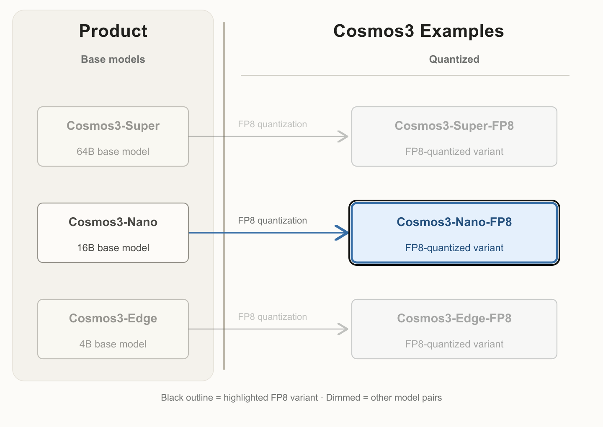
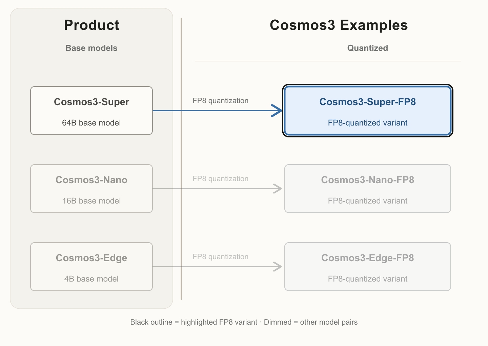

# Cosmos3：把世界理解与多模态生成放进一个家族

> [!tldr] 核心判断
> Cosmos3 的关键不是“能生成视频”，而是用 MoT 框架容纳自回归文本推理和连续模态去噪。Edge 4B、Nano 16B、Super 64B 归入同一 Cosmos3 正代 family；尺寸分支合读，具体接口和首发时间分开核对。它可以成为环境观察和轨迹合成器，但没有显式物理引擎，不能直接成为任务成功验证器。

> [!warning] 原始资料与阅读深度
> 本轮亲自阅读 Nano / Super 完整 HF 模型卡，保存官方评估原图与项目网页。基础 Tech Report 存在，按“不下载 PDF”的要求仅保留链接；完整报告本轮未读。原卡对 loss、消融和评估统计协议披露有限，因此**未达到完整技术报告精读深度**，不补造图中无法可靠读取的数字，也不声称已复现。

## 身份、日期与来源

两张模型卡的 Release Date 都明确写 HF / GitHub **2026-05-31**。HF 仓库创建于更早时间不能替代首发日；本次是历史补收，不是 10 月的新模型。

| 项目 | Nano | Super |
|---|---|---|
| 参数量（卡片字段） | 16B | 64B |
| 架构 | MoT：自回归塔 + 扩散塔 | 同一产品族 |
| 首发 | 2026-05-31 | 2026-05-31 |
| 许可证 | OpenMDW1.1 | OpenMDW1.1 |
| 已测试精度 | BF16 | BF16 |

- 🤗 HF Model Card：[Nano](https://huggingface.co/nvidia/Cosmos3-Nano)、[Super](https://huggingface.co/nvidia/Cosmos3-Super)
- 📄 [Tech Report（PDF 链接，未下载）](https://research.nvidia.com/labs/cosmos-lab/cosmos3/technical-report.pdf)
- 🌐 [官方项目页](https://research.nvidia.com/labs/cosmos-lab/cosmos3/)、[官方代码](https://github.com/NVIDIA/cosmos)
- 本地原件：[[src/hf_model_card.md|Nano 原始 MD]]、[[src/Cosmos3-Super.md|Super 原始 MD]]；抓取时间、URL、SHA256 见 `src/retrieval_manifest.json`。

## 为什么需要双生成机制

文本推理天然是离散 token 的自回归过程；视频、音频和连续动作通常通过迭代去噪生成。Cosmos3 不是强迫所有模态都用同一种输出机制，而是把两类 transformer 放进 Mixture-of-Transformers 框架。Reasoner 负责文字解释与图像/视频推理，Generator 负责图像、视频、音频、动作等连续输出。

这能统一输入语义，却不意味着每个接口共享相同上下文、吞吐、身体表征或验证标准。一个模型会解释物体关系，不自动证明它预测的接触动力学正确。

## 输入输出：最容易混淆的两套长度

| 接口 | 原卡边界 | 不能推断什么 |
|---|---|---|
| Reasoner | 最多 256K tokens；视频推荐 4fps | 不代表生成器可以吃 256K 文本 |
| Generator 文本 | 4096 tokens | 不等于多模态总容量无限 |
| Generator 视频输入 | 最多 5 帧，限定分辨率/比例 | 不代表任意长视频续写 |
| 音频条件 | 最多 0.5 秒 | 不代表长语音上下文 |
| 动作输入 | 16–400 视频帧；形状 `(T,D)` | D 随身体变化，不是统一通用动作空间 |
| 生成视频 | 5–400 帧，默认 189 帧 | 播放 FPS 由请求指定，不是推理吞吐 |
| 音频输出 | MP4 内 48kHz 双声道 AAC | 不等于所有后端均已支持 |

输入 RGB 为 8-bit sRGB，灰度不支持。动作只支持明确列出的 embodiment：如相机 9D、AV 9D、AgiBot 29D、单/双 Franka 10D/20D 等。不能把输出 JSON 的一维列表示意照抄成实际无时间维的控制向量。

## 数据：数量与去重口径分开

原卡列出 1.3B data points、393 dataset entries，时间范围 2024–2026。以下是模态分类计数，不是互斥、独立、可直接求和的 episode 数：

| 模态 | Reasoning 样本 | Generation 样本 |
|---|---:|---:|
| Text | 22M | 不适用 |
| Image | 19M | 767M |
| Video | 1M | 348M |
| Audio | 不适用 | 139M |
| Action | 不适用 | 8M |

公共来源包括 OpenImage、Coyo、YouTube、UMI；私有来源含 Egocentric、Nexar、AgiBot、HOI；合成图像使用 HiDream-I1、Qwen-Image-2512，caption 来源包含 Qwen3-VL。原卡公开来源和过滤流程，不等于公开了完整采样权重、去重清单或训练配方。

## 官方评估图：保持原图完整

图为官方整体评估面板，保留完整比较对象和标签。跨任务指标量纲不同，不合成为一个“平均领先百分比”。

可直接从完整原图核对：General reasoning 中 Super / Nano 为 73.7 / 69.6，Gemini3.1 Pro 为 77.5；Robotics reasoning 为 57.8 / 55.1，Gemini 为 58.2。不能据此写成基础 Cosmos3 在所有理解任务上领先。Robot policy 面板 Nano 为 39.7*、π0.5 为 28.1，星号对应的适配/评估条件必须继续查报告；这里不把它等同于开箱真实机器人成功率。

正向动态预测、逆向动作推断、在线策略是不同条件下的问题。逆向推断能看完整轨迹，不能把其误差当作在线执行成功率。其他 reasoning / visual-audio 原图仍可从原卡查看；本地保留的是以上两张，不把局部存档描述成全部附件离线镜像。

动作图还区分 MT-init / PT-init。以 Robotics forward-dynamics PSNR 为例：Super 为 26.04 / 22.69，Nano 为 25.52 / 23.24，Ctrl-World 为 22.99；这些初始化条件不是新增尺寸 SKU，也不能混合选最好数字代表同一个未经适配 checkpoint。AV inverse-dynamics 的 RTE/ATE 与图像 PSNR 量纲不同，不能合并排名。

## Edge 4B：历史尺寸分支补充（2026-11-09研读）

本轮新读 Cosmos3-Edge 完整模型卡。卡片明确首发 **2026-07-20**，并有 **2026-08-25** 的生成器检查点、默认配置、示例和评测更新声明。两者都是历史时间，不能把本次README导航调整或今天发现模型卡记成11月新发布，也不另造一个Cosmos4正代。

| 维度 | Edge | Nano / Super |
|---|---|---|
| 卡片参数量 | 4B | 16B / 64B |
| 卡片明确首发 | 2026-07-20 | 2026-05-31 |
| 归类 | 同一Cosmos3 family的尺寸分支 | 保留原节点和5月家族首发日 |
| Generator视频范围 | 50–150帧、12–30fps；256p/480p | 不套用Edge限制到其他分支 |
| Reasoner声明上下文 | 最多256K；服务示例配置131072 | 模型声明上限与运行配置分开 |
| 生成训练数据中的Action计数 | 7M | 原Nano/Super卡为8M，不能相互覆盖 |

图是Edge原卡中的完整比较面板。带星号的Robot Policy来自DROID后训练变体，不是未适配的4B基础检查点；不能把模型小与机器人部署成功直接连成因果结论。

图中Edge / Nano的PAIBench-G Overall为81.1 / 82.4，PhysicsIQ为34.1 / 41.2；Edge吞吐6.71 frames/s高于Nano的2.66，但质量指标有取舍，不能概括成“小模型全面领先”。RBench为55.1 / 54.5，结论也取决于评价维度。

官方图生视频比较使用480p、24fps，并在单H100 eager模式下测frames/s。PBR另有不同后端的延迟表：单卡、batch1、480p/189帧条件下，H100 SXM80GB的图生视频为vLLM-Omni **27.64秒**、PyTorch **23.92秒**。它们是运行条件下的生成延迟，不能写成24fps实时生成。Reasoner的并发、TTFT和token吞吐又是另一套协议，不混成一个速度数字。

原卡还给出B200、H20、工作站与Jetson平台结果，但“支持某平台”不是所有任务、精度与上下文配置都已验证；本次不安装运行时，也不声称复现这些成绩。Edge沿用MoT双塔和显式的身体/动作表征限制，同样不具有可靠物理求解器的保证。

🤗 [Edge HF Model Card](https://huggingface.co/nvidia/Cosmos3-Edge) · [[src/Cosmos3-Edge|原始MD]] · [官方8月25日更新声明](https://huggingface.co/nvidia/Cosmos3-Edge/discussions/62)

## 11月9日FP8部署变体：质量与接口变化

> [!tldr]
> 11月10日巡检发现官方Edge/Nano/Super-FP8模型卡，三卡Release Date明确写2026-11-09。它们是现有架构的量化变体，补入原Cosmos3 family；不增加叶子，也不把量化、尺寸SKU写进近30天新模型表。三个原始MD和三张官方结构图已归档。

| 项目 | Edge-FP8 | Nano-FP8 | Super-FP8 |
| --- | --- | --- | --- |
| 参数量 | 4B | 16B | 64B |
| 定位 | 原Edge的FP8变体 | 原Nano的FP8变体 | 原Super的FP8变体 |
| Reasoner卡片上限 | 131,072 tokens | 256K | 256K |
| 精度边界 | 部分组件量化；排除组件保留原精度 | 同左，含ModelOpt状态 | Generator/Reasoner性能分别测FP8 |
| 官方部署示例快照 | vLLM0.33.0 | vLLM0.31.0；SGLang0.5.23 | vLLM0.31.0；SGLang0.5.23 |

这些版本是本次卡片的可追溯快照，未安装或实跑。Nano/Super的Diffusers示例先启用ModelOpt checkpoint恢复，并显式获取`transformer/modelopt_state.pth`，因为它不在Diffusers默认下载白名单；这解释了普通from_pretrained为何可能漏掉量化状态，不是本站已下载该二进制。SGLang示例还要求CUDA toolkit以编译FP8内核，不能把包安装成功当成内核已跑通。

### 质量表不能被概括成“FP8无损”

以下逐项保留官方BF16/FP8质量表。Reasoner四个域分别对18/10/8/3个benchmark取无权均值，不是每个域难度、题数和分布相同的总成功率。Generator中BF16使用PyTorch，FP8使用vLLM-Omni，因此这是**精度与后端一起变化的对照**，不能单独归因为FP8量化。

最关键的负向结果：Super SoundBench **7.31→6.64**、RBench **0.58→0.55**、Driving **76.83→76.27**；Nano SoundBench **7.34→7.09**、Depth si-RMSE **0.62→0.64**（越低越好，因此变差）；Edge Robotics **49.17→48.68**、PAIBench-G I2V **81.10→80.75**。同时存在UVA PSNR等正向值，不应只挑其中一边。没有置信区间和多种子统计，接近数值也不能直接判定无退化。

### Edge：全部质量结果

| Domain | BF16 | FP8 |
| --- | --- | --- |
| General ↑ | 56.56 | 58.10 |
| Robotics ↑ | 49.17 | 48.68 |
| Smart Infrastructure ↑ | 52.00 | 51.95 |
| Driving ↑ | 62.50 | 62.38 |

| Benchmark | BF16 | FP8 |
| --- | --- | --- |
| PAIBench-G I2V ↑ | 81.10 | 80.75 |
| PAIBench-G T2V ↑ | 76.90 | 76.58 |
| RBench ↑ | 0.55 | 0.57 |
| PhysicsIQ I2V ↑ | 31.28 | 31.37 |

### Nano：全部质量结果

| Domain | BF16 | FP8 |
| --- | --- | --- |
| General ↑ | 68.16 | 68.25 |
| Robotics ↑ | 52.07 | 52.54 |
| Smart Infrastructure ↑ | 63.24 | 62.70 |
| Driving ↑ | 71.57 | 72.50 |

| Benchmark | BF16 | FP8 |
| --- | --- | --- |
| PAIBench-G I2V ↑ | 82.70 | 82.60 |
| PAIBench-G T2V ↑ | 79.40 | 79.40 |
| RBench ↑ | 0.58 | 0.57 |
| SoundBench ↑ | 7.34 | 7.09 |
| PhysicsIQ V2V ↑ | 50.20 | 52.01 |
| PAIBench-C Edge F1 ↑ | 0.49 | 0.48 |
| PAIBench-C Blur SSIM ↑ | 0.91 | 0.91 |
| PAIBench-C Depth si-RMSE ↓ | 0.62 | 0.64 |
| PAIBench-C Seg. mIoU ↑ | 0.72 | 0.72 |
| UVA FDM PSNR ↑ | 21.05 | 21.89 |
| UVA WAM PSNR ↑ | 12.01 | 19.25 |

### Super：全部质量结果

| Domain | BF16 | FP8 |
| --- | --- | --- |
| General ↑ | 72.31 | 72.69 |
| Robotics ↑ | 53.47 | 54.10 |
| Smart Infrastructure ↑ | 64.03 | 64.50 |
| Driving ↑ | 76.83 | 76.27 |

| Benchmark | BF16 | FP8 |
| --- | --- | --- |
| PAIBench-G I2V ↑ | 82.80 | 82.60 |
| PAIBench-G T2V ↑ | 80.00 | 79.80 |
| RBench ↑ | 0.58 | 0.55 |
| SoundBench ↑ | 7.31 | 6.64 |
| PhysicsIQ V2V ↑ | 59.70 | 59.01 |
| PAIBench-C Edge F1 ↑ | 0.50 | 0.50 |
| PAIBench-C Blur SSIM ↑ | 0.91 | 0.91 |
| PAIBench-C Depth si-RMSE ↓ | 0.58 | 0.58 |
| PAIBench-C Seg. mIoU ↑ | 0.71 | 0.72 |
| UVA FDM PSNR ↑ | 21.05 | 21.79 |
| UVA WAM PSNR ↑ | 12.01 | 19.34 |

FP8卡共同写生成训练Action为7M，而此前Nano/Super基础卡为8M，Edge基础卡本来为7M；这里只记录卡片口径差异，不能据此推断又预训练了一代模型，也不覆盖基础卡的历史数据字段。

## FP8吞吐：工作负载、真实测量与估计分开

> [!tldr]
> Generator的frames/s是生成整段视频的推理吞吐，不是播放帧率；Policy actions/s按32-action chunk计算，不直接等于闭环控制频率。单卡、八卡、代理估计和模拟硬件不能混成无条件排行榜。

### Edge：全部硬件结果

| Hardware | Generator — 480p (frames/s) | Reasoner — time to first token (ms) | Reasoner — output token throughput (tokens/s) | Action Policy — 480p (actions/s, 32-action chunks) |
| --- | ---: | ---: | ---: | ---: |
| H100 | 13.04 | 108.1 | 312.64 | 20.50 |
| H200 | 12.96 | 103.0 | 341.18 | 21.11 |
| H20 | 3.30 | 163.6 | 262.42 | 6.81 |
| DGX Station | 30.63 | 65.4 | 425.65 | 30.48 |
| DGX Spark | 1.65 | 213.2 | 69.46 | 4.03 |
| RTX PRO 6000 | 7.52 | 121.0 | 245.38 | 10.77 |
| RTX PRO 5000 | 4.51 | 99.7 | 243.16 | 9.58 |
| Jetson Thor T5000 | 1.92 | 205.7 | 76.69 | 3.79 |
| Jetson T3000 | 0.88 | 384.3 | 62.16 | 1.81 |
| Jetson AGX Orin | - | 817.8 | 41.46 | - |

### Nano：全部硬件结果

| GPU (1 GPU) | Generator — 480p (frames/s) ↑ | Generator — 720p (frames/s) ↑ | Reasoner — time to first token (ms) ↓ | Reasoner — output token throughput (tokens/s) ↑ | Action Policy — 480p (actions/s, 32-action chunks) ↑ |
| --- | ---: | ---: | ---: | ---: | ---: |
| GB300 | 10.06 | 2.80 | 91.8 | 241.65 | 37.47* |
| B300 | 8.69 | 2.38 | 108.5 | 240.16 | 37.47 |
| B200 | 8.11 | 2.24 | 137.8 | 221.72 | 52.36 |
| H100 | 3.20 | 1.01 | 129.5 | 173.01 | 38.29 |
| H200 | 3.34 | 1.00 | 128.3 | 202.05 | 38.97 |
| H20 | 0.91 | 0.24 | 242.0 | 148.21 | 11.17 |
| DGX Spark | — | — | 336.1 | 22.62 | — |
| DGX Station | — | — | 85.4 | 255.99 | — |
| RTX PRO 6000 Blackwell Server Edition | 2.34 | 0.61 | 150.2 | 112.90 | 24.90 |

### Super：全部硬件结果

| GPU configuration | Generator 480p (frames/s) | Generator 720p (frames/s) | Reasoner time to first token (ms) | Reasoner output token throughput (tokens/s) | Action Policy (Hz, 32-action chunks)* |
| --- | ---: | ---: | ---: | ---: | ---: |
| GB300 | 2.88 | 0.78 | 136.667 | 104.886 | 27.02 |
| B300 | 2.45 | 0.67 | 146.213 | 106.473 | 27.02 |
| B200 | 2.34 | 0.63 | 167.483 | 102.833 | 26.43 |
| H100 × 8 | 4.69 | 1.69 | 267.748 | 59.758 | 15.65 |
| H200 × 8 | 4.80 | 1.85 | 257.864 | 74.618 | 15.99 |
| H20 × 8 | 1.57 | 0.46 | 741.806 | 47.566 | 5.47 |

### Nano / Super：卡数、分母与代理估计

- Nano所有行均单GPU。Generator为vLLM-Omni、I2V、189帧，frames/s=189除以平均整段生成耗时；Reasoner为vLLM、并发1、50输入token、100输出token、视频采样FPS1、50请求；Policy用PyTorch、DROID、480p、32-action chunks。
- Nano的GB300 Policy **37.47***由B300代理，尚未在GB300实测。DGX Spark/Station的Generator和Policy没有结果，保留横杠；不能按Reasoner能力补值。
- Super的Generator/Reasoner在GB300、B300、B200为单卡，在H100/H200/H20为8卡；**Policy除H20用8卡外，其他都是单卡**，不能把H100×8行的15.65Hz写成8卡Policy。
- Super GB300 Policy **27.02Hz**也是B300代理：单卡B300 1.184213秒生成32动作。卡片表已混入该估计，必须明确标注，不写成全部实测。
- Super性能表189帧，但“单H200约14分钟、B200约11分钟”的720p服务说明是另一单卡配置；官方因此上调同步请求超时。它不与H200×8表行构成矛盾，不应跨卡数计算量化加速倍数。

### Edge：后端、帧数与嵌入式设备限定

- Generator：vLLM-Omni FP8 I2V，832×480、**121帧、35去噪步**、并发1、1次warmup，吞吐=121/端到端服务推理时间；不同GPU取所测最快后端，H100/H200用FLASH_ATTN，其余所列平台用CUDNN_ATTN。因此不能与Nano/Super的189帧表直接等比比较。
- 标准Reasoner负载：50文本token加30秒374×374、1fps视频（30帧），输出100token，并发1。DGX Station、Spark、RTX PRO5000仅给OSL100/FPS1/并发1，未完整公开输入长度、分辨率、视频时长和attention后端；它们的425.65等值不构成完全同负载比较。
- Policy：vLLM-Omni、DROID、32-action chunks、30去噪步、并发1、warmup1；嵌入式输出736×544属480p模型tier，另含1条件帧。按32/端到端推理时间算actions/s，未包括感知、网络、执行器响应与chunk重规划的全部闭环时间。
- **T3000是T5000 devkit配置模拟**（12SM、8CPU、32GB），不是实际T3000开发板实测。Thor/T3000原生FP8；**Orin使用FP8 checkpoint但weight-only W8A16计算**，不能称Orin原生FP8。Orin Generator/Policy来自另一BF16 checkpoint，不列入FP8表；横杠不是零分。
- H100为SXM80GB、H200为SXM141GB、H20为SXM96GB；RTX PRO6000为Blackwell Server Edition，5000 Generator为72GB版。嵌入式为MAXN且锁频，不能忽略设备与功耗模式。

### 对Agent Training与部署选择的判断

> [!insight]
> 先用同任务、同后端、同采样预算评估量化质量，再测相同硬件的端到端时延与功耗；训练rollout还需记录吞吐变化是否改变有效样本、失败修复和奖励分布。不能把少显存或token更快直接解释为策略更强，也不能让有偏的世界生成替代独立真实状态verifier。

这些卡片给出质量取舍和部署可行性证据，没有证明全部精度无损，也没有给出同后端BF16→FP8的完整速度消融。原有完整技术报告未读、长程物理可靠性与统计协议缺口继续保留；本轮未下载PDF/权重，未运行容器/模型或控制硬件。

官方卡：[Edge-FP8](https://huggingface.co/nvidia/Cosmos3-Edge-FP8)、[Nano-FP8](https://huggingface.co/nvidia/Cosmos3-Nano-FP8)、[Super-FP8](https://huggingface.co/nvidia/Cosmos3-Super-FP8)。原始MD、完整示例代码和benchmark列表在同级src，不能把归档的示例当作已执行轨迹。

## 工程与能力边界

vLLM 的 Reasoner、vLLM-Omni、Diffusers、SGLang 不能混为同一后端。原基础卡当时写SGLang不支持video-to-video、带声音视频及动作生成；新增Nano/Super FP8卡改为SGLang0.5.23支持这些接口，属于特定版本的能力声明。保留这项来源/版本差异，支持服务API不等于本站已逐模态实测。此前基础卡仅标注BF16已测；11月9日新增的独立FP8卡现已给出质量与性能数据，详见下方部署变体板块。FP8卡所测版本、后端、上下文与基础BF16卡分开，不将“有FP8权重”推成无精度回归。

模型明确没有显式物理求解器：接触、碰撞、对象恒常性、长程状态可能出错；Reasoner 也可能误判因果、时序、几何或意图。安全关键部署需外部约束与系统级验证。本轮仅归档和研读，没有加载权重、执行容器、运行推理或设备控制。

> [!insight] 对 Agent Training 的启发
> 适合研究“更丰富的观察生成能否改善策略”，但必须保存状态账本与观察账本。生成器负责扩充环境分布，独立 verifier 负责动作后真实目标是否达成；否则策略可能学会讨好一个视觉上自洽、物理上错误的世界。比较时固定 policy、初始状态、任务分布与预算，分开测理解、生成、策略三个环节。

## 家族与相关阅读

10 月出现的 Auto、Sim-Transfer、Sim-Bimanual 是 Cosmos3 派生专项，不是 Cosmos4；它们的后训练数据不能与本基础家族训练量混写。

- [[Topics/13_base_model/NVIDIA_Nemotron/Variants/2610_Cosmos3_Nano_Auto/Cosmos3-Nano-Auto-Family|驾驶 Transfer / Sim-Auto]]
- [[Topics/13_base_model/NVIDIA_Nemotron/Variants/2610_Cosmos3_Nano_Sim_Transfer/Cosmos3-Nano-Sim-Transfer|视觉迁移 Sim-Transfer]]
- [[Topics/13_base_model/NVIDIA_Nemotron/Variants/2610_Cosmos3_Nano_Sim_Bimanual/Cosmos3-Nano-Sim-Bimanual|双臂与相机交互]]

> 📊 相关可视化：[[cosmos3_family_poster_zh.html|中文 Poster]]
