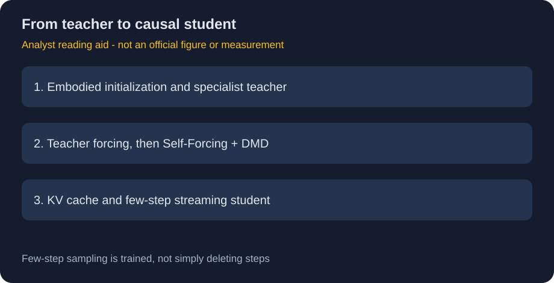
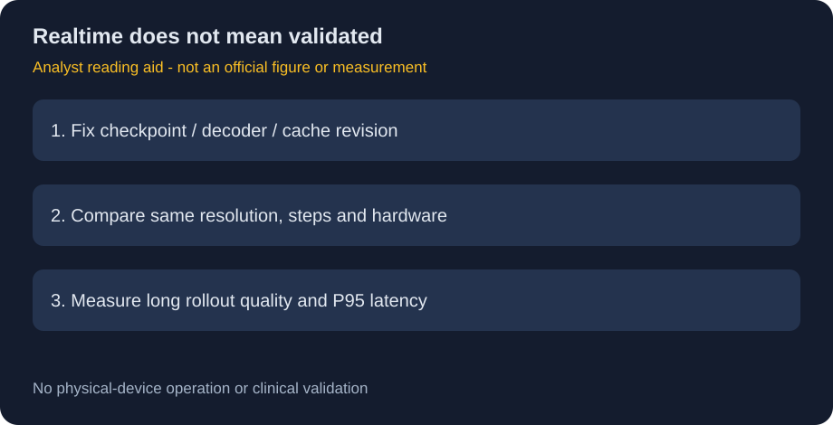

# Cosmos3-H-Dreams：从双向教师到实时因果世界模型

> [!tldr] 我的判断
> H-Dreams把专项双向视频教师蒸馏成可缓存的少步因果学生。它解决实时生成链路，不等于已证明长程物理正确，更不等于可用来实际手术控制。

> [!warning] 原始资料不足
> 已全文读并归档官方HF模型卡与GitHub README。卡片披露训练阶段、数据筛选和FPS，却没有完整质量数值表、独立本版技术报告及跨任务临床验证；未达到完整技术报告精读深度。两张图片是据原文绘制的机制/验收示意，非官方生成视频或实测截图。前代2608.24199不是本版报告。

## 来源、日期与继承关系

原卡明确 **GitHub/HF 2026-10-20**：[HF Model Card](https://huggingface.co/nvidia/Cosmos3-H-Dreams)、[官方 GitHub](https://github.com/isaac-for-healthcare/Cosmos3-H-Dreams)。归档原件在 [[src/Cosmos3-H-Dreams.md]]、[[src/github_README.md]]。

Cosmos3-Nano→Cosmos3-H-Embodied-Nano→CMR专项teacher→H-Dreams学生。它是独立蒸馏专项，不把4步/2步推理设置拆成正代。旧Cosmos-H-Dreams基于Predict2.5，不能沿用其结论给新学生。

## 训练路径与架构变化

约15.17B MoT继承Qwen3-VL-8B Reasoner与扩散生成专家，Wan2.2潜空间；最终是block-causal学生，使用KV cache。把首帧和短真实历史prefill一次，随后按动作流持续生成。

| 阶段 | 卡片明确内容 | 研究上应追问 |
|---|---|---|
| 初始化 | H-Embodied多embodiment后训练checkpoint | 继承哪些非公开训练数据 |
| 专项teacher | 24帧2000iterations→72帧4400iterations，35步双向教师 | 数据筛选带来怎样的覆盖损失 |
| 因果蒸馏 | teacher forcing1000iterations→Self-Forcing+DMD300iterations | 教师/学生误差与长程偏差是否分开评估 |

它不是“每帧一次完整重算”，也不是把35步直接删到4步而不训练。蒸馏与因果缓存共同降低延迟；teacher forcing和Self-Forcing的输入分布不同，后者面向学生自己的历史误差。

## 数据分母：原始规模不等于有效训练量

来源共4792episodes、约1700万60Hz帧，但实际严格筛选到64recordings、约526独立分钟（24帧阶段）；72帧阶段约436分钟。窗口重叠，183528/106820window starts不是独立视频数。

训练/留出按episode拆约98%/2%；留出为10recordings、10.6独立分钟。仅保留符合既定双工具可见、控制状态一致且无活动相机指令的窗口，使模型覆盖条件比“整个临床场景”窄得多。这里不把这些筛选描述转换成医疗操作流程。

评估两个固定面板各48quality+12action-control，共120cases。它们来自同10recordings，不是120个独立病人或procedure。30.4秒rollout与旋转探针是视觉检查；卡中未给相应定量质量值。

## 速度：不同分辨率与步数不能混比

| 硬件 | 分辨率 | 步数 | 官方FPS |
|---|---|---|---|
| RTX PRO6000 Blackwell Workstation | 832×480 | 4 / 2 | 30.0 / 43.2 |
| 同系列Max-Q Workstation | 832×480 | 4 / 2 | 20.2 / 31.2 |
| DGX Spark | 512×288 | 2 | 16.9 |

Spark用了更低分辨率；不能从这个表推断同画质下相对速度。FPS不是首帧等待或含网络/工具的P95延迟。README默认480×832、12history latents需超过32GB显存，首次编译更慢；H100“能运行”也没有给同设置吞吐。

## 原卡与代码页的版本差异

卡片描述4步causal学生与静态cache；当前GitHub默认示例则提2步、TAEHV和FadeMem，并把HF称“previously released version”。**这是版本对应关系待核，不是新的首发证据**。复现必须固定checkpoint、配置、decoder和cache版本，不能把当前代码性能不经核验归到卡片权重。

代码Apache2.0不覆盖下载权重的NVIDIA Open Model License。BF16训练/原生推理与FP32导出是不同概念；不能因导出文件是FP32就按FP32推理速度作比较。

## 对 Agent Training 的启发

> [!insight] 速度提升之后，首先补“谁在判成功”
> 模拟器加速可提高rollout量，但策略可能利用它的漏洞。需要真实保留轨迹或独立观测验证器校验动作效果，并比较短窗、长程、未知初态和失败恢复。少步学生在质量/控制一致性上的损失必须与FPS一起报告。

本文不执行训练/推理、不控制设备、不把模拟视频当真实安全证据。关联：[[NVIDIA_Nemotron/Variants/2610_Cosmos3_H_Embodied_Nano/Cosmos3-H-Embodied-Nano]]。

> 📊 中文 Poster：[[cosmos3_h_dreams_poster_zh.html]]
