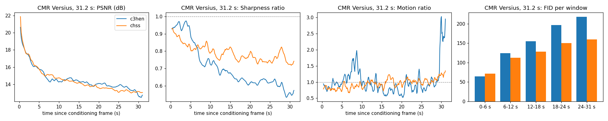

# Cosmos3-H-Embodied-Nano：同一序列里的世界动态与策略

> [!tldr] 我的判断
> 这次从仅预测视频，变为同一checkpoint支持正向动态、逆向动态和策略。三种模式是条件掩码变化，不是三个新模型；短片段精度上升也没有消除长rollout退化。

> [!warning] 原始资料不足
> 本文基于完整HF卡、官方README及评估文档的协议/结果，保留两张官方原图。Cosmos3基础报告仅保留官方PDF链接，按当前约定未下载；专项完整训练报告和全部数据未公开，未达到完整报告与全部实验精读深度。没有执行模型或临床验证。

## 来源与时间

- 原卡明确GitHub/HF均 **2026-10-20**：[HF Model Card](https://huggingface.co/nvidia/Cosmos3-H-Embodied-Nano)。
- [官方代码页](https://github.com/NVIDIA-Medtech/Cosmos3-H-Embodied-Nano)、[评估文档](https://github.com/NVIDIA-Medtech/Cosmos3-H-Embodied-Nano/blob/main/cosmos3_h_embodied/README_EVALUATION.md)。
- [Cosmos3基础 Tech Report（PDF，仅链接）](https://research.nvidia.com/labs/cosmos-lab/cosmos3/technical-report.pdf)。不是专项模型的独立验证报告。

## 结构与三种条件分布

Cosmos3-Nano约16B MoT把Qwen3-VL-8B Reasoner与扩散Generator耦合，共享视频、动作和文字的多模态序列。后训练更新约7B生成专家、timestep与动作/视频投影，Reasoner冻结。由embodiment ID选择动作映射，不是一个动作归一化表通吃所有机器人。

| 模式 | 作为干净条件的输入 | 去噪目标 | 训练比例 |
|---|---|---|---|
| Forward dynamics | 首帧与动作 | 未来视频 | 0.4 |
| Inverse dynamics | 已观测完整视频 | 动作 | 0.2 |
| Policy | 首帧、任务文字、过去动作 | 未来动作与视频 | 0.4 |

训练50000iterations；每片2.4秒、25帧含首帧、24动作，10Hz，最多16步真实历史动作。正向预测看到未来动作、policy没有，因此前者更好不能直接解释成策略能力。这里讨论学习系统，不提供实际手术控制建议。

## 数据覆盖的真实边界

Open-H混合15families、55roots，约95%训练、5%留出。**仅11families公开**，四个family与部分root/文本/视频没有公开；只下载公开集合无法保证复原完整训练。公开评估的三模式结果覆盖有留出episode的10个family，每个64clips，共640clips，不是全部15个family。

视频使用256p档，具体宽高按比例选择；动作在各family坐标与统计量下归一化。MSE是归一化动作空间误差，不能直接转成毫米、实机成功率或临床安全。

## 三模式结果：mean与best-of-4必须分开

| 指标 | 全640clips | dVRK九families | CMR Versius |
|---|---|---|---|
| Forward video PSNR↑ | 26.1 | 26.9 | 18.6 |
| Inverse action MSE↓ | 0.009 | 0.008 | 0.019 |
| Policy MSE mean / best4↓ | 0.052 / 0.033 | 0.046 / 0.031 | 0.101 / 0.056 |
| Policy PSNR mean / best4↑ | 23.0 / 23.9 | 23.7 / 24.6 | 16.7 / 17.8 |
| Family均值轨迹MSE↓ | 0.075 | 0.073 | 0.091 |

总体policy mean比均值轨迹低，但 **CMR mean0.101反而差于0.091基线**；best4的0.056需要额外采样与选择，不能冒充单次表现。Inverse任务能看完整真实视频，不能用它的0.009替代policy误差。

## 对上一代和长程的发现

共同留出episode、同输入动作、各自发布推理设置、176行评分下，dVRK短窗PSNR26.53对24.52、dynamic PSNR21.08对19.33；CMR7.2秒FID44.3对55.4，但FVD274差于225。单帧外观更像不代表运动更对。

31.2秒CMR长rollout在后段退化更明显：24–31秒FID218对159、FVD1765对961。它主要训练2.4秒片段，这使一步与长程分布不一致。评价不能只截最开始六秒。

静态组织占多数像素，PSNR奖励复制背景；dynamic PSNR只看真实视频变化最大的20%像素。GATC依赖tool mask，TCD混合定位误差与分割器漏检；FID/FVD依赖样本数。因此需同rollouts、同评分分辨率和相同窗口比较，不跨表挑最好数字。

## 对 Agent Training 的启发

> [!insight] 把“生成世界”和“在世界里成功”分开
> 一个模型同时出动作和未来视频时，二者可能相互自洽但共同偏离现实。用外部状态/独立物理验证器评策略，保留按family、时间跨度与采样次数分层的失败；不能用模型自己生成的漂亮视频当reward真值。

研究验收应固定数据revision与episode拆分，记录真实历史动作、预测动作、选择器是否用真值、所有seed和失败分母。当前材料支持模拟与算法研究，不构成真实设备或临床使用许可/安全认证。

关联：[[NVIDIA_Nemotron/Variants/2610_Cosmos3_H_Dreams/Cosmos3-H-Dreams]]；[[NVIDIA_Nemotron/Variants/2610_Flora/Flora]]。

> 📊 中文 Poster：[[cosmos3_h_embodied_nano_poster_zh.html]]
