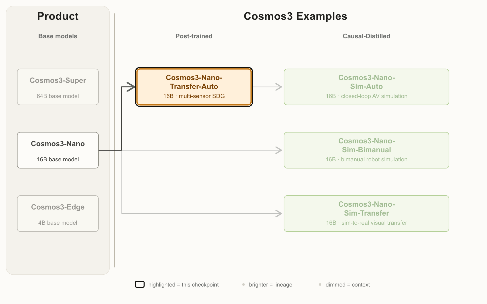
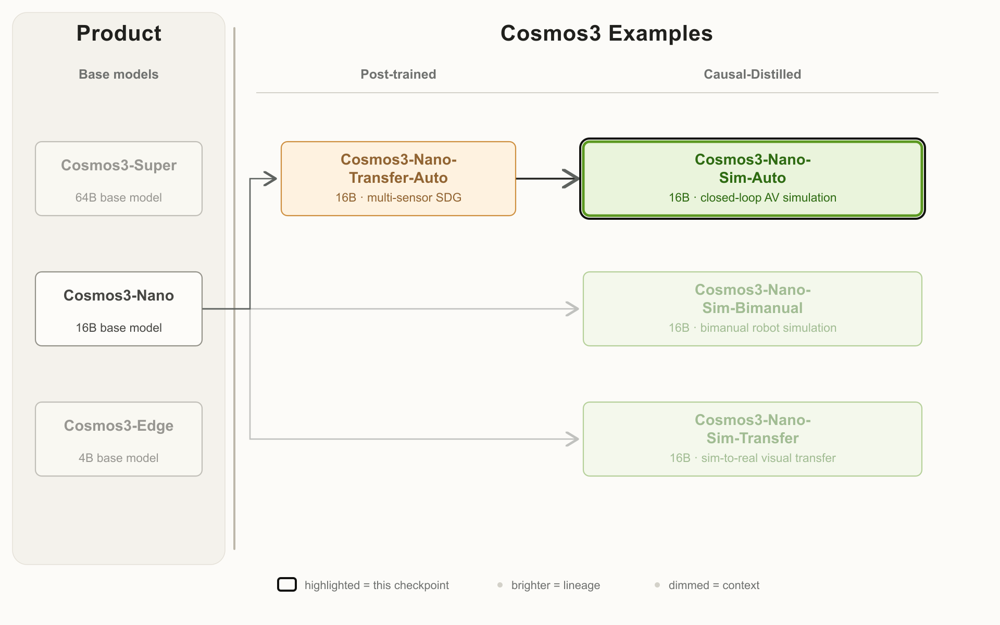

# Cosmos3-Nano Auto：离线双向教师与闭环因果学生

> [!tldr] 核心判断
> Transfer-Auto 把同一个驾驶场景的多相机与 LiDAR 联合生成；Sim-Auto 从它因果蒸馏，让新驾驶输入可以影响后续观察。二者同一驾驶 family 合读，同时保留两个 checkpoint 的身份与结果。最重要的边界是：**支持 11 路传感器不等于 11 路都能实时生成，更不等于真实驾驶安全验证完成。**

> [!warning] 原始资料不足之处
> 两张完整模型卡有明确评估表，谱系图已归档；专项项目页直连 403，未成功保存正文。但专项 Technical Report 仍标 **coming soon**，完整 loss、蒸馏配方、闭环安全统计和置信区间未披露，因而**未达到完整技术报告精读深度**。基础 Cosmos3 的报告不冒充该专项报告；本轮未下载任何 PDF 或模型权重。

## 两个模型是什么关系

| 属性 | Transfer-Auto | Sim-Auto |
|---|---|---|
| 原卡首发 | 2026-10-20 | 2026-10-20 |
| 初始化路径 | Cosmos3-Nano 多传感器后训练 | 从 Transfer-Auto 因果蒸馏 |
| 卡片参数字段 | 16B | 16B |
| 时间处理 | 整段双向去噪 | 历史 cache + 小 latent 块 |
| 典型用途 | 批量合成多传感器数据 | 可更新控制的闭环观察流 |
| 推理评估配置 | 35 去噪步、CFG，共 70 NFE | 4 步，无 CFG |

两张官方原图保留完整节点，不把基础家族、后训练教师与因果学生压成一个没有方向的“全能模型”。

## 从世界状态到观察

WSM（World Scenario Map）renderer 从 AV policy 规划轨迹或人操作方向盘生成结构控制：车道线、标志、交通灯与物体 cuboid。文本用于天气、时间和光照外观；摄像机配置也要写进输入约定。

生成 LiDAR 时必须另提供与 camera controls 对齐的 HD-map range controls。模型联合生成多视角 RGB 和 LiDAR range / intensity，再转点云。这不等于有真实光学/雷达传感器，也不意味着真实标签自动对齐每一个生成像素或回波。

支持 Hyperion 8.1 的 1–11 路标准/鱼眼相机和 128 线旋转 LiDAR。换自定义 rig 需要先适配 Transfer-Auto，再做因果蒸馏，不能只改 camera 名称。Sim 的实测 LiDAR 条件前缀只支持初始一个 sweep，不支持任意长前缀。

## RGB 结果：保留画质与几何的取舍

以下来自原卡 720p 测试。Transfer guidance=3；Sim guidance=1、4 步、7 cameras、297 frames。旧 Transfer2.5 基线使用不同 prompts，不能把所有差异都归因为模型权重。

| 模型 / 条件 | FID ↓ | FVD-I3D ↓ | FVD-StyleGAN-V ↓ | DOVER ↑ | Temporal Sampson ↓ | ACM ↑ | CSE2 ↓ | CSE5 ↓ |
|---|---:|---:|---:|---:|---:|---:|---:|---:|
| Transfer2.5 T2V | 61.9 | 772 | 770 | 8.56 | 0.530 | 0.885 | 2.51 | 2.07 |
| Transfer-Auto T2V | 45.5 | 488 | 487 | 9.01 | 0.473 | 0.906 | 2.01 | 1.63 |
| Sim-Auto T2V | 48.6 | 480 | 479 | 7.30 | 0.503 | 0.906 | 2.60 | 2.24 |
| Transfer2.5 I2V | 41.9 | 383 | 382 | 8.22 | 0.524 | 0.878 | 2.45 | 1.98 |
| Transfer-Auto I2V | 27.8 | 238 | 237 | 8.27 | 0.472 | 0.902 | 2.25 | 1.80 |
| Sim-Auto I2V | 33.6 | 325 | 324 | 7.51 | 0.505 | 0.900 | 2.36 | 2.09 |

我的判断：Transfer-Auto 多项改善；蒸馏后的 Sim 在部分画质、一致性指标上付出代价。尤其不能说 Sim 全面优于旧模型：I2V DOVER 下降、CSE5 变差。ACM 是同一视角中帧与前帧/首帧的 CLIP 相似度，不读取真值、不衡量跨视角；冻结不动的视频也可能得高分。

## LiDAR：分布接近，不一定更能检出物体

| 模型 | 全局 BEV JSD ↓ | Utonia 距离 ↓ | Temporal CTC/real（近1） | Vehicle CTC/real（近1） | Object support recall ↑ | Detection F1 ↑ |
|---|---:|---:|---:|---:|---:|---:|
| LidarVerse 21 scans | 0.151 | 33.6 | 1.20 | 2.51 | 0.843 | 0.201 |
| LidarVerse 116 scans | 0.116 | 44.8 | 1.35 | 3.73 | 0.788 | 0.200 |
| Transfer-Auto T2V | 0.0401 | 12.8 | 1.17 | 2.53 | 0.885 | 0.237 |
| Sim-Auto T2V | 0.0552 | 20.1 | 1.28 | 3.59 | 0.816 | 0.188 |

LidarVerse 使用不同评估子集，所以只能带条件比较。CTC 比值应接近 1，不是越低越好；F1 按平面中心距离小于 3m 做同类目标匹配，不能当毫米级几何精度。Sim 的分布距离改善没有转化成这里的更高 detection F1。

## 速度：吞吐、NFE 与播放帧率分开

原卡 Sim 吞吐采用单 GPU、201 帧、4 步无 CFG；以下摘选关键配置，完整矩阵留在原始卡：

| Sim 配置 | GB200 fps | H100 fps |
|---|---:|---:|
| 1 视角 480p，无 LiDAR | 16.8 | 10.2 |
| 7 视角 720p，无 LiDAR | 1.3 | 0.58 |
| 11 视角 720p，无 LiDAR | 0.74 | 不支持 |
| 1 视角 480p，有 LiDAR | 7.1 | 3.4 |
| 7 视角 720p，有 LiDAR | 1.1 | 不支持 |
| 11 视角 720p，有 LiDAR | 0.65 | 不支持 |

原卡空白是未报告，“-”是不支持，不能填 0。Transfer 报告 per-NFE 秒数和端到端时间：例如单 GB200、1 路 480p 无雷达共 1m22s，有雷达 10m15s；必须与帧数、CFG、采样步骤一起解读，不能拿 per-NFE 直接除以 Sim fps 得速度倍率。

## 数据、限制与研究用法

专项后训练视频为 1 万至 100 万小时量级、LiDAR 少于 1 万小时，未公开精确采样配方。原卡还重复列了基础家族 1.3B / 393 entries 统计，它不是本专项新增规模。商业可用也不等于无条件安全许可，许可证和各输入数据权利需分别确认。

> [!insight] Agent Training 的正确对照
> 先固定仿真状态与控制序列，比较原渲染、Transfer 离线合成和 Sim 闭环观察；然后固定策略预算，看最终碰撞、越线、任务达成。不要让同一个生成模型既制造观察又给成功奖励。记下摄像机 rig、LiDAR 开关、模型 revision、seed、吞吐及所有失败，单独看长尾交互与长 rollout 漂移。

## 一手来源与关联

- 🤗 [Transfer-Auto Model Card](https://huggingface.co/nvidia/Cosmos3-Nano-Transfer-Auto)、[Sim-Auto Model Card](https://huggingface.co/nvidia/Cosmos3-Nano-Sim-Auto)
- 🌐 [专项项目页](https://research.nvidia.com/labs/cosmos-lab/cosmos-simulation/)
- 📄 [专项 Tech Report：原卡标 coming soon](https://research.nvidia.com/labs/cosmos-lab/cosmos-simulation/technical-report.pdf)，仅保留链接，不声称已读或已发布。
- [[src/hf_model_card.md|Transfer 原始 MD]]、[[src/Cosmos3-Nano-Sim-Auto.md|Sim 原始 MD]]；完整表格、例程与抓取清单留在同级 `src/`，不执行原文里的容器命令。
- [[Topics/13_base_model/NVIDIA_Nemotron/Variants/2605_Cosmos3/Cosmos3-Family|基础 Cosmos3 家族]]、[[Topics/13_base_model/NVIDIA_Nemotron/Variants/2610_Cosmos3_Nano_Sim_Bimanual/Cosmos3-Nano-Sim-Bimanual|机器人与相机模拟]]

> 📊 相关可视化：[[cosmos3_nano_auto_poster_zh.html|中文 Poster]]

## 2026-10-28：SGLang serving 文档增补

Transfer-Auto 和 Sim-Auto 原卡都新增 SGLang Videos API。输入是服务端可访问的路径，目录需挂载；生成是异步 job，客户端轮询。不是把 MP4 上传后同步立即返回。Transfer 示例为35步、guidance3，Sim 为蒸馏固定4步、guidance1；不能互换。七相机按 camera-major 输出；联合 LiDAR 走额外 notebook。dev 镜像随主干移动，应固定镜像/代码revision。本次为同权重服务文档，不改10/20首发，也未运行示例。
