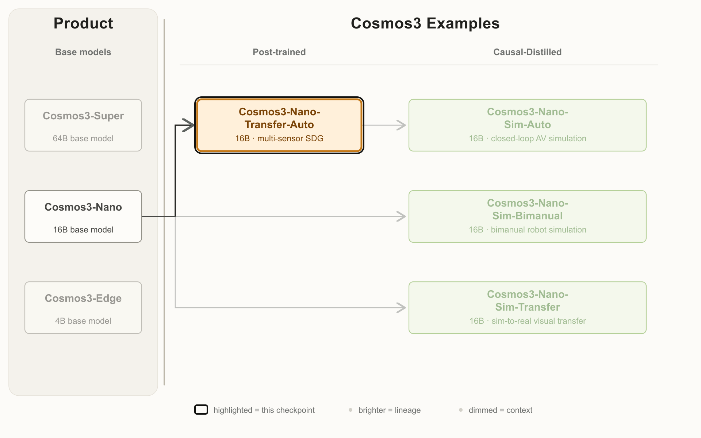
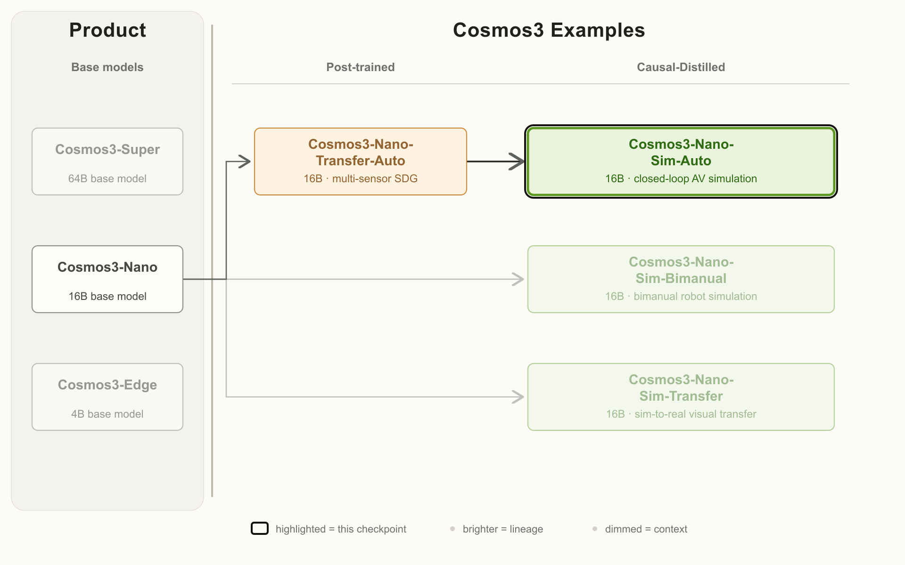

# Cosmos3-Nano Auto：离线双向教师与闭环因果学生

> [!tldr] 核心判断
> Transfer-Auto 把同一个驾驶场景的多相机与 LiDAR 联合生成；Sim-Auto 从它因果蒸馏，让新驾驶输入可以影响后续观察。二者同一驾驶 family 合读，同时保留两个 checkpoint 的身份与结果。最重要的边界是：**支持 11 路传感器不等于 11 路都能实时生成，更不等于真实驾驶安全验证完成。**

> [!warning] 原始资料不足之处
> 两张完整模型卡有明确评估表，谱系图已归档；专项项目页直连 403，未成功保存正文。但专项 Technical Report 现已移除coming soon，PDF链接经HEAD核验HTTP200；本轮未读报告正文，本轮已读卡片中缺完整loss、蒸馏配方、闭环安全统计和置信区间，不能据此断言PDF未披露，因而**未达到完整技术报告精读深度**。基础 Cosmos3 的报告不冒充该专项报告；本轮未下载任何 PDF 或模型权重。

## 两个模型是什么关系

| 属性 | Transfer-Auto | Sim-Auto |
|---|---|---|
| 原卡首发 | 2026-10-20 | 2026-10-20 |
| 初始化路径 | Cosmos3-Nano 多传感器后训练 | 从 Transfer-Auto 因果蒸馏 |
| 卡片参数字段 | 16B | 16B |
| 时间处理 | 整段双向去噪 | 历史 cache + 小 latent 块 |
| 典型用途 | 批量合成多传感器数据 | 可更新控制的闭环观察流 |
| 推理评估配置 | 35 去噪步、CFG，共 70 NFE | 4 步，无 CFG |

两张官方原图保留完整节点，不把基础家族、后训练教师与因果学生压成一个没有方向的“全能模型”。

## 从世界状态到观察

WSM（World Scenario Map）renderer 从 AV policy 规划轨迹或人操作方向盘生成结构控制：车道线、标志、交通灯与物体 cuboid。文本用于天气、时间和光照外观；摄像机配置也要写进输入约定。

生成 LiDAR 时必须另提供与 camera controls 对齐的 HD-map range controls。模型联合生成多视角 RGB 和 LiDAR range / intensity，再转点云。这不等于有真实光学/雷达传感器，也不意味着真实标签自动对齐每一个生成像素或回波。

支持 Hyperion 8.1 的 1–11 路标准/鱼眼相机和 128 线旋转 LiDAR。换自定义 rig 需要先适配 Transfer-Auto，再做因果蒸馏，不能只改 camera 名称。Sim 的实测 LiDAR 条件前缀只支持初始一个 sweep，不支持任意长前缀。

## RGB 结果：保留画质与几何的取舍

以下来自原卡 720p 测试。Transfer guidance=3；Sim guidance=1、4 步、7 cameras、297 frames。旧 Transfer2.5 基线使用不同 prompts，不能把所有差异都归因为模型权重。

| 模型 / 条件 | FID ↓ | FVD-I3D ↓ | FVD-StyleGAN-V ↓ | DOVER ↑ | Temporal Sampson ↓ | ACM ↑ | CSE2 ↓ | CSE5 ↓ |
|---|---:|---:|---:|---:|---:|---:|---:|---:|
| Transfer2.5 T2V | 61.9 | 772 | 770 | 8.56 | 0.530 | 0.885 | 2.51 | 2.07 |
| Transfer-Auto T2V | 45.5 | 488 | 487 | 9.01 | 0.473 | 0.906 | 2.01 | 1.63 |
| Sim-Auto T2V | 48.6 | 480 | 479 | 7.30 | 0.503 | 0.906 | 2.60 | 2.24 |
| Transfer2.5 I2V | 41.9 | 383 | 382 | 8.22 | 0.524 | 0.878 | 2.45 | 1.98 |
| Transfer-Auto I2V | 27.8 | 238 | 237 | 8.27 | 0.472 | 0.902 | 2.25 | 1.80 |
| Sim-Auto I2V | 33.6 | 325 | 324 | 7.51 | 0.505 | 0.900 | 2.36 | 2.09 |

我的判断：Transfer-Auto 多项改善；蒸馏后的 Sim 在部分画质、一致性指标上付出代价。尤其不能说 Sim 全面优于旧模型：I2V DOVER 下降、CSE5 变差。ACM 是同一视角中帧与前帧/首帧的 CLIP 相似度，不读取真值、不衡量跨视角；冻结不动的视频也可能得高分。

## LiDAR：分布接近，不一定更能检出物体

| 模型 | 全局 BEV JSD ↓ | Utonia 距离 ↓ | Temporal CTC/real（近1） | Vehicle CTC/real（近1） | Object support recall ↑ | Detection F1 ↑ |
|---|---:|---:|---:|---:|---:|---:|
| LidarVerse 21 scans | 0.151 | 33.6 | 1.20 | 2.51 | 0.843 | 0.201 |
| LidarVerse 116 scans | 0.116 | 44.8 | 1.35 | 3.73 | 0.788 | 0.200 |
| Transfer-Auto T2V | 0.0401 | 12.8 | 1.17 | 2.53 | 0.885 | 0.237 |
| Sim-Auto T2V | 0.0552 | 20.1 | 1.28 | 3.59 | 0.816 | 0.188 |

LidarVerse 使用不同评估子集，所以只能带条件比较。CTC 比值应接近 1，不是越低越好；F1 按平面中心距离小于 3m 做同类目标匹配，不能当毫米级几何精度。Sim 的分布距离改善没有转化成这里的更高 detection F1。

## 速度：吞吐、NFE 与播放帧率分开

原卡 Sim 吞吐采用单 GPU、201 帧、4 步无 CFG；以下摘选关键配置，完整矩阵留在原始卡：

| Sim 配置 | GB200 fps | H100 fps |
|---|---:|---:|
| 1 视角 480p，无 LiDAR | 16.8 | 10.2 |
| 7 视角 720p，无 LiDAR | 1.3 | 0.58 |
| 11 视角 720p，无 LiDAR | 0.74 | 不支持 |
| 1 视角 480p，有 LiDAR | 7.1 | 3.4 |
| 7 视角 720p，有 LiDAR | 1.1 | 不支持 |
| 11 视角 720p，有 LiDAR | 0.65 | 不支持 |

原卡空白是未报告，“-”是不支持，不能填 0。Transfer 报告 per-NFE 秒数和端到端时间：例如单 GB200、1 路 480p 无雷达共 1m22s，有雷达 10m15s；必须与帧数、CFG、采样步骤一起解读，不能拿 per-NFE 直接除以 Sim fps 得速度倍率。

## 数据、限制与研究用法

专项后训练视频为 1 万至 100 万小时量级、LiDAR 少于 1 万小时，未公开精确采样配方。原卡还重复列了基础家族 1.3B / 393 entries 统计，它不是本专项新增规模。商业可用也不等于无条件安全许可，许可证和各输入数据权利需分别确认。

> [!insight] Agent Training 的正确对照
> 先固定仿真状态与控制序列，比较原渲染、Transfer 离线合成和 Sim 闭环观察；然后固定策略预算，看最终碰撞、越线、任务达成。不要让同一个生成模型既制造观察又给成功奖励。记下摄像机 rig、LiDAR 开关、模型 revision、seed、吞吐及所有失败，单独看长尾交互与长 rollout 漂移。

## 一手来源与关联

- 🤗 [Transfer-Auto Model Card](https://huggingface.co/nvidia/Cosmos3-Nano-Transfer-Auto)、[Sim-Auto Model Card](https://huggingface.co/nvidia/Cosmos3-Nano-Sim-Auto)
- 🌐 [专项项目页](https://research.nvidia.com/labs/cosmos-lab/cosmos-simulation/)
- 📄 [专项 Tech Report：PDF链接已可用，本轮未读](https://research.nvidia.com/labs/cosmos-lab/cosmos-simulation/technical-report.pdf)，仅保留链接，不声称已读正文；PDF链接可用不等于训练细节已核实。
- [[src/hf_model_card.md|Transfer 原始 MD]]、[[src/Cosmos3-Nano-Sim-Auto.md|Sim 原始 MD]]；完整表格、例程与抓取清单留在同级 `src/`，不执行原文里的容器命令。
- [[Topics/13_base_model/NVIDIA_Nemotron/Variants/2605_Cosmos3/Cosmos3-Family|基础 Cosmos3 家族]]、[[Topics/13_base_model/NVIDIA_Nemotron/Variants/2610_Cosmos3_Nano_Sim_Bimanual/Cosmos3-Nano-Sim-Bimanual|机器人与相机模拟]]

> 📊 相关可视化：[[cosmos3_nano_auto_poster_zh.html|中文 Poster]]

## 2026-10-28：SGLang serving 文档增补

Transfer-Auto 和 Sim-Auto 原卡都新增 SGLang Videos API。输入是服务端可访问的路径，目录需挂载；生成是异步 job，客户端轮询。不是把 MP4 上传后同步立即返回。Transfer 示例为35步、guidance3，Sim 为蒸馏固定4步、guidance1；不能互换。七相机按 camera-major 输出；联合 LiDAR 走额外 notebook。dev 镜像随主干移动，应固定镜像/代码revision。本次为同权重服务文档，不改10/20首发，也未运行示例。

## 10月30日文档补充：H20吞吐，非新权重

Sim-Auto官方卡补齐H20单卡吞吐：无LiDAR时单视角480p/720p为3.59/1.50fps，11视角为0.28/0.10fps；有LiDAR时单视角1.10/0.76fps，11视角480p为0.22fps、720p标“-”不支持。均为vLLM-Omni、4步去噪、无CFG、201帧测试。空格表示未报告，“-”表示不支持，二者不互换。这些是指定配置的生成吞吐，不是驾驶控制时钟、视频播放帧率或端到端闭环安全证据；多GPU优化仍进行中。旧卡与新卡保留，非模型新发，不增加30天发布事件。

### 2026-10-31报告链接状态复核

本轮四张相关HF卡均移除Tech Report的coming soon。对同一官方PDF只发HEAD，返回HTTP200、application/pdf，没有下载PDF正文。Last-Modified不是报告或模型首次发布日，不新增模型事件。此前“报告仍未提供”的表述现已纠正；训练细节尚未读到，不再断言报告本身没有披露，也不冒称已完成精读。

## 2026-11-13 · H20性能表补齐（文档更新）

> [!tldr]
> 官方补齐Transfer-Auto的H20单卡/双卡/四卡/八卡时延列；不是新权重或新正代。下列四表完整保留NFE与端到端口径，传感器路数/分辨率/LiDAR必须匹配。一个单元写“16”缺s单位，仍照原文保留，不擅自填单位；空白和横杠不当成零。未独立复测。

### Inference Performance - per NFE

Each per-NFE time is the end-to-end time from the tables below divided by 70 NFEs (35 denoising steps with CFG).

**Without LiDAR (per NFE, in seconds)**

| Views | Res | GB200 x1 | GB200 x2 | GB200 x4 | H100 x1 | H100 x2 | H100 x4 | H100 x8 | H20 x1 | H20 x2 | H20 x4 | H20 x8 | H200 x1 | H200 x2 | H200 x4 | H200 x8 |
| :---: | :---: | :---: | :---: | :---: | :---: | :---: | :---: | :---: | :---: | :---: | :---: | :---: | :---: | :---: | :---: | :---: |
| 1 | 480p | 1.2s | 0.6s | 0.4s | 2.4s | 1.3s | 0.8s | 0.6s | 11s | 5.7s | 3.1s | 1.8s | 2.4s | 1.3s | 0.8s | 0.6s |
|  | 720p | 5.1s | 2.8s | 1.6s | 10s | 5.6s | 3.1s | 2.0s | 47s | 25s | 13s | 7.5s | 10s | 5.6s | 3.1s | 2.0s |
| 4 | 480p | 5.3s | 2.9s | 1.6s | 11s | 5.7s | 3.3s | 2.3s | 46s | 24s | 13s | 7.5s | 11s | 5.7s | 3.3s | 2.3s |
|  | 720p | 22s | 12s | 6.3s | 44s | 24s | 13s | 8.3s | 199s | 104s | 55s | 31s | 46s | 25s | 13s | 8.1s |
| 5 | 480p | 6.7s | 3.7s | 2.1s | 14s | 7.3s | 4.2s | 2.9s | 59s | 30s | 16 | 9.5s | 14s | 7.2s | 4.3s | 2.9s |
|  | 720p | 28s | 15s | 8.1s | 56s | 30s | 17s | 10s | 253s | 132s | 70s | 39s | 58s | 31s | 17s | 10s |
| 7 | 480p | 9.7s | 5.3s | 3.0s | 20s | 12s | 7.2s | 5.3s | 86s | 46s | 26s | 16s | 20s | 12s | 7.0s | 5.1s |
|  | 720p | 40s | 21s | 11s | 81s | 44s | 24s | 15s | 364s | 190s | 101s |  | 85s | 45s | 24s | 15s |
| 8 | 480p | 11s | 6.0s | 3.5s | 23s | 13s | 8.1s | 6.0s | 100s | 53s | 30s | 18s | 23s | 13s | 8.0s | 5.8s |
|  | 720p | 46s | 25s | 13s | 94s | 51s | 28s | 17s | 423s | 220s | 116s | 65s | 97s | 51s | 28s | 17s |
| 11 | 480p | 16s | 8.6s | 4.9s | 33s | 19s | 11s | 8.3s | 141s | 76s | 42s | 26s | 33s | 19s | 11s | 8.1s |
|  | 720p | 66s | 35s | 19s | - | 73s | 40s | 24s | 603s | 315s | 166s | 92s | 141s | 75s | 40s | 24s |

**With LiDAR (per NFE, in seconds)**

| Views | Res | GB200 x1 | GB200 x2 | GB200 x4 | H100 x1 | H100 x2 | H100 x4 | H100 x8 | H20 x1 | H20 x2 | H20 x4 | H20 x8 | H200 x1 | H200 x2 | H200 x4 | H200 x8 |
| :---: | :---: | :---: | :---: | :---: | :---: | :---: | :---: | :---: | :---: | :---: | :---: | :---: | :---: | :---: | :---: | :---: |
| 1 | 480p | 8.8s | 4.8s | 2.7s | 20s | 11s | 5.9s | 3.4s | 86s | 44s | 23s | 12s | 20s | 11s | 5.8s | 3.4s |
|  | 720p | 13s | 6.9s | 3.7s | 28s | 15s | 8.3s | 4.8s | 123s | 63s | 33s | 18s | 29s | 15s | 8.3s | 4.7s |
| 4 | 480p | 13s | 7.2s | 3.9s | 30s | 16s | 9.3s | 6.0s | 126s | 66s | 35s | 20s | 30s | 16s | 9.3s | 5.8s |
|  | 720p | 31s | 16s | 8.9s | 67s | 36s | 20s | 12s | 283s | 147s | 77s | 43s | 69s | 36s | 20s | 12s |
| 5 | 480p | 16s | 8.6s | 4.7s | 34s | 19s | 11s | 6.8s | 140s | 73s | 39s | 22s | 34s | 18s | 10s | 6.8s |
|  | 720p | 37s | 20s | 11s | 81s | 43s | 24s | 14s | 338s | 176s | 93s | 52s | 81s | 44s | 24s | 14s |
| 7 | 480p | 19s | 10s | 5.7s | 41s | 22s | 13s | 8.5s | 169s | 89s | 48s | 27s | 41s | 22s | 13s | 8.4s |
|  | 720p | 50s | 26s | 14s | - | 58s | 32s | 19s | 454s | 236s | 125s | 69s | 112s | 59s | 32s | 19s |
| 8 | 480p | 21s | 11s | 6.4s | 44s | 25s | 14s | 9.3s | 183s | 96s | 52s | 30s | 44s | 24s | 14s | 9.3s |
|  | 720p | 56s | 30s | 16s | - | 65s | 36s | 22s | 514s | 268s | 142s | 79s | 125s | 67s | 36s | 21s |
| 11 | 480p | 27s | 14s | 8.1s | 56s | 31s | 18s | 12s | 229s | 121s | 66s | 38s | 56s | 31s | 18s | 12s |
|  | 720p | 77s | 41s | 22s | - | - | 50s | 30s | - | 367s | 194s | 107s | 171s | 90s | 49s | 29s |

### Inference Performance - end2end

**Without LiDAR (end-to-end inference time)**

| Views | Res | GB200 x1 | GB200 x2 | GB200 x4 | H100 x1 | H100 x2 | H100 x4 | H100 x8 | H20 x1 | H20 x2 | H20 x4 | H20 x8 | H200 x1 | H200 x2 | H200 x4 | H200 x8 |
| :---: | :---: | :---: | :---: | :---: | :---: | :---: | :---: | :---: | :---: | :---: | :---: | :---: | :---: | :---: | :---: | :---: |
| 1 | 480p | 1m22s | 0m45s | 0m28s | 2m47s | 1m29s | 0m56s | 0m41s | 12m58s | 6m39s | 3m37s | 2m07s | 2m51s | 1m31s | 0m57s | 0m40s |
|  | 720p | 5m54s | 3m13s | 1m55s | 11m41s | 6m32s | 3m40s | 2m21s | 55m21s | 28m57s | 15m30s | 8m48s | 11m59s | 6m31s | 3m40s | 2m18s |
| 4 | 480p | 6m11s | 3m22s | 1m53s | 12m32s | 6m39s | 3m52s | 2m42s | 54m06s | 27m55s | 15m07s | 8m45s | 12m32s | 6m37s | 3m53s | 2m41s |
|  | 720p | 25m22s | 13m28s | 7m23s | 50m58s | 27m54s | 15m21s | 9m38s | 232m32s | 121m32s | 64m36s | 36m13s | 53m45s | 28m37s | 15m27s | 9m30s |
| 5 | 480p | 7m49s | 4m18s | 2m27s | 15m49s | 8m28s | 4m57s | 3m25s | 68m27s | 35m27s | 18m56s | 11m04s | 15m54s | 8m25s | 5m00s | 3m24s |
|  | 720p | 32m19s | 17m13s | 9m24s | 65m36s | 35m01s | 19m35s | 12m09s | 295m24s | 154m09s | 81m48s | 45m46s | 68m13s | 36m18s | 19m35s | 11m53s |
| 7 | 480p | 11m20s | 6m08s | 3m29s | 23m28s | 13m47s | 8m24s | 6m08s | 100m44s | 54m05s | 30m08s | 18m36s | 23m27s | 13m36s | 8m10s | 5m56s |
|  | 720p | 46m21s | 24m36s | 13m24s | 93m58s | 51m19s | 28m20s | 17m21s | 424m38s | 221m37s | 117m28s | 65m25s | 98m43s | 52m33s | 28m18s | 17m04s |
| 8 | 480p | 12m57s | 7m03s | 4m02s | 27m03s | 15m36s | 9m30s | 6m58s | 116m13s | 62m20s | 34m46s | 21m15s | 27m05s | 15m40s | 9m23s | 6m48s |
|  | 720p | 53m57s | 28m40s | 15m40s | 109m12s | 59m36s | 32m19s | 20m03s | 492m59s | 256m36s | 135m49s | 75m32s | 112m56s | 60m02s | 32m46s | 19m43s |
| 11 | 480p | 18m27s | 10m04s | 5m40s | 38m33s | 22m08s | 13m21s | 9m41s | 164m52s | 88m25s | 49m04s | 29m59s | 39m04s | 22m00s | 13m14s | 9m25s |
|  | 720p | 77m31s | 41m05s | 22m29s | - | 84m38s | 46m28s | 27m50s | 703m59s | 367m01s | 193m47s | 107m25s | 164m35s | 87m16s | 46m49s | 27m40s |

**With LiDAR (end-to-end inference time)**

| Views | Res | GB200 x1 | GB200 x2 | GB200 x4 | H100 x1 | H100 x2 | H100 x4 | H100 x8 | H20 x1 | H20 x2 | H20 x4 | H20 x8 | H200 x1 | H200 x2 | H200 x4 | H200 x8 |
| :---: | :---: | :---: | :---: | :---: | :---: | :---: | :---: | :---: | :---: | :---: | :---: | :---: | :---: | :---: | :---: | :---: |
| 1 | 480p | 10m15s | 5m35s | 3m06s | 23m12s | 12m34s | 6m51s | 3m58s | 100m42s | 51m33s | 26m41s | 14m13s | 23m39s | 12m27s | 6m44s | 3m55s |
|  | 720p | 15m07s | 8m00s | 4m18s | 33m08s | 17m41s | 9m42s | 5m34s | 143m41s | 74m02s | 38m25s | 20m40s | 33m40s | 17m50s | 9m40s | 5m32s |
| 4 | 480p | 15m31s | 8m22s | 4m36s | 35m05s | 19m11s | 10m52s | 6m59s | 146m25s | 76m52s | 40m56s | 23m01s | 35m13s | 19m09s | 10m48s | 6m47s |
|  | 720p | 35m48s | 19m03s | 10m25s | 78m32s | 42m00s | 22m56s | 13m54s | 330m20s | 171m22s | 90m18s | 49m57s | 80m16s | 41m57s | 23m02s | 13m44s |
| 5 | 480p | 18m35s | 10m00s | 5m32s | 39m09s | 21m35s | 12m25s | 7m59s | 163m38s | 85m37s | 45m47s | 26m01s | 39m27s | 21m30s | 12m14s | 7m54s |
|  | 720p | 42m51s | 22m48s | 12m30s | 94m27s | 50m22s | 27m37s | 16m54s | 394m20s | 205m34s | 108m29s | 60m11s | 94m57s | 50m48s | 27m39s | 16m25s |
| 7 | 480p | 22m35s | 12m02s | 6m40s | 47m16s | 26m12s | 15m01s | 9m57s | 196m55s | 103m21s | 55m38s | 31m56s | 47m20s | 26m04s | 14m59s | 9m51s |
|  | 720p | 57m48s | 30m38s | 16m50s | - | 68m04s | 37m19s | 22m12s | 529m15s | 275m54s | 145m47s | 81m01s | 130m18s | 68m28s | 37m14s | 22m07s |
| 8 | 480p | 24m41s | 13m17s | 7m28s | 51m33s | 28m36s | 16m29s | 10m51s | 213m53s | 112m34s | 60m53s | 35m11s | 51m38s | 28m20s | 16m21s | 10m48s |
|  | 720p | 65m27s | 34m53s | 19m05s | - | 76m06s | 41m45s | 25m24s | 599m18s | 313m00s | 165m19s | 91m47s | 145m15s | 77m40s | 42m09s | 25m04s |
| 11 | 480p | 30m55s | 16m40s | 9m30s | 64m47s | 36m16s | 20m54s | 13m41s | 266m35s | 141m00s | 76m30s | 44m53s | 65m14s | 35m47s | 20m41s | 13m37s |
|  | 720p | 89m47s | 47m45s | 25m58s | - | - | 57m47s | 34m26s |  | 427m57s | 225m51s | 125m07s | 199m14s | 105m01s | 57m42s | 34m06s |

