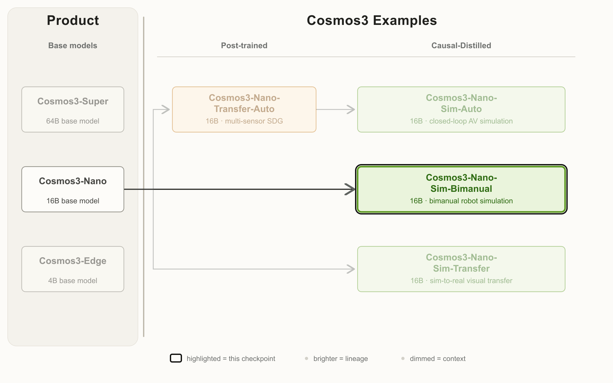
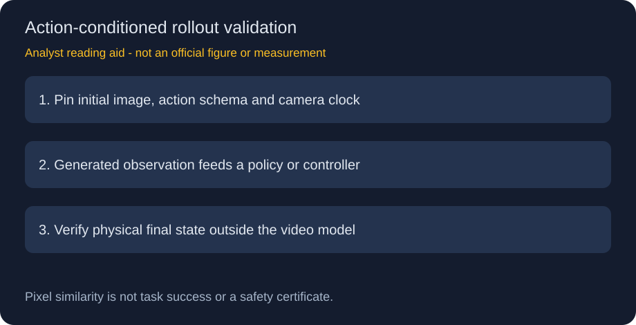

# Cosmos3-Nano-Sim-Bimanual：动作来一段，观察生成一段

> [!tldr] 核心判断
> 用机器人操作与相机轨迹混合后训练，再做因果蒸馏，使同一 rollout 能交错改变视角和操作双臂。它生成动作条件观察，**不是直接替 VLA 作决策**。原卡像素代理指标较强，但真实抓取成功率、长期物理正确性不是这些指标已经证明的事情。

> [!warning] 原始资料与深度限制
> 原卡全文与官方谱系图已归档；项目网页直连 403，未成功保存正文；专项报告链接现已移除coming soon，PDF链接经HEAD核验HTTP200；本轮未读报告正文。训练 loss、精确蒸馏配方、闭环成功率与方差不足，**未达到完整技术报告精读深度**。第二张图是研读示意，明确不是官方图或实测。未下载 PDF、权重，未运行推理或控制设备。

## 身份和派生关系

Release Date 明确 HF / GitHub **2026-10-20**，V1.0；16B、MoT、Cosmos3-Nano 后训练与因果蒸馏，OpenMDW1.1。属于 NVIDIA 世界模型专项支线，不作为通用聊天新正代。

## 方法：在视角变化中维持操作连续

机械臂视频与动作配对、相机导航视频与轨迹配对，混合后训练后再因果蒸馏。生成时读取初始图、小段新动作和历史 cache，返回少量 latent-frame 块；新输入可由 policy 或人类控制器在 rollout 中继续提供。

混合控制带来的问题不只是“预测下一帧”，还包括相机移动后同一物体是否仍在、夹爪接触是否保持、不同身体坐标是否正确。这些错误对策略具有不同影响，不能只用一个视觉质量分覆盖。

| 输入字段 | 原卡约束 | 注意 |
|---|---|---|
| 初始图 | JPG / PNG / JPEG / WebP | quickstart 只有初始真实视觉观察 |
| 机器人动作 | `(T,D)` 的状态/控制序列 | D 随 embodiment，不是通用维度 |
| 相机轨迹 | 例如 9D motion representation | 要与动作/视频时钟对齐 |
| 文本 | 可选场景说明 | 不能掩盖控制不匹配 |
| 支持身体 | AgiBot | 换机器人需额外后训练 |
| 输出 | 480p、30fps 播放视频 | 不等于所有硬件都实时 |

示例 JSON 使用 59D 混合控制，必须与其 schema、domain_id、归一化匹配，不能写成“所有机器人固定 59D”。官方部署例程为四步采样、一次一请求、64-latent-frame 滚动 KV cache、8 attention sinks；这不是无限长记忆的承诺。例程 `--no-guardrails` 不应被当作推荐安全部署默认值，本轮不执行它。

## 相机导航：保持基线与误差定义

ViPE 从生成视频估计位置和朝向，然后用 Umeyama 旋转/平移/统一尺度对齐。ATE 是对齐后的轨迹误差，不是原始绝对米制定位精度。

| 基准 / 模型 | Video quality ↑ | ATE ↓ | RTE ↓ | RRE ↓ | Drift ↓ |
|---|---:|---:|---:|---:|---:|
| PAI / LingBot-World2.0 | 65.3577 | 4.1698 | 0.0596 | 0.1781 | 0.0209 |
| PAI / Sana-WM | 65.2090 | 6.4823 | 0.1284 | 0.1601 | 0.0299 |
| PAI / Sim-Bimanual | 73.9099 | 4.7072 | 0.0545 | 0.1002 | 0.0210 |
| Sana simple / LingBot | 65.9748 | 1.4254 | 0.0185 | 0.2591 | 0.0371 |
| Sana simple / Sana-WM | 66.0599 | 1.2159 | 0.0192 | 0.2356 | 0.0223 |
| Sana simple / Sim-Bimanual | 77.2887 | 1.0040 | 0.0124 | 0.0551 | 0.0118 |
| Sana hard / LingBot | 64.5462 | 1.3423 | 0.0161 | 0.3264 | 0.0372 |
| Sana hard / Sana-WM | 65.5699 | 1.3165 | 0.0178 | 0.1826 | 0.0251 |
| Sana hard / Sim-Bimanual | 76.3971 | 1.3085 | 0.0161 | 0.1774 | 0.0161 |

PAI 上画质提高，但 ATE 不如 LingBot，drift 也略差；Sana simple 更全面；hard 上 RTE 与 LingBot 相同。不能删掉这些例外写成“全项领先”。

## 双臂操作：帧相似度是代理，不是控制验收

| 基准 / 模型 | Quality ↑ | PSNR dB ↑ | SSIM ↑ | LPIPS ↓ | Drift ↓ |
|---|---:|---:|---:|---:|---:|
| AgiBot-World / DreamDojo2B | 74.5327 | 12.1016 | 0.6405 | 0.3766 | 0.0149 |
| AgiBot-World / DreamDojo14B | 74.9390 | 12.3561 | 0.6635 | 0.3586 | 0.0133 |
| AgiBot-World / Sim-Bimanual | 76.0884 | 14.4138 | 0.6839 | 0.3454 | 0.0118 |
| AgiBot-GEAR / DreamDojo2B | 72.4586 | 11.5709 | 0.5437 | 0.4638 | 0.0232 |
| AgiBot-GEAR / DreamDojo14B | 73.0033 | 12.1113 | 0.5818 | 0.4326 | 0.0218 |
| AgiBot-GEAR / Sim-Bimanual | 74.4912 | 14.0158 | 0.6172 | 0.4057 | 0.0188 |

对照包含双向教师，与因果学生的条件不同，不能忽略角色差异。PSNR/SSIM/LPIPS 比较生成和参考像素/特征，只能作为动作遵从代理。机械臂末端接触、目标是否移动、最终是否完成任务，需要外部状态或独立测量。

## 吞吐、数据与长程限制

| 单 GPU 480p | GB200 | H100 | H200 | H20 | RTX Pro6000 |
|---|---:|---:|---:|---:|---:|
| 吞吐 fps | 54.1 | 32.6 | 32.4 | 10.7 | 20.6 |

30fps 播放和上述推理速度不同，H20 等配置并不实时。后训练动作/轨迹视频量只给 1 万至 100 万小时区间；基础数据统计不等于该专项新增量。官方演示只展示选定种子前 15 秒，不能推断长 rollout 无漂移，也不能从视频剪辑推断对未见身体的泛化。

> [!insight] 对 Agent Training 的启发
> 这是可训练观察模拟器的候选，而非可以自动信任的 RL 环境。先用固定动作比较短窗与长窗误差，再固定 policy 比较外部最终成功；相机控制、机械臂控制与交错控制分层统计。把失败尾段和动作归一化错误保留下来，避免 policy 在模型漏洞中获得高 reward。

## 一手来源与相关笔记

- 🤗 [HF Model Card](https://huggingface.co/nvidia/Cosmos3-Nano-Sim-Bimanual)，[[src/hf_model_card.md|完整本地原始 MD]]。
- 🌐 [官方项目页](https://research.nvidia.com/labs/cosmos-lab/cosmos-simulation/)、[官方代码](https://github.com/NVIDIA/cosmos)。
- 📄 [专项 Tech Report：现已移除coming soon，本轮未读PDF](https://research.nvidia.com/labs/cosmos-lab/cosmos-simulation/technical-report.pdf)，本轮仅链接。
- [[Topics/13_base_model/NVIDIA_Nemotron/Variants/2605_Cosmos3/Cosmos3-Family|Cosmos3 基础 family]]、[[Topics/13_base_model/NVIDIA_Nemotron/Variants/2610_Cosmos3_Nano_Sim_Transfer/Cosmos3-Nano-Sim-Transfer|视觉迁移与外部状态账本]]。

> 📊 相关可视化：[[cosmos3_nano_sim_bimanual_poster_zh.html|中文 Poster]]

## 2026-10-28：SGLang 的历史与接口契约

新增 SGLang 示例接受上传的初始图像和 inline actions，用 embodiment names，而非另一接口的domain ID。示例指定64-frame KV窗口：8 pinned +55 recent +current；若缺该pipeline config，将保留901-frame全历史，原卡警示该例可耗尽141GB GPU。当前例900行59D normalized actions；multipart extra_params有1MiB限制。蒸馏固定步数/guidance，不在请求里改。是服务文档更新，不是新模型，未本地运行。

### 2026-10-31报告链接状态复核

本轮四张相关HF卡均移除Tech Report的coming soon。对同一官方PDF只发HEAD，返回HTTP200、application/pdf，没有下载PDF正文。Last-Modified不是报告或模型首次发布日，不新增模型事件。此前“报告仍未提供”的表述现已纠正；训练细节尚未读到，不再断言报告本身没有披露，也不冒称已完成精读。
