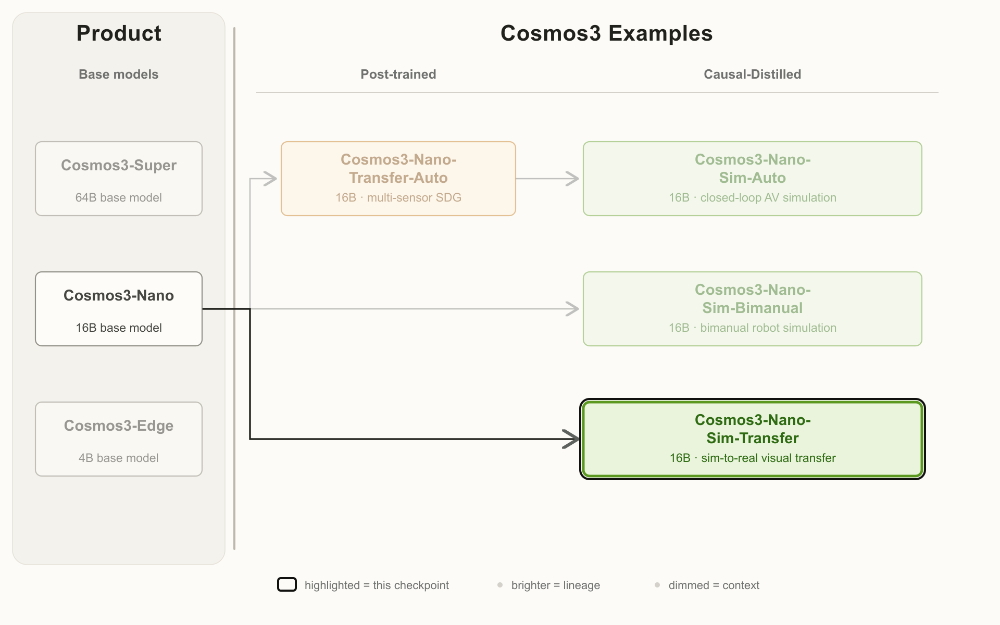

# Cosmos3-Nano-Sim-Transfer：状态不动，观察换域

> [!tldr] 核心判断
> 这是 16B Cosmos3-Nano 的后训练、因果蒸馏专项。经典仿真器负责状态、物理与标注，它根据深度、分割、边缘或模糊控制生成逼真 RGB。它最适合回答“视觉域变化是否改变策略”，而不是直接替代物理模拟器。

> [!warning] 达不到完整报告精读的部分
> 已逐段阅读原卡、保存官方完整谱系图和控制演示动图。专项报告仍标 **coming soon**；精确训练损失、蒸馏配方、真实闭环 RL 收益和统计方差尚缺，因此**未达到完整技术报告精读深度**。仅保存 PDF 链接，不下载，不用基础 Cosmos3 报告冒充该专项报告。

## 身份和来源

原卡明确 HF / GitHub **2026-10-20** 发布，V1.0；归入 NVIDIA 世界模型支线，不是新的通用语言模型正代。许可证为 OpenMDW1.1，基座为 Cosmos3-Nano，架构 MoT，卡片参数字段 16B。

## 问题：逼真观察不应偷偷改写物理状态

原始仿真往往易于验证却视觉域不够真实；纯视频生成逼真但难保证接触、遮挡和标签。该模型折中为：仿真器仍做物理状态演化，渲染控制送入生成器，生成器返回策略看到的 RGB。

这种职责分离很关键。仿真标注描述的是底层场景，不是生成像素已经无条件保证准确；目标边界、遮挡与细节仍需检查。不能因为模型输入了 segmentation 就声称生成后的 mask 一定是真值。

## 方法与输入输出契约

1. 从 Cosmos3-Nano 后训练，让模型接受 simulator 控制视频与文本。
2. 因果蒸馏为少步模型；按小 latent-frame 块生成，复用历史 cache，并继续接受新控制。
3. 在 Isaac Lab 等环境里闭环使用观察，物理状态与 ground truth 继续由外部仿真器维护。

支持 depth、segmentation、edge、blur 四种控制。输出视频最多 600 帧、480p、播放 30fps。单 GB200 约 24.5fps 的吞吐与播放速度不同；“可批量集成最多 8 环境”是接口/设计说明，不证明 8 路每路都能 30fps 实时。

官方说明：控制在上、生成 RGB 在下，左右分别展示深度与分割条件。这是选择样例，不是全测试集或真实任务成功率。

## 控制遵从：改善是真实的，但有代价

PAI-Bench-C / TransferBench 中，把生成结果重新映射回控制模态再比较。下表为原卡全部控制指标：

| 模型 | DOVER ↑ | Seg mIoU ↑ | Blur SSIM ↑ | Edge F1 ↑ | Depth SI-RMSE ↓ |
|---|---:|---:|---:|---:|---:|
| Cosmos3-Nano | 10.359606 | 0.643263 | 0.855906 | 0.214024 | 0.842346 |
| Sim-Transfer | 10.175942 | 0.737760 | 0.886650 | 0.340696 | 0.619426 |

控制指标四项改善，DOVER 略降。深度是 scale-invariant RMSE，不是绝对米制重建误差；mIoU 是像素区域交并比，不是抓取成功率。

| 模型 | Prompt following ↑ | Video quality ↑ | Perceptual drift ↓ | Temporal Sampson ↓ |
|---|---:|---:|---:|---:|
| Cosmos3-Nano | 7.184583 | 4.929583 | 0.006349 | 0.081045 |
| Sim-Transfer | 7.025417 | 4.950833 | 0.006504 | 0.096544 |

Prompt、drift、时序几何都不是全面提升。我的判断是：更强控制可能值得部分感知质量代价，但是否改善策略训练必须单独测，不能由几张演示图决定。

## 速度、数据与复现

| 单 GPU，480p 吞吐 | fps |
|---|---:|
| GB200 | 24.5 |
| H100 | 14.6 |
| H200 | 14.9 |
| H20 | 4.0 |
| RTX Pro 6000 | 8.3 |

后训练视频量卡片只给“少于 1 万小时”，文本是宽泛量级；1.3B data points / 393 entries 是重复的基础家族说明，不能当作本专项新增样本。需要固定输入控制分辨率、帧数、硬件、采样配置、checkpoint revision 才能复现吞吐；本轮不启动容器、不加载权重。

> [!insight] 对 Agent Training 的用法
> 保留状态账本与观察账本：同一状态、同一动作分别用原渲染和生成渲染；先检查标签不变量，再训练 policy。最终 reward 由物理终态/外部 verifier 给出。长 rollout 中要保留失败尾段，不只截取开始的逼真 3 秒；否则容易把视觉自洽误判成物理正确。

## 一手链接与关联

- 🤗 [HF Model Card](https://huggingface.co/nvidia/Cosmos3-Nano-Sim-Transfer)，[[src/hf_model_card.md|完整本地原始 MD]]。
- 🌐 [官方项目页](https://research.nvidia.com/labs/cosmos-lab/cosmos-simulation/)、[官方代码](https://github.com/NVIDIA/cosmos)。
- 📄 [专项 Tech Report（原卡仍标 coming soon）](https://research.nvidia.com/labs/cosmos-lab/cosmos-simulation/technical-report.pdf)。
- [[Topics/13_base_model/NVIDIA_Nemotron/Variants/2605_Cosmos3/Cosmos3-Family|Cosmos3 基础家族]]、[[Topics/13_base_model/NVIDIA_Nemotron/Variants/2610_Cosmos3_Nano_Auto/Cosmos3-Nano-Auto-Family|驾驶多传感器生成]]。

> 📊 相关可视化：[[cosmos3_nano_sim_transfer_poster_zh.html|中文 Poster]]
