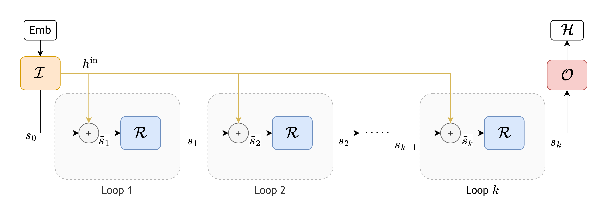
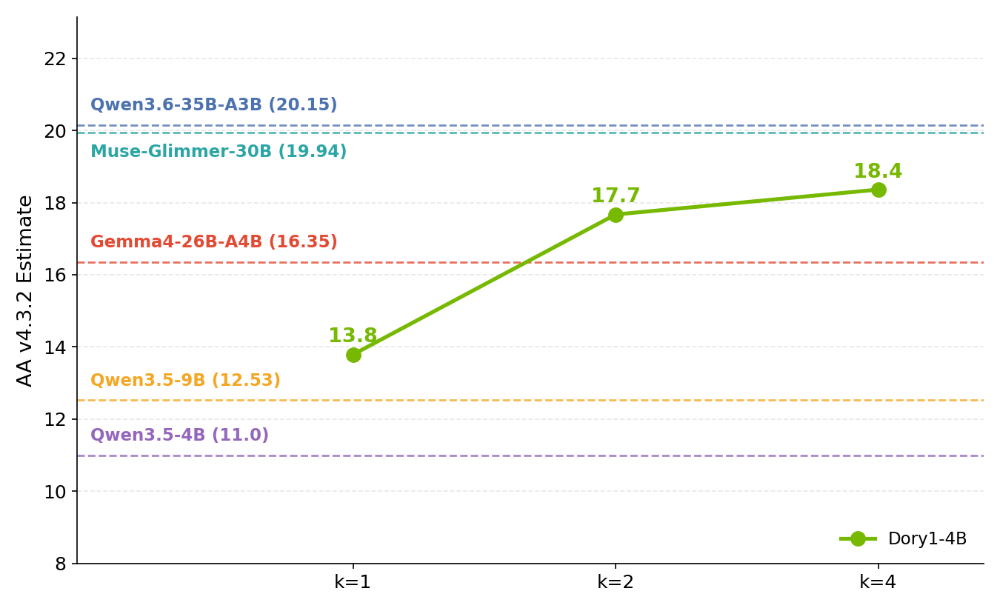
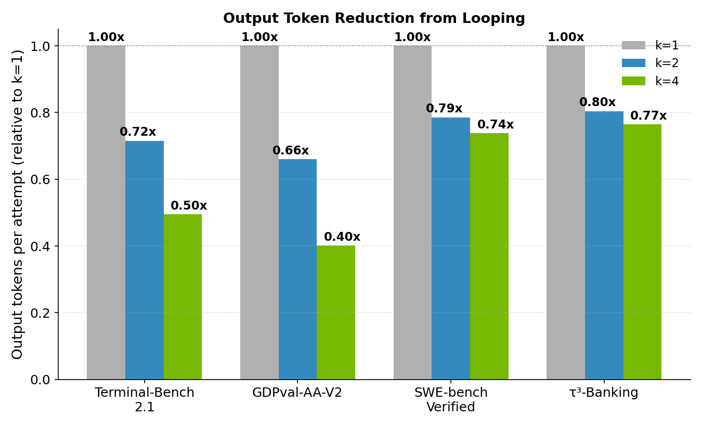

# Dory1.0-4B：不增加权重，用循环深度换计算

> [!tldr] 我的判断
> Dory 的关键不是“4B 又赢了谁”，而是把每个 token 的潜空间计算深度变成部署时可调的旋钮：同一组循环层重复 1、2、4 次，不更换 checkpoint。代码、工具和长上下文指标通常改善，但知识问答几乎不变，GPQA/HLE 从两循环到四循环还小幅退步。**更多内部计算与更长显式思考不是同一件事，也都不保证任务整体更便宜。**

> [!warning] 原始资料与研读深度不足
> 本页已亲自读取四种格式的官方 HF Model Card、BF16 配置及三张完整技术图。当前没有核实到 Dory 专属完整 Tech Report / Tech Blog，训练数据配比、loop 训练分布、奖励实现与系统消融仍不足，**因此达不到 GLM-5.3-Flash / Kimi-K3 完整报告级拆解深度**。不把通用 Nemotron 数据说明或其他模型报告冒充 Dory 报告；卡中链接的 safety / explainability / bias / privacy 四份子卡本轮均返回 404，未声称读过。

## 发布与收录口径

| 项目 | 已核实内容 |
|---|---|
| 官方名称 | NVIDIA-Nemotron-Labs-Dory1.0-4B |
| 首发日 | **2026-10-16**；原卡 `Release Date` 和 `GA (10/16/2026)` 两处明确标注 |
| 定位 | Nemotron Labs 独立的通用小模型架构 family；不是 Nemotron 3.5 的一次精度更新 |
| 规格 | 4B，英文文本输入/输出，验证上下文 262,144 tokens |
| 格式 | BF16、MXFP8、NVFP4、GGUF Q5_K_M；**合并一个 family，不拆四代** |
| 许可 | OpenMDW-1.1；不改写成 Apache-2.0 或 MIT |
| 本轮工作 | 原卡/配置/官方图归档、带图研读笔记、中文 Poster；没有下载或运行权重 |

官方来源：[🤗 BF16 Model Card](https://huggingface.co/nvidia/NVIDIA-Nemotron-Labs-Dory1.0-4B-BF16) · [MXFP8](https://huggingface.co/nvidia/NVIDIA-Nemotron-Labs-Dory1.0-4B-MXFP8) · [NVFP4](https://huggingface.co/nvidia/NVIDIA-Nemotron-Labs-Dory1.0-4B-NVFP4) · [GGUF](https://huggingface.co/nvidia/NVIDIA-Nemotron-Labs-Dory1.0-4B-GGUF) · [OpenMDW-1.1](https://openmdw.ai/license/1-1/)。

## 机制：共享权重，不等于共享所有状态

普通加深网络要增加不同层的权重。Dory 把网络分成 Input、Recurrent、Output 三段；Recurrent 共享参数，输入在每次循环中重新注入。重复计算使中间表示有机会修正，但不新增一套独立权重。

图为官方完整架构图，未裁剪。下面只是研读抽象，**不是官方公布的完整前向公式**：

$$
h^{(0)}=I(x),\qquad h^{(\ell+1)}=R(h^{(\ell)},x),\qquad y=O(h^{(L)}).
$$

原卡图注按 Transformer block 口径写 **8 / 20 / 8**；`config.json` 则将 attention 与 MLP 分成独立条目，列出 **16 / 40 / 16**，共 72 个条目。配置的 `layer_types` 确实交替 attention / MLP，二者不能简单当作相互矛盾的网络深度，也不能直接把 72 乘循环数当 FLOPs。

| 配置 | 原始值 | 读法与边界 |
|---|---|---|
| hidden_size | 2560 | 隐状态宽度 |
| query / KV heads | 16 / 4 | 配置的头数；不从 hidden/head 比例猜 head_dim |
| head_dim | 256 | 以原配置为准 |
| sliding_window | 1024 | 局部窗口，不是全模型最长上下文 |
| SWA / full attention | 交错 | 局部注意力与全注意力混用，不是纯局部模型 |
| 默认循环 | 2 | 部署建议起点，不是所有任务最优值 |
| 最大位置 | 262144 | 支持长度，不代表长度内质量无损 |

### per-loop 与 last-loop KV

共享循环权重仍然可能为每轮存一份 KV，循环越多，缓存越大。Dory 提供 `last_loop`：循环层只保留一份缓存，下一轮覆盖前一轮历史缓存，留下最后循环的 keys/values。

- `per_loop`：不同循环独立保存状态，缓存随循环数增加。
- `last_loop`：循环层缓存保持一循环级别；这不意味着全模型没有 KV、权重内存消失或推理 FLOPs 不增加。
- 官方称质量接近且输出长度几乎不变，但当前卡没有完整的逐任务数值和方差，不能写成“无损”。

## 训练：能确认的三阶段与缺失部分

1. **预训练**：6T tokens，前约 4.5T 用原生 NVFP4，剩余阶段 BF16；之后 300B tokens 做上下文扩展至 256K。不能把 NVFP4 出厂权重与“全程 NVFP4 训练”画等号。
2. **SFT**：NVIDIA curated 数据；卡中提到多源合成、结构验证、重复过滤、compiler / numerical check 等筛选手段，未给出完整混合比例。
3. **RL**：NeMo RL / NeMo Gym，多环境 GRPO，覆盖数学、代码、科学、指令遵循、多步工具、多轮和结构化输出；异步架构解耦训练与推理。

教师轨迹含 GPT-OSS-120B 等 permissive 模型，可能有多候选选择与工具验证；但当前卡不够重建 teacher 混合、sampling、KL、rollout 数、reward 权重或各 loop 的训练安排。本页不把普通 GRPO 公式填进去冒充 Dory 特定算法。

卡中注释区写预训练截止 2025-09、后训练截止 2026-05；后面的训练数据段又写收集至 2025-12。**口径并未完全一致**，因此不提供一个看似确定的单一知识截止日。

## 结果：主要收益在第二轮，更多循环不是单调提升

下表完整保留原卡十项指标的 1 / 2 / 4 循环结果。它们是 NVIDIA 自报，不是本地复测；GDPval 是 Elo，其余按原卡分数口径，不能跨任务平均。

| 指标 | 1 loop | 2 loops | 4 loops | 两轮之后的观察 |
|---|---:|---:|---:|---|
| SciCode | 27.3 | 34.94 | 35.11 | 额外提升小 |
| SWE-bench Verified | 50.3 | 59.5 | 61.8 | 继续改善 |
| Terminal-Bench 2.1 | 12.5 | 18.1 | 22.2 | 仍明显低于卡中更大参对照 |
| τ³-bench Banking | 11.6 | 12.89 | 14.69 | 工具任务改善 |
| GDPval-AA-V2 Elo | 815 | 946 | 967 | 两轮收益更大 |
| GPQA Diamond / 无工具 | 69.19 | 72.41 | 72.16 | **四轮反而低 0.25** |
| HLE text / 无工具 | 8.25 | 10.89 | 10.43 | **四轮反而低 0.46** |
| IFBench | 74.29 | 77.94 | 79 | 改善，不等同所有约束可靠 |
| AA-LCR | 63 | 71 | 73 | 长文推理改善 |
| AA-Omniscience accuracy | 10.03 | 10.08 | 10.03 | 几乎不变 |

### 不能只挑赢的对照

四循环 SWE Verified **61.8** 略高于表中的 Qwen3.5-9B **61.0**，但 Terminal-Bench 2.1 的 **22.2** 低于后者 **24.0**；GPQA **72.16 vs 80.93**、HLE **10.43 vs 15.43** 也较弱。因此不能概括成“全面超过9B”。Qwen3.6-35B-A3B 的 SWE **73.4†** 是引用成绩，原表特别标了 †，不是全部同一 harness 重测。

评测注意事项：

- 官称总体用 NeMo Gym / Evaluator SDK 同框架，Terminal-Bench 2.1 用 Terminus-2；仍缺每项完整题集版本和全部参数。
- 图中 AA v4.3.2 是**内部估计**，不可当作 Artificial Analysis 官方榜单认证。
- AA-LCR 使用 v1.1 修正答案，但 judge 仍用 Qwen3-235B-A22B，不是更新的 GPT-5.6 Luna。
- 重复次数各异：SciCode 8、AA-LCR 16、AA-Omniscience 10、HLE 1；部分额外 AA 子项 1 或 5 次，不能把所有数字都描述成稳定多次均值。
- 表里是 Terminal-Bench **2.1**，脚注重复次数另写 **4.0**；本页保留这个待核对处，不擅自替官方修正。

## token 效率、延迟和量化是三个问题

较多循环可能减少输出 token，但每个 token 的计算增加。真实成本同时依赖循环数、输出长度、缓存模式、量化、prefill 与并发，**不能从 token 变少直接推出端到端更快**。值得做的是在同一任务成功率下比较延迟，而非只比 tokens/s。

官方 DGX Spark 相对 BF16 的量化速度表：

| 输入 / 输出 tokens | batch | MXFP8 W8A16 | NVFP4 W4A16 |
|---|---:|---:|---:|
| 2560 / 300 | 1 | 1.69× | 2.17× |
| 128 / 1024 | 1 | 1.84× | 2.44× |

这只是两组单请求长度下的格式比较，不是循环数消融，也不是任何硬件下的统一倍速。BF16 基准表不能直接当 GGUF 的准确率；GGUF Q5_K_M 文件大小约 3.67GB 也不是总运行显存。

## 部署与安全边界

2026-10-17 午间复核：官方修正了 MXFP8 / NVFP4 / GGUF 原卡的模型名、精度与对应启动示例，GGUF 卡改为独立的 llama.cpp 快启。资料包已更新原文；这是同一 family 的文档修订，不是新模型，表中基准仍为 BF16，不转移给量化版本。

原卡 vLLM 支持仍处于 [PR #60149](https://github.com/vllm-project/vllm/pull/60149)，llama.cpp 参考 [PR #30306](https://github.com/ggml-org/llama.cpp/pull/30306)，不能假设任意正式版开箱即用。原卡另给固定 llama.cpp revision；复现时需锁定实际代码、模型 revision 和 chat template。

- 起点：两循环；根据任务测试一/四循环与 `per_loop` / `last_loop`，不要改多项后无法归因。
- vLLM 原卡参数是 `n_recurrent_loops` 与 `recurrent_kv_cache_mode`；llama.cpp 使用对应 GGUF override keys，二者不能互换粘贴。
- 推荐 temperature 1.0、top_p 0.95；推理与工具 parser 以及 `force_nonempty_content` 都属于工程验收项。
- “支持256K”不等于本机可在256K并发启动；原卡 macOS示例只给4K，需区分验证上限与示例配置。
- 不自动执行下载卡内的安装、sudo、clone 或启动命令；本次仅归档研读。
- 许可允许的商业使用仍受 OpenMDW-1.1；安全子卡404意味着审计材料不足，不意味着已经没有风险。

### 10 月 27 日文档修订：Linux GGUF 路径

当前 GGUF 卡新增 Linux/CUDA 编译与启动说明，固定 llama.cpp commit `98a74c97ea09ac72f6ceda1559808fc0a2f447ce`；GB300 的 CUDA architecture 103、全 GPU offload、`sha256sum` 与 `LD_LIBRARY_PATH` 均属于该部署例程条件。macOS 与 Linux 路径不互换；存在命令不等于已在本机跑通。本轮只同步原卡并补记，权重与基准表未因此变化，不在发布表重复计为新模型。

## 对 Agent Training 的启发

> [!insight] 将 latent compute 与轨迹长短分开优化
> 最有价值的实验不是训练 agent 说更长的思考，而是在固定环境、奖励与输出预算下测试：**同一参数容量，更多内部迭代是否减少失败恢复和无效工具调用？** 共享权重也提供一个研究角度：能否按步骤难度调 loop，而不是整段对话固定最大计算？后者只是研究假说，本模型卡没有证明动态路由有效。

建议先做小而可归因的矩阵：loops={1,2,4} × cache={per_loop,last_loop}，固定精度、服务版本、temperature、task种子与输出预算。记录终态成功率、有效工具率、输出tokens、prefill/decode延迟、峰值显存、每个成功任务成本。之后才测量化；不要同时改变loop、precision和harness。

必须留两个反例集：知识缺失题（更多计算不能补回未学知识）与验证循环题（更多思考可能重复检查）。用 GPQA/HLE 的非单调结果提醒自己，不把“会多想”作为“想得对”的代理。

## 资料地图与关联

- `src/HF-Model-Card-{BF16,MXFP8,NVFP4,GGUF}.md`：四种原卡，未修改官方内容。
- `src/config.json`：实际配置，区分图注block与attention/MLP条目。
- `src/assets/`：完整官方架构、AA对照、token效率图和logo，离线可读。
- Tech Report / Tech Blog：本轮未核实到专属正文，**不伪造链接**；训练数据公共说明PDF仅链接在原卡中，本次不下载。
- 关联：[[Topics/13_base_model/NVIDIA_Nemotron/261015_Nemotron_3_5_Super_Bolt/Nemotron-3.5-Super-Bolt|Nemotron-3.5-Super-VL-Family]] 的容量/吞吐优化与本模型循环深度是不同轴；[[Hy-Memory-30B-A3B]] 的外部记忆写入也不同于潜空间循环。

> 📊 相关可视化：[[dory_1_0_poster_zh.html|Dory1.0 中文研究 Poster]]
