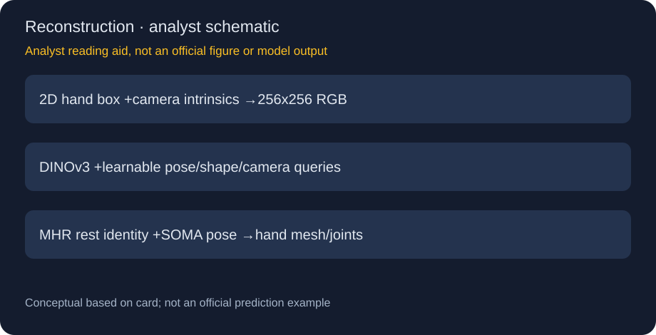
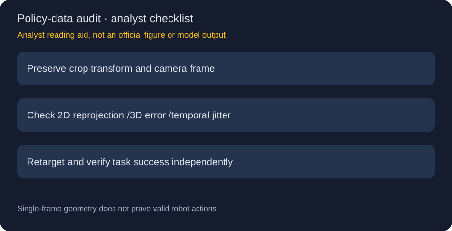

# EgoHand v1：单帧手部裁切到可变形三维手，而非直接动作策略

> [!tldr] 我的判断
> 883.5M单图手部重建：DINOv3+TransformerDecoder预测SOMA/MHR pose、27维shape/scale及相机平移。无首发日/月和公开benchmark分数。

> [!warning] 原始资料覆盖不足，尚未达到完整技术报告精读深度
> 原卡缺明确首发日期、公开benchmark、完整recipe/独立报告与官方效果图；数据统计也不完全自洽，未达到完整技术报告深度。两图均为研读示意，不是重建效果或官方原图。

## 收录身份与日期

本轮10/22新发现官方模型仓库，卡未给首发日/月；10月目录只是归档月份线索，模型不进入精确日期30天表。它是视觉几何专项，不是通用聊天正代，也不是机器人动作策略。

## 输入里已包含哪些外部工作

输入是一张RGB图像里由2D hand bounding box裁出的手部，平方化加padding后缩放到256×256，另外输入3×3相机内参（焦距和主点）。2D检测、正确裁切、左右手/镜像约定与crop坐标到原图坐标变换并未凭空消失；把它包装成“直接理解整场景”会隐藏依赖。

## 结构：身份、姿态、相机不能混为一个mesh

DINOv3视觉骨干从SAM3DBody初始化，接TransformerDecoder的SOMAHandTransformerDecoderHeadV2；learnable init pose/shape/camera queries产生SOMA手pose、27维MHR shape/scale和full-perspective相机translation。形状/尺度定义rest-pose hand identity，SOMA rig再通过前向运动学按姿态变形，最终可得到3D关节与mesh。

相机输出不能简单等同于完整6DoF全局camera pose。卡明确描述的是以内参为条件的perspective translation；尺度、camera/crop坐标和深度歧义仍须核验。本笔记公式仅是机制示意，不冒充未披露loss。

## 训练与评估证据到底够到哪里

训练组合真实第一人称手运动、RigPlay/DigitalHuman合成渲染与采购动捕，监督包括crop-frame 2D/3D关键点及MHR/SOMA参数。合成渲染有精确ground truth，但真实数据权利、分布覆盖与标签噪声不能因此忽略。卡称约16小时动捕，分1360×1360/30FPS与2464×2064/60FPS两种格式；这不是全部图像去重训练量。

| 材料 | 官方内容 | 本文边界 |
|---|---|---|
| 定性测试字段 | 100K images，真实视频/XR片段 | 不等于100K带3D标签定量验证 |
| EgoDex | 829h、338K演示、约90M帧 | 卡明确只用RGB做定性，不声称全量训练 |
| HOT3D | 9人、1.5K clips、227K帧 | 遮挡与不同相机的定量成绩未披露 |
| H2O | 4人、184clips、114K帧 | 与HOT3D标签/采集方法不同 |
| Evaluation字段 | 231K images | 与227K+114K不能直接相加对上，子集/去重口径待核 |
| Benchmark score | Undisclosed | 不补造MPJPE、PA-MPJPE或排名 |

## 从单帧结果到机器人训练，缺的桥是什么

即使mesh视觉上自然，逐帧跳动、接触穿透、相机抖动和形状漂移仍会污染动作轨迹。原卡说可为机器人基础模型和操控策略提供信号，这是应用动机，不是已公开的闭环策略收益。应保存RGB、手框、内参、crop变换、pose/shape/camera及置信/失败标记，再做时间一致、物体接触和retarget约束。

卡给PyTorch/Linux与Ampere兼容，L40/L40s测试硬件，但无统一吞吐、延迟或显存表；883.5M参数不能换算成已验证实时FPS。本轮没有运行模型或下载权重。

> [!insight] 几何标签不自动成为可靠动作监督
> 对Agent/具身训练，应先分开检验2D重投影、3D误差、时序抖动、接触一致性，再问策略最终状态是否成功。用同一重建器产生标签又做唯一verifier会形成自证回路；少量独立动捕/专家审查比仅看渲染图更关键。

## 一手来源与限制

[🤗 HF Model Card](https://huggingface.co/nvidia/EgoHand-v1)，本地保存原MD与仓库元数据。权重OpenMDW1.1；原卡列出的隐私/安全subcards作为来源链接保留。涉及人物的图像与手部轨迹应具有授权，模型输出不会自动匿名化。

> 📊 相关可视化：[[egohand_v1_poster_zh.html|中文Poster]]
