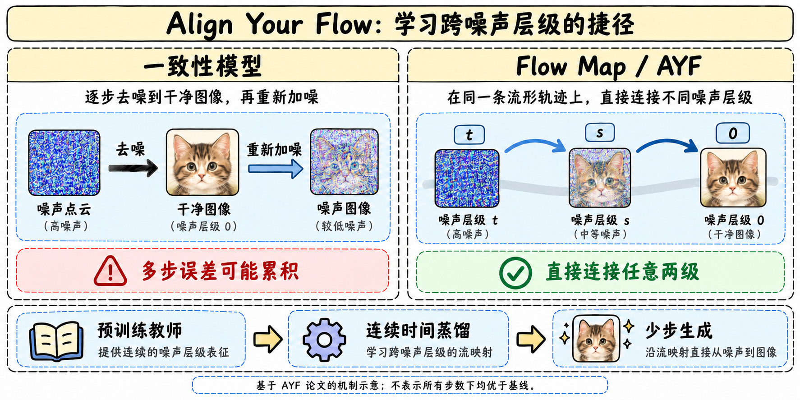
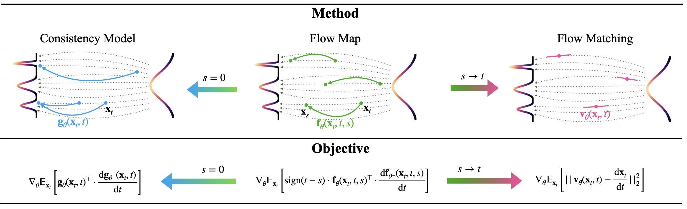
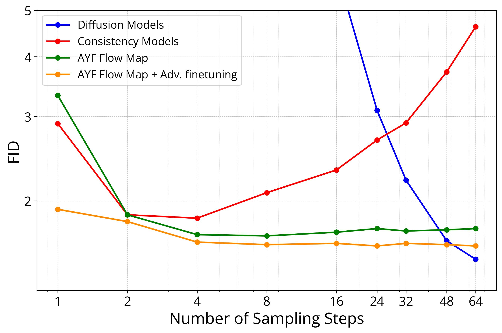

# FastGen-AYF：把多步生成压缩成可变长度的 Flow Map

> [!tldr] 我的判断
> AYF 的重点不是“再少几步”的固定 sampler，而是学习**任意两个噪声层级之间的映射**，让生成预算可以改变。官方 HF 发布的是基于 FLUX.1-dev 与 Qwen-Image 的 LoRA adapters，合为同一专项 family。2025 年论文的 ImageNet/FLUX 实验和 2026 年发布包是两层证据，尤其不能把论文 FLUX 的训练成本和质量搬给新增 Qwen adapter。

> [!info] 历史补齐
> HF 主卡明确 Release Date 27/08/2026，按 2026-08-27 收录。论文 arXiv v1 为 2025-06-17；本轮 10/28 发现仓库不构成新发布，也不进入当前近 30 天表。

## 问题：为什么一致性模型多走几步反而可能更差

一致性模型把某条去噪轨迹上的点映射到同一干净终点。多步采样常先估计干净图，再重新加较少的噪声。若估计有误，重加噪后的状态也偏离训练分布，误差会在重复操作中累积。

论文用各向同性高斯例子证明：即使允许误差任意小，也存在非最优一致性模型，在足够多步后 Wasserstein-2 距离恶化。这里有具体分布和“存在”的量词；不能扩写成所有模型、每次加一步、所有数据分布都必然变差。

Flow Map 同时接受起点与终点时间，直接沿 PF-ODE 从起始噪声层级到另一个层级。终点为干净数据时涵盖一致性模型；间隔趋近零时与局部 flow matching 关联。少步可用与多步稳定并非自动来自任意参数化，仍要检查训练目标与实际曲线。

## 两个连续时间目标：在哪一端检查对齐

| 目标 | 固定什么、检查什么 | 实验判断 |
|---|---|---|
| AYF-EMD | 固定终点，沿教师起始轨迹移动时保持映射终点一致 | 图像实验采用；连接连续一致性与 flow matching |
| AYF-LMD | 固定起点，终点随时间形成的轨迹与教师速度一致 | 2D toy 较稳，但图像中过度平滑，质量更差 |

两者在用于目标方向的时间导数中停止梯度，避免对 JVP 再做反向传播。与 Flow Map Matching 中相近写法相比，这不是符号上的小差异：它改变优化方向和训练成本。论文附录说明 EMD 不停梯度时高维训练不稳；LMD 即使稳定也没有在图像质量上胜出。

## 稳定训练的组合

先用预训练教师初始化学生；调整时间嵌入以匹配 flow matching 时间参数化，避免端点导数不稳定。采用 tangent normalization；JVP 项逐渐加入，但保留一部分直线正则，防止 warmup 后长期训练失稳。论文还比较了 EMD/LMD、autoguidance/CFG 及与 Shortcut 的差异。

Autoguidance 用较弱模型指示低质量方向，让教师更集中于高质量区域，再把该教师蒸馏给学生。它与 CFG 的“有条件/无条件”对照不同；不能假设发布的 FLUX、Qwen LoRA 都使用与 ImageNet 相同的 autoguidance 教师设置。

短暂 adversarial finetuning 与 EMD 联合可继续改善 ImageNet 的少步质量，论文用 recall 检查多样性；这不等于 GAN 项对所有模型都免费提升，也不等于本发布包就是相同 adversarial 版本。

## 公开实验：方法级成绩不等于每个 adapter 的成绩

| ImageNet-512 方法 | NFE | FID↓ | 模型 / 计时 |
|---|---:|---:|---|
| AYF-S | 1 | 3.32 | 280M；论文同设置 0.06 s |
| AYF-S | 2 | 1.87 | 280M；0.12 s |
| AYF-S | 4 | 1.70 | 280M；0.24 s |
| AYF-S + adversarial | 4 | 1.64 | 280M；0.24 s |
| sCD-XXL | 2 | 1.88 | 1.5B；0.50 s |

这些是论文 Table 2 的同类比较，延迟依赖其测量设备与设置，不是任意设备的服务 SLA。单步 AYF-S 不是最优；优势主要是更小模型在 2–4 步下的质量/速度折中。

FLUX.1-dev 的论文实验用 LoRA 蒸馏 10,000 steps，约 8×A100×4 小时。用户研究与 LCM/TCD 比较时后两者基座为 SDXL，AYF 为 FLUX；因此偏好同时混入基座差异，不能当纯蒸馏算法严格消融。

## 2026 年 HF 发布包的实际内容

| 项目 | HF 主卡 |
|---|---|
| AYF-FLUX | FLUX.1-dev LoRA，文件 `flux.1-dev/model.pth` |
| AYF-Qwen-Image | Qwen-Image LoRA，文件 `qwen-image/model.pth` |
| adapter 参数 | 357M / 445M；**不是完整基座总参** |
| 推荐生成 | 主体写 4–8 steps；子卡又写 2–4 steps，单步可能模糊 |
| 训练数据 | text-to-image-2M，约 2M 图文；卡称约 10% split 测试 |
| 分辨率 | 256²、512²、1024² fine-tuning；其他分辨率不自动保证 |
| 运行栈 | PyTorch / FastGen；不含底层 FLUX/Qwen 权重 |

> [!warning] 发布包仍有资料不足，不能把论文完整度移植到 Qwen 分支
> 已读完整可用论文 HTML 的方法、实验与相关附录及 FastGen README；但**2026 发布包各 adapter 的独立训练配置、评测表与复现映射仍不足**，Qwen-Image 版尤其没有这篇 2025 论文中的对照成绩。对此无法达到完整 checkpoint 级验收深度。主卡与子卡步数不一致原样说明，不擅自选一个当保证。

使用时固定底模、LoRA revision、采样器、步数、guidance、分辨率与随机种子。基模自己的条款与 adapter 条款分别适用。本轮未下载任何权重或执行 Quickstart。

## 对 Agent Training 的启发

> [!insight]
> 多步策略蒸馏也应检查“多花计算是否真的更好”，而不能只测最短路径。AYF 在生成域提醒我们：监督对象若只对齐终点，未必约束中间状态分布。迁移到 Agent 是研究类比，尚无此论文的工具轨迹实验支撑。

建议固定教师与数据，在相同成本下同时测一步/多步质量、失败尾部和状态分布漂移。将“减少步数”与“减少总推理成本”分开，不用 ImageNet FID 替代下游任务成功率。

## 官方来源

- [S1] [HF Model Card](https://huggingface.co/nvidia/FastGen-AYF)
- [S2] [Tech Report](https://arxiv.org/abs/2506.14603)
- [S3] [官方项目页](https://research.nvidia.com/labs/toronto-ai/AlignYourFlow/)
- [S4] [FastGen 官方代码](https://github.com/NVlabs/fastgen)
- [[Topics/13_base_model/Base Model MOC|基模主题索引]]
- [[fastgen_ayf_poster_zh.html|中文Poster]]

> 📊 相关可视化: [[fastgen_ayf_poster_zh.html|FastGen-AYF 中文Poster]]
