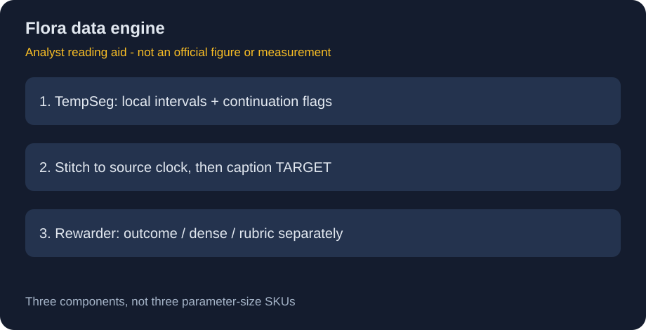
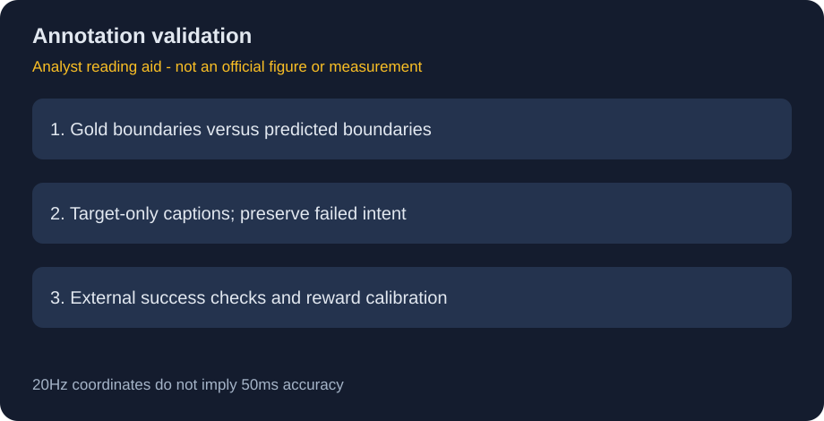

# Flora：机器人数据的时间、语义与奖励三层标注

> [!tldr] 我的判断
> Flora把“何时做了什么”和“做得怎样”拆成三个训练过的标注组件。它值得关注的不是多了三个聊天模型，而是SFT数据构造与过程奖励使用同一条可追溯事件时间线。

> [!warning] 原始资料不足
> 已逐段读取、归档Rewarder、TempSeg、Captioner三份官方模型卡。卡片引用Flora论文表2/4与附录F，但当前未核实该完整报告链接和训练配方；不可把GR00T N1旧白皮书当Flora独立报告。未达到完整论文精读深度。两张图均为依据卡片整理的研读示意，不是官方原图或实测结果。

## 来源与日期

三份卡均明确 **HF 2026-10-15**；10月21日是发现/归档，不是新首发。统一一个Flora数据引擎family入口，页面明确列出三个独立组件，不误称参数SKU，也不计入NVIDIA主干新正代。

- [Rewarder原卡](https://huggingface.co/nvidia/Flora-Rewarder)：[[src/Flora-Rewarder.md]]。
- [TempSeg原卡](https://huggingface.co/nvidia/Flora-TempSeg)：[[src/Flora-TempSeg.md]]。
- [Captioner原卡](https://huggingface.co/nvidia/Flora-Captioner)：[[src/Flora-Captioner.md]]。

## 三个模型的职责和训练边界

| 组件 | 基座与训练 | 输出 | 不负责什么 |
|---|---|---|---|
| TempSeg / segmenter-9B | Qwen3.5-9B；rank32/alpha64 LoRA；SFT→GRPO，冻结基座含视觉编码器 | 局部时间区间与左右延续标记JSON | 不给动作语义标签 |
| Captioner-27B | Qwen3.5-27B；SFT→GRPO；视觉编码器冻结，语言与merger训练 | TARGET的一条英文动作指令 | 不重预测边界，不描述上下文独立动作 |
| Rewarder-27B | Qwen3.5-27B全参数微调，含视觉编码器 | 结果、dense过程或rubric分数 | 不直接控制机器人，不是唯一安全监控 |

## 时间坐标是数据契约，而不是精度承诺

标准分段窗口16秒、4Hz、64帧，emit core12秒，两侧guard各2秒；长窗32秒、128帧、core24秒。输出20Hz ticks，与输入4Hz和原视频帧率是三套时钟。局部tick应通过窗口起点映射到原始时间：0.05秒分辨率**不意味着边界误差只有50ms**。

lo/ro表示事件在可见范围外仍延续。端点截断不是事件真正结束；跨窗口拼接必须保留延续标记，并允许同时发生的事件重叠，不强制成互斥分区。重复的边缘padding不是新观察。同步相机的mosaic是空间视角，BEFORE/TARGET/AFTER是时间块，不混为多份独立动作。

Captioner在给定TARGET上抽8–40帧、两侧可用context各4–12帧，总预算64；context用于消歧，不应把失败事故改写成目标或凭空宣称成功。它的benchmark使用gold区间，因此64.7%不能直接当“预测分段后整链标注准确率”。

## 奖励信号的语义

结果奖励1–5分描述整段成功程度；dense奖励每0.5秒给1/2/3动作质量，并带最差分与异常理由；rubric逐项输出评分。三种分数不能直接共用归一化或当作同一个reward head。Outcome最多64均匀帧，dense使用16秒64帧，rubric每相机单独采样，协议不同。

## 官方结果及正确分母

| 模型 | 基准 | 官方数值 | 口径 |
|---|---|---|---|
| segmenter-9B | WGO-Bench | F1 50.3% | tIoU≥0.75一对一匹配；三子集等权；含production拼接 |
| captioner-27B | WGO-Bench | accuracy64.7% | gold intervals，给episode instruction |
| rewarder-27B | RoboRewardBench | MAE×100=40.0 | 1–5量表，**不是40%准确率** |
| rewarder-27B | RobometerBench | tau-a×100=72.0 | 567轨迹，先task平均再dataset等权 |

WGO有100episodes（HomER25、DROID50、Galaxea25）、743gold segments。训练数据覆盖公开、授权与自采，文字均英语；分段/描述各不足1000万例、reward不足100万例，视频均不足1万小时，这些是上界而非精确规模。官方说明没有独立testing dataset，不能由此推断没有benchmark评估，也不能保证所有污染风险已排除。

## 许可、复现与研究判断

NVIDIA OneWay **Noncommercial**用于研究开发；基座Apache2.0不覆盖这个后训练权重的限制。H100测试不等于吞吐或显存保证。原生推理混合BF16与FP32 Gated DeltaNet；TempSeg另有FP32 LoRA，不能把所有参数无条件cast成BF16。

10月23日复核：三卡 frontmatter 新增 `license: other`、许可名称与仓库 `LICENSE.pdf` 链接，正文的非商业许可口径没有变化。这是文档元数据补齐，不作为新权重、能力升级或新发布日期。按当前不下载 PDF 的要求，仅保留官方许可链接，未宣称已经阅读该 PDF 或许可发生变更。

> [!insight] 验证器应独立于被训练的数据引擎
> 同一VLM既生成描述又打分容易形成自我确认。可把人工边界、物体状态或独立传感器作为外部检验，分别量化分段误差、语义误标和reward calibration，再追踪它们怎样影响SFT/RL。不可只保留高reward轨迹后宣称真实成功率提升。

关联：[[NVIDIA_Nemotron/Variants/2610_Cosmos3_H_Embodied_Nano/Cosmos3-H-Embodied-Nano]]；[[NVIDIA_Nemotron/Variants/2610_Cosmos3_H_Dreams/Cosmos3-H-Dreams]]。

> 📊 中文 Poster：[[flora_poster_zh.html]]
