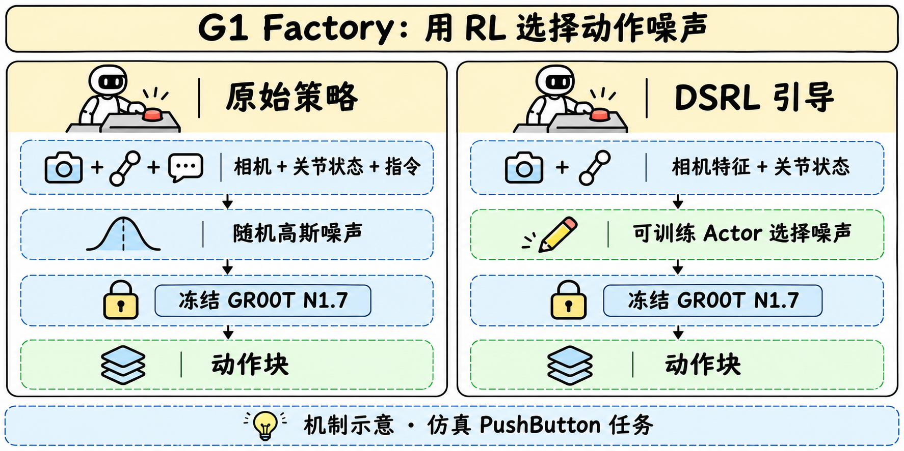
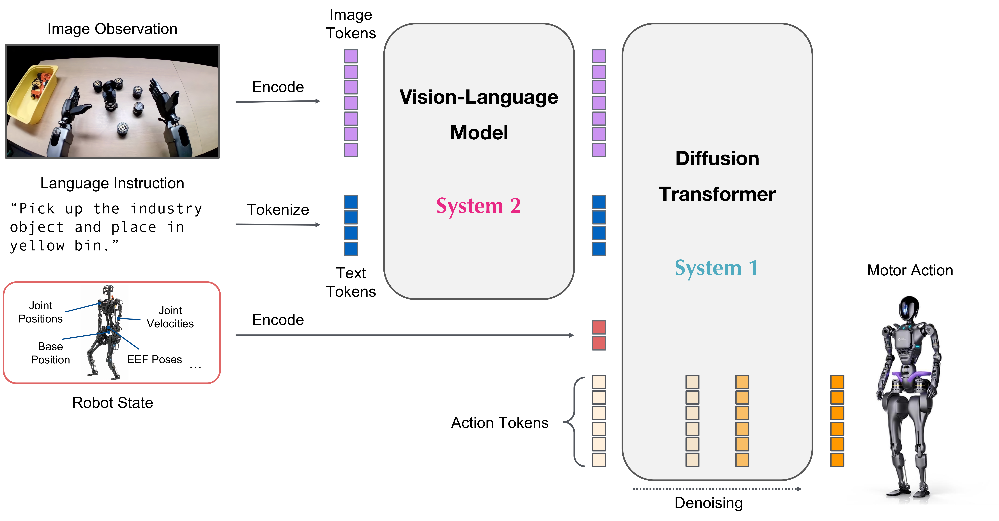

# G1 Factory · 让冻结的机器人策略学会选择噪声

> [!tldr] 我的判断
> 这组检查点把两个问题拆开。先把通用 GR00T N1.7 微调到 Unitree G1 的工厂操作任务，再用一个约 6.44M 的 actor 选择扩散策略的初始噪声。后一阶段冻结 3.144B 的底层策略，用单任务 RL 改善动作选择。在同一批 300 个仿真 episode 上，PushButton 成功率从 61.3% 提到 82.0%。这个对照支持研究潜空间引导，但数据不足以证明九项任务都受益。

> [!warning] 资料充分度与日期边界
> 已读两份完整官方模型卡、上游 GR00T 卡、微调配置及 steering checkpoint 的 manifest，并归档官方架构图。两个模型卡均声明 2026-10-19 发布，但这两个 HF 仓库当前可见的首次上传提交为 11 月 7 日。Atlas 按模型卡声明补到 10 月 19 日，先前公开渠道仍待核。G1-Factory 项目页返回 404，训练数据卡返回 401，因此不能达到完整训练复现与独立技术报告精读标准。未下载权重或运行仿真。

## 定位与两个检查点

**一句话**　把机器人 embodiment 适配与冻结策略的 RL 引导放在一个研读节点中比较。

| 检查点 | 参数与作用 | 相互关系 |
|---|---|---|
| G1-Factory-GR00T-1.7 | 3,144,016,000 参数，九项任务微调 VLA | 基于 GR00T N1.7，提供动作生成器 |
| Isaac-RLPT-GR00T-1.7-G1-Factory-PushButton-DSRL | steering actor 为 6,442,182 参数 | 选择初始噪声，依赖冻结的上述 G1 策略 |

这里的一张图像、31 维上半身状态和英文指令共同决定一块动作。图像是头部相机原生 640×480 RGB，31 维依次包含双臂、双手及腰部。输出是一块 40×35 的连续动作，其中 31 维对应上半身关节目标，另有 1 维底盘高度和 3 维导航指令，由单独全身控制器产生腿部动作。

## 方法与训练

**一句话**　微调负责学到工厂动作分布，RL actor 在这个已学分布中选择更有利的起点。

### 从通用 VLA 到 G1 Factory

官方架构是 Cosmos-Reason2-2B 视觉语言骨干、4 层视觉语言 self-attention 模块和 32 层 Flow Matching 动作 Transformer，动作头执行 4 个去噪步。微调时冻结语言骨干，更新视觉编码器、projector 与动作头。

*图来自上游通用 GR00T 模型卡，用于解释骨干。它未独立展示本次 G1 Factory 微调的全部实现细节。*

九项任务共 900 条遥操作示范，每项 100 条，约 40 万帧，按 50 Hz 记录。微调为 20,000 步、8 GPU、全局 batch 32，AdamW 学习率 1e−4、cosine 调度、5% warm-up、weight decay 1e−5、state dropout 0.2、seed 42。模型卡给出这些设置，数据卡访问失败使本次无法逐轨迹审查质量与任务覆盖。

### DSRL 怎样改变动作

普通扩散动作策略从高斯噪声出发去噪。DSRL 训练一个独立 Transformer actor，输入 31 维关节状态和相机的 768 维 DINOv2 特征，输出限制在 [−2,2] 的 40×35 噪声。冻结的 VLA 从该噪声生成动作，所以 RL 的控制变量是动作分布的潜起点。

训练采用 SAC 和 Transformer critic ensemble。actor 在推理时工作，critic 与优化器保存在 learner state 中用于训练恢复。关键约束是训练与评测使用相同噪声边界，否则每个 steering action 都会被重新缩放。

| RL 设置 | 官方记录 |
|---|---|
| 任务与奖励 | 单场景 PushButton，成功 1，其他 0 |
| 训练预算 | 80,000 环境步计划，发布 checkpoint 位于 72,488 步 |
| 体验量 | manifest 记录 253 个 episode、9,114 个已完成 rollout |
| 初始化与探索 | actor 均值 0、log std −0.46，warm-up 用高斯 latent |
| 正则与熵 | 熵系数固定 0.05，Gaussian prior std 0.63 的 KL 正则 |
| 每次决定 | 40 个 latent，seed 0 |

这说明代码、数据、训练环境与解码配置必须一起固定。仅替换 actor 权重，未必能还原原先的闭环动作分布。

## 评测与可支持的结论

**一句话**　九任务基线与 300 episode 的 steering 对照使用两套评测协议，应分别阅读。

| 九任务官方基线，每任务 100 episode | 成功率 |
|---|---:|
| BoxLift | 98% |
| BoxLiftFloor | 96% |
| BoxTableToShelfPnP | 77% |
| DrillLift | 66% |
| DrillLiftObs | 75% |
| DrillPnP | 69% |
| PickDrillFromHolder | 44% |
| PushButton | 42% |
| PushShelfForward | 58% |
| 平均 | 69.4% |

上述基线使用 CPU physics，每条 episode 最多 20 秒。DSRL 的配对对照另用 Isaac Sim 6.2 / Isaac Lab 3.0，逐场景运行同一批 300 个 held-out episode，种子为 5050–5199 和 6000–6149。达到按键成功条件或 1,000 步（20 秒）上限后结束。

| 相同 300 episode、相同评测器 | 成功数 | 成功率 |
|---|---:|---:|
| 冻结 G1 策略 | 184 / 300 | 61.3% |
| 冻结 G1 策略加 DSRL actor | 246 / 300 | 82.0% |

绝对提升为 20.7 个百分点。模型卡给出的差值 95% 区间约为 +13.9 至 +27.4 个百分点，但缺少逐 episode 配对结果，无法独立验证配对不确定性。300 次对照中的 61.3% 才是这一实验对应的基线。

训练中的 checkpoint 按 17 次评估中最佳的一次选择，当时是 20 个 episode 中成功 13 个。独立 300 次 held-out 评测减少了直接在选择集合上报分的问题，仍需要多训练种子和不同场景对照来判断稳定性。

## 复现与研究启发

**一句话**　先控制 embodiment、相机、归一化与评测种子，再比较潜噪声引导的收益。

- 固定 G1 baseline 与 steering checkpoint 的 SHA256SUMS，保留处理器、归一化统计和 embodiment mapping。
- 使用原生 640×480 相机输入、相同噪声界限与 task instruction。基线和 steering 用相同 held-out seeds，保存逐 episode 结果及超时原因。
- 在相同环境步预算下，对比随机 latent、无 KL 引导和官方 SAC+KL。逐步扩大训练种子与场景范围，并检查其余八项任务是否受损。
- 单 L40/L40S、48GB 显存可同时运行模拟器和策略，官方参考 50 episode 约 45 分钟。这是其软件栈上的运行提示，本次没有计时复测。

> [!insight] 对 Agent Training 的启发
> 这是一种把基础策略能力与小规模在线适配解耦的实验形式。值得检验的变量包括潜动作空间边界、先验正则强度和回报稀疏度。对文字工具代理，可以类比研究冻结生成器上的可学习决策模块，但这组机器人实验尚不能证明文字任务收益。

## 来源与未核实范围

**一句话**　两份官方模型卡是本次 G1 微调与 DSRL 实验的直接证据，关联论文解释上游方法。

- [HF Model Card · G1 微调策略](https://huggingface.co/nvidia/G1-Factory-GR00T-1.7)
- [HF Model Card · DSRL steering](https://huggingface.co/nvidia/Isaac-RLPT-GR00T-1.7-G1-Factory-PushButton-DSRL)
- [上游 GR00T N1.7](https://huggingface.co/nvidia/GR00T-N1.7-3B)
- [关联 Tech Report · DSRL](https://arxiv.org/abs/2506.15799) · [关联 Tech Report · GR00T N1](https://arxiv.org/abs/2503.14734)
- [本地原始模型卡](src/factory_model_card.md) · [steering 原卡](src/steering_model_card.md) · [归档清单](src/retrieval_manifest.json)

尚缺 10 月 19 日已公开下载的历史证明、可读的 G1 Factory 源工程与训练数据，以及本次 checkpoint 的独立技术报告。已有来源足以展开训练与协议分析，不能据此宣称完成从头复现。

> 📊 相关可视化 [[g1_factory_poster_zh.html|G1 Factory 中文 Poster]]
