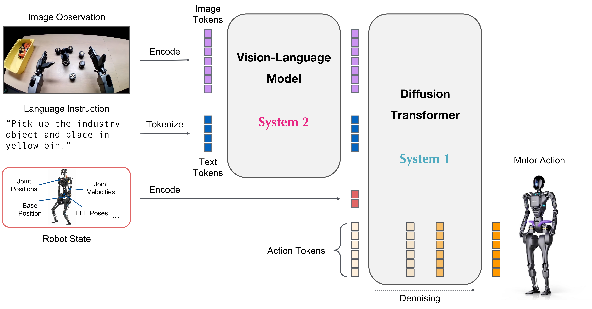

# GR00T E2E：两个机器人任务策略，不是N1.8

> [!tldr]
> G1导航取苹果放盘、H2双手交接放盘，是N1.7-3B的任务微调checkpoint，合为E2E专项，不拆两个正代。公开报告的98.42%与73.8%来自不同任务、不同episode数和控制接口，不能据此比较机器人或模型优劣。

## 开放、日期与数据接口

> [!tldr]
> 两卡声明10/1发布，但本轮11/13才在官方公开inventory观察到；createdAt分别9/3和9/13也不是公开证明。历史首公告尚未核，暂记2026-10月份待核，不往近30天伪造一条11/13首发。卡内release/v0.2工作流链接与raw链接404，保留缺口。

|接口|G1|H2 Plus / Sharpa手|
|---|---|---|
|输入state|31维，不含腿|75维关节state|
|动作|35维：31关节+1base-height+3导航|61维：14臂+44手+3导航|
|chunk horizon|40|40|
|数据原始action|43维|75关节目标，不能等同61维policy|
|视觉|640×480 egocentric；目标256/crop230|头部RGB；目标256/crop230|
|checkpoint|55,000step|10,000step|
|训练恢复文件|含optimizer/scheduler/RNG等|仅推理，故意不含恢复状态|

G1保存的eval transform为letterbox、最短边256、.95中心crop再resize；不能只按配置230解释全流程。最大padding action132维不等同选取35维动作。G1分组ABSOLUTE/NON_EEF与另一use_relative_action=true并存，实际运行语义待代码核验。

## 训练与闭环评估

> [!tldr]
> 都是仿真遥操作种子经AutoData扩展，种子不能再加到生成episode数上；均无独立held-out demonstration split，闭环评估另算。

架构是Cosmos-Reason2-2B（Qwen3-VL）视觉语言底座+flow-matching DiT动作头，embodiment条件化MLP处理状态/动作，AdaLN处理扩散步。图为官方通用架构，不能把图中历史组件代号替代本卡明确的N1.7配置。

G1：25个XR种子→2500生成演示，330175条时序记录；55kstep、global batch10、gradacc1、LR1e-4/cosine、单GPU、BF16、DeepSpeed2。LLM冻结，vision/projector/VLLN/diffusion训练，loss1.2822→.0107。

H2：10种子→1000演示，1178888记录；10kstep、batch32、gradacc1、LR1e-4，单RTX5880Ada48GB；visual和LLM冻结，projector/diffusion训练，最终loss.0138。两任务loss/步数不在同一统计条件，不能作收敛速度对比。

|评估|G1|H2|
|---|---:|---:|
|成功/总episode|9842/10000|369/500|
|成功率|98.42%|73.8%|
|失败|158|131|
|H2批次|不适用|77/73/76/73/70%，各100|
|运行错误|未列|0|
|共同扰动|苹果XY±.02m、盘固定|苹果XY±.02m、盘固定|

G1成功需稳定放盘且接触确认；H2需最终稳定放盘并双手离开，30秒仿真预算、100Hz控制、seed5301–5305。抓住/交接中间里程碑不算成功。单一英文指令和小幅位置扰动不覆盖语言泛化、物体泛化、真实机器人安全。

## 可复现边界与研究启发

> [!tldr]
> NVIDIA Open Model License与Apache不同；checkpoint、processor、normalization、action mapping、底座revision必须一起固定。本轮没有下载模型、数据或运行机器人代码。

H2卡指定Isaac-GR00T revision 4b1dca9d88d2a0b9ea5a65aa61c82ff89f5c4f0e，底座pinned revision在training_provenance.json；本轮未获取该文件与machine-readable evaluation/summary.json，不宣称逐字段复核。上层VLA给导航命令，腿部由独立whole-body controller实现，不能把策略成功全归因VLA。

> [!insight]
> Agent训练可借鉴种子→合成轨迹→小范围闭环验收，但应把训练演示独立划分和reset分布外测试分开。下一步应固定任务、控制器和预算，比较生成演示规模与闭环RL；当前两卡不构成这种因果对照。

来源：两份src/官方完整模型卡；[G1](https://huggingface.co/nvidia/GR00T-E2E-Reference-Workflow-SIM-G1-N1.7-AppletoPlate-Model)、[H2](https://huggingface.co/nvidia/GR00T-E2E-Reference-Workflow-SIM-H2-N1.7-AppleHandoverPlate-Model)。[旧N1报告链接](https://arxiv.org/abs/2503.14734)不是本次任务训练报告，未抓PDF。

> 📊 中文Poster：[[Topics/13_base_model/NVIDIA_Nemotron/Variants/2610_GR00T_E2E/gr00t-e2e_poster_zh.html]]
