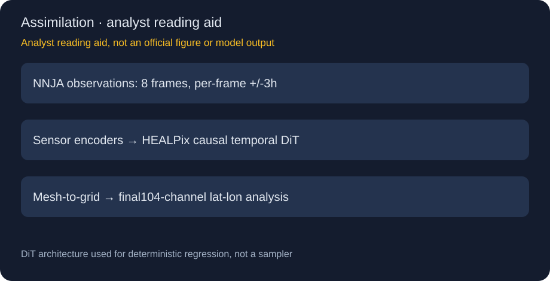
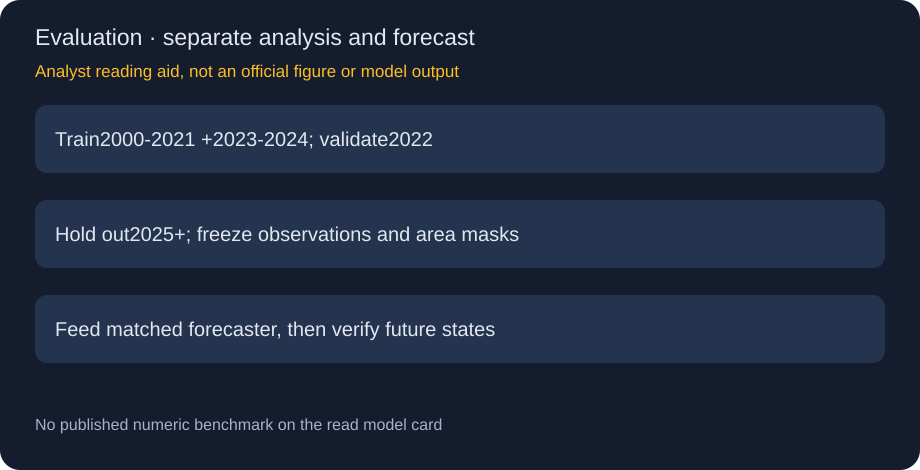

# HealDA v2：从不规则观测到104通道全球分析，而非直接预报

> [!tldr] 我的判断
> 10/1官方首发历史补收；8帧因果时间同化、104通道0.25°全球分析。DiT作为确定性回归，不把它当采样天气预报模型。

> [!warning] 原始资料覆盖不足，尚未达到完整技术报告精读深度
> 原卡无benchmark数值、组件消融或完整可复训证据；代码README给recipe入口但不含原始ETL，未达到完整技术报告深度。2601.17636为HealDA背景报告，未据此冒充V2专项报告；两图为研读示意。

## 日期与问题定位

官方HF卡明确2026-10-01首发，本轮是历史补漏，不把10/22发现日或仓库lastModified当新日期。HealDA v2是**数据同化**：从观测估计当前大气状态，为天气预报提供初始条件；不是输入历史天气就直接预测未来的forecast模型。

## 48小时并不是8×6个互不重叠预测步

8个分析帧相隔6小时，首尾中心相隔42小时；每帧可看中心前后3小时观测，因此最早到最晚观测覆盖48小时。时间attention因果，只允许较晚分析利用此前帧状态；但±3小时观测窗口意味着它并非无等待的实时滤波。公共API只返回最后分析帧，不是一次输出8步未来天气。

## 架构与输入契约

传感器专用point-cloud embedders处理不规则观测，observation-to-pixel cross-attention映射到HEALPix latent；DiT做空间self-attention与因果时间attention，GraphCast式mesh-to-grid直接输出规则0.25°经纬网格。**DiT是骨干名称，此模型按确定性回归使用**，不能据名字补造扩散步数/噪声调度。

| 项目 | 已披露 | 约束 |
|---|---|---|
| 参数 | 917.42M | 不含另一个天气预报器的总系统预算 |
| 输入 | NNJA点观测、8静态ERA5通道、年内日/秒 | 检查传感器、单位、归一化和时间 |
| 观测源 | 微波/红外sounders、GNSS、卫星风、站点/飞机/探空/浮标 | 观测系统随年变化，不能默认同分布 |
| 输出 | batch×104×721×1440 | 保留time轴时长度1 |
| 内部/输出 | HEALPix latent /规则lat-lon | 不混用网格面积权重 |

104通道可核算为13层上的U/V/T/Z/Q/W共78，10hPa另加U/V/T/Z四项，地表/柱12项、云4项、陆面6项。10hPa不含Q/W。海温、海冰、土壤等必须按物理域mask，不在无意义区域计分。

## 数据拆分与工程边界

监督目标是ERA5，NNJA只供输入观测；35068个nominal六小时时刻是可用性过滤前目标数，不等于独立8帧训练样本。训练2000–2021和2023–2024，2022验证，2025以后留测试。归一化逐通道，loss/metric面积加权；还应测试极端事件、观测缺失和新传感器，而不是仅平均误差。

代码README提供`v2-nnja-latlon-final`及dense preset，但**不含raw-data ETL**。named preset可能忽略额外loop flags；finetune只有找不到可resume checkpoint才加载，optimizer与计数从零。不能仅换命令参数就断言训练配置已生效。

dense recipe加入更密观测、位置特征与探空位置修正，是另一个配置；其32GB300、约126秒/千样本的说明不能冒充当前公开checkpoint的统一速度。主recipe每video用8GPU time_parallel；H100训练未验证，推理约40GB显存已在H100/Blackwell运行。这些是官方工程说明，非本地资源实验。

## 结果与不能补写的空白

卡明确Benchmark Score未报告。不能根据更长上下文或更高分辨率宣称比V1低多少误差。下游比较应固定forecast模型、初始化日期、网格/重映射与验证目标；否则无法区分初值、预报器和后处理的收益。

> [!insight] 可训练环境的状态估计不能当真实状态
> 对World Model/Agent数据管道而言，同化器是带偏差的状态估计。保留观测、估计状态、mask和模型revision；使用独立验证器评价未来行为结果，避免估计器自己的目标成为唯一奖励。这里没有证明它已能直接用于机器人或语言Agent。

## 来源

[🤗 Model Card](https://huggingface.co/nvidia/healda-v2)、[官方代码README](https://github.com/NVlabs/HealDA)、[Earth2Studio](https://github.com/NVIDIA/earth2studio)、[📄 HealDA背景报告](https://arxiv.org/abs/2601.17636)。原始MD、代码说明和元数据已归档；未下载报告PDF、权重、观测库，不执行原始训练/安装指令。天气状态估计不能单独作为安全关键判断依据。

> 📊 相关可视化：[[healda_v2_poster_zh.html|中文Poster]]
