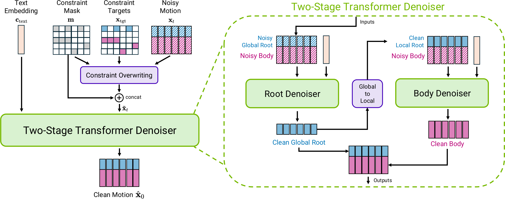
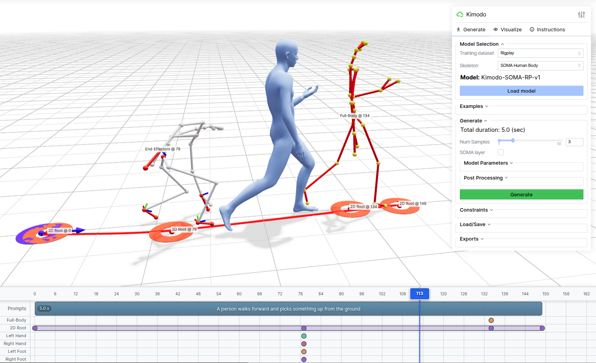

# Kimodo SOMA RP v1.2

> [!tldr] 核心判断
> v1.2 最重要的变化是纠正 RP 训练数据中 BONES-SEED 测试序列泄漏。分数略降不必然代表模型变差，而可能意味着评测终于可信。smooth-root 与 ArdyRep 是同一版数据 / 训练配方下的两种表示，不应成为两个新基模正代。

> [!warning] 资料深度与未完成事项
> 已阅读两个 v1.2 官方模型卡、项目页与仓库说明，原卡和官方图已归档。Tech Report 只保留官方 PDF 链接，不下载；未完成报告全文和新 benchmark 全量复现，达不到 GLM / Kimi 完整报告级深度。官方仓库仍把结果链接描述为 v1.1，因此本页不拿旧表冒充 v1.2 成绩，不编造 R-precision / FID 数字。

## 这是动作模型，不是机器人控制器

官方模型卡给出 GitHub / HF 发布日 **2026-10-15**。Kimodo 是 Kinematic Motion Diffusion：输入文字、时长及可选动作约束，生成三维骨骼运动。它不直接输出关节力矩，也不自带场景接触、碰撞或物理稳定性验证。

| 项目 | SOMA RP v1.2 |
|---|---|
| 结构 | 两阶段 Transformer diffusion |
| 参数 | 282M |
| 骨架 | SOMA，30 joints |
| 速率 / 最长片段 | 30fps / 10s，最多 300 帧 |
| 输入 | 文本、帧数、pose / end-effector / path / waypoint 等约束 |
| 输出 root translation | num_frames × 3 |
| 输出 joint rotations | num_frames × 30 × 3 × 3 |
| 权重许可 | NVIDIA Open Model License |
| 代码许可 | Apache-2.0，不能替代权重许可 |

*图：官方项目方法总览，不是专门针对 v1.2 的消融。*

## 数据家族与表示家族分开管理

RP 指专有 Bones Rigplay 数据，约 700 小时动作捕捉，配细粒度文本与数据增强。原卡给出 90/10 划分；不要将其与开源 BONES-SEED 混为一个完整公开训练集。SOMA-SEED 另外基于开放数据；G1-RP / G1-SEED 采用 34-joint Unitree G1，SMPLX-RP 使用 22-joint SMPLX-body。这些是骨架 / 数据变体，不是每个名称都升一代。

v1.2 的 smooth-root sibling 与 ArdyRep 共享修正后的训练 split 和配方。ArdyRep 是该表示的首次发布，但为了对应 sibling，直接使用 v1.2 版本号；不能据名称推断此前已有 v1.0 / v1.1 ArdyRep。

| 表示 | Root 与旋转约定 | 评测注意事项 |
|---|---|---|
| 常规 SOMA RP | 平滑 root 轨迹及对应骨架约定 | 使用其自身约束和测试构造 |
| ArdyRep | 原始 hip trajectory 作为 root，全局 root / global joint rotations | create_benchmark 加 motion_rep ardy，root 约束指向 raw hip |

如果拿 smooth-root 的约束数值直接喂 ArdyRep，即使输出看起来合理，几何误差也不是可比的。骨架、坐标系、局部 / 全局旋转、帧率必须成为 benchmark 元数据。

## 为什么纠正泄漏可以伴随指标回落

原卡明确承认 v1.1 中一部分 BONES-SEED 测试序列进入训练；v1.2 去除泄漏，按推荐 split 训练。官方描述文本跟随指标 R-precision / FID 略差，同时脚滑更少、约束精度相近。这里的“略差 / 更少”保留为官方定性描述，不自动转成数值提升。

这个变化至少包含两个因素：去掉与测试同源内容，以及模型重新训练。没有控制变量实验，不能说全部下降都由去污染造成，也不能说脚滑改善已经证明某个模块有效。

仓库公开 Motion Generation Benchmark 的测试构建、生成与评分路径，TMR-SOMA-RP-v1 可用于 R-precision / FID 表征；但度量模型在全 RP 700 小时上训练，其覆盖与偏差也应进入评测解释。单靠嵌入相似度不能证明动作物理有效。

*图：官方仓库 demo 截图，仅用于解释可控输入；不是 v1.2 新版性能证据。*

## 一次可信的 v1.2 验收

首先冻结 checkpoint、数据 split、评测序列 ID 与 motion representation。按文字生成、全身 pose、末端位置、路径和 waypoint 分组，不把不同约束难度平均后只留一行。

每组至少记录文本一致性、几何约束误差、脚滑、连续性与推理成本。再单独加入场景碰撞、地面穿透和不可达约束；Kimodo 不感知场景物体，失败不能靠动画看起来流畅就忽略。超过 10 秒若用片段拼接，应作为新系统实验，不能当原生长度能力。

机器人应用需要 retargeting、物理仿真和控制策略闭环。仓库列出的 ProtoMotions / SONIC 等项目说明可能的对接路径，不证明所有 Kimodo 输出已经能安全驱动真实机器人。

> [!insight] 对 Agent Training 的启发
> 评测污染修复应像一次独立发布事件记录，保留旧版与新版数据谱系，而不是只维护最高分。工具轨迹也可能通过重用任务或环境 seed 泄漏；应对任务 ID、环境初态与轨迹相似性联合去重。指标下降时先确认 split 变化，再判断学习方法是否退步。

## 来源与导航

- [HF Model Card · SOMA RP v1.2](https://huggingface.co/nvidia/Kimodo-SOMA-RP-v1.2)；[[src/Kimodo-SOMA-RP-v1.2-model-card|本地原卡]]
- [HF Model Card · ArdyRep v1.2](https://huggingface.co/nvidia/Kimodo-SOMA-RP-ArdyRep-v1.2)
- [官方项目页](https://research.nvidia.com/labs/sil/projects/kimodo/)
- [官方仓库](https://github.com/nv-tlabs/kimodo)
- [Tech Report · PDF](https://research.nvidia.com/labs/sil/projects/kimodo/assets/kimodo_tech_report.pdf)
- [官方 Benchmark 文档](https://research.nvidia.com/labs/sil/projects/kimodo/docs/benchmark/introduction.html)
- [[Topics/13_base_model/NVIDIA_Nemotron/261015_Nemotron_3_5_Super_Bolt/Nemotron-3.5-Super-Bolt|同团队语言 / 视觉模型发布阶段]]

> 📊 相关可视化：[[kimodo_soma_rp12_poster_zh.html|中文 Poster]]
