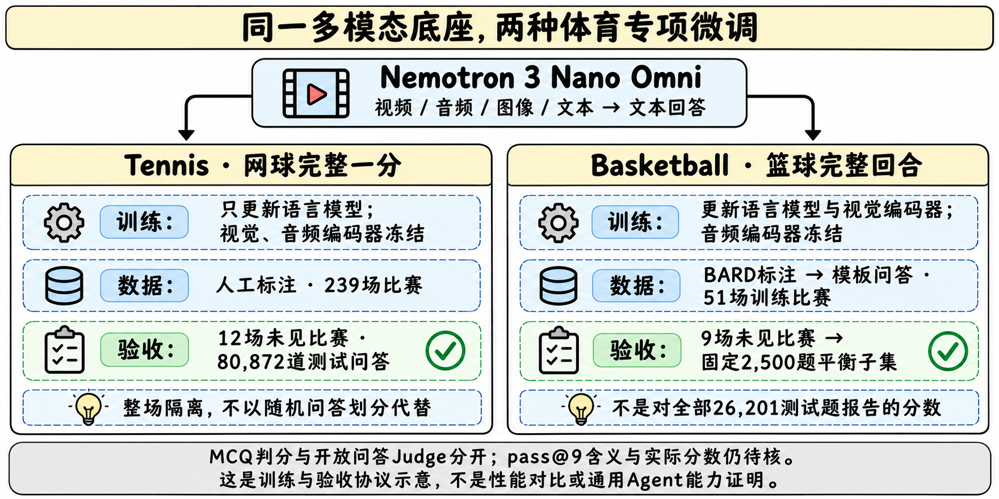
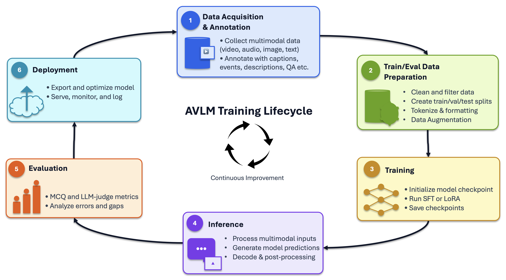

# Media Sports：从完整比赛片段到专项问答

> [!tldr]
> NVIDIA 将同一个 Nemotron 3 Nano Omni 底座分别微调到网球和篮球：差别不仅是运动名称，还包括哪些编码器参与训练、怎样由标注生成问答、以及怎样隔离整场比赛。它们能支持体育理解研究，当前公开材料不能证明准确率、跨运动泛化或通用 Agent 能力提升。

> [!warning] 原始资料不足，达不到完整报告级精读标准
> 已读两张官方 HF 模型卡、config、采帧与推理脚本、Model Card++ 子卡，以及官方 Playbooks 的数据构建和评测说明。未找到两款专项模型的独立 Tech Report 与完整分项成绩表，实际准确率、TTFT/吞吐、judge配置及pass@9聚合定义不足；Tennis完整训练视频还是专有数据。因此无法达到 GLM-5.3-Flash / Kimi-K3 的完整实验归因与独立复现标准。下文只列有来源的设置和数量，不编造性能分数；没有下载权重、视频、训练集或PDF，也没有执行模型代码或外部LLM调用。

## 定位、日期与一手材料

> [!tldr]
> 9/10 Tennis 与10/15 Basketball 是官方卡声明的历史日期；11/4是本Atlas补漏时间。两者归入一个 Media Sports 科研支线family，篮球作为同族新增专项记录，尺寸、精度与服务示例不拆新正代。

| 项目 | Tennis | Basketball |
|---|---|---|
| 官方卡 Release Date | 2026-09-10 [S1] | 2026-10-15 [S2] |
| 主要观察单位 | 完整网球一分 | 完整篮球回合 |
| 专项目标 | 击球/球场位置、比分与规则、音频线索、point描述 | 球员动作、投篮/篮板、回合结构、球衣号码/颜色、play描述 |
| 共同底座 | Nemotron 3 Nano Omni 30B-A3B-Reasoning | 同左，独立专项微调 |
| 总/激活规模口径 | 卡称31B、每token约3B激活 | 卡同称31B/A3B |
| 可输入 / 输出 | 视频、音频、图像、英文文本 / 文本 | 同左；不是视频生成模型 |
| 最大上下文 | 256k tokens | 同左；不是最大输出长度 |

官方模型卡共同描述 Mamba2-Transformer 混合 MoE、C-RADIO v4-H视觉编码器和Parakeet语音编码器。Card++里泛称“Transformer”不能覆盖主卡的具体混合架构。HF仓库索引实际列出BF16权重分片；卡片精度栏仍带“TBD”，保留为文档同步问题，不因它就断言权重不存在。Basketball HF safetensors元数据约33.0B tensors，主卡31B是另一口径；尚未按组件独立审计，不能把二者直接当作新的模型规模。[S2][S3]

两张卡的明确日期比仓库createdAt/lastModified更适合做发布依据；本轮新观测到Basketball且collection增加条目，只说明发现了遗漏，不把11月4日造为新发布日。官方原卡MD分别保存在src/Tennis-model-card.md与src/Basketball-model-card.md。

## 训练：同一底座，两个不同协议

> [!tldr]
> Tennis只更新语言模型；Basketball还更新视觉编码器及projector，二者都冻结音频编码器。比较结果时必须同时控制训练模块与数据，不能把差异全归因运动种类或样本量。

| 设置 | Tennis | Basketball |
|---|---|---|
| 可训练模块 | 语言模型 | 语言模型 + 视觉编码器与projector |
| 冻结模块 | 视觉、音频编码器 | 音频编码器 |
| 训练方式 | BF16 packed SFT | BF16 packed SFT |
| 优化器 | AdamW，lr5×10^-5，β=(0.9,0.999) | 同左 |
| 调度 / 正则 | warmup+cosine，weight decay0.05，grad clip max-norm1.0 | 同左；无额外damping |
| 超参来源 | 公开NeMo AutoModel recipe | 同左，不是各运动独立搜索出的最优超参 |
| 卡中专项训练规模 | 1,312,129 QA / 43,084 point clips / 239场 | 127,211 QA / 11,218 play clips / 51场 |

官方Playbooks提供AutoModel与Megatron-Bridge两种训练栈，也提供full SFT和LoRA选项；“仓库可以运行LoRA”不等于这两款公开模型就是LoRA。卡明确的是上述SFT范围，不推断隐藏reward、在线RL或其他训练阶段。训练轮数、全量显存/硬件时长与完整实验种子在所读卡中没有完整披露。[S1][S2][S4]

### Tennis：专有标注与公开示例的区别

模型卡训练数据是2025年NVIDIA自有网球片段，包含1,226,081 MCQ与86,048开放问答。Playbooks只附两场比赛20个point的示例标注，不含训练视频；不能把示例数据当成完整百万题训练集。

数据构建按point标注字段套模板：比分、击球数、终结原因、描述和音频线索进入question/answer，选项打乱后写入HF conversation JSONL。当前categorical配置无需LLM；legacy mcq_*模板可用LLM写错误选项，正确答案仍来自标注。公开categorical说明为39模板、五类，卡为38 annotation categories；两者不是已核对的一一对应关系，保留版本/统计口径差异。[S5]

### Basketball：BARD标注不等于每道QA都由人撰写

BARD公开数据是60场、14,676标注clips；官方脚本生成175,193问答。模型卡train127,211、val6,695、test_seen15,086、test_unseen26,201，合计恰为175,193。这能核对统计自洽，但不是本地重跑验证。

16个模板（14MCQ、2开放）基于动作顺序、投篮结果、助攻、球衣颜色/号码等标签确定答案。ambiguity filter确保指定球员/事件的答案唯一；干扰项可以来自同队其他号码，避免只看颜色排除。错误行、歧义和身份标注问题被quality gates排除并计数。README还提供chance、majority与duration-only基线：clip长度与事件数相关，仅靠时长猜题也可能得分，不能把所有选择题收益当成视觉推理。[S6]

## 评测：未见整场与固定子集

> [!tldr]
> 同一片段可衍生很多QA，随机拆QA很容易泄漏。正式测试用完全未见的整场比赛；Basketball最终报告口径仅为2,500题平衡子集，不能当作全部26,201题的成绩。

| 数据/计分范围 | Tennis | Basketball |
|---|---:|---:|
| train QA | 1,312,129 | 127,211 |
| train clips / 场次 | 43,084 / 239 | 11,218 / 51 |
| MCQ / 开放train QA | 1,226,081 / 86,048 | 101,773 / 25,438 |
| validation QA | 68,931 | 6,695 |
| test_seen QA | 69,091 | 15,086 |
| test_unseen QA | 80,872 | 26,201 |
| test_unseen clips / 场次 | 2,689 / 12 | 2,208 / 9 |
| 卡指定报告集合 | 80,872未见比赛QA | 固定2,500题，10细分类各250题 |
| Basketball子集题型 | 不适用 | 2,125 MCQ + 375开放问答 |
| 已读材料实际准确率 | 未给出完整数值 | 未给出完整数值 |
| TTFT / tokens-per-second | 列为指标，缺实际成绩与协议 | 同左；不是已测速度表 |

Basketball的val来自训练clip池中5%问答，与训练共享clip，用于看拟合而不是未见场景泛化；test_seen留出同场比赛的clip，test_unseen才是九场整体隔离。Tennis另有seen-match测试，也不用于卡声明的正式reported metrics。[S1][S2][S6]

MCQ采用确定性的字母答案匹配；开放问答交给LLM judge，官方框架分别保存prediction、MCQ结果、judge逐题结果与summary。卡把开放指标称pass@9，但所读评测总览未完整定义9次怎样生成与聚合、judge具体版本/提示词和校准。因此这里不把pass@9解释成一次回答准确率，也不按独立同分布假设反推pass@1。[S7]

Tennis的proprietary训练/测试集限制独立复测；Basketball公开BARD也仍需固定生成器revision、quality gates、split seed、2,500题ID与judge配置。公开原数据不自动意味着最终成绩已经可精确复现。

## 推理：采样、音频与显存边界

> [!tldr]
> 截断帧数改变的是可见证据；256k上下文、支持多种GPU和完整比赛片段推荐，都不能代替实际任务时延与可靠性验收。

| 项目 | Tennis | Basketball |
|---|---|---|
| 卡视频建议 | 1080p≤1FPS/128帧；720p可2FPS/256帧 | 2FPS，最多32帧；训练clips3–38秒、720p60FPS |
| 附带脚本默认 | 2FPS / 128帧 / 256 new tokens | 2FPS / 32帧 / 512 new tokens |
| 解码 | greedy；video_pruning_rate=0.0 | 同左 |
| 音频 | 自带demo无音轨时自动视频only；有音轨才使用 | MP4有音轨时可视频+音频，否则可显式no-audio |
| 音频预处理 | 必要时ffmpeg提取16kHz WAV | 同左 |
| BF16资源建议 | 约62GB权重，单80GB A100/H100为卡建议 | 同左；不是48GB显卡单卡完整运行保证 |

亲读video_io.py：先计算所需帧数，再按上限截为desired_frames；实际索引用全片段的linspace均匀选取，不是超出32帧后只保留前16秒。长片段触发上限后，有效采样率会下降，碰球、球衣号码等短暂证据可能消失。Tennis卡的分辨率建议与脚本默认并不完全一致，比较时记录真实参数，而不是只记录模型ID。[S8]

附带脚本是读取与运行示例；“trust_remote_code”会加载模型自定义实现，本任务只读其文本，没有安装依赖、执行脚本、申请GPU或消费推理配额。卡列出L40S/RTX5090等硬件兼容不等于这些设备都能单卡装下BF16全模型；KV、视频token和batch还会增加内存。Card++还明确专项范围外的OCR、通用Agent与跨体育任务不可直接套用。

## 对 Agent Training 的判断与原文导航

> [!tldr]
> 最值得迁移的是“同一事件衍生多题、保留完整证据、按事件/比赛隔离”的数据工程，以及把MCQ与judge分开验收。体育QA能作为观察与状态理解组件，不能独自证明工具执行能力。

> [!insight]
> 为Agent训练构造视频观察数据时，可以把事件结构变成多个可验证问题，但须让同一事件的所有派生题留在同一个split；更高层的比赛/场景也要隔离。单纯增加模板数量会放大相关样本，不等于新增独立经验。把事件时长、固定比分条、球衣颜色等shortcut基线一起报告，才能知道模型是否真的利用目标视觉证据。

建议验收至少含正确视频、错配视频、无音频、稀疏采帧四种条件，固定问题、预算与最终状态标注。检查答案是否随关键证据改变、是否在遮挡/不可读时表达不确定，而非只给一条流畅解说。涉及工具执行还需要另行验证动作与环境最终状态，不用体育常识问答代替。[研读建议，未运行]

- [S1] [🤗 Tennis HF Model Card](https://huggingface.co/nvidia/NVIDIA-NemotronLabs-AI-for-Media-Sports-Tennis)：9/10日期、专有数据、训练/测试统计。
- [S2] [🤗 Basketball HF Model Card](https://huggingface.co/nvidia/NVIDIA-NemotronLabs-AI-for-Media-Sports-Basketball)：10/15日期、BARD专项设置与平衡子集。
- [S3] 同级src中的两份HF repository JSON、config与Card++：权重清单、模型revision、专项限制；没有下载分片。
- [S4] [Official Code / Playbooks](https://github.com/NVIDIA/sports-intelligence-playbooks)：通用SFT/LoRA双栈，不冒充专项Tech Report。
- [S5] [Tennis data-prep README](https://github.com/NVIDIA/sports-intelligence-playbooks/blob/main/avlm/data_prep_example/tennis/README.md)。
- [S6] [Basketball data-prep README](https://github.com/NVIDIA/sports-intelligence-playbooks/blob/main/avlm/data_prep_example/basketball/README.md)。
- [S7] [Evaluation README](https://github.com/NVIDIA/sports-intelligence-playbooks/blob/main/avlm/evals/README.MD)。
- [S8] 两仓库video_io.py与video_inference.py的原始文本，保存在src/Tennis与src/Basketball。

原始材料清单：[[src/retrieval_manifest.json|retrieval manifest]]。官方生命周期图只说明Playbooks通用流程，手绘图是本笔记研读，不是官方分数图。没有找到独立报告就不补造Tech Report链接。

- [[Topics/13_base_model/Base Model MOC|基模主题索引]]
- [[media_sports_poster_zh.html|中文 Poster]]

> 📊 相关可视化: [[media_sports_poster_zh.html|Media Sports 中文 Poster]]
