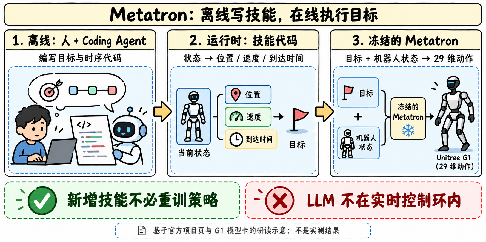
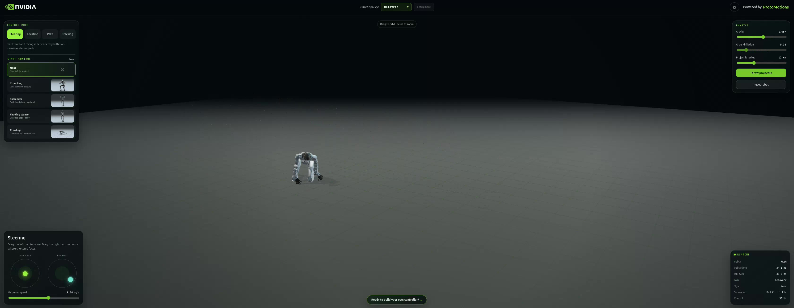

# Metatron v1：把技能写成目标程序，让策略协调全身

> [!tldr] 我的判断
> Metatron 是 Unitree G1 的可提示运动策略。真正值得研究的是**把任务拆成可编程目标接口与冻结的执行器**：Coding Agent 离线改技能代码，运行时由普通代码生成位置、速度、朝向、到达时间等目标，策略补全全身运动。演示不意味着在线 LLM 直接控制关节，也不意味着一个发布包覆盖所有机器人。

> [!warning] 原始资料较少，达不到完整技术报告精读标准
> 已读官方项目页、HF 主卡、G1 原生卡及 README；公开了训练概述、架构和接口，但没有完整 Metatron 技术报告、训练超参/数据切分、任务成功率与安全基准。**因此实验与可复现深度仍达不到 GLM-5.3-Flash 参考标准**。下文把定性实机演示、单次仿真结果与导出一致性检查分别记载。

> [!info] 日期与版本边界
> 本轮新观察到官方仓库。HF 创建时间为 UTC 10/27 21:43，不能用作正式首发日；项目页没有确认首发日，暂以 2026-10 作为归档线索，并列入“日期待核实”。原生 PyTorch、单机器人 ONNX 和六机器人 Racer 是同一策略的不同接口，合为一个专项 family。

## 问题：为什么只给稀疏目标，也能协调全身

低层控制器既要满足脚、手、躯干的局部约束，也要维持平衡与时序。若每个新任务都重新训练策略，迭代成本很高。Metatron 让任务代码只约束重要的目标，未约束的身体部分由生成式控制策略补全。目标包括全局/局部未来姿态、速度、样式和场景几何；“promptable”在这里主要是结构化运动目标，而不是聊天指令直接进电机。

项目页的逻辑分为三步：先用 RL 训练密集动作跟踪专家；冻结专家，通过带目标遮蔽的 on-policy distillation 得到能接受部分目标的策略；之后冻结策略，离线开发目标程序。G1 卡进一步列出运动跟踪、恢复与 SAMP 场景交互专家，学生以专家动作作为监督。不要把“专家用 RL”与“学生是每个任务在线 RL”混为一谈。

## G1 原生模型的已知结构

| 字段 | 官方卡所述 |
|---|---|
| 机器人 / 动作 | Unitree G1，29 个 raw actions |
| 模型族 | MaskedMimic 风格 spherical conditional VAE |
| 潜变量 | 64 维球面 latent |
| prior | 6 层、4 heads、1024 宽 Transformer |
| 数据来源 | BONES、AMASS/LAFAN、fall recovery、SAMP interaction |
| 训练环境 | IsaacLab；不是所有物理引擎都已完整验收 |
| 运行时 | learned prior + conditioned decoder，不需外部专家 |

原生 checkpoint 包含 posterior 与归一化统计，但不含 optimizer state，不能当作可断点续训的完整训练 checkpoint。原生包约 459 MB；两个浏览器图各约 403 MB，这些是文件大小，不能直接换算成参数量或显存。

## 三种运行接口，不能互换

| 发布物 | 保留 / 输入输出 | 必须配套什么 |
|---|---|---|
| G1 原生 PyTorch | 权重、配置、posterior、normalization | ProtoMotions 对应版本及原生 observation / PD 映射 |
| `demo/model.onnx` | 39 输入；集成 observation preprocessing 与动作转换；输出 action、raw_action、PD gains | 单机器人浏览器应用 |
| `racer/network.onnx` | 六机器人批量 network；只输出 action、raw_action | Racer 外部 observation 与控制参数 |

主卡明确 Racer 的变化是图组织和 batching，不是新训练权重。单机器人输入含当前状态、八个历史状态样本、动作历史、masked future goals 与场景上下文。关节顺序、坐标系、四元数约定、历史排列、控制频率与归一化都是模型契约。

## 场景能力的细节尤其容易被误读

G1 权重**保留**场景条件；PyTorch prior 可接受两个 scene boxes，每盒八个三维角点，以及可见性 mask。场景坐标在 root-heading frame。单机器人 39 输入的预导出图也保留了相应预处理。

但随包原生 preset 和通用 re-export **关闭场景输入**：角点为零，visibility mask 为 false。通用导出会得到另一条 observation path，不能据“权重相同”认定它与 scene-capable demo 图相同。原生 preset 会拒绝家具场景文件，避免静默忽略；本包也没有给出完整 SAMP 训练 recipe 或 scene provider。

## 编码 Agent 到底参与了哪一段

项目页说 Claude Code 用动作捕捉片段拟合脚轨迹规则，改善实机步态，评价是定性的；GPT-6 Astra 在人指导下为仿真任务迭代目标代码、时序与动作参考。运行时 C++ 技能代码读取当前状态并输出目标，LLM 不在实时控制环里。

| 官方项目页案例 | 展示结果 | 解读限制 |
|---|---|---|
| 四次跨栏 | 单次连续运行跨过 4 个 20 cm 栏，间距 5 m，无碰栏 | 栏位置由任务代码提供，不能称视觉避障成功率 |
| 跌倒恢复 | 该次运行跌倒后 3.28 s 再次奔跑 | 不是恢复时间分布或实机平均值 |
| 保龄球 | 该次击倒 9/10 球瓶 | 释放时刻由场景代码指定，不是自主抓取规划评测 |
| 网球 | 该次出球 5.37 m/s | 定时落球练习，不是视觉追踪来球 |
| 踢球 | 该次峰值球速 4.82 m/s | 接触物理使球运动；不代表开放环境泛化 |

项目还展示 SOMA / IsaacLab 的另一策略。不能把 SOMA 片段归成这个 G1 包已验证的同一个 checkpoint。

## 评测证据：数值一致性与任务效果分开

六机器人图与单机器人导出在 60 个状态/历史扰动测试上的最大 action 绝对差为 5.55e-6。这证明特定测试集上的导出数值接近；不证明任务成功率、安全性或 sim-to-real 泛化。原生卡的配置加载、有限动作、rollout/reset、归一化一致性、scene sensitivity 也属于集成检查。

本轮未下载权重、未安装运行机器人代码。仍缺训练/验证划分、重复试验、控制延迟分位数、恢复成功率与部署干预率。

## 对 Agent Training 的启发

> [!insight]
> 这是“冻结执行策略 + 可编辑目标程序”的分层方案。可把失败归因拆成目标程序错误、时序/状态估计错误、执行策略失败与物理模型误差，再决定修程序还是重新收集训练数据。若只奖励演示片段成功，编码 Agent 可能利用已知球释放时间、栏位或模拟器辅助；需要独立终态验证和未见状态测试。

建议在固定策略版本、同一物理参数与随机初态下比较人工代码、Agent 代码与无脚目标版本。记录成功率、跌倒/恢复、目标满足误差、任务代码复杂度和人为干预；仿真、实机分别报告。这是研读提出的实验设计，没有宣称已复现。

## 官方来源与导航

- [S1] [HF Model Card](https://huggingface.co/nvidia/Metatron-v1)
- [S2] [G1 Model Card](https://huggingface.co/nvidia/Metatron-v1/blob/main/G1/MODEL_CARD.md)
- [S3] [官方项目页](https://research.nvidia.com/labs/par/projects/metatron/)
- [S4] [ProtoMotions 官方代码](https://github.com/NVlabs/ProtoMotions)
- [[Topics/13_base_model/Base Model MOC|基模主题索引]]
- [[metatron_v1_poster_zh.html|中文Poster]]

> 📊 相关可视化: [[metatron_v1_poster_zh.html|Metatron v1 中文Poster]]
