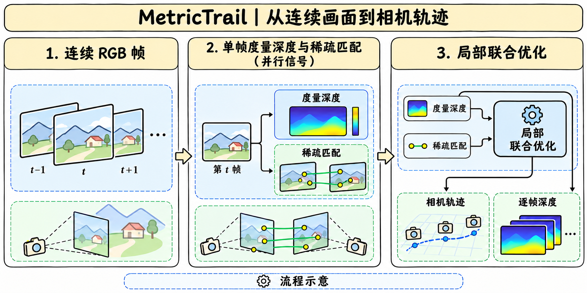

# MetricTrail 1.0

## 版本与输入输出

> [!tldr]
> NVIDIA 于 11 月 5 日在 HF 发布 MetricTrail 1.0。它从连续 RGB 帧估计相机运动与逐帧深度，支持提供内参、从 RGB 估内参，以及经校正的双目输入。

卡片文字仍把适配权重写成计划另发，仓库目录与提交记录已显示 dino_dpvo.pth 上传，LFS SHA-256 与卡片一致。已归档模型卡、配置和目录元数据。3,425,860 是该 checkpoint 的学习参数，冻结的 DINOv3 与外部 MoGe-2 等依赖另计。官方 README 将权重用途限定为非商业研究或评估，源码和上游依赖各有条款。

## 局部几何与学习信号

> [!tldr]
> DPVO 学习跨帧稀疏匹配，MoGe-2 提供度量深度先验，局部束调整在活动窗口联合估计相机位姿和稀疏逆深度。

DINOv3-S/16 保持冻结。384 维特征投影成 64 通道，分成两路 32 通道，分别补充匹配流和循环上下文。零初始化残差分支从原 DPVO 的预测起步。MoGe-2 单帧相机 Z 深度既初始化 patch 深度，也提供可被多视图证据覆盖的软约束。逐帧稠密深度图来自冻结提供器，局部优化处理稀疏 patch。

卡片给出 15,000 步、全局 batch 16、16 张 A100 80GB、约七小时。先用 5,000 个 TartanAir clips 预热融合分支，再对剩余 235,000 clips 联合微调。MoGe-2 未参与适配。

## 结果与协议

> [!tldr]
> 读 ATE 要同时看标定输入、回环与对齐。仅 RGB 标定和给定内参在 KITTI-02 报告的稳态速度相同，启动等待差异很大。

| KITTI 轨迹条件 | 平均 ATE |
|---|---:|
| RGB 标定，无回环 | 14.05 m |
| RGB 标定，有研究回环 | 9.78 m |
| 提供内参，有研究回环 | 7.39 m |
| 标定双目，有研究回环 | 3.00 m |

ATE 是整条序列经一次 Sim(3) 对齐后的 RMSE。稠密重建还使用 ICP，KITTI 视频深度拟合每段的乘性尺度。三个结果衡量的输出与对齐不同。KITTI-02 两种配置均为 12.70 FPS 稳态，首输出分别约 0.7 秒（提供内参）与 175 秒（RGB 标定）。VBR 的回访焦距优化另耗约 7.1 分钟/序列，属于回顾式协议。

## 复现边界

> [!warning] 资料深度
> 原卡披露了训练与量化结果，独立报告和发布版评测脚本尚缺，暂未达到完整报告审计深度。

发布 CLI 保存轨迹和逐帧深度缓存。稠密点云和全局 BA 对应独立研究流程，新增外部回环候选后处理尚无等价验证。低视差、快速转动、滚动快门、动态物体、运动模糊和错误回环适合分组测试。做下游仿真时，可另测未经尺度对齐的误差、丢跟踪率和恢复时间。

- [HF 原始模型卡](https://huggingface.co/nvidia/MetricTrail)
- [HF 文件目录](https://huggingface.co/nvidia/MetricTrail/tree/main)
- [[metrictrail_poster_zh.html|中文 Poster]]
