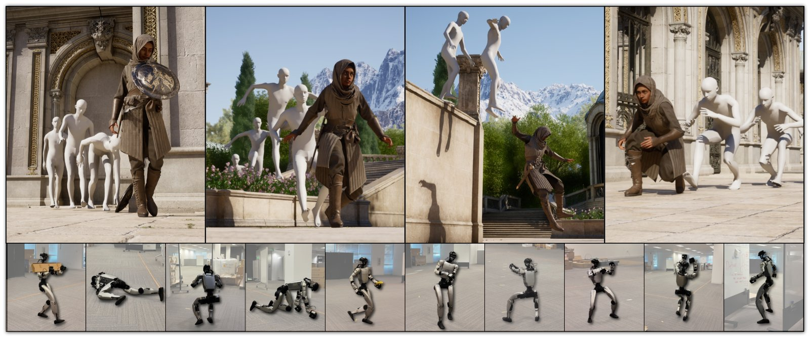
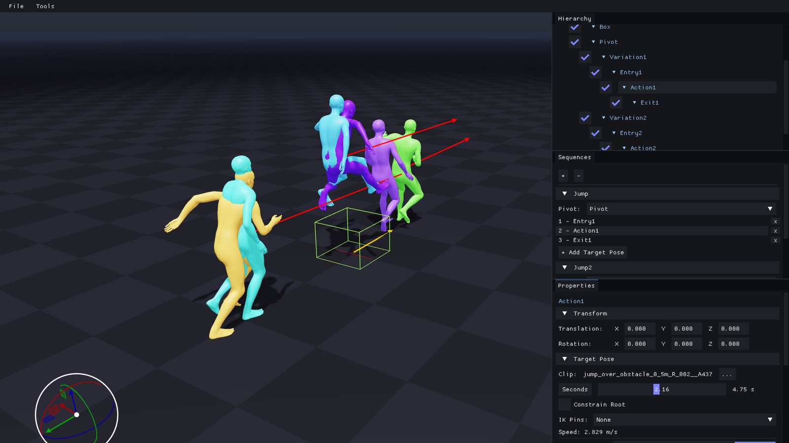

# MotionBricks：神经骨干与 Smart Primitives 如何分工

> [!tldr]
> MotionBricks 将短时运动生成与应用层约束分开：神经网络在最近姿态和目标姿态之间生成过渡，Smart Primitives 把导航、坐下、跳跃等任务组织成目标。SOMA 人体与 G1 机器人是同一方法族的两套骨架，不是两个聊天正代。2026-10-23 是两套 HF checkpoint 包明确写出的发布日期，不能覆盖 4 月论文或旧 G1 权重的历史。

> [!warning] 原始材料不足，未达到完整报告精读深度
> 已读根卡、SOMA/G1 完整子卡、项目页、代码 README 与 ONNX 接口说明，保存两张官方原图。论文链接为 arXiv 2604.24833，本轮未下载 PDF、未取得并精读全篇源码。checkpoint 包未附完整端到端成绩和训练流水线；不能把项目页的 15000 FPS / 2ms 方法级宣传直接当作这些 SafeTensors 在本机的速度。

## 解决的问题：从动作片段库走向连续可组合

传统动作系统需要为场景动作准备动画、过渡和图连接。只训练一个生成器也不够：应用仍须告诉它要接近哪个位置、以什么姿态接触物体、何时结束。MotionBricks 的分工是让模型学习动作连续性，让可编辑的 primitives 描述目标与阶段，避免每个任务重新训练一个网络。[S1–S4]

模型自身没有场景几何输入，也不直接接收文本、图像或视频。演示中角色绕行或与物体互动，来自应用如何放置目标和组合约束；不能据此说网络已经学会读场景、避障或物理控制。

## 发布与 family 口径

| 时间/对象 | 证据 | 处理 |
|---|---|---|
| 2026 年 4 月 | arXiv 2604.24833 方法论文 | family 保留月份，具体最早公开日待核 |
| 旧 G1 预览 | README 指向 GR00T WholeBodyControl | 这轮 SafeTensors 重打包不是新训练正代 |
| 2026-10-23 | SOMA、G1 子卡各自明确 HF release | 合并一条同族 checkpoint 包发布事件 |
| v0.2.0 | 配套软件版本 | 不把代码版本当模型首发日期 |

## 三个学习模块组成一次过渡

| 模块 | 作用 | 可核对的 SOMA 配置 |
|---|---|---|
| Tokenizer / decoder | 将短运动压成离散码，再重建骨骼特征 | 约 23.4M；5 heads × 每 head 16 codes，32 维 code |
| Pose predictor | 在上下文与目标约束下预测运动码 | 约 136.5M；masked transformer |
| Root predictor | 预测根轨迹与时长 | 约 40.4M |

三部分约 200M 是卡中分项近似求和，不含所有应用系统，也不能外推 G1 完全相同。SOMA 输入最近四个上下文姿态和 1–4 个目标姿态；离散 token 覆盖四帧，6–16 tokens 对应 24–64 帧的表示跨度。30Hz 下的原始帧跨度与运行时扣除边界后的播放时长不是同一口径。

根预测器定义了不可达一类，但生成时该类别被禁用。这并不等于有一个可靠拒绝器能保证每个目标物理可行。长动作通过反复把输出反馈为下一次上下文形成；姿态、脚接触和后端数值误差可能随反馈累积。

Smart Primitive 可包含 entry、action、exit、目标位置及时间等约束。图中多种颜色展示控制阶段/姿态，不是多个独立模型。网络负责填中间动作，场景层负责障碍和目标布置。所谓无需逐任务 fine-tune，是这个组合接口的适用范围，不代表任意新骨架、新体型或新物理环境都能直接泛化。

## SOMA 与 G1 的区别

| 维度 | SOMA RP-v1 | G1 RP-v1 |
|---|---|---|
| 表示 | 30 joints 的统一人体骨架 | 34-joint 内部骨架，输出浮动 pelvis + 29 关节角接口 |
| 训练 | RP1 从头训练，三模块 FP32 | RP1 人体动作重定向到 G1，不是直接机器人采集 |
| checkpoint step | 1,500,000 | 2,000,000 |
| 10/23 包 | 新公开 SOMA PyTorch 包 | 复用旧 G1 权重并转换 SafeTensors，无重新训练 |
| 应用边界 | 体型/骨架固定 | 关节顺序、坐标和 hinge 定义必须匹配 |

step 数是训练元数据，不是动作质量分。FP32/混合 FP16 ONNX 也是同一权重的导出形态。动画生成、运动学轨迹、物理 tracking controller 是三个不同层次。

## 数据与评测：包里有什么，缺什么

训练使用 Bones RigPlay 1（RP1）。卡中给出 **313,526 个训练 clips**，**4,881 个验证/训练中评估 clips**，两者不重叠。约 350,000 clips / 700 小时描述源库，不是精选训练子集的时长。文本说明属于元数据，不是此 motion-only 配置的条件输入。

| 证据 | 能支持的结论 | 不能支持的结论 |
|---|---|---|
| clip 不重叠 | 训练/验证片段分开 | performer-disjoint 或完全无泄漏 |
| tokenizer 训练记录 | 记录过重建和 foot-skating 指标 | 完整最终包基准 |
| root validation | 有训练时验证信息 | 所有目标可达/物理安全 |
| pose 训练 loss | 可追溯训练过程 | 有完整独立验证结果 |
| CPU 导出测试 | SafeTensors→ONNX 路径经过测试 | CPU 实时推理性能 |
| 项目 15000 FPS / 2ms | 特定方法级配置的官方报告 | 此包任意平台、任意并发下端到端延迟 |

G1 子卡也没有这套 checkpoint 的完整量化质量表。论文中另训的 benchmark 模型、训练数据规模与当前应用包应分别标记；本轮不抄一个论文分数贴到 G1 上。

## 复现入口和许可不能混用

公开 PyTorch checkpoints 可以作为继续训练的初始化，但包没有 optimizer、scheduler、callback 和训练循环状态，无法准确 resume 原训练。ONNX runtime 另依赖 TensorRT、Warp、Newton；首轮构建的 engine cache 会影响启动耗时，需分别测冷启动与稳态。

模型权重采用 NVIDIA Open Model Agreement；软件 Apache-2.0；BONES 示例动作另有 NVIDIA Sample Data Evaluation License。三种对象的许可边界不同，不能把代码 Apache 标签推广到所有动作数据或模型权重。本轮仅归档和阅读，没有运行源代码、安装依赖或下载权重。

## 对 Agent Training 的判断

> [!insight]
> 这是学习式低层技能与显式高层约束结合的例子。Agent 可以负责选择 primitive 和目标，运动模型负责插值；奖励应分别记录任务是否达成、目标误差、接触/滑步、碰撞和物理跟踪误差，避免只奖励“动画看起来连贯”。

一个有价值的对照是在同一骨架上固定运动骨干，只训练目标选择器，再比较人工 primitives 与学习策略。加入不可达目标和场景障碍，分别测高层是否正确拒绝/重规划，以及低层是否产生违规轨迹；不要将应用已提供的障碍知识算作模型自己的感知能力。

## 一手资料与导航

- [S1] [🤗 HF 根卡](https://huggingface.co/nvidia/MotionBricks)，本地 [[src/hf_model_card|原件]]。
- [S2] [SOMA 子卡](https://huggingface.co/nvidia/MotionBricks/blob/main/soma/README.md)、[G1 子卡](https://huggingface.co/nvidia/MotionBricks/blob/main/g1/README.md)；本地 [[src/soma/README|SOMA]]、[[src/g1/README|G1]]。
- [S3] [官方项目页](https://nvlabs.github.io/motionbricks/)、[官方代码](https://github.com/NVlabs/motionbricks)。
- [S4] [📄 Tech Report](https://arxiv.org/abs/2604.24833)，本轮保留链接、不下载 PDF。
- [[Topics/13_base_model/Base Model MOC|基模主题索引]]；[[motionbricks_poster_zh.html|中文 Poster]]。

> 📊 相关可视化: [[motionbricks_poster_zh.html|MotionBricks 中文 Poster]]
