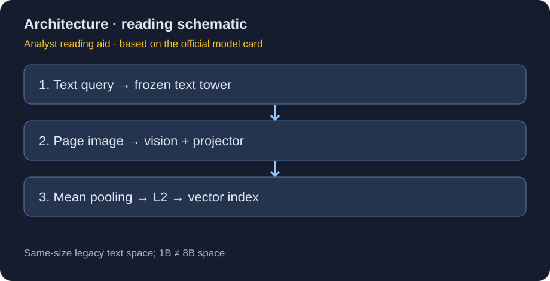
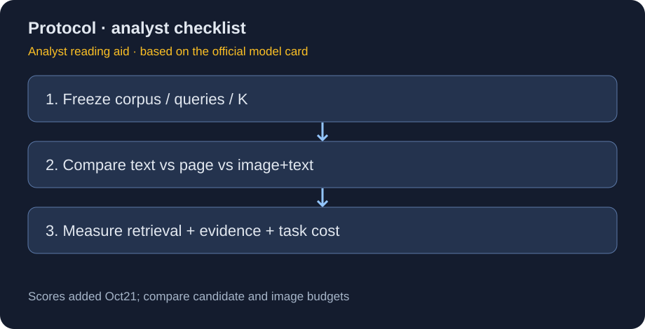
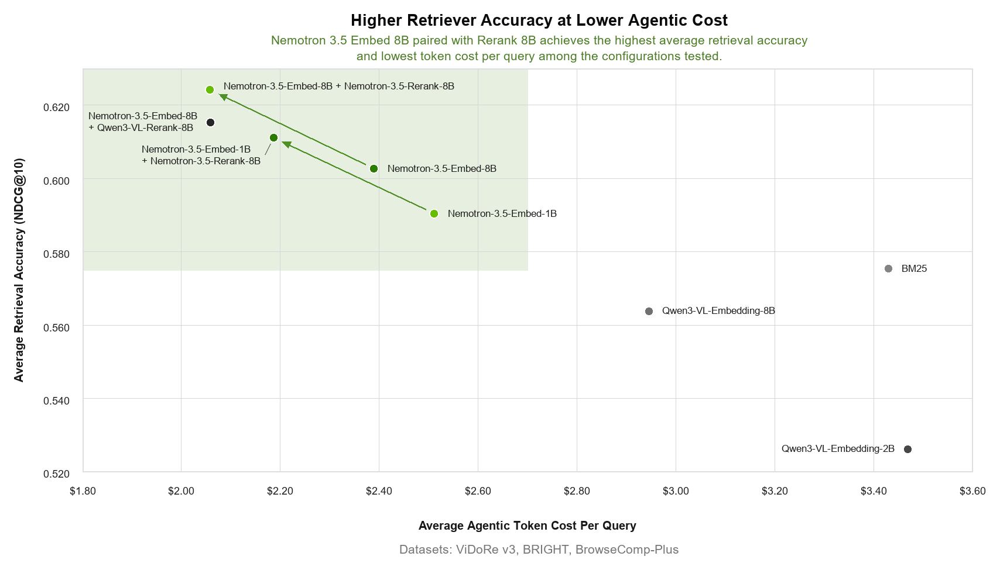

# Nemotron 3.5 Embed：冻结文本空间，补上视觉文档检索

> [!tldr] 我的判断
> 这次的关键不是把所有检索能力重新训练一遍，而是在保留 Nemotron 3 文本 embedding 空间的前提下，把文档页图像接入同一尺寸模型的检索空间。8B 与 1B 是同一 family 的教师 / 蒸馏学生，不拆成两代；两个尺寸之间不因此共享向量空间。

> [!warning] 资料仍不足以复建完整训练与因果消融
> 已补读10月21日官方Tech Blog，新增官方图与训练/系统证据；原先“只有示意图/没有相关结果”的描述不再适用。仍缺本版独立Tech Report、完整训练recipe、预算与关键因果消融，因此达不到完整技术报告精读深度。图1、2是研读重绘，图3为官方原图；本轮不下载权重、PDF或执行推理。

## 版本、来源与日期

官方两张卡均明确写 Hugging Face **2026-10-20** 发布；按这个明确字段收录，不以仓库 lastModified 作为日期。模型卡之前已可读取不等于能把预标日期当作已发生发布；本轮到标注日期后重新核验公开仓库。

| 官方材料 | 用途 |
|---|---|
| [🤗 HF Model Card · 8B](https://huggingface.co/nvidia/Nemotron-3.5-Embed-8B-BF16) | 教师、结构、数据、使用协议 |
| [🤗 HF Model Card · 1B](https://huggingface.co/nvidia/Nemotron-3.5-Embed-1B-BF16) | 学生、冻结语言塔、COS + MSE 蒸馏 |
| `src/hf_model_card.md` 与 `src/Nemotron-3.5-Embed-1B-BF16.md` | 原始 Markdown 离线快照 |

BF16 / NVFP4 是格式变体；模型卡中的旧 Nemotron 3 文本模型是初始化与兼容对象，不是新发布条目。许可证为 OpenMDW-1.1；上游 Ministral 组件另有 Apache-2.0 条款。

## 解决的问题：不要为了读图把旧文本索引全部推倒

企业语料既有可提取文本，也有图表、扫描页、版式表格。只做 OCR 会损失位置与视觉关系；每次查询都让生成式 VLM 扫完整库又太贵。bi-encoder 将文档离线编码、查询在线编码，再用向量相似度召回。3.5 新增的是视觉文档入口，查询仍仅支持文本，不应宣传为任意图搜图。

## 两个尺寸的结构与训练，哪些真的变了

| 项目 | 1B | 8B |
|---|---|---|
| 实际总参数 | 1.55B | 8.38B |
| 文本塔初始化 | Nemotron-3-Embed-1B-BF16 | Nemotron-3-Embed-8B-BF16 |
| 视觉入口初始化 | Ministral-3-3B 的 Pixtral 编码器 | Ministral-3-8B 的视觉编码器 |
| 文本塔 | 蒸馏期间冻结 | 多模态微调期间冻结 |
| 学习部分 | 视觉编码器 + 多模态投影 | 视觉编码器 + 多模态投影 |
| 输出维度 | 2048 | 4096 |
| 原卡披露的文本数据规模 | 8.5M+ | 50M+ |
| 含图像训练样本 | 2.3M | 2.3M |

8B 冻结原文本塔，原卡明确说与对应的 Nemotron 3 8B 文本向量相同。1B 用 8B embedding 教师，结合 cosine distance 与 MSE 蒸馏；语言部分从旧 1B 初始化且冻结，视觉与投影适配。不能把“两个模型分别兼容各自旧空间”误解成 1B 的 2048 维向量可直接与 8B 的 4096 维向量点积。

模型对 token hidden states 做 mean pooling，之后 L2 normalization。原卡也允许截取前 1024 / 512 维后重新归一化，但没有本版本完整的维度–质量曲线。缩短维度节省索引，不等于质量无损。

## 数据如何读，避免重复计算训练量

公开视觉数据包含 ArxivQA、ColPali-PDF、InfoVQA、docmatix-ir、Docmatix、wiki-ss-nq；8B 表中额外列出 TAT-DQA。合成查询 / 问答由 Nemotron、Qwen、Gemma、Pixtral、gpt-oss 等模型生成，种子包括 FinePdfs、CentralActs、BRIGHT、MultiHiertt、Digital Corpora、Vdr-multilingual。

文本 8.5M+ / 50M+ 与原文本模型训练有关；不要简单加上 2.3M 就宣布本次多模态阶段完整去重训练规模。原卡未给每套数据采样比、训练步数、精确 COS/MSE 系数、负例挖掘比例、污染去重表，留白比补造更重要。

## 输入契约与容易踩的实现坑

查询前缀 `query:`；文档前缀 `passage:`。文档可为图、文本或图文组合；上下文上限 **32768 tokens，含视觉 tokens**。图像最长边默认 1120，支持增到 1540；不是任意高分辨率无成本。mean pooling / mask / L2 必须一致。

原卡给 Transformers 5.20.0 与独立的 vLLM 0.32.0 + Transformers 5.19.0 环境。前者提示 5.17–5.19 配合 Flash Attention 2 的图像路径可能出错；不要把两套环境强行合并。这里记录的是原卡固定版本，不是对未来软件兼容性的保证。本轮只读代码，未安装、加载权重或执行模型推理。

## 实验到底披露到了哪里

| 事项 | 可以确认 | 不能推断 |
|---|---|---|
| 文本语言 | 评估涉及 34 种语言 | 34 种性能相同、额外语言已验证 |
| 视觉检索 | 评估涉及 18 种语言 | 所有跨语言查询方向同样有效 |
| ViDoRe V3 | 8 个公开 + 2 个私有集合；指标 NDCG@10 | 本轮补了表；不等于所有系统/语言都领先 |
| MIRACL-VISION | 多语言视觉文档检索，18 语言 | 与文本 MIRACL 分数直接混比 |
| 示例相似度 | 证明 API 格式与维度 | 四个样例不是泛化实验 |

### 10月21日补充：官方新增结果，不是新模型发布

| 模型 | ViDoRe image | text | image+text | MIRACL-VISION image |
|---|---|---|---|---|
| Qwen3-VL-Embedding-2B | 52.89 | 48.31 | 51.97 | 58.42 |
| Nemotron3.5 Embed1B | 58.02 | 57.80 | 58.82 | 68.93 |
| Qwen3-VL-Embedding-8B | 58.29 | 53.69 | 57.03 | 68.33 |
| Nemotron3.5 Embed8B | 60.39 | 60.65 | 61.47 | 72.64 |

均为官方NDCG@10口径，非本地重跑。Nemotron使用默认最长边1120像素，Qwen使用max_pixels1843200；不是相同像素预算的严格控制实验。表内8B更高但没有延迟/成本曲线，不能据此宣称更高成本效率。卡片同时调整Sentence Transformers6.1.0示例与FlashAttention安装路径；这些是文档/集成更新，不改2026-10-20首发日，不新增叶子。

## 10月21日官方Tech Blog：检索质量、Agent成本和领域微调

[📰 NVIDIA官方Tech Blog](https://huggingface.co/blog/nvidia/nemotron-retriever-world-class-agentic-retrieval)在10月21日发布，不改变模型10月20日首发。原网页与正文已保存为`src/retriever_tech_blog.html`和`.txt`。

*图3｜NVIDIA原图，非本文重绘或复测。横轴是按Agent token计费折算的美元成本，不是纯token数，也不含全部系统基础设施成本。*

博客固定LLM、工具、任务、语料和执行策略，仅改变检索组件。ViDoRe V3采用图文输入，BRIGHT/BrowseComp-Plus采用文本；统计所有轮次的输入、输出token。加入Rerank后8B/1B组合的agentic token cost分别约降14%/13%。这是指定工作流下的质量–成本关系，不是任意Agent任务完成率保证。

博客另外报告**ViDoRe v3.1**的8B/1B为61.17/58.38，后者保留约95.4%得分。它与前面模型卡V3图文61.47/58.82不是同一个表，不能覆盖旧值或伪造模型退步。

NVFP4同时量化视觉与文本encoder；在GB200上documents/s从101.3到128.8，约+27.1%，该ViDoRe V3图文评测保留99.85%准确率。这不是所有数据集无损保证。另一个RTX PRO6000 Blackwell Server Edition运行中，NIM query吞吐6031 QPS，vLLM2099，约2.9倍；passage表现接近，不能写成完整Agent加速2.9倍。

领域微调示例从8202张领域图片生成8591条查询（Qwen3.8 Flash Next教师），6872条训练一轮、1719条留出。1B的nDCG@10由37.34到44.12（约18%相对提升），8B从41.44到42.75（约3%）。这是合成查询留出，未证明按源图片分组隔离，更不等于独立真实用户测试。训练时语言部分冻结；最终发布权重还做checkpoint ensembling，但选择规则、权重与步数未充分披露。

对研究更有用的实验是同时固定查询、源图片分组和教师版本，比较蒸馏学生的微调收益、索引漂移与真实查询泛化；不能只报告同教师合成分布上的最好提升。

## 我的研究判断与可执行实验

> [!insight] 对 Agent Training 的启发
> 把检索器当成策略系统中可控的观察通道。冻结文本塔提供了一种减少历史索引漂移的设计，但视觉入口变了仍会改变候选分布；训练 Agent 时应记录每步文档版本、召回集合与最终引用，防止把更好的检索误归因于策略 RL。

建议同一语料设置 text-only / page-image / image+text 三路；固定查询、K、chunk、图像分辨率与 reranker。分别报告 NDCG@10、证据召回率、最终答案引用正确率、延迟与每成功任务成本。测旧索引兼容时固定同一尺寸、模板、pooling、截断与归一化，不只比较维度。

向量正确不等于事实正确；恶意网页内容也可能被召回，相关性模型不是可信来源判定器。私有数据、版权、访问控制应在索引层执行，不能指望 embedding 自动匿名化。

## 关联与交付

- [[Topics/13_base_model/NVIDIA_Nemotron/Variants/261020_Nemotron_3_5_Rerank/Nemotron-3.5-Rerank|Nemotron 3.5 Rerank]]：召回后的 query–document 联合排序。
- [[Topics/13_base_model/NVIDIA_Nemotron/Variants/261017_Nemotron_3_5_Parse/Nemotron-3.5-Parse|Nemotron 3.5 Parse]]：页面解析与视觉检索不是同一任务。
- 📊 中文 Poster：[[nemotron_3_5_embed_poster_zh.html]]。
