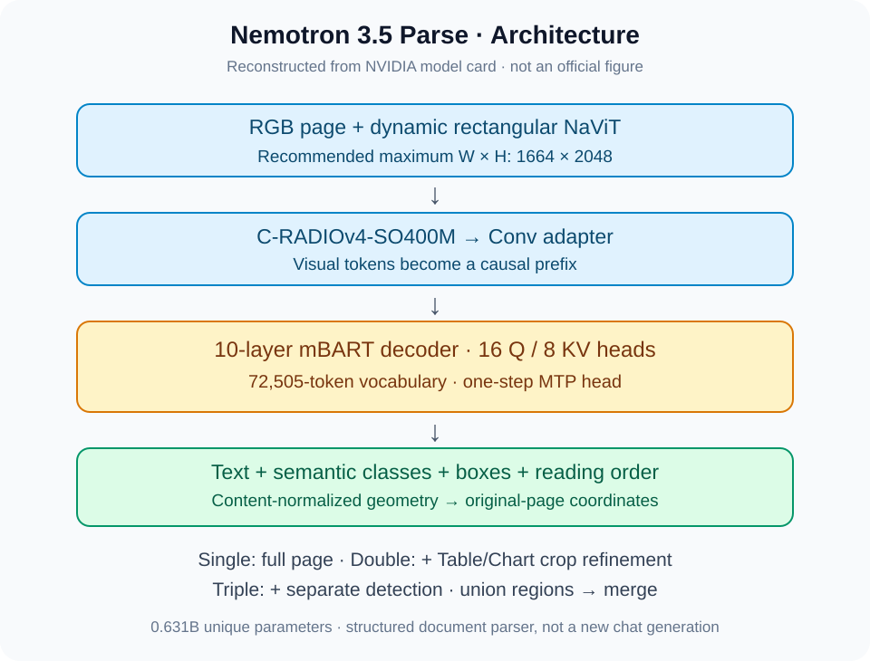
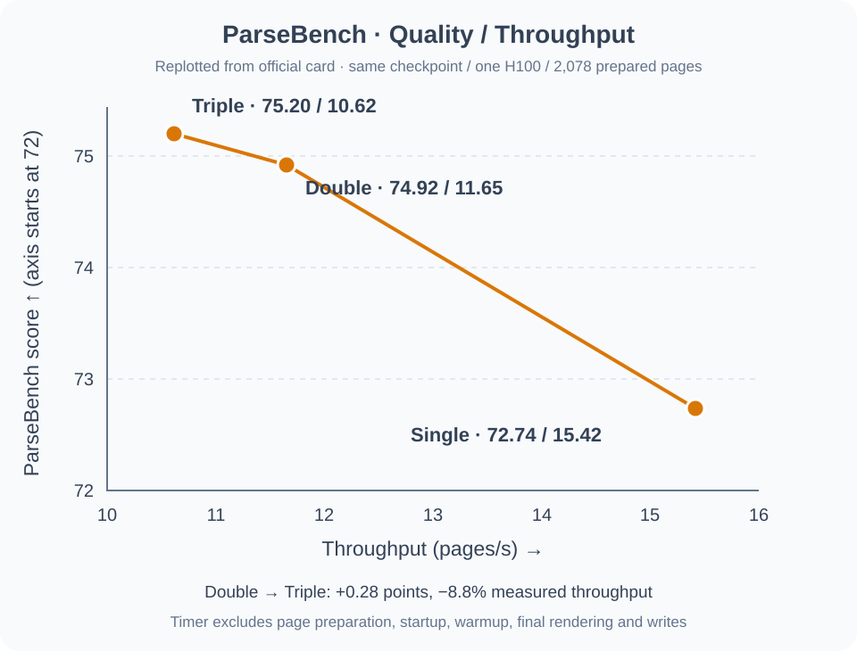

# Nemotron 3.5 Parse：不只是读出文字，还要保留可用结构

> [!tldr] 我的判断
> 真正值得关注的是小型专用 parser 与多遍裁切、合并和可追溯评测组成的系统，而不是把 75.20 当成裸模型单次推理成绩。0.631B 模型在官方 2,078 页 ParseBench 上，单遍 72.74 / 15.42 pages/s，双遍 74.92 / 11.65，三遍 75.20 / 10.62；双遍拿到了大部分增益。适合作为文档训练数据构建的前端，不能据此推导通用推理或 Agent 能力。

> [!warning] 原始资料与分析深度
> 本笔记亲自阅读官方模型卡、架构/processor 源码片段、ParseBench 比较与复现说明、多语言评测协议、后处理与安全说明。**已读材料没有给出独立的 Parse 3.5 Tech Report 链接、完整训练 recipe、逐数据源配比、训练预算或关键组件因果消融；因为这部分原始资料较少，训练机制分析达不到完整技术报告精读的深度。** 不拿其他 Nemotron 3.5 报告冒充本模型报告。原卡没有配图，两张图由本文根据官方规格和数字重新绘制，均非官方原图；本次没有下载权重、PDF，也没有本地复测。

## 日期与谱系：10 月 17 日，而非发现日或建仓日

官方 README 的 `Release Date` 和 `Model Version(s)` 均明确写 **2026-10-17**。本次在 10 月 18 日观察到它出现在官方公开 inventory，但 API 给出的仓库 `createdAt` 是 9 月 3 日；这恰好说明建仓时间不能代替首发时间。

它属于 NVIDIA 的 **Document / OCR 专项支线**。不要因为名称含“3.5”就把它当成 Super、Bolt 或 Lightning 的尺寸 SKU，也不要把 single/double/triple 三种推理流程拆成三个模型。三者使用同一 checkpoint。

## 输出为什么必须超过普通 OCR

下游 RAG、表格分析与训练数据构建需要同时保存文字、语义类型、位置和阅读顺序。只识别字符会把跨栏顺序、合并表头、图表标题和单元格关系压平；而流畅 Markdown 也可能静默丢掉空单元格或合并结构。

模型输出的是携带控制标记的序列：文本、语义类别、content-normalized boxes、reading order；后处理再转为 Markdown、HTML、JSON 或 CSV。**后处理后的文档不是未经修改的原始模型预测**，两者必须分别留存，才能区分识别错误与转换错误。

*图 1｜本文重绘，非官方原图。来源：官方模型卡 Model Architecture、Input/Output，以及复现协议；不表示所有组件都有独立消融验证。*

## 架构：视觉前缀 + 小型因果解码器

| 部件 | 官方披露 | 阅读时的边界 |
|---|---|---|
| 视觉编码器 | C-RADIOv4-SO400M，`vit_so400m_patch16_224` | 不是 Qwen / Nemotron 通用聊天骨干 |
| 图像处理 | 动态矩形 NaViT；建议最大宽高 1664×2048 | 建议输入规格不等于任意分辨率质量保证 |
| Adapter | 卷积与归一化压缩视觉 latent；源码含 1D 投影和 2D 空间压缩 | 未给独立精度—压缩比消融 |
| Decoder | 10 层 mBART，视觉序列作为 causal prefix | 不宜笼统理解为标准 encoder-decoder cross-attention |
| Self-attention | 16 query heads / 8 KV heads 的 GQA | 头数不是吞吐提升的独立因果证据 |
| Tokenizer | 72,505 项；embedding padding 至 72,512 | 含 bbox、class、text-in-picture、Chart 等控制 token |
| 参数 | 630,800,496 个唯一可训练参数，约 0.631B | 包含 MTP head；共享 embedding/output 权重只计一次 |
| 辅助头 | 一步 MTP；vLLM 插件用于单 token speculative decoding | Transformers 正常生成不自动享有相同加速 |

理解上的关键：视觉信息先成为解码前缀，之后按统一输出序列产生结构化内容。内容坐标需要根据实际评估图像的宽高恢复到原图像素；不同版本的 bbox 坐标规则不能混用。多语言协议特别注明 Parse 2.0 用其专用回映射，3.5 用 content-normalized scaling。

默认任务 prompt 组合 `predict_bbox`、`predict_classes`、`output_markdown`、`predict_text_in_pic`。必须保留 special tokens；先用 `skip_special_tokens=True` 清理再解析，会丢失结构协议。离线 vLLM 入口还包含图像占位符，不能随意照搬另一条服务调用链的 prompt。

## 推理：不是三代模型，而是三个预算点

| 流程 | 实际做什么 | 质量 / 吞吐 |
|---|---|---|
| Single pass | 整页解析一次 | 72.74 / 15.42 pages/s |
| Double pass | 整页预测后，对 Table / Chart 框裁切精读并合并 | 74.92 / 11.65 |
| Triple pass | 另做检测，精读 detector 与 parser 区域的 union | 75.20 / 10.62 |

双遍比单遍 +2.18 分，吞吐下降约 24.4%；三遍再比双遍 +0.28 分，吞吐下降约 8.8%。这是根据原表计算的观察，不是统计显著性检验。是否值得三遍，应看真实文档错误代价，而不是只追最高 headline。

*图 2｜本文按官方表重绘；质量轴从 72 起，有意明确非零起点，不按折线坡度推断提升倍数。相同 H100 和 2,078 个预处理页，非整条业务链延迟。*

复现包对 union 有明确规则：优先 detector 框；以 IoU 0.85 去近重复，新增同类框与原框 IoU 0.5 时抑制，最多 80 个区域。裁切加 4% +12 pixels 边缘，JPEG quality 95。这里新增区域会增加请求，不是“免费 refinement”。全页与检测可以并发，但裁切依赖检测输出；计时不能把并发调用时长简单相加。

## 后处理：必须纳入模型系统的版本管理

官方 helpers 保留 reading order、table spans、空单元格和单元格内换行。HTML 与 hierarchical JSON 能保留合并结构，flat Markdown / CSV / record JSON 会压平 spans。选择输出格式本身就会影响下游监督信号。

已有启发式包括重复元素移除、已有列表项目规范化、文本角色里的 discretionary soft hyphen 清理，以及空序列前缀修复；代码与数学内容被保护。表头从预测 spans 与已有 bold 推断，并非强行套英文表头词典。图表中的成对数值可以拆成 Value / Percent 列，但协议明确不能计算或发明新的值、坐标轴与图例。

**保留 full-page / crop 的不同候选是该流程的一部分**，官方计分也包含这些 alternatives。对训练数据而言，这可能提升召回，但也可能把相互冲突的内容同时喂给下游；需要专门测重复、冲突与引用可定位性，不能只检查最终文本是否“看起来很全”。

## 结果：完整主比较与准确的计时口径

下面均为官方发布，不是本次复测。比较模型 accuracy 来自固定 revision 的公开 leaderboard 或发布卡；其原始协议、scorer 可能与 NVIDIA 自己的复现不同。**同页同卡的吞吐测量，不自动使跨模型 accuracy 成为完全相同协议的公平对照。**

| 模型 / 流程 | Published ParseBench ↑ | 同页实测 pages/s ↑ |
|---|---:|---:|
| Nemotron 3.5 Parse · triple | 75.20 | 10.62 |
| LightOnOCR-3-4B | 75.10 | 2.76 |
| Nemotron 3.5 Parse · double | 74.92 | 11.65 |
| LightOnOCR-3-0.8B | 74.60 | 5.69 |
| Infinity-Parser2-Flash | 73.25 | 3.06 |
| MinerU2.5-Pro-2605-1.2B | 72.78 | 4.13 |
| Nemotron 3.5 Parse · single | 72.74 | 15.42 |
| KDL-Frontier-Parser-nano | 72.38 | 2.98 |
| LightOnOCR-3-1B | 71.40 | 2.44 |
| Chandra-ocr-2 | 70.10 | 2.01 |
| PaddleOCR-VL-1.6 | 67.43 | 3.11 |
| PaddleOCR-VL-1.5 | 65.95 | 3.40 |
| Nemotron Parse 2.0 | 63.91 | 3.95 |

三遍相对 LightOnOCR-3-4B accuracy 仅 +0.10，未公开置信区间，不应称显著胜出。速度比约 3.85× 仅适用此 prepared-page serving profile，不可写成所有硬件、所有 PDF 的端到端加速。

三遍五项 headline：Tables 84.67，Charts 64.40，Content Faithfulness 87.96，Semantic Formatting 68.28，Visual Grounding 70.67；均值 75.20。图表和格式仍弱于文字保真，说明高均分不能替代结构验收。

官方计时从首个模型调用到最终响应，包含 queue、传输和依赖裁切准备/派发，**排除**初始页面准备、服务启动、warmup、最终文档渲染和写盘。每模型一张 H100，全部 2,078 页包括达到 token limit 的输出；空成功响应也保留为空预测，不偷偷删掉。官方给的是已测 serving profile，不是最大硬件吞吐。

复现 README 另报 72.72 /74.88 /75.14 /75.20（single/double/triple/union），与新 general helpers 的 72.74 /74.92 /75.20 不完全一致。**不同运行与 renderer 的结果不要拼成一套**；本页速度—质量图严格使用模型卡 matched-run 三行，复现说明另作来源追踪。

## 10 月 18 日回归资料更新：不是新 checkpoint，也不是推理进步

10 月 19 日巡检发现官方模型卡新增 quick20/full500 引用。已继续阅读并归档 [官方回归说明](https://huggingface.co/nvidia/Nemotron-3.5-Parse/blob/main/reference/parse_3_5/README.md)、`validation.json`、`expected_results.json` 和文件哈希清单。官方明确：这是 **10 月 18 日的评测参考刷新，不是新模型首发**，不为它另建叶子或发布事件。

Full500 使用 OmniDocBench v1.5 的固定 500 页子集，其中 250 页表格、250 页图片/图示；quick20 为 20 页。`layout_lite` 回归工具不等于官方 OmniDocBench TEDS 或 ParseBench，不能把下表与前面的 2,078 页成绩混排。

| Full500 指标 | 历史 raw parsing | Released table parsing |
|---|---:|---:|
| Overall | 70.17% | 74.49% |
| Table quality | 70.41% | 83.38% |
| Layout class F1 @ IoU 0.50 | 66.10% | 66.10% |
| Table recall @ IoU 0.50 | 93.36% | 93.36% |
| Picture recall @ IoU 0.50 | 74.01% | 74.01% |

**两列使用同一批 raw predictions**。Version 3 只将预测的 Table bodies 通过已发布 HTML 后处理器转换后，再使用原有指标公式；框、类别、ground truth 与其他 block 文本不变。74.49 − 70.17 = +4.32 个百分点是解析兼容性修正后的计分差，不能说模型推理能力提高 4.32 分。Table quality 平均字符袋 F1、单元格袋 F1、网格形状相似度；Overall 平均 class F1、table quality、picture recall，也不是标准 TEDS。

官方记录 500/500 页无请求失败，**19 页达到 token cap、2 个 malformed Table bodies 仍计分**；quick20 有 1 页达到 cap。单 H100 80GB、BF16、单 token MTP、并发 128、16 次 warmup 与预加载图片时，请求阶段 55.35890 秒、9.03197 pages/s；排除启动、预加载、warmup、转换和计分，不与前表混称端到端速度。

记录的模型 revision 为 `dca5b2df89d00a671509204501d8f1f379d5e94f`，package 为 `3.5.0.post7`；应按各自 reference 文件固定版本，不能把另一套 ParseBench revision 自动移植过来。对照允许绝对误差 0.02，不要求不同 GPU batch schedule 逐字节一致。实际环境 Pillow 12.3.0 偏离源包的 12.2.0 pin，官方明确这不是完全干净的 dependency-lock 复现。本次仅归档与解读，没有安装包或运行推理。

## 多语言：真实页与简单合成页分开读

IndicVisionBench 是 876 个测试页、10 种语言；ANLS-char 平均页，CER 按总体字符聚合，插入错误可使 CER 超过 100%。

| 语言 | 页数 | 2.0 ANLS ↑ | 3.5 ANLS ↑ | 2.0 CER ↓ | 3.5 CER ↓ |
|---|---:|---:|---:|---:|---:|
| Overall | 876 | 72.12 | 83.73 | 52.67 | 16.00 |
| Bengali | 89 | 55.47 | 90.25 | 68.92 | 7.69 |
| Gujarati | 90 | 40.70 | 66.96 | 127.53 | 34.08 |
| Hindi | 85 | 85.03 | 88.34 | 16.32 | 9.36 |
| Kannada | 89 | 87.54 | 91.37 | 19.25 | 7.33 |
| Malayalam | 88 | 48.89 | 63.15 | 75.55 | 42.47 |
| Marathi | 83 | 92.95 | 93.19 | 6.50 | 6.01 |
| Odia | 86 | 67.77 | 73.61 | 71.46 | 24.61 |
| Punjabi | 89 | 83.25 | 91.95 | 66.57 | 7.30 |
| Tamil | 88 | 81.77 | 91.24 | 42.05 | 7.41 |
| Telugu | 89 | 79.86 | 87.75 | 43.57 | 10.53 |

Malayalam 63.15、Gujarati 66.96 仍明显低于总体，不能把平均提升泛化成每语种可靠。MOSCAR 的 8,111 页是**简单合成渲染**：163 language/script entries、162 个不同语言码（简繁中文单列）、26 个 script groups。3.5 character-bag F1 为 99.51（2.0 为 97.44），总体 CER 1.35（2.0 为 11.55）。字符袋 F1 不管顺序，即使字符集合吻合也可能阅读顺序错；这不是“163 种语言复杂扫描件达到 99.51% 准确率”。

两版使用相同页与 scorer、greedy decoding、最大 8,744 tokens；各用默认任务 prompt，同时另存 shared-prompt 对照。模型各自 preprocessing 保留，多语言 OCR 不应用 ParseBench 多遍合并。全部 163 条逐语言结果见本地原始 `src/reference/multilingual/moscar_by_language.md`，未替用户虚构复杂扫描、手写、低清或真实财务报表的表现。

## 可复现的程度，以及还缺什么

复现协议固定模型 revision `e5e0406c85ec241b164907bf41ebd648a54e4ea2`、数据 revision `2805a1d940f95a203e0ae4b88be9934f7765b3fc`、scorer `9af4102e26b51f234ab5f037e19fec05c0696ec6`。数据准备对每个源文档只渲染**第一页**，150 DPI、RGB、JPEG92；源文件有其他页不意味着这些页也进入 2,078 页结果。

复现包的五类有限值计数为 Tables503 /Charts568 /Content506 /Formatting456 /Grounding500；Formatting 共476案例、456适用有限值。这些不是互斥分区，不能相加称唯一样本量。协议核验了 241 个 upstream Python 源文件哈希；这些是官方复现证据，不等于我已经运行复现。

训练说明只给“1M–1B images”“1B–10T tokens”等宽区间，以及数字文档、科学论文、表格与合成材料、自动/人工标注混合。**不能据区间上界推测真实训练量**，也不能声称可完整复训。NaViT、GQA、tokenizer 与 MTP 各自增益、精确训练拆分与泄漏审计并未在已读材料充分披露。

部署示例包含 `trust_remote_code=True`。本次只归档阅读，不执行下载的代码、不安装模型服务。真正部署前应 pin revision、review 自定义代码、隔离服务并核验所有依赖许可；OpenMDW1.1、tokenizer MIT 及 benchmark/组件许可分别处理，不能因为“可商用”就把所有材料视为同一许可证。

## 对数据构建与 Agent Training 的启发

> [!insight] 先保证监督信号没有在解析阶段变形
> 解析器不是“无损数据搬运工”。RAG、工具轨迹与 Agent 文档任务若依赖表格和图表，必须保存原页、bbox、raw sequence、后处理结果及对应版本；把 parser 的错误传播与下游模型推理错误分开。三遍推理花更多预算获得的增益，也提醒我们比较训练数据管道时不能只固定模型参数，不固定 preprocessing 与 inference budget。

建议优先四项对照：相同预算下 single/double/triple；HTML/层次JSON 对 flatCSV 的结构保真；full-page/crop 冲突保留策略；困难语种、扫描噪声、长表与跨页布局分层。测量字段/数值保真、阅读顺序、可定位 citation、下游答案、token-limit率以及每成功文档全链成本。每页都经过预处理不代表全链时间已计入。

页面可能包含个人、医疗或商业机密，解析器会把可见信息更易检索地输出；应做权限隔离、数据最小化与删除验证。文档中的恶意指令也只能当内容，不可因为抽取成“工具上下文”而获得执行权限。

## 一手材料与相关笔记

- [🤗 HF Model Card](https://huggingface.co/nvidia/Nemotron-3.5-Parse)；本地 `src/hf_model_card.md`。
- [官方 ParseBench 对照说明](https://huggingface.co/nvidia/Nemotron-3.5-Parse/blob/main/reference/parsebench/comparisons/README.md)；本地同相对路径，完整原表与来源。
- [官方复现说明](https://huggingface.co/nvidia/Nemotron-3.5-Parse/blob/main/reference/parsebench/pipeline/README.md)；不等同训练技术报告。
- [官方多语言结果](https://huggingface.co/nvidia/Nemotron-3.5-Parse/blob/main/reference/multilingual/README.md)；163条原始结果已归档。
- [[Topics/13_base_model/NVIDIA_Nemotron/261015_Nemotron_3_5_Super_Bolt/Nemotron-3.5-Super-Bolt|Nemotron 3.5 Super / Bolt]]：通用模型 family，与本 parser 分线阅读。

> 📊 相关可视化：[[Topics/13_base_model/NVIDIA_Nemotron/Variants/261017_Nemotron_3_5_Parse/nemotron_3_5_parse_poster_zh.html|Nemotron 3.5 Parse 中文 Poster]]
