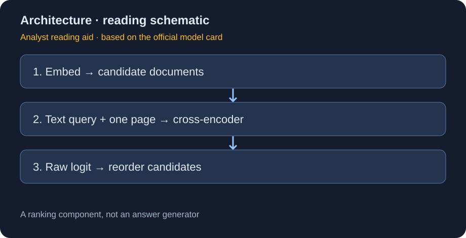
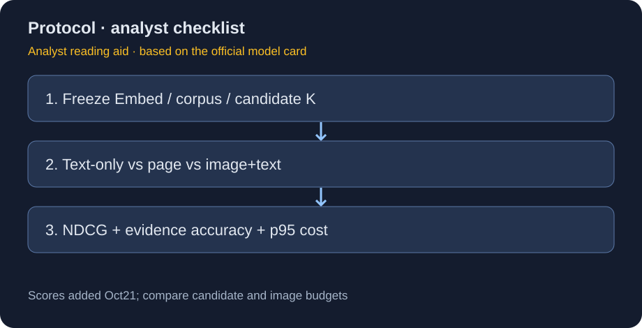

# Nemotron 3.5 Rerank：视觉 RAG 的联合相关性判断

> [!tldr] 我的判断
> Embed 负责可预计算的粗召回，Rerank 将文本查询与一份图文文档联合编码再输出相关性 logit。它是不同计算位置上的专项模型，不是 Embed 的更大尺寸，也不是负责回答问题的聊天模型。核心代价是对每个候选重新计算，因此应与候选数量、页面分辨率和端到端收益一起看。

> [!warning] 原始资料不足，未达到完整报告级实验剖析
> 已读完整官方 Model Card，包含两阶段训练、2.3M 图像样本与集成细节，但没有本版本独立 Tech Report、官方结构图、具体 NDCG@10 分数、延迟对照或消融。因此无法达到 GLM-5.3-Flash 完整结果分析深度。两张插图是依据原卡制作的研读示意，不冒充官方实验图；不把示例 logit 当 benchmark。

## 版本与一手来源

[🤗 HF Model Card](https://huggingface.co/nvidia/Nemotron-3.5-Rerank-8B-BF16) 明确列 Hugging Face **2026-10-20** 发布；本地原文 `src/hf_model_card.md` 保留。按原卡明确日期，不用仓库修改时间代替首发。OpenMDW-1.1 适用本模型，上游 Ministral-3-8B 使用 Apache-2.0。

## 问题：相关页面，不等于有最高文本相似度

表格与图表中的答案可能并不出现在 OCR 的连续片段里。向量召回必须把整个库压成可索引表示，会牺牲细粒度 query–page 交互。cross-encoder 在较小候选集里联合读取 query 与 document，弥补粗召回的表达压缩；但无法找回第一阶段完全漏掉的文档。

## 结构与训练：不要套用 Embed 的冻结结论

总参数 **8.38B**，Pixtral-based vision encoder + **bidirectional Ministral3** language tower。原卡说明两阶段：先基于 Ministral-3-8B-Instruct-2512-BF16 训练文本 reranker，再从这个 checkpoint 训练图像 / 图文联合数据。它没有说整个 Rerank 文本塔在第二阶段一定与 Embed 一样冻结，不能照抄另一个模型的机制。

输入是一对“文本 query + 一份 document”；document 是文本、页图或二者组合。输出每对一个 **raw relevance logit**，越大表示预测越相关，不是回答文本、概率或置信度校准值。原卡示例第一名约 −1.8，负数不意味着模型失败；排序只看同一查询内相对值。不同查询的 raw logit 不应拿来当统一拒答阈值。

| 数据项 | 官方披露 | 解读边界 |
|---|---|---|
| 文本样本 | 21M | 未给全部混合比、步数、去重统计 |
| 含图样本 | 2.3M | 可含配套文本，不是额外 2.3M 独立文档的保证 |
| 公开视觉来源 | ArxivQA、ColPali-PDF、InfoVQA、TAT-DQA、docmatix-ir、Docmatix、wiki-ss-nq | 数据列表不能替代训练 recipe |
| 合成来源 | Nemotron、Qwen、Gemma、Pixtral、gpt-oss 等生成 query / QA | 未证明所有合成标签准确、无偏 |
| 文本 / 视觉语言评估 | 34 / 18 种 | 不保证各语言效果一致 |

## 推理协议：最容易把“能跑”误判成“正确”的部分

上下文 **32768 tokens，图文合计**。图像最长边默认1120，可到1540；不能只按文本 token 计算预算。使用 checkpoint chat template 的 `query`、`document` role，图像 placeholder 与像素输入必须对应。多模态 vLLM 原卡推荐结构化消息走 **`/classify`**；`/score`、`/rerank` 渲染路径可能处理错图像占位符。

设置 `use_activation=False` 时，即使 API 字段叫 `probs[0]`，内容仍是 raw logit，不是概率。`add_special_tokens=False` 避免在模板之外重复插入特殊 token；官方示例限制每文档一张图。超长内容应明示裁切 / 降分辨率，不能悄悄丢掉答案再责怪模型。

Transformers 示例用5.20.0，vLLM示例用0.32.0搭配5.19.0独立环境；原卡提示部分旧 Transformers + Flash Attention 2 图像路径错误。`trust_remote_code=True` 的示例只是原文，本次没有执行远程代码或下载权重。

## 实验、限制和我的验收设计

官方列 ViDoRe V3（8公开+2私有集合）与 MIRACL-VISION（18语言），指标 NDCG@10；**本次卡没有结果数字**。不虚构与 ColPali / Qwen 等系统的胜负，不把“world-class”宣传语转成实测结论。原卡没有独立 test 描述，而指向这些评估基准，不应写成没有做评估，也不应编造测试集规模。

建议固定同一个 Embed、候选K与语料版本，只替换 Rerank；比较不重排 / 文本重排 / 页图重排 / 图文重排。报告 NDCG@10、证据进入最终上下文的比例、引用正确率、p50/p95延迟和每成功任务成本。候选K增大通常也增算力，应画成本–质量曲线，而不是只选最高分。

> [!insight] 对 Agent Training 的启发
> 重排分数适合帮助观察选择，不应直接当事实正确的 RL reward。高相关页面仍可能错误或带提示注入；把检索选择、引用证据和最终任务验证分层保存，才能区分“找到信息”和“正确使用信息”。

## 关联与交付

- [[Topics/13_base_model/NVIDIA_Nemotron/Variants/261020_Nemotron_3_5_Embed/Nemotron-3.5-Embed|Nemotron 3.5 Embed]]：bi-encoder 的预计算召回。
- [[Topics/13_base_model/NVIDIA_Nemotron/Variants/261017_Nemotron_3_5_Parse/Nemotron-3.5-Parse|Nemotron 3.5 Parse]]：结构化文档解析，输出契约不同。
- 📊 中文 Poster：[[nemotron_3_5_rerank_poster_zh.html]]。
