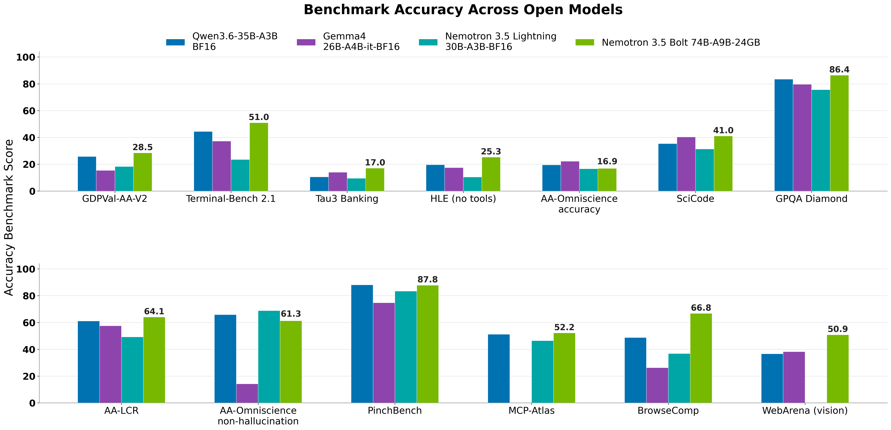
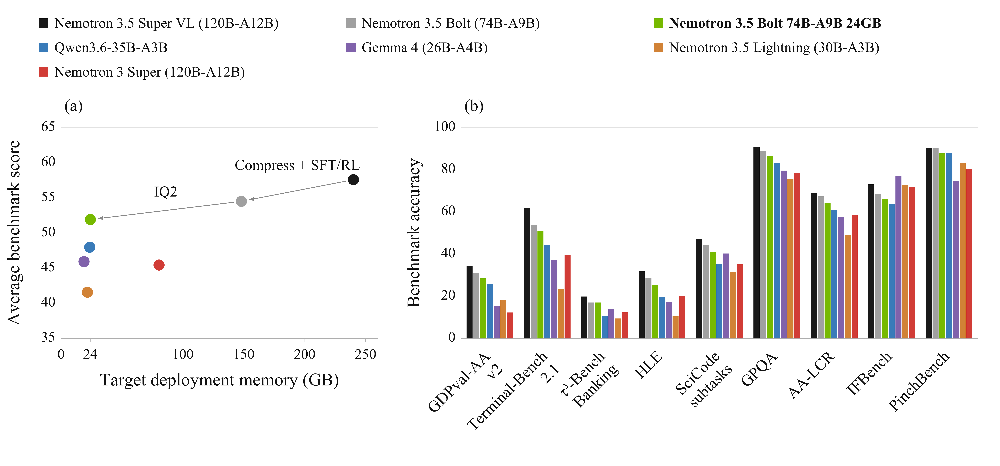
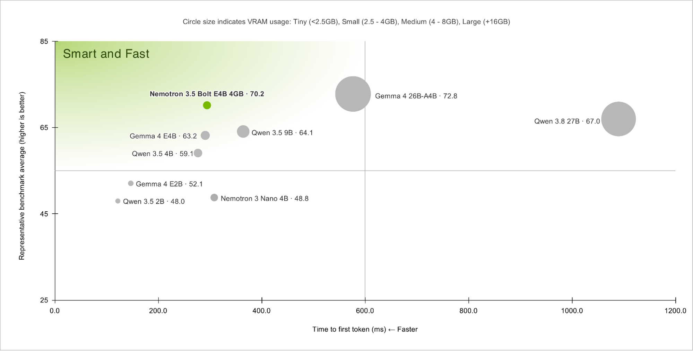
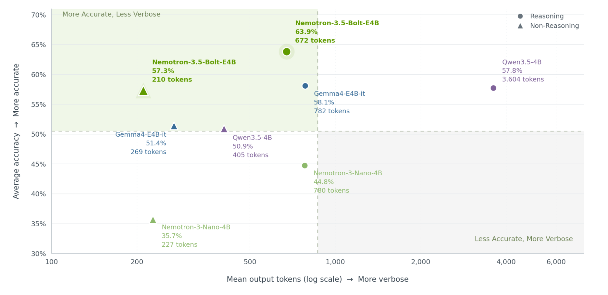

# Nemotron 3.5 Super VL / Bolt

> [!tldr] 核心判断
> 本次发布同时给出大容量父模型与围绕本地显存预算压缩的派生模型。Super VL 的语言—视觉联合后训练、Bolt 的结构压缩—能力恢复—混合量化，是一条链，不是 BF16、NVFP4、GGUF、Base、drafter 各自成为新正代。Atlas 以一个 3.5 family 发布阶段展示；不把既有 Lightning 历史节点擅自删除或重命名。

> [!warning] 证据边界
> 已读取并归档 Super BF16 / NVFP4 / Base、Bolt BF16 / 24GB / GGUF / LiLiCorr 模型卡，以及 Bolt 官方博客和官方图。两份 Tech Report 已找到并列出链接，按当前约定不下载 PDF；报告全文与消融尚未完成精读，因此还达不到 GLM / Kimi 完整报告级细节。以下是卡与博客级深入研读，不冒充报告全文结论。本次没有运行权重。

## 同一发布阶段中的两种任务

官方模型卡写明 **2026-10-15** 发布，Bolt 博客也标为 10 月 15 日；博客有时区时间，模型卡只给日期。训练时期、仓库创建时间、lastModified 均不替代这个发布日期。

| 项目 | Super VL | Bolt |
|---|---|---|
| 总参数 / active | 120B / 12B | 74B / 9B |
| 上下文窗口 | 1M，输入输出共享 | 256K |
| 角色 | 多模态父模型 | 从父模型结构压缩的本地 Agent 模型 |
| 权重选择 | BF16、NVFP4、Base 等 | BF16 定制基准、24GB 混合量化、GGUF |
| 推测解码 | 原生 MTP | 配套 LiLiCorr drafter |
| 许可 | OpenMDW 1.1 | 原卡列 OpenMDW 1.1 |

“24GB”是部署版本设计目标，不是 BF16 的体积，更不是任意 256K 上下文、并发、视觉输入都能在 24GB 总系统内运行。激活参数减少计算，但全部权重、KV、运行时和视觉组件仍需内存。

*图：官方 Super 模型卡结果。指标绑定其 harness，不代表本次本地实测。*

## Super：能力来自训练链，而不只是接一个视觉编码器

Super 使用混合 Mamba-2、MoE、Attention 主干，视觉侧是 C-RADIO encoder 与 connector。模型卡列出 512 个 routed experts；不要把路由专家总数与每 token 活跃参数混为一谈。

公开训练路径可以按依赖关系理解：

1. 冻结主干训练 MTP，随后通过来自 Nemotron 3 Ultra Base 的 1T token 蒸馏更新能力。
2. 加入 100B Indic 持续预训练、35B 的 1M 长上下文扩展、67B 的 SWE 中间训练，再做 9B 长上下文恢复。SWE 数据包含仓库、issue/PR、diff、CI 日志和 Agent 轨迹。
3. 训练视觉 encoder / connector，进行语言与视觉联合的两阶段 SFT，序列打包至 524,288。
4. 结合可验证奖励 RL、RLHF、专项教师与多教师 on-policy 蒸馏；最后对冻结的后训练主干重新训练 MTP。
5. NVFP4 通过 QAD 恢复量化质量；不是把所有模块无差别四比特化。

卡中语言基础训练规模超过 20T tokens；这与 Bolt 的 80B 压缩训练量是不同口径，不能相加成一个新的训练总量。公开流程仍缺完整可复现配比和逐项因果消融；知道阶段名不等于知道每一步的独立贡献。

## Bolt：先改变结构，再恢复能力，再按模块量化

Star Elastic 用预算条件路由器选择各层专家数量与 MoE 中间宽度，在结构搜索中考虑后续量化占用，将 120B/A12B 压到 74B/A9B。博客给出专家 top-k 从 22 改为 9。它不是简单删掉固定比例层，也不是在同一权重上换文件格式。

压缩后先恢复视觉能力，再做模拟环境端到端 RL；最后进一步优化推理路径与工具执行的 token 效率。这里最值得研究的是：压缩损失能否被任务反馈补回，而不是只看压缩前后知识问答均分。

| 模块 | 24GB 版本的处理 |
|---|---|
| routed 与 shared experts 的 FC1 / FC2 | IQ2_XXS，2.0625 bits/element |
| Mamba 线性层 | NVFP4 |
| lm_head、embedding、attention、Latent MoE | Q8_0 |
| 恢复方法 | Quantization-aware distillation |

因此，“整个模型只有 2bit”是不准确的。Super NVFP4 也保留视觉 encoder / connector、Mamba convolution、embedding 的 BF16 与 router 的 FP32；Blackwell W4A4 与其他硬件 W4A16 路径不能混报。

*图：官方按约 24GB 内存级筛选的对照；这是特定筛选条件，不是所有开放模型总榜。*

*图：博客展示压缩到部署阶段的精度变化。与训练数据、后训练同时改变时，不把全部收益只归因于比特数。*

## 检查弱项：量化不会在每个任务上等比例退化

下面第一张表来自官方控制其他参数不变的 Super BF16 / NVFP4 比较。保留 offline 标记，不与在线网页环境混用。

| 基准 | Super BF16 | Super NVFP4 |
|---|---:|---:|
| GPQA Diamond | 89.52 | 89.90 |
| SWE-bench Verified | 71.10 | 71.07 |
| SWE-bench Pro | 51.78 | 51.30 |
| Terminal-Bench 2.1 | 60.67 | 62.78 |
| BrowseComp | 78.00 | 77.50 |
| WebVoyager offline | 77.72 | 66.31 |
| OSWorld-Verified | 51.14 | 52.30 |
| DeepSWE offline | 24.65 | 18.20 |

SWE Verified 几乎持平，WebVoyager 却下降 11.41 个百分点；Terminal / OSWorld 反而略高。正确结论是逐任务验收 checkpoint，不是宣称“量化完全无损”或“所有任务都变差”。同一官方对照中 Qwen3.8 Flash Next 的 Terminal-Bench 2.1 为 85.8，也不能被只选优势项目的叙述省略。

| 基准 | Bolt 24GB | Bolt BF16 |
|---|---:|---:|
| Terminal-Bench 2.1 | 50.98 | 53.93 |
| GPQA Diamond | 86.43 | 88.83 |
| PinchBench | 87.82 | 90.35 |
| MCP Atlas | 52.20 | 55.60 |
| BrowseComp | 66.75 | 70.00 |
| WebArena Vision | 50.86 | 50.25 |
| AA-Omniscience non-hallucination | 61.27 | 56.14 |

这张表不是 Super 的量化实验，也不能把不同榜单上 MCP Atlas 的 reported 全量值与 reproduced 500 题子集混成同一设置。NeMo Gym 提供部分重现实验配方；一些视觉基准仍使用待开源内部 scaffold，复现能力不是全面完备。

## 84 tokens/s 必须连同慢项一起读

博客在 Windows 11 ARM x64、同一 RTX Spark（Surface Laptop Ultra，128GB）上用 llama.cpp 测试：

| 模型配置 | SPEED-Bench-Coding TPS ↑ | AA AgentPerf Local replay 秒 ↓ |
|---|---:|---:|
| Bolt IQ2_XXS + LiLiCorr | 83.99 | 600.80 |
| Qwen3.6 35B-A3B Q4 + MTP | 96.63 | 453.97 |
| Gemma4 26B-A4B Q4 + MTP | 100.56 | 480.68 |
| Qwen3.8 27B Q4 + DFlash | 28.26 | 1043.28 |

Bolt 不是这张表中最快的模型。速度与质量 Pareto 的主张依赖质量维度，不能删去 Qwen3.6 / Gemma4 更快的事实。LiLiCorr 是 1.13B 参数的并行 drafter（不含共享 embedding / head），与目标模型是两个组件。博客另列 7-token draft、vLLM 并发 64 的接受长度，不能与上述 llama.cpp 端到端结果拼成一个实验。

## 研读后的验收方案

固定任务集、harness、parser、thinking effort、输入长度与输出预算，比较 Super BF16、Super NVFP4、Bolt BF16、Bolt 24GB。每项记录终态成功、工具格式错误、无效重复、每成功任务 tokens、延迟、峰值内存；推测解码开关另做同硬件对照。卡里的示例允许本地媒体目录过宽，实际服务应收窄文件权限，不原样照搬到多人服务。

> [!insight] 对 Agent Training 的启发
> 面向内存预算做结构压缩后，奖励应直接覆盖工具正确性和推理效率，而不能只通过教师 token 相似度恢复。量化在长链任务上的退化可能远大于短问答均分变化；优先分析第一个工具错误及其后续放大，而不是把所有失败都叫知识不足。

## 来源与导航

- [HF Model Card · Super BF16](https://huggingface.co/nvidia/NVIDIA-Nemotron-3.5-Super-VL-120B-A12B-BF16)；[[src/NVIDIA-Nemotron-3.5-Super-VL-120B-A12B-BF16-model-card|本地原卡]]
- [HF Model Card · Bolt 24GB](https://huggingface.co/nvidia/NVIDIA-Nemotron-3.5-Bolt-74B-A9B-24GB)
- [Tech Blog · Bolt](https://research.nvidia.com/labs/nemotron/Nemotron-3.5-Bolt-24GB/)
- [Tech Report · Super / Lightning PDF](https://research.nvidia.com/labs/nemotron/files/NVIDIA-Nemotron-3.5-Super-and-Lightning-Technical-Report.pdf)
- [Tech Report · Bolt PDF](https://research.nvidia.com/labs/nemotron/files/NVIDIA-Nemotron-3.5-Bolt-74B-A9B-24GB-Technical-Report.pdf)
- [[Topics/13_base_model/NVIDIA_Nemotron/Variants/261015_Kimodo_SOMA_RP_v1_2/Kimodo-SOMA-RP-v1.2|同团队动作生成支线]]

> 📊 相关可视化：[[nemotron35_super_bolt_poster_zh.html|中文 Poster]]

## 10月23日同 family 新增：Bolt E4B，不能照搬74B压缩链

10月24日巡检新发现四个E4B仓库，但**官方博客与4GB原卡都明确10月23日发布**。因此按10/23同族更新加入近30天表格；维持本条3.5 family的10/15首发及原URL，不拆四个正代。前面的Super→74B压缩分析仍然有效，但不自动适用于这一支。

| 项目 | Bolt E4B | 与74B Bolt的区别 |
|---|---|---|
| 基座 | Gemma-4-E4B-it后训练 | 不是Super VL结构压缩得到 |
| 总参数/有效参数 | 8B / 4B effective | 不把4B写成总参数，或未经证实称4B MoE激活 |
| 输入/输出 | 当前卡明确文本→文本 | 上游结构含多模态模块，不证明本版视觉/语音已评测 |
| 上下文 | 部署示例总长度65536 | 原卡输入/输出各写64K，不等于同时输入64K再输出64K |
| 发布格式 | BF16与Q4_K_M GGUF | BF16用于定制/评测，4GB是推理目标版本 |
| 加速 | 两条配套DFlash drafter路径 | 不是74B的LiLiCorr，也不是两个独立聊天正代 |

图的质量是MultiChallenge、RoleMRC、BFCL-v3、IHEval、SysBench与RelyToolBench的Q4均值；RTX5090、约3K输入/50输出。圆面积表示显存档位。不同质量项目、精度、harness和硬件的数字不能跨图拼成一个Pareto结果。

### 训练最值得注意的是两种模式共同优化

官方卡写GRPO与异步训练/推理解耦；博客进一步明确RLVR和RLHF，使用NeMo RL/Gym，环境覆盖工具schema、多轮工具、层级指令、格式、日历和GenRM等。**每个样本都用于思考和非思考两种模式，批内非思考:思考为2:1，分环境分模式监控reward。** 这比“训练完把think关闭”多了一层分布设计，但不能据此推测未披露的各环境权重和训练步数。

后训练使思考链与最终回答都变长，因此在GenRM环境增大组相对长度惩罚；其他环境关闭overlong过滤。这两项是不同控制：前者改变奖励偏好，后者改变被接受的轨迹分布，不能写成简单“全数据截短”。

选定BF16后，用同一训练step约1M rollout tokens做llama.cpp imatrix校准，再量化Q4_K_M。DFlash一次提出多个draft token，由target并行验证；官方相对Gemma原MTP“最高21%吞吐提升”依赖任务与实现，不能写成任意请求都21%。本轮未运行权重、训练、推理或测速。

图中思考/非思考模式是圆/三角；输出token为对数坐标。官方“最多80%更少token”不能解释成所有任务成本都减少80%，更不能把简短回答当作工具执行成功。原卡多数任务用思考模式，RoleBench、EQ-Bench、RULER例外；图中均值也不替代逐任务结果。

| 官方模型卡BF16结果 | E4B Bolt | Gemma4 E4B | Qwen3.5 4B |
|---|---:|---:|---:|
| MultiChallenge | 53.10 | 42.08 | 51.76 |
| RoleBench | 67.05 | 49.95 | 53.66 |
| BFCL-v3 | 68.51 | 66.39 | 70.95 |
| Tau2-Bench | 55.10 | 38.50 | 75.06 |
| IHEval | 84.79 | 67.04 | 60.57 |
| RULER64K | 86.99 | 86.55 | 95.15 |
| LongMemEval | 72.10 | 70.95 | 66.85 |
| GaRAGe | 42.61 | 34.73 | 24.66 |

E4B并非全面超过Qwen；EQ-Bench也略低Gemma。Q4的MultiChallenge为55.60、BF16为53.10，这种单项上升不能被写成“量化提高能力”的普遍因果结论。

### 4GB、异步工具和“完整recipe”的三个坑

| 硬件/条件 | 峰值显存GB | TTFT毫秒 | TPS |
|---|---:|---:|---:|
| RTX5070，0cache/3K输入/50输出 | 3.5 | 548 | 133.4 |
| RTX5070，32Kcache/2K输入/256输出 | 4.3 | 1238 | 106.2 |
| RTX Spark，0cache/3K输入/50输出 | 3.1 | 930 | 67.0 |
| Orin Nano8GB，0cache/3K输入/50输出 | 4.2 | 5785 | 15.5 |
| Orin Nano8GB，32Kcache/2K输入/256输出 | 4.9 | 6259 | 13.0 |

以上为官方batch1、Q4_K_M、llama.cpp CUDA+AIPerf测量；不是本地实测，也不代表64K/多并发/视觉整套系统总显存。设备Agent“能运行”与“响应足够快”须分别判断。

`enable_thinking`与`conversational_mode`可以组合，后者鼓励简短口语输出，不是禁用思考的同义词。运行时thinking budget可能截断思考，须扫预算并同时记录任务质量与总生成上限。

原卡不允许游离的`tool`消息。异步工具采用：assistant发tool_call→立即tool确认pending→结果到达后宿主以结构化user `TOOL UPDATE`回填。**task ID、结果来源与状态转移仍由宿主校验，不能因为放在user role就信任任意自然语言“工具完成了”。** 这也不是原生任意顺序tool-role协议。

博客“full recipe”链接实际是AutoModel定制文档：MedPix-VQA全参/LoRA示例，8/2张H100，LoRA dim16/alpha32、AdamW2e−4，冻结视觉/音频塔。它不是原始多环境RL训练的全部复现配方；文档还使用`E4B-4GB-BF16`名称，与当前有效`E4B-BF16`仓库名不同，不能盲跑或伪称已验证该入口。

> [!warning] E4B资料深度边界
> 四份原卡、完整博客、两张官方静态图和适配文档已归档并阅读。独立TechReport只保留PDF链接，按当前“不下载PDF”要求没有抓取，也未冒称报告全文精读完成；原始RL采样权重、完整消融及跨设备同预算结果不足，**本部分仍未达到完整训练报告复现审计标准**。

> [!insight]
> 对Agent训练有价值的对照是：相同任务在think/nonthink两种模式下分别训练与验证，结合终态正确性和长度成本约束。验收不能只看短答案或首token延迟，应记录漏调用、错误状态、grounding和每成功任务成本；量化与drafter另做固定target的对照。

- [HF Model Card · E4B](https://huggingface.co/nvidia/NVIDIA-Nemotron-3.5-Bolt-E4B-4GB)
- [Tech Blog · E4B，10/23](https://research.nvidia.com/labs/nemotron/NVIDIA-Nemotron-3.5-Bolt-E4B-4GB/)
- [Tech Report · E4B PDF，仅链接](https://research.nvidia.com/labs/nemotron/files/NVIDIA-Nemotron-3.5-Bolt-E4B-4GB-Technical-Report.pdf)

> 📊 相关可视化：[[nemotron35_bolt_e4b_poster_zh.html|E4B专题中文 Poster，与既有family同目录]]
