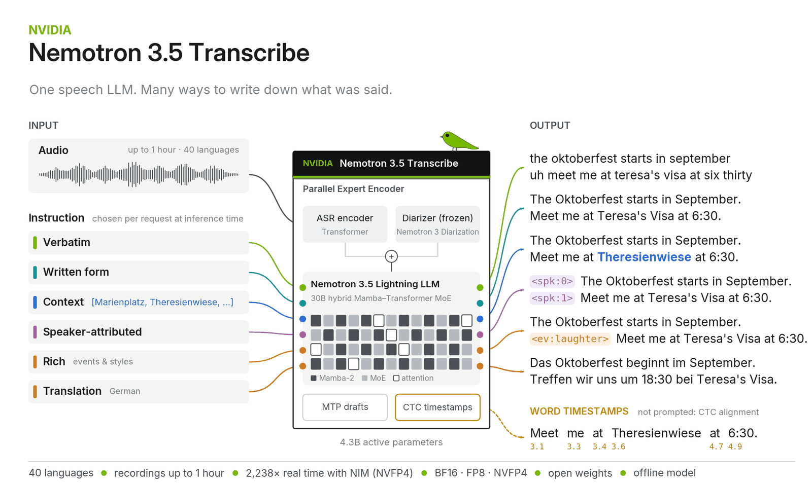
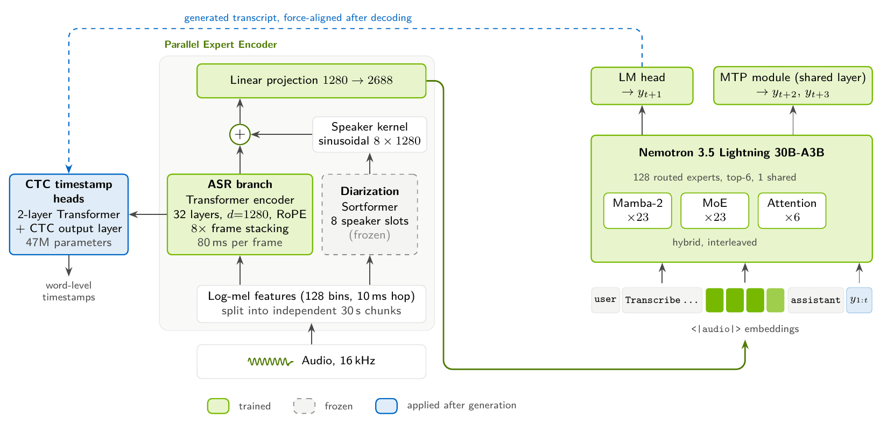
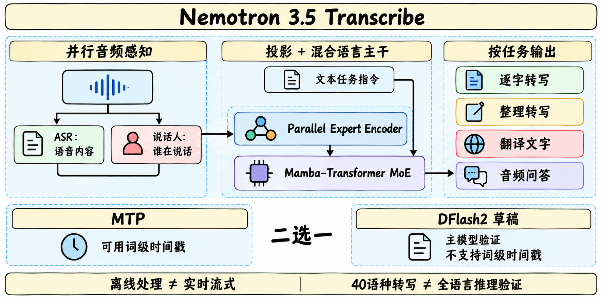
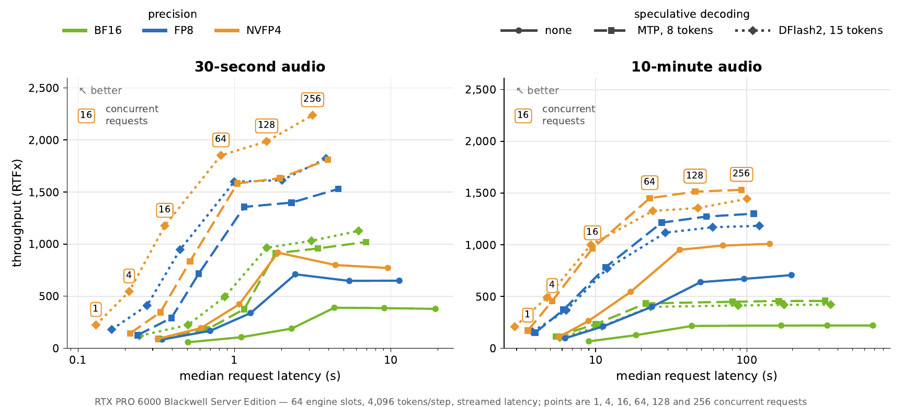

# Nemotron 3.5 Transcribe

> [!tldr] 我的判断
> 重点是把“逐字记下”“整理成可读文本”“谁说了什么”“按音频回答问题”放进同一个带指令的声文模型。并行的声学与说话人编码器，接到混合 Mamba–Transformer MoE 语言主干；CTC 负责时间对齐，MTP 或 DFlash2 负责加速。它是离线语音专项 family，不是新的通用聊天正代，DFlash2、BF16、FP8、NVFP4不拆叶子。

> [!warning] 原始资料的深度边界
> 已亲自阅读完整主卡、DFlash2卡、任务矩阵、训练数据统计、逐项结果与推理限制，保存官方原图与配置。卡中有独立 Tech Report 的 PDF 链接；遵守不抓PDF的要求，本轮仅保留链接，**没有阅读全文报告，也没有运行权重**。原卡仍不足以还原完整训练阶段、优化超参和消融，因此达不到完整技术报告精读与独立复现的深度；下文明确区分官方自报、接口说明与研读推断。

## 时间、权重与模块

主卡 Release Date 明确列 Build、GitHub、HF、NGC均为 **2026-10-28**。结果快照标注10月12日，属于评测时间，不是首发日；本轮发现日10月29日也不覆盖首发。

| 项目 | 原卡口径 | 阅读边界 |
|---|---|---|
| 总参数 / 激活参数 | 含音频编码器34B / 约4.3B | 名称30B-A4B是家族命名，不能替代精确计数 |
| 语言主干 | Nemotron 3.5 Lightning 30B-A3B，约3.5B激活 | 专项训练后文本能力不保证等同底模 |
| 音频感知 | 600M预训练ASR Transformer + 约99M说话人encoder | 联合音频感知约800M的舍入口径 |
| 上下文 / 录音长度 | 65,536 tokens / 最长1小时 | 内部分块不意味着实时流式 |
| 转写语言 | 40种 | 问答、推理与口语指令仅英文评测 |
| 许可 | OpenMDW-1.1 | 不把文档中的商业可用概述替代许可原文 |

## 两个感知分支解决两个不同问题

ASR编码器负责语音内容，说话人编码器来自Nemotron-3-Diarization，帮助保留谁在何处说话的线索。Parallel Expert Encoder的感知配置使用1280维identity connector，再学习投影到2688维，把音频特征与文本任务指令一起交给语言主干。说话人标签只用于区分同一录音中的声音，不建立现实身份。

CTC alignment head提供词级时间戳，输出可含词、起止秒、说话人段、标签映射和alignment error。时间对齐与自然语言回答不是同一个输出头；要求格式正确不能证明时间或身份归属正确。

## 同一录音为何需要不同监督目标

逐字转写应保留填充词和重复；可读转写可以删除意外重复，但应保持其余原话。翻译、音频问答、语言识别和说话人归属又有不同目标。把这些输出混成单一“正确文本”，训练会互相矛盾。

原卡的转写/翻译配方要求空system prompt、关闭thinking、temperature=0。音频理解配方则打开thinking，temperature=0.6、top_p=0.95，并采用任务专属system prompt。不能用问答配方跑ASR后直接对比原卡WER，也不能把较长推理输出当逐字转写。

语音中的指令既可能是用户要执行的请求，也可能只是录音中应转写的内容。两种模式需要由外部任务定义区分；模型能执行口语指令，不代表所有录音都应当作可信控制信号。

## 数据量：索引唯一不等于录音去重

官方列约372,206,279个唯一索引音频样本、1,718,453小时；计重复暴露则约1,780,012,724样本、6,527,883小时。总计479B多模态token中，音频286B、文本193B，另列唯一文本5.6B。这里的“唯一”是数据源内索引记录，同一录音可以派生多个任务或重复出现在不同源，不能称为172万小时完全去重录音，也不含底模/声学encoder预训练成本。

Granary v2提供转写、翻译、术语上下文、风格、长音频和语言ID等变体。多说话人AuMix将已有录音混成最多8位说话人的对话；它不是生成8个新身份的音色。教师伪转写和翻译保留原音频，不等于合成音频。另有无语音拒答、PII标注、音频理解及少量文本指令数据。

对上下文ASR，数据会构造粗/细术语、干扰词、部分和负上下文。它使输入依赖关系更丰富，但模型卡没有建立所有误导上下文下的稳健性保证。训练混合涉及私有/授权数据，不能把可读卡片等同完整可重建训练集。

## 结果：保持任务、语言与指标各自的分母

以下为官方10/12快照，未独立复测。WER/cpWER/CER越低越好；cpWER先匹配预测说话人与参考说话人再计算错误。

| 测试 | 结果 | 限定条件 |
|---|---:|---|
| 英文Open ASR | WER 4.71 | 9个数据集等权平均 |
| 长音频Open ASR | WER 10.98 | CORAAL / Earnings21 / Earnings22；55分钟块、重叠5秒 |
| 多语言Open ASR | WER 4.62 | 7种语言均值，非全部40种语言平均 |
| 多说话人总体 | cpWER 15.80 | 官方汇总的会议/电话等完整录音 |
| AMI headset / distant | cpWER 10.29 / 17.34 | 同类任务中麦克风条件仍显著影响结果 |
| NOTSOFAR headset / distant | cpWER 14.94 / 25.91 | 不能只展示最佳近讲值 |
| AISHELL-4 / AliMeeting | cpCER 32.91 / 34.95 | 中文以字符计错，不与英文WER直接相减 |
| HALAS | WER 31.50 | 幻觉 / 稳健性风险未由总体均分消除 |
| MMAU / MMAR | Accuracy 73.40 / 66.67 | 英文音频理解，thinking开启 |
| VoiceBench IFEval | 平均81.47 | 与prompt-level strict 77.97不同 |

多语言FLEURS按中文/日文等语言使用CER，榜单则全用WER，连参考文本归一化也有差异。不能把FLEURS中文8.62 CER当“多语言4.62 WER”的组成项。ASCEND中英混合错误率18.74，Bengali-English WER35.46，说明宣称支持语言不等于不同任务同质量。

上下文的粒度也改变效果：ContextASR-Bench无上下文WER3.33、粗上下文3.34、细上下文1.71，粗提示并未改善。实体WER12.21→2.20、漏实体率14.99→1.32属于细上下文条件，不是每次加几个关键词就可复制。Contextual Earnings22 local提示keyword F1为97.09，仍应另测不相关术语造成的误插入。

## 加速：先区分MTP、草稿、量化和服务实现

MTP联合训练两个next-token预测深度，复用同一层可在推理中提出最多8个token。DFlash2为约570M、6层block-diffusion草稿，条件来自主模型第1/5/19/29/41/51层；每步最多15个提议token，推荐从7开始。草稿由主模型核验，greedy下除小数值差异保持同样输出，**影响速度而非新增精度**。它不能独立转写，MTP与DFlash2是替代选项，不同时叠加。

| 需求 | 当前官方路径 | 代价与限制 |
|---|---|---|
| 词级时间戳 | CTC + vLLM V1，MTP或无草稿 | 请求中要显式保留时间戳结构与错误字段 |
| DFlash2低延迟 | vLLM V2、关闭CTC alignment | 当前无词级时间戳；原卡另列0.32.0补丁要求 |
| 长录音吞吐 | 按长度与并发评估MTP / DFlash2 | 10分钟录音MTP可能吞吐更高；草稿接受率随任务变化 |

原卡宣传单RTX PRO 6000 Blackwell Server Edition、NVFP4+DFlash2下最高2238音频秒/秒，30秒录音返回0.13秒；前者是吞吐，后者是特定请求延迟，不能认为同一个并发点同时达到两者。该优化来自**NIM优化版vLLM，尚未全部进入开源发布**；当天NeMo Speech集成被注明预计约慢2倍。图的硬件不是Quickstart的H10080GB，不能混合推导成本。

## 部署记录应包含哪些开关

保存模型/NeMo Speech revision、vLLM0.32.0、精度、硬件、录音长度、并发、MTP或DFlash2、thinking和时间戳开关。SGLang-Omni0.2.0对应SGLang0.5.22，支持范围应查独立表。硬件兼容列表不是所有卡都装得下最大上下文/并发的显存承诺。

音频应按任务支持做16kHz输入和分段。词级时间戳还依赖runner选择，DFlash2需要关闭CTC。原卡的安装、补丁、远程代码和权重示例仅归档，本轮未执行、未提交录音到托管服务。

> [!insight] 对Agent训练：输入监督和动作监督一起记账
> 一条语音工具轨迹至少要存音频、任务模式、逐字参考、归一化参考、说话人归属、术语上下文和最终工具参数。分别比较术语帮助与误导、近讲与远讲、长录音与混语，测数值/实体错误如何传播到动作和最终状态。不能把ASR总体均值下降等同策略更可靠，也不能以尖锐选项概率掩盖上游理解错。

## 一手资料与关联

- [🤗 HF Model Card](https://huggingface.co/nvidia/NVIDIA-Nemotron-3.5-Transcribe-30B-A4B)、[[src/hf_model_card|本地完整主卡]]。
- [🤗 DFlash2 Model Card](https://huggingface.co/nvidia/NVIDIA-Nemotron-3.5-Transcribe-30B-A4B-DFlash2)、[[src/DFlash2|本地草稿卡]]。
- [📄 Tech Report](https://research.nvidia.com/labs/nemotron/files/NVIDIA-Nemotron-3.5-Transcribe-Technical-Report.pdf)：仅保留官方PDF链接，本轮未下载、未精读。
- [官方NeMo Speech代码](https://github.com/NVIDIA-NeMo/Speech)；历史SALM方法报告2310.09424不冒充本版报告。
- [[Topics/13_base_model/IBM_Granite/Variants/260825_Granite_Speech_5/Granite-Speech-5|Granite Speech 5.0]]：对比CTC速度路线与声文语言模型路线，勿混任务指标。

> 📊 相关可视化：[[nemotron35_transcribe_poster_zh.html|中文Poster]]
