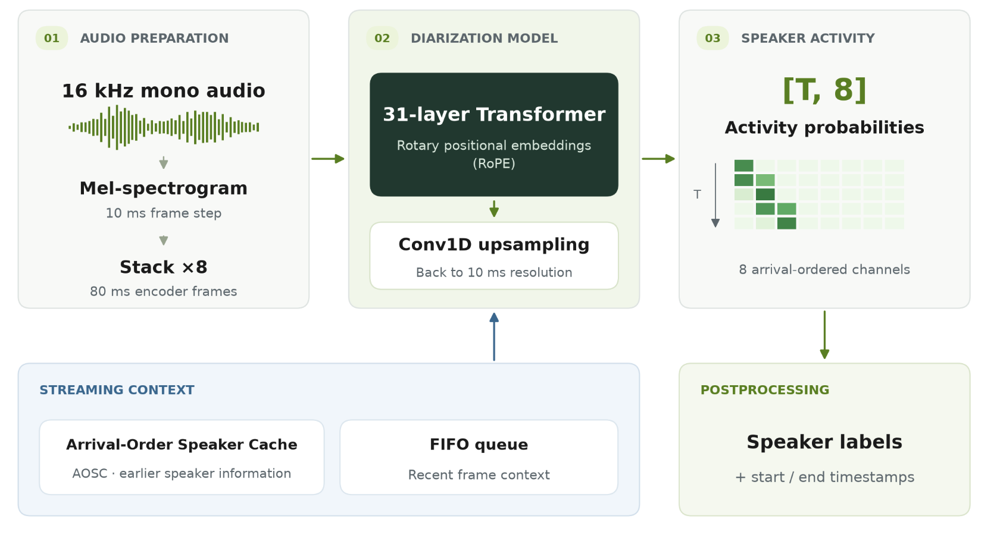
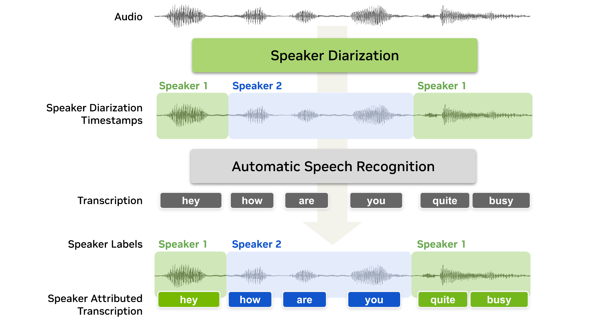
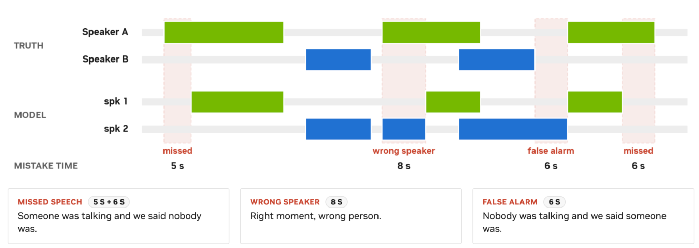

> [!tldr]
> 这是判断“谁在何时说话”的100M专项模型：同一checkpoint覆盖离线风格与流式推理，通过到达顺序、说话人缓存和近期上下文维持跨块标签。它输出匿名说话人活动，不输出文字或真实身份；与ASR对齐后才能产生带说话人的转写。

> [!warning] 资料充分度
> 已亲自阅读官方模型卡、NVIDIA署名博客及三张原图，完整保留模型卡所有性能表。技术报告仅保留链接，未下载PDF、未读完整报告，未运行权重或执行示例代码。配方、超参数、长期真实域可靠性仍不足以达到完整GLM/Kimi技术报告精读标准。9/23是模型卡与博客共同确认的首发日；本次是历史补漏，不算11月新模型。

## 问题、定位与发布证据

| 项目 | 核实内容 |
|---|---|
| 官方首发 | 2026-09-23，模型卡Release Date与官方博客Published一致 |
| Atlas定位 | NVIDIA语音专项支线，保持通用语言模型主干不变 |
| 规模 | 卡片写100M；不把HF文件页精确参数统计当新尺寸SKU |
| 输入 | 16kHz单声道音频；分块推理没有固定时长上限，仍可能长音频退化 |
| 输出 | `[T,8]`活动概率；可后处理为起止时间与匿名speaker标签 |
| 说话人 | 最多8位；按首次出现排序，不进行实名识别；重叠时多通道可同时激活 |
| 分辨率 | 默认10ms输出步长，可设为10ms的整数倍 |
| 许可 | Open Model, Data and Weights License 1.1；不误标MIT/Apache |

我的判断：最有价值的是将“文字是否正确”和“说话人归属是否正确”分离验收。会议纪要与语音Agent记忆若归错承诺者，即使词全对也可能得到错误行动项；不能用普通WER代表整个系统效果。

博客中的预置演示是合成场景，部分八人场景带说话人前置信息，不是无提示八人基准。没有运行Demo，也没有把人物姓名当模型身份识别能力。

## 方法、训练与可复现边界

31层带RoPE的Transformer编码器接收10ms Mel特征，8倍特征堆叠后以80ms帧计算，Conv1D再上采样到10ms输出。Sortformer按首次到达时间解决输出通道排列；AOSC保留较早说话人信息，FIFO保留最近帧，当前chunk与右侧上下文提供局部判别依据。它们分别管理长期标签与短期变化，不宜简单统称“无限记忆”。

训练从NEST自监督checkpoint初始化，官方披露64张A100-SXM4-80GB：先用模拟混合语音离线训练，再用真实对话和模拟混合做流式微调。约10000小时真实对话与82611小时模拟混合分别列示，不能当独立来源总小时或训练token数。模拟来源小时数6694/6743/6745/6755/36458/19216合计82611；David AI等许可语料无法仅凭开源模型卡重建。完整来源清单见原始卡。

| 配置 | 输入缓冲延迟 | cache | FIFO | chunk | 右上下文 | 更新周期 |
|---|---|---|---|---|---|---|
| 离线风格 | 30.4s |264|40|340|40|300|
| 低延迟 |1.04s|264|264|9|4|222|
| 很低延迟 |0.64s|264|264|6|2|222|
| 超低延迟 |0.32s|264|264|3|1|222|

参数单位都是80ms帧；输入缓冲=(chunk+右上下文)×80ms。技术上可用80ms，但官方最低推荐320ms。缓冲延迟不含计算、传输、ASR和应用时间；30.4s“离线风格”也不等于一次看完整录音。

复现入口是NeMo的e2e_diarize_speech.py及官方配置，也有Transformers集成。这里只存接口说明，不执行随仓库代码；库版本、编译开关、缓存状态和后处理都应冻结。模型/基线cache不同（264 vs188），所以比较的是已发布整套配置，不是仅说话人数这一变量的严格消融。

DER分为误报、漏检和说话人混淆；重叠参考语音分别计入说话人时间。全部评估包含重叠，DIHARD/AliMeeting/AMI/NOTSOFAR为0秒collar，CALLHOME为0.25秒。AMI/AliMeeting/NOTSOFAR使用指定强制对齐RTTM；换回原分段标签会改变漏检与边界口径，不能直接判复现失败。901是按条件计数的录音，MHM/SC可能来自同一会议，不等于901独立会议。

| 同为1.04s缓冲：全量DER，越低越好 | 四人基线 | 本模型 |
|---|---|---|
| DIHARD III |19.60|13.18|
| CALLHOME-Part2 |11.31|10.29|
| AliMeeting Near |12.47|6.59|
| AliMeeting Far |15.58|10.80|
| AMI MHM |16.36|9.48|
| AMI SDM |21.73|12.80|
| NOTSOFAR MHM |22.12|7.70|
| NOTSOFAR SC |31.81|12.77|

八条件相对DER降幅的无权均值约41.0%，不是把所有录音池化后的DER，也不是每个数据集都提升41%。不能仅引用博客标题的40%而省略聚合定义。

必须保留反例：30.4s CALLHOME两人子集新模型5.98高于基线5.68；AMI MHM人数准确率本模型87.5低于基线93.75，虽DER更低。DIHARD的5–9人聚合含超过8人上限的录音。全集更好不代表每个子集、人数估计或域都更好。

速度测于RTX PRO5000、BF16、NeMo PyTorch，eager/compile与batch1/32分开。30.4s配置batch32编译RTFx15113与基线2619对应批吞吐，不能解释成单流延迟或实时语音交互响应；1.04s为865对136，batch1编译164对42。这里未独立复测。

> [!insight] 对Agent Training的启发
> 语音环境轨迹同时保存词、speaker通道、原始时间和重叠概率，避免把说话人分错的指令训练为正确行为。评测冻结RTTM版本、collar、重叠设置、缓冲和后处理；奖励拆分WER、DER、归属正确的行动项与端到端延迟。AOSC状态应随轨迹一起保存，重启缓存与持续对话分开测。按人数/噪声/时长报告失败，不只给总体均值。

## 完整官方性能表与来源

TL;DR：下面逐项保留公开模型卡的8条件表与速度表，粗体仅沿用官方，部分粗体值并不优于基线。读数必须随上述RTTM、collar、重叠、硬件与缓冲口径一起使用。

#### DIHARD III

| Model                                 | Latency | DER ↓ (1–4 spk) | DER ↓ (5–9 spk) | DER ↓ (full) | SCA ↑ (full) | MAE ↓ (full) |
| ------------------------------------- | ------- | ------------------ | ------------------ | --------------- | --------------- | --------------- |
| `diar_streaming_sortformer_4spk-v2.1` | 30.4 s  | 13.98              | 40.21              | 19.09           | 75.29           | 0.5135          |
| `diar_streaming_sortformer_4spk-v2.1` | 1.04 s  | 14.33              | 41.39              | 19.60           | 69.50           | 0.5483          |
| `diar_streaming_sortformer_4spk-v2.1` | 0.32 s  | 14.37              | 42.71              | 19.85           | 66.80           | 0.5869          |
| `Nemotron-3-Diarization`              | 30.4 s  | **9.13**           | **27.58**          | **12.73**       | **81.47**       | **0.2664**      |
| `Nemotron-3-Diarization`              | 1.04 s  | **9.47**           | **28.65**          | **13.18**       | **76.83**       | **0.3243**      |
| `Nemotron-3-Diarization`              | 0.64 s  | **9.44**           | **29.16**          | **13.28**       | **77.22**       | **0.3205**      |
| `Nemotron-3-Diarization`              | 0.32 s  | **9.69**           | **29.49**          | **13.55**       | **76.45**       | **0.3282**      |

#### CALLHOME-Part2

| Model                                 | Latency | DER ↓ (2 spk) | DER ↓ (3 spk) | DER ↓ (4 spk) | DER ↓ (5 spk) | DER ↓ (6 spk) | DER ↓ (full) | SCA ↑ (full) | MAE ↓ (full) |
| ------------------------------------- | ------- | ---------------- | ---------------- | ---------------- | ---------------- | ---------------- | --------------- | --------------- | --------------- |
| `diar_streaming_sortformer_4spk-v2.1` | 30.4 s  | 5.68             | 10.41            | 12.36            | 21.00            | 21.15            | 10.32           | 84.40           | 0.1720          |
| `diar_streaming_sortformer_4spk-v2.1` | 1.04 s  | 6.83             | 11.26            | 13.49            | 21.67            | 23.82            | 11.31           | 82.40           | 0.1880          |
| `diar_streaming_sortformer_4spk-v2.1` | 0.32 s  | 7.92             | 12.54            | 15.32            | 24.01            | 27.70            | 12.67           | 72.40           | 0.2920          |
| `Nemotron-3-Diarization`              | 30.4 s  | **5.98**         | **9.26**         | **11.03**        | **15.82**        | **15.80**        | **9.10**        | **91.60**       | **0.0840**      |
| `Nemotron-3-Diarization`              | 1.04 s  | **6.98**         | **10.90**        | **11.84**        | **18.47**        | **16.01**        | **10.29**       | **89.20**       | **0.1080**      |
| `Nemotron-3-Diarization`              | 0.64 s  | **7.21**         | **11.17**        | **12.10**        | **19.31**        | **16.70**        | **10.66**       | **88.40**       | **0.1160**      |
| `Nemotron-3-Diarization`              | 0.32 s  | **7.75**         | **11.84**        | **13.02**        | **20.65**        | **17.30**        | **11.32**       | **88.40**       | **0.1160**      |

#### AliMeeting Test Near

| Model                                 | Latency | DER ↓ | SCA ↑ | MAE ↓ |
| ------------------------------------- | ------- | ----- | ----- | ----- |
| `diar_streaming_sortformer_4spk-v2.1` | 30.4 s  | 11.57 | 80.00 | 0.20  |
| `diar_streaming_sortformer_4spk-v2.1` | 1.04 s  | 12.47 | 70.00 | 0.30  |
| `diar_streaming_sortformer_4spk-v2.1` | 0.32 s  | 13.68 | 70.00 | 0.30  |
| `Nemotron-3-Diarization`              | 30.4 s  | **6.40** | **90.00** | **0.10** |
| `Nemotron-3-Diarization`              | 1.04 s  | **6.59** | **85.00** | **0.15** |
| `Nemotron-3-Diarization`              | 0.64 s  | **6.74** | **85.00** | **0.15** |
| `Nemotron-3-Diarization`              | 0.32 s  | **7.19** | **80.00** | **0.20** |

#### AliMeeting Test Far

| Model                                 | Latency | DER ↓ | SCA ↑ | MAE ↓ |
| ------------------------------------- | ------- | ----- | ----- | ----- |
| `diar_streaming_sortformer_4spk-v2.1` | 30.4 s  | 13.69 | 95.00 | 0.05  |
| `diar_streaming_sortformer_4spk-v2.1` | 1.04 s  | 15.58 | 75.00 | 0.25  |
| `diar_streaming_sortformer_4spk-v2.1` | 0.32 s  | 16.85 | 65.00 | 0.35  |
| `Nemotron-3-Diarization`              | 30.4 s  | **10.47** | **100** | **0** |
| `Nemotron-3-Diarization`              | 1.04 s  | **10.80** | **95.00** | **0.05** |
| `Nemotron-3-Diarization`              | 0.64 s  | **11.03** | **85.00** | **0.15** |
| `Nemotron-3-Diarization`              | 0.32 s  | **11.60** | **85.00** | **0.15** |

#### AMI Test MHM

| Model                                 | Latency | DER ↓ | SCA ↑ | MAE ↓  |
| ------------------------------------- | ------- | ----- | ----- | ------ |
| `diar_streaming_sortformer_4spk-v2.1` | 30.4 s  | 15.81 | 93.75 | 0.0625 |
| `diar_streaming_sortformer_4spk-v2.1` | 1.04 s  | 16.36 | 93.75 | 0.0625 |
| `diar_streaming_sortformer_4spk-v2.1` | 0.32 s  | 17.77 | 93.75 | 0.0625 |
| `Nemotron-3-Diarization`              | 30.4 s  | **9.25** | **87.50** | **0.1250** |
| `Nemotron-3-Diarization`              | 1.04 s  | **9.48** | **81.25** | **0.1875** |
| `Nemotron-3-Diarization`              | 0.64 s  | **9.62** | **81.25** | **0.1875** |
| `Nemotron-3-Diarization`              | 0.32 s  | **10.05** | **81.25** | **0.1875** |

#### AMI Test SDM

| Model                                 | Latency | DER ↓ | SCA ↑ | MAE ↓  |
| ------------------------------------- | ------- | ----- | ----- | ------ |
| `diar_streaming_sortformer_4spk-v2.1` | 30.4 s  | 21.42 | 93.75 | 0.0625 |
| `diar_streaming_sortformer_4spk-v2.1` | 1.04 s  | 21.73 | 93.75 | 0.0625 |
| `diar_streaming_sortformer_4spk-v2.1` | 0.32 s  | 23.89 | 93.75 | 0.0625 |
| `Nemotron-3-Diarization`              | 30.4 s  | **11.14** | **87.50** | **0.1250** |
| `Nemotron-3-Diarization`              | 1.04 s  | **12.80** | **87.50** | **0.1250** |
| `Nemotron-3-Diarization`              | 0.64 s  | **13.06** | **87.50** | **0.1250** |
| `Nemotron-3-Diarization`              | 0.32 s  | **12.95** | **87.50** | **0.1250** |

#### NOTSOFAR1 MHM

| Model                                 | Latency | DER ↓ (3–4 spk) | DER ↓ (5–7 spk) | DER ↓ (full) | SCA ↑ (full) | MAE ↓ (full) |
| ------------------------------------- | ------- | ------------------ | ------------------ | --------------- | --------------- | --------------- |
| `diar_streaming_sortformer_4spk-v2.1` | 30.4 s  | 11.14              | 29.38              | 21.77           | 35.00           | 0.9375          |
| `diar_streaming_sortformer_4spk-v2.1` | 1.04 s  | 12.03              | 29.49              | 22.12           | 34.38           | 0.9437          |
| `diar_streaming_sortformer_4spk-v2.1` | 0.32 s  | 12.94              | 30.75              | 23.37           | 32.50           | 0.9625          |
| `Nemotron-3-Diarization`              | 30.4 s  | **5.25**           | **7.86**           | **6.77**        | **93.75**       | **0.0625**      |
| `Nemotron-3-Diarization`              | 1.04 s  | **5.85**           | **9.02**           | **7.70**        | **79.37**       | **0.2062**      |
| `Nemotron-3-Diarization`              | 0.64 s  | **6.07**           | **9.39**           | **7.99**        | **79.37**       | **0.2062**      |
| `Nemotron-3-Diarization`              | 0.32 s  | **6.57**           | **10.16**          | **8.65**        | **74.38**       | **0.2687**      |

#### NOTSOFAR1 SC

| Model                                 | Latency | DER ↓ (3–4 spk) | DER ↓ (5–7 spk) | DER ↓ (full) | SCA ↑ (full) | MAE ↓ (full) |
| ------------------------------------- | ------- | ------------------ | ------------------ | --------------- | --------------- | --------------- |
| `diar_streaming_sortformer_4spk-v2.1` | 30.4 s  | 19.67              | 38.42              | 30.49           | 33.12           | 0.9563          |
| `diar_streaming_sortformer_4spk-v2.1` | 1.04 s  | 20.58              | 39.84              | 31.81           | 33.12           | 0.9563          |
| `diar_streaming_sortformer_4spk-v2.1` | 0.32 s  | 22.14              | 40.80              | 32.95           | 31.87           | 0.9688          |
| `Nemotron-3-Diarization`              | 30.4 s  | **7.94**           | **13.21**          | **11.00**       | **78.12**       | **0.2188**      |
| `Nemotron-3-Diarization`              | 1.04 s  | **8.96**           | **15.44**          | **12.77**       | **60.62**       | **0.4062**      |
| `Nemotron-3-Diarization`              | 0.64 s  | **9.47**           | **16.16**          | **13.35**       | **55.00**       | **0.4625**      |
| `Nemotron-3-Diarization`              | 0.32 s  | **10.28**          | **17.61**          | **14.53**       | **55.00**       | **0.4625**      |

### Inference Speed Evaluation

| Model                                 | Latency | RTFx ↑ (`batch_size=1`) eager / compiled | RTFx ↑ (`batch_size=32`) eager / compiled |
| ------------------------------------- | ------- | ---------------------------------------- | ----------------------------------------- |
| `diar_streaming_sortformer_4spk-v2.1` | 30.4 s  | 874 / 1468                               | 3204 / 2619                               |
| `diar_streaming_sortformer_4spk-v2.1` | 1.04 s  | 16 / 42                                  | 193 / 136                                 |
| `diar_streaming_sortformer_4spk-v2.1` | 0.32 s  | 8  / 21                                  | 101 / 76                                  |
| `Nemotron-3-Diarization`              | 30.4 s  | **1340 / 4385**                          | **12196 / 15113**                         |
| `Nemotron-3-Diarization`              | 1.04 s  | **38 / 164**                             | **581 / 865**                             |
| `Nemotron-3-Diarization`              | 0.64 s  | **25 / 113**                             | **391 / 579**                             |
| `Nemotron-3-Diarization`              | 0.32 s  | **12.5 / 54**                            | **199 / 292**                             |

**Acceleration Engine:** PyTorch backend through the NeMo Framework, with and without `torch.compile()`.

**Test Hardware:** NVIDIA Blackwell RTX PRO 5000.

**Precision:** BF16.

---

### 来源与关联

- [S1 官方HF模型卡](https://huggingface.co/nvidia/Nemotron-3-Diarization)，含2026-09-23首发、方法、数据、完整表及RTTM协议。
- [S2 NVIDIA官方博客](https://huggingface.co/blog/nvidia/nemotron-diarization)，首发同日，含架构与应用图、41.0%聚合定义。
- [S3 技术报告链接，未阅读](https://arxiv.org/abs/2611.12246)。
- 关联：[[Topics/13_base_model/NVIDIA_Nemotron/Variants/2610_Nemotron_Labs_Unified_ASR/Nemotron-Labs-Unified-ASR|Nemotron Labs Unified ASR]]。

> 📊 相关可视化: [[nemotron_3_diarization_poster_zh.html|中文Poster]]
