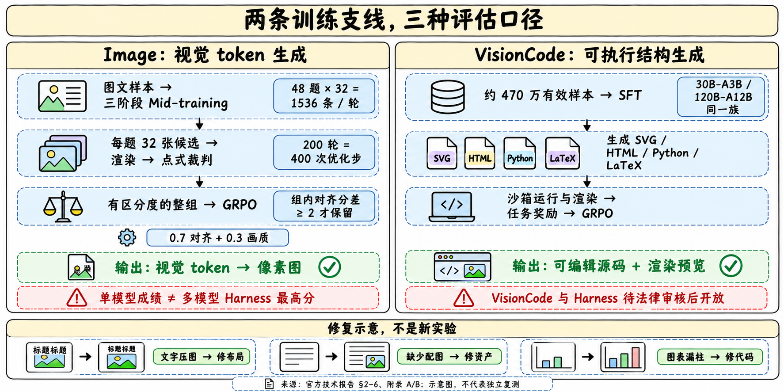
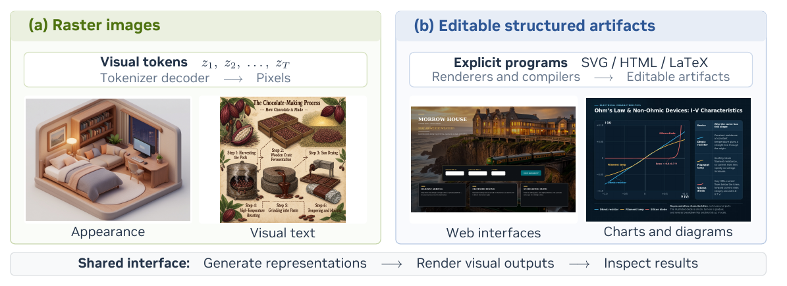
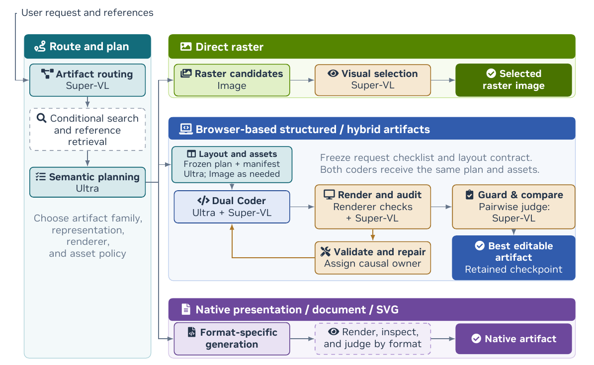

# Nemotron-Labs-Image — 图像 token 策略、GRPO 与系统增益必须分开看

> [!tldr]
> 我的判断：这项研究的可迁移点是先让视觉 token 策略产生有质量差异的候选，再用整组过滤和数据重采样维持 GRPO 学习信号。图像模型的成绩、多模型创建流程的成绩、VisionCode 代码模型的成绩是三套实验。GenEval 92.86 和 BizGenEval 86.0 来自 GPT-6 辅助的完整系统，不能写成 30B 图像模型单独达到。

> [!warning] 日期、开放与来源边界
> 同一官方报告 arXiv:2611.31358 的 v1 为 2026-11-23 18:57:41 UTC，即北京 **11/24 02:57:41**；Atlas 按报告首次日期回填11/24。HF仓库创建于9/24，最早可见的 clean release snapshot 提交为11/25北京05:55；创建和提交均不证明何时从私有转为公开，权重首个公开时刻仍待核。本轮已确认公开文件列表有32个生成器分片及配套tokenizer，但未下载权重、未运行模型。当前开放的是 Image 与配套 tokenizer；Harness、VisionCode 仍称待法律审核，不把未来承诺当已发布权重。

## 定位与模型接口

> [!tldr]
> 这是一条自回归图像生成支线，沿用 Nemotron 3 Nano 的 Mamba2–Transformer MoE；图像由离散码的解码器渲染，不是 Diffusers pipeline。

| 项目 | 原始披露 | 解读与限制 |
|---|---|---|
| 生成器 | 30B总量、约3B激活；NemotronHForCausalLM | HF参数统计约32.63B与产品30B命名不完全相同，不据此另拆SKU |
| 骨干配置 | 52层、hidden2688、128路由专家、每token6路+1共享；词表327680 | `config.json` dtype字段float32与卡/参考推理BF16不同；字段不代表全部分片运行精度 |
| 文本/图像词表 | 基础文本131072、视觉虚拟token196560 | 视觉token按16×16patch形成行；使用img_start/img_end/vis_row边界与尺寸头 |
| Tokenizer | 约642M；encoder/decoder各24层、width1024、16heads、24维量化 | 冻结196560个归一化Leech-lattice码本；不作为另一通用正代 |
| 上下文 | 配置262144；参考推理max_model_len6144、max_tokens4352 | 训练mid-training81920、RL8192又是不同条件，不混为同一个服务承诺 |
| 条件输入 | 文本；训练还含参考图、编辑、多轮TI2I | 报告明确TI2I未评测；公开quickstart只证明接口描述，未独立验证编辑能力 |
| 许可 | NVIDIA非商业研究/评估许可 | 不能从“公开权重”推出商业许可 |

## 数据与视觉表示

> [!tldr]
> Tokenizer、图像策略与代码策略各有数据。不能把4.7M代码样本算入374M图像对，也不能把样本量当训练去重后的唯一图像数。

Tokenizer从约200M的NVCLIP筛选池中训练约153M图像，用SigLIP2、DINOv2和SSCD聚类、去重与过滤。图像生成mid-training数据约374M：326M网页图文对（GPIC、CC12M、CommonCatalog CC-BY/SA、Megalith、WIT）加48M Z-Image合成图。Qwen3.5的27B、397B-A17B和4B负责标注，397B还参与图文一致性过滤；移除水印与低质图。三个mid-training阶段均为90%T2I、10%TI2I。训练数据许可、完整样本与最终去重清单没有随此模型完整开放。

16×16patch让256×256图像只需256个视觉token，8×8时为1024；文中“每节点4倍样本”是该tokenizer研究配置，不是端到端出图4倍。编码器把图像变成离散码；解码器把码变回图像。结构化路线的SVG/HTML则由不同的真实渲染器执行，共享的是“生成表示→渲染→检查”接口，并非共享词表。

## Tokenizer训练：固定码本与后期冻结编码器

| 设置 | 原文数值/做法 |
|---|---|
| 总步数/冻结 | 670K；480K之后冻结encoder，decoder继续训练 |
| 损失 | RGB L1权重1；LPIPS0.1；DINOv2 ViT-L蒸馏0.1；无commitment loss |
| 蒸馏位置 | decoder第3block→MLP→二维自适应池化；两侧逐token L2；负平均cosine |
| GAN | unconditional三层PatchGAN、base64、4×4核、BatchNorm；softplus、weight0.5；从第0步开始 |
| R1 | gamma10，每16步一次；当步乘80，时间平均系数5；不等于每步80 |
| Packing | 按实际像素预算打包变分辨率序列；每rank2621440像素，replicate pad到16倍数；max_pixels1638400 |
| 优化 | AE和判别器均AdamW；β=(.9,.99)、eps1e-8、WD1e-4；BF16 AMP、gradient checkpoint |
| 学习率 | base4e-7×world32×名义batch8=1.024e-4；0–300K此值，300–480K为6.144e-5，480–670K为3.6864e-5 |

名义batch用于学习率缩放，不是packing后每batch恰好8张。码本全程固定，使用straight-through梯度；量化本身没有可训练的码本漂移。

## 图像策略训练：三阶段mid-training→两段GRPO

| 阶段 | 最大图像面积 | 时长 | 序列长 | 学习率/其他 |
|---|---|---|---|---|
| Mid1 | 256² | 35Ksteps | 81920 | Muon1e-3、Adam1e-4、500warmup |
| Mid2 | 512² | 90Ksteps | 81920 | 同上；可变宽高比 |
| Mid3 | 1024² | 70Ksteps | 81920 | 同上；EMA .9999，WD .01、gradclip1 |
| RL | 混合分辨率/比例 | 200rollout迭代=400优化步 | 8192 | Adam2e-6、β=(.9,.98)、WD0、无warmup、无显式KL |

Mid-training的Muon用momentum .95、Polar Express和spectral-norm LR adjustment；Adam β=(.9,.95)、eps1e-8。RL起点要求重复采样已经能出现高质量且遵循提示的候选，best-of-N潜力成为可学习信号。StageI覆盖计数、属性绑定、空间、动作、风格和文字；当reward升高但有区分度的组越来越少，StageII保持reward定义和优化器状态，换成更长更难的约束并调整分辨率/宽高比分布。这里的数据刷新不是新增一个基础正代。

每轮 **48题×32候选=1536条**，温度1.0；保持同题整组，将其分成两个不重叠768条batch，各更新一次，每条只用一次。因此200轮是400步，不是200步或1536次独立更新。先按原始0–10对齐分的组内range≥2筛选；不满足的组丢弃并重新抽题，直到凑足48个合格组，不能把拒绝后的较小batch与名义batch混用。

### 奖励、credit与错误处理

点式VLM裁判逐图独立打六项对齐分：主体/数量、属性、空间关系、动作姿态、场景风格、文字；权重依次 .35/.25/.15/.15/.10/.25，按适用项重新归一化。未请求文字时文字项N/A；请求了文字则核对大小写、拼写、标点与可读性。对齐与纯技术画质分开，画质不评“是否好看”或是否听指令。总reward=.7×归一化alignment+.3×quality。

严重错误不能靠其余项平均掩盖：某项≤.3时，对齐上限主体.35、属性.55、空间/动作.65、文字.50。裁判返回可见理由和最多三项关键错误。这里的“pointwise”与创建Harness最后的blind pairwise选择是两套裁判工作，不能混写。

同题reward减均值除标准差，得到每序列一个advantage，并共享给该序列所有生成token；prompt和参考图不参与action loss。PPO式clip下界.20、上界.28。rollout与训练实现分离，按每序列平均log概率差计算几何平均比，只有[.95,1.05]保留，再施加token级重要性权重；这不是把长图的token概率直接相乘后作窄区间判断。256GPU异步分离生成、解码、裁判和更新；裁判失败先重试，不可恢复的组丢弃补齐，不能人为给0；每25rollout迭代保存checkpoint和完整轨迹。

## 三种配置的完整主要读数

> [!tldr]
> 同一生成器加不同agent后差异很大，说明工程/搜索/选择预算有贡献；这些表不单独识别各模块因果收益。

| 指标↑ | Image单独 | +Nemotron agent | +GPT-6 agent |
|---|---:|---:|---:|
| GenEval | 80.97 | 86.40 | 92.86 |
| GenEval2 Soft-TIFA GM | 31.71 | 52.56 | 65.43 |
| UniGen++ EN短 | 77.64 | 88.78 | 93.20 |
| UniGen++ EN长 | 85.02 | 89.84 | 94.25 |
| LongTextBench EN | 94.30 | 97.00 | 97.98 |
| CVTG-2K EN | 84.11 | 89.63 | 92.53 |
| OneIG EN | 52.77 | 54.14 | 54.63 |
| Qwen-Image-Bench EN | 46.36 | 51.33 | 52.46 |
| WISE Verified | 46.30 | 88.60 | 91.50 |
| BizGenEval | 未报告 | 64.7 | 86.0 |

GPT-6辅助GenEval2仍低于GPT Image2的81，OneIG低于NanoBananaPro58.30，Qwen-Image-Bench低于GPTImage2的65.23；SenseNovaU1.5的LongText98.80和CVTG94.80也更高。Nemotron原生系统BizGen64.7低于GPTImage2 83.2和NanoBananaPro76.7。基线采自官方报告/榜单，重复来源同型号同指标取较低值；不是所有模型由作者同硬件同预算重跑。WISE裁判Qwen3.5-35B-A3B、Verified口径；不等于知识无幻觉。

Tokenizer约178K、35数据集、六域的总体PSNR26.08→29.57、SSIM.781→.834、LPIPS.0855→.0713、GMSD.0994→.0675。MUSIQ65.84→65.78、CLIP-IQA.593→.583反而略降。ImageNet任意分辨率原生rFID .5482→.8595变差；两维放大2倍再编码才到.4235，同时约4倍token。A100-SXM4-80GB、BF16、1024²、batch1编码41.30ms/解码37.10ms，相对Emu3.5为7.13×/10.93×，不含读图、预处理、CPU→GPU、生成token和agent。L4最大可跑batch不是最优吞吐，原文分开报告。

## Harness归因与复现边界

Super-VL负责路由和视觉检查，Ultra规划；自然图只采样/选图，不走网页代码修复。结构化或混合产物先冻结验收清单和布局契约，Ultra与Super-VL用同一plan/asset manifest独立编码。真实renderer检查与视觉检查都通过才算候选合格，修复按plan/asset/layout/code/interaction/content责任定位；默认最多3次接受修复、8次尝试，每轮2候选、重规划各1次。盲pairwise打平或confidence<.75留旧checkpoint，不能用审美抵偿必需内容缺失。这些模型分工与另行训练的VisionCode不同。

公开例程：Linux/Python3.12、CUDA13兼容驱动、4×H10080GB、PyTorch2.11、vLLM.21、Transformers5.23；BF16、TP4、TritonMoE、temperature.9/top_p1、seed42。解码代码验证尺寸头、视觉token范围、每行patch数和完整结束符。64×64网格是4096码，再加行标记与边界，所以4352预算不能被理解为图像patch数。配置声明262K不意味着示例可直接生成任意巨大图。

> [!insight]
> 对Agent Training：把“reward上升而有效组率下降”同时记录，区分学习变强与数据耗尽；冻结原始验收清单再修复，保留失败原因与较强checkpoint。建议固定图像模型、候选数、搜索权限、预算和裁判，分别消融RL、planning、selection；当前报告完整配置差异尚不证明某单模块的净收益。

## 原图、原表与关联

- [[src/official_tables_20261126|官方全部表格转录]]；原始完整HTML在同目录src，不抓PDF。
- [[Topics/13_base_model/NVIDIA_Nemotron/Variants/261124_Nemotron_Labs_VisionCode/Nemotron-Labs-VisionCode|VisionCode：源码策略与五任务评测]]。
- [Tech Report HTML](https://arxiv.org/html/2611.31358v1)、[arXiv首版记录](https://arxiv.org/abs/2611.31358)、[HF模型卡](https://huggingface.co/nvidia/Nemotron-Labs-Image-30B-A3B)。

> 📊 相关可视化: [[nemotron_labs_image_poster_zh.html|中文Poster]]
