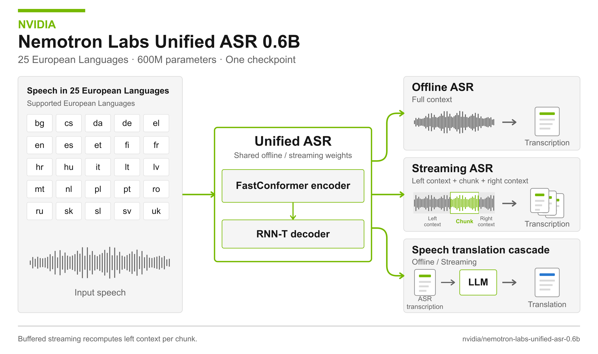
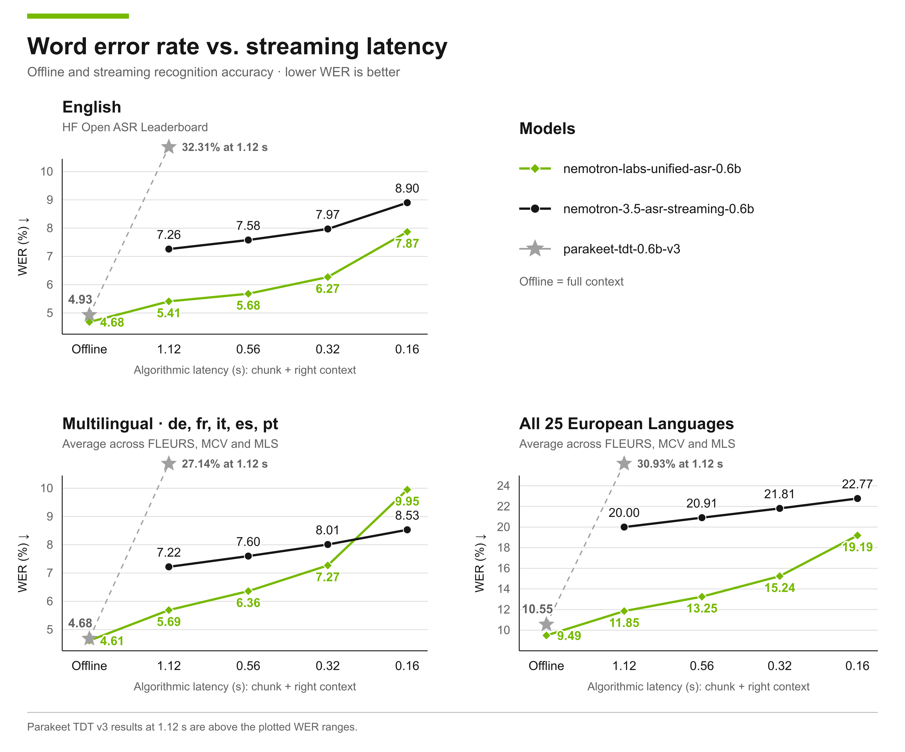
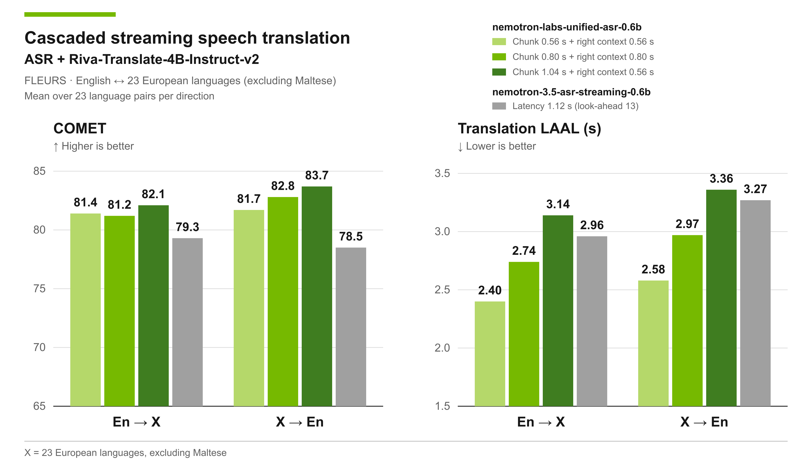

# Nemotron Labs Unified ASR

> [!tldr]
> 我的判断：这次发布的关键是用共享 600M 权重兼顾离线识别和可调延迟流式识别，并用语言提示稳定低延迟的语言选择。代价同样明确：当前依赖重算左上下文的 buffered streaming，160ms 是算法等待，不是整条语音链路的实测响应时间。

## 发布定位与来源边界

HF Model Card 的 Release Date 明确写 **10/27/26**，因此收录日为 **2026-10-27**，不是仓库 createdAt 或 lastModified。它是英文 Parakeet-unified-en-0.6b 的多语言扩展：覆盖 **25 种欧洲语言**，属于 NVIDIA 语音识别专项支线，不是新的通用文本正代。

方法背景是《Reducing the Offline-Streaming Gap for Unified ASR Transducer with Consistency Regularization》（arXiv:2604.19079）。这篇报告早于本次多语言 checkpoint，不能把论文日期当作这个权重的首发，也不能将所有论文实验直接归到本卡。原始 README 和三张官方图已保存到 src；本轮没有下载权重或 PDF，也没有运行官方训练/推理程序。

## 为什么要把两种工作模式统一

离线识别能够看整段上下文，流式识别需要在未来语音尚未到来时提交文本。分别训练两个模型会增加维护成本，还可能出现离线识别很好、在线错误传播严重的问题。该模型共享 encoder、predictor 和 joint networks，通过训练时切换上下文模式缩小差异，而不是在离线模型外面简单套一个音频切块循环。

| 核心规格 | 原卡公开内容 |
|---|---|
| 参数 / 编码器 | 600M；24 层 Unified FastConformer |
| 解码目标 | RNNT；不是 TDT checkpoint 的直接改名 |
| 初始化 | parakeet-tdt-0.6b-v3 的 encoder |
| 输入 | 16kHz 单声道音频，至少 80ms；语言 ID 或 auto |
| 输出 | 带标点与大小写的转写文本；不是语音合成 |
| 运行框架 | NeMo Speech 3.1.0；当前仅提供 inference 支持 |
| 许可 | OpenMDW 1.1；以仓库许可条款为准 |

语言完整列表为 bg、hr、cs、da、nl、en、et、fi、fr、de、el、hu、it、lv、lt、mt、pl、pt、ro、sk、sl、es、sv、ru、uk。中文不在此识别清单中；下游翻译模型支持中文也不能扩写为 ASR 本身识别中文。

## 统一训练：共享权重，切换可见上下文

离线模式使用完整 self-attention 和非因果卷积；流式模式施加 left / chunk / right 的分块 attention mask，并在 FastConformer 各层采用 Dynamic Chunked Convolution。**MCR（mode-consistency regularization）**进一步约束两种模式的一致性。初始 8 倍下采样仍包含非因果卷积；因此“统一”不意味着网络在所有模式下都是严格因果。

训练数据包括约 **10,000 小时人工转写 NeMo ASR Set 3.0** 与 **660,000 小时 Granary 伪标注数据**，合计约 670k 小时。使用带标点/大小写的转写和温度采样平衡语料与语言，共享 SentencePiece tokenizer。不能把 660k 小时伪标注当成人工逐句校验，也不能从总时长推断各语言覆盖均匀。

> [!warning] 尚未公开的训练细节
> 原卡已经给出架构、数据规模、机制、官方图和完整评测，但本次多语言训练的完整超参数、MCR 权重及消融、各语言有效时长和训练成本仍不完整；目前只支持推理。笔记对这些部分无法达到完整 Tech Report 的复现深度，保留缺口，不自行编造损失系数或训练配方。

## Language-ID prompt 为什么在低延迟时更重要

25 种语言共用输出词表，tokenizer 本身不携带语言身份。首批音频很短时，模型可能先输出错误语言的 token，之后即使识别出语言，已经提交的文本也无法撤回。

官方做法是将 one-hot language vector 沿时间维广播，与声学表示拼接，再投影到 RNNT 解码路径。它解决的是早期语言歧义，不是增加一套每语言模型。可用 target_lang=auto 自动判断，但**本卡所有结果都使用显式语言 prompt**；不能将同一组结果直接推广为自动识别模式的表现。

## 延迟预算与重算成本

| 左上下文(s) | chunk(s) | 右上下文(s) | 算法延迟 C+R(s) |
|---|---|---|---|
| 5.6 | 1.04 | 1.04 | 2.08 |
| 5.6 | 0.56 | 0.56 | 1.12 |
| 5.6 | 0.16 | 0.40 | 0.56 |
| 5.6 | 0.08 | 0.24 | 0.32 |
| 5.6 | 0.08 | 0.16 | 0.24 |
| 5.6 | 0.08 | 0.08 | 0.16 |

最低推荐 160ms 由 80ms chunk 加 80ms right context 构成，不含采集、网络、排队、GPU 运算、文本提交或 TTS。原卡不建议左上下文低于 2s；缩到 3–2s 可以减少重算，但可能损失准确率。

当前实现是 **buffered，不是 cache-aware**：每步重新计算左上下文。直接缓存 encoder 状态会破坏训练和推理条件的一致性并降低准确率；改为零右上下文微调虽可帮助缓存，却会牺牲离线精度。应用选型必须比较每秒音频 GPU 成本，而不能只看“160ms”。

## 公开评测：收益与退化都保留

WER 为百分数，越低越好；转写经过 normalization。英文是七个 cleaned 测试集，多语言 HF 子集为德法意西葡的 14 个 dataset-language runs，25 语种汇总为 44 runs。不同套件不能混成同一均分。

| 套件 / 模型 | 离线 | 1.12s | 0.56s | 0.32s | 0.16s |
|---|---|---|---|---|---|
| 英文 / Parakeet TDT v3 | 4.93 | 32.31 | — | — | — |
| 英文 / Nemotron 3.5 streaming | — | 7.26 | 7.58 | 7.97 | 8.90 |
| 英文 / Unified | 4.68 | 5.41 | 5.68 | 6.27 | 7.87 |
| 多语 HF / Parakeet TDT v3 | 4.68 | 27.14 | — | — | — |
| 多语 HF / Nemotron 3.5 streaming | — | 7.22 | 7.60 | 8.01 | 8.53 |
| 多语 HF / Unified | 4.61 | 5.69 | 6.36 | 7.27 | **9.95** |
| 全 25 语 / Parakeet TDT v3 | 10.55 | 30.93 | — | — | — |
| 全 25 语 / Nemotron 3.5 streaming | — | 20.00 | 20.91 | 21.81 | 22.77 |
| 全 25 语 / Unified | 9.49 | 11.85 | 13.25 | 15.24 | 19.19 |

关键反例：多语 HF 子集在 160ms 时 Unified **9.95 差于 streaming baseline 8.53**，并非每个延迟、每个套件都更强。44-run 汇总不是对 25 个语言均分再求平均；各语言数据集数量不同。完整逐语言表保留在渲染模型卡中。

英文 80ms 无右上下文实验均值为 9.02，稳定性更差，只测英文且不在推荐设置内。原卡英文 cleaned suite 与历史 uncleaned suite 不可直接横比。

## 级联同传：ASR 前端与翻译 LLM 分开

ASR 提交片段后交给 Riva-Translate-4B-Instruct-v2，使用 longest-common-prefix 策略 waitk=-1 和 800ms end-of-utterance。FLEURS 上两个方向分别平均 23 个 language pairs；Maltese 因翻译 LLM 不支持而排除。识别支持 25 语与翻译评测覆盖不是同一计数。

| 前端设置 | En→X COMET↑ | LAAL(s)↓ | X→En COMET↑ | LAAL(s)↓ |
|---|---|---|---|---|
| Unified .56+.56s | 81.4 | 2.40 | 81.7 | 2.58 |
| Unified .80+.80s | 81.2 | 2.74 | 82.8 | 2.97 |
| Unified 1.04+.56s | 82.1 | 3.14 | 83.7 | 3.36 |
| Nemotron 3.5 cache-aware 1.12s | 79.3 | 2.96 | 78.5 | 3.27 |

LAAL 和 COMET 是整条级联系统的结果，不能归因为 ASR 单独贡献。英文前身在 IWSLT2026 的获奖结果，也不是这个新多语 checkpoint 直接参加比赛得到的成绩。

> [!insight]
> Agent 语音入口的验收应同时固定语言提示、噪声与领域、算法延迟、GPU 重算预算和工具终态。先测识别错误如何改变实体/数字，再测是否导致错误工具调用；不要只优化 WER 后假定任务成功率同步提升。

## 原始资料与关联

- [HF Model Card](https://huggingface.co/nvidia/nemotron-labs-unified-asr-0.6b)
- [Tech Report · 统一训练方法背景](https://arxiv.org/abs/2604.19079)
- [官方 NeMo Speech](https://github.com/NVIDIA-NeMo/Speech)
- [[Topics/13_base_model/Tencent_Hunyuan/Variants/2610_Hy_SimulMT/Hy-SimulMT|Hy-SimulMT 同传对照]]：端到端语音翻译与级联方案需按相同延迟预算比较。

> 📊 相关可视化: [[Topics/13_base_model/NVIDIA_Nemotron/Variants/261027_Nemotron_Labs_Unified_ASR/nemotron_labs_unified_asr_poster_zh.html|Unified ASR 中文 Poster]]
