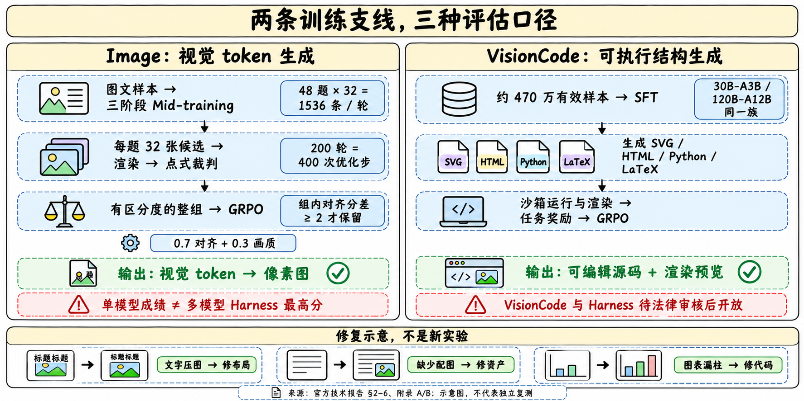
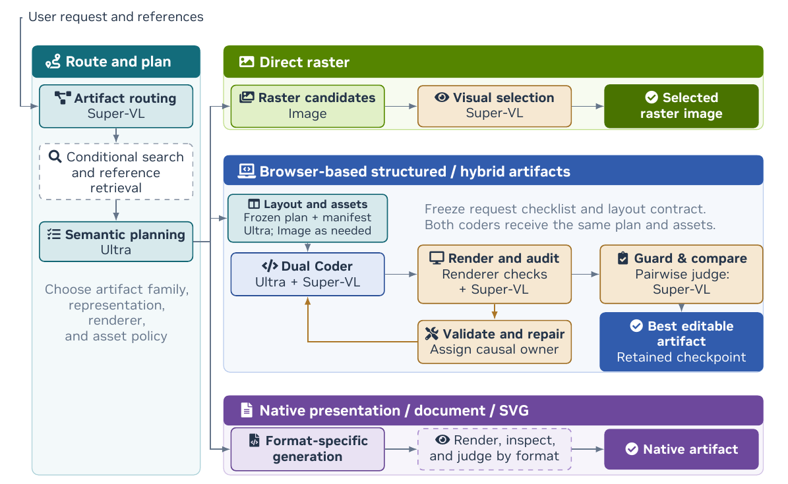
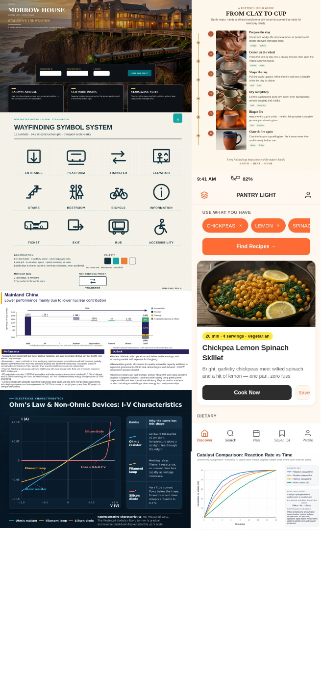

# Nemotron-Labs-VisionCode — 用执行与渲染反馈训练可编辑产物

> [!tldr]
> 我的判断：VisionCode展示的是“视觉输入/文字需求→可执行结构”专项后训练，适合借鉴其sandbox outcome reward。120B五任务归一化总分98.27不是准确率，也不等于Image模型或已开放Harness达到的端到端分数。30B和120B归同一专项family，底座不同，不能当作主干新正代。

> [!warning] 论文公开不等于权重开放
> 与Image共享arXiv:2611.31358，首版11/23 18:57:41UTC→北京11/24 02:57。两款VisionCode在报告中训练和评测，当前官方Release Plan仍写待法律审核后开放，Harness也同样待开放。本条是**论文披露的研究模型**；未下载或运行权重，不制造可用模型仓库或服务链接。完整报告HTML与所有原表、图已归档，独立复现和完整训练数据仍缺。

## 问题与两款模型

> [!tldr]
> 一张看起来正确的图不一定有可编辑源码；代码能运行也不代表可视结果满足文字、几何和布局。这里把二者都纳入训练与评测。

| 型号 | 初始化底座 | 预测对象 | 当前开放 |
|---|---|---|---|
| VisionCode30B-A3B | Nemotron-3-Nano-Omni-30B-A3B GA | SVG、HTML/CSS、绘图Python、文档标记/编辑 | 未承诺已开放权重 |
| VisionCode120B-A12B | Nemotron-3.5-Super-VL | 同上；训练数据和训练程序同30B | 同上 |

“Pixel as Code”是共同表示/渲染接口，而非两模型共享一套视觉词表。Image生成token经学习到的decoder变像素；VisionCode生成程序，由SVG/browser/office/plotting/LaTeX等真正运行。混合产物可以在可编辑布局中嵌入栅格资产。论文中浏览器Dual Coder用Ultra+Super-VL，**不是**把这两款VisionCode自动作为已部署双编码器；native文档路线又有各自格式生成器。

## 数据、SFT与任务RL

约4.7M“有效样本”包含采样重复，不是4.7M唯一任务。覆盖视觉重建、文字条件生成、编辑和代码理解：SVG生成/编辑/理解，网页截图→源码及网页编辑，图表程序/结构/理解，公式转录、表格转LaTeX、CAD。另混合教师生成CoT和直接ground-truth锚点。两款先多模态coding SFT，再GRPO；报告没有给出可复跑的全部样本清单、两款精确SFT步数/学习率和RL预算，不从Image的200轮/400步外推过来。

任务sandbox执行Python、渲染SVG与HTML/CSS、编译LaTeX。Execution checks检查运行、渲染、编辑解析、文档编译；quality检查重建保真、Text2SVG图文一致性与美学、编辑准确率。该任务奖励不等于Image的“.7对齐+.3画质”，同名GRPO也不证明共享裁判或超参。最终reward重在可执行结果与可见产物，而不是仅评价生成解释是否流畅。

## 五任务如何评分

所有报告的代码模型比较均开启thinking。Chart2Code看F1和执行率；Img2SVG看render、DINOv2相似和SSIM；Text2SVG看render、美学、CLIP；Design2Code看render、Composite、CLIP；Image2Struct看compile和FID-sim（原文明确保留higher-is-better“相似度”定义，不可误当越小越好的FID距离）。

每个metric除以比较集合中该列最好值×100，先在任务内平均，再五个任务等权；前两任务总分权重2/5、后三任务3/5。缺任一必需测量不出相应overall。这个总分依赖比较对象和metric集合，不能跨论文直接比较，也没有给出显著性或置信区间。

| 模型 | 图表+Img2SVG(2任务) | Text2SVG+网页+文档(3任务) | 五任务总分 |
|---|---:|---:|---:|
| NanoOmni30B GA | 46.81 | 62.93 | 56.48 |
| VisionCode30B | 91.17 | 95.25 | 93.62 |
| SuperVL120B | 93.12 | 91.96 | 92.42 |
| VisionCode120B | 97.47 | 98.80 | 98.27 |
| KimiK3.1Pro | 96.28 | 93.21 | 94.44 |
| Qwen3.5-35B-A3B | 87.29 | 缺Text2SVG | 不计算 |
| Qwen3.5-122B-A10B | 90.54 | 缺Text2SVG | 不计算 |

### 完整关键原始指标

| 模型 | Chart F1/Exec% | Img2SVG Render%/DINO/SSIM | Text2SVG Render%/美学/CLIP | Design Render%/Composite/CLIP | Struct Compile%/FID-sim |
|---|---|---|---|---|---|
| NanoOmni30B | 64.12/49.37 | 31.67/.2548/.2138 | 98.67/4.3097/.2179 | 88.64/.7528/.7689 | 20.25/.1829 |
| VisionCode30B | 70.10/85.30 | 100/.8555/.8016 | 100/4.6342/.2484 | 100/.9314/.9155 | 94.25/.8732 |
| SuperVL120B | 73.16/96.66 | 98.33/.8479/.7235 | 100/4.7987/.2588 | 100/.9034/.8991 | 83.83/.7779 |
| VisionCode120B | 78.51/99.17 | 100/.8820/.7829 | 100/4.7730/.2857 | 100/.9483/.9405 | 97.08/.9190 |
| Qwen35B | 72.76/79.55 | 94.33/.8128/.7194 | 未报告 | 100/.9154/.9065 | 70.42/.6606 |
| Qwen122B | 74.04/84.84 | 98/.8456/.7353 | 未报告 | 100/.9149/.9090 | 65.25/.6125 |
| KimiK3.1Pro | 69.66/95.80 | 99.67/.9200/.8800 | 100/5.3500/.2600 | 99.38/.9300/.9300 | 81.67/.7680 |

120B总分领先，但Kimi的Img2SVG DINO/SSIM及Text2SVG美学更高；VisionCode120B的Text2SVG美学4.7730还低于原SuperVL4.7987。这些反例不能被“所有维度提升”概括。参数更小是规模描述，未给出同条件端到端时间或token成本，不能仅凭活跃参数推断总预算更省。

## 创建Harness：怎样让渲染证据变成修复动作

先固定原始需求与可观察验收清单（带稳定ID、content hash）、resolved layout（canvas、safe margins、overflow、区域边界/顺序、文字与组件预算）、asset manifest。渲染检查定位缺失、越界、遮挡、运行/交互错误；多模态审核按稳定selector提出可见证据、root-cause、confidence和owner。修复只更新plan、asset、layout、code、interaction或content的责任层，冻结无关区域，避免修改检查标准来让产物过关。

默认4个栅格候选；浏览器每轮2修复候选，最多接受3修复、总尝试8次，layout/search-template replan各1次；pairwise盲比较不看模型和迭代身份，硬约束不能被审美抵偿，平手或confidence<.75保留旧checkpoint。文中展示文字压图修布局、缺图修资产、城市图表恢复20根柱及标签/数值/图例，是定性完整系统案例，不是VisionCode逐模块消融。

> [!insight]
> 对Agent Training：最有价值的数据单元可不是“截图+更好代码”二元对，而是冻结要求、原产物、渲染失败、责任层、修复范围、修后证据与保留决策的完整记录。需要用固定预算和同一渲染器比较SFT/GRPO前后，分别统计运行成功与可视正确，防止只优化compile pass或主观审美。

## 材料与未完成项

- [[src/official_tables_20261126|报告全部原表]]、同目录完整HTML和官方图。
- [[Topics/13_base_model/NVIDIA_Nemotron/Variants/261124_Nemotron_Labs_Image/Nemotron-Labs-Image|Image生成器：数据、tokenizer与GRPO详细笔记]]。
- [Tech Report HTML](https://arxiv.org/html/2611.31358v1)、[首版日期](https://arxiv.org/abs/2611.31358)、[官方Release Plan](https://huggingface.co/nvidia/Nemotron-Labs-Image-30B-A3B)。没有为VisionCode伪造独立HF权重页。
- 待核：权重/代码正式开放、全量训练与eval输入、harness执行日志、计算预算与独立复现。

> 📊 相关可视化: [[nemotron_labs_visioncode_poster_zh.html|中文Poster]]
