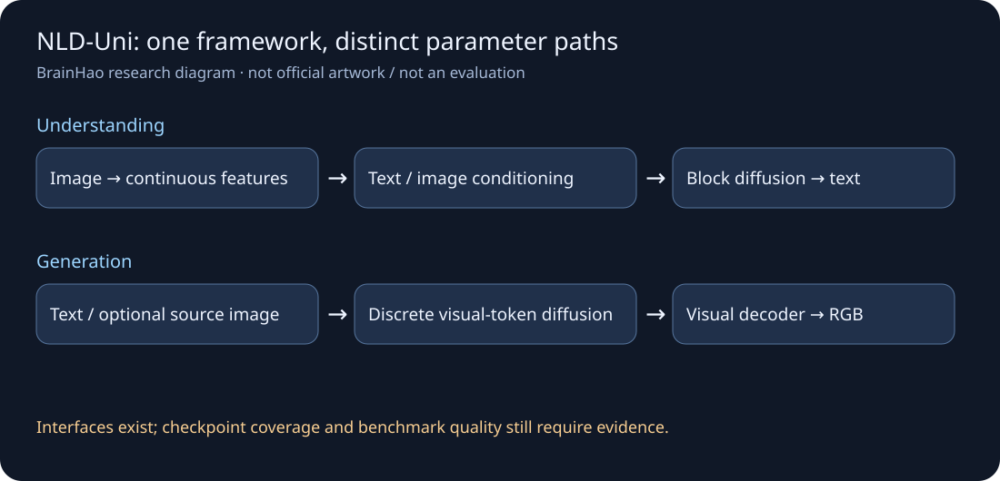
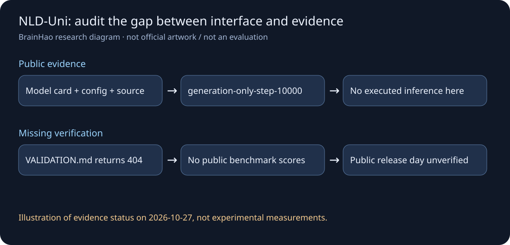

# NLD-Uni：理解、生成与实际 checkpoint 要分别验收

> [!tldr]
> 官方将 Nemotron-Labs-Diffusion-Uni-8B 描述为统一图文理解与图像生成模型，但“统一”指共同框架内存在不同 transformer 参数路径，不是所有任务完全共享同一条计算路径。公开卡列出了大量应评测的基准，却没有附这些基准的成绩。当前 release manifest 还标记 `generation-only-step-10000`，因此架构接口存在不能代替此 checkpoint 的双任务质量证据。

> [!warning] 原始资料较少，达不到完整技术报告精读标准
> 目前读到 HF 卡、配置、公开实现、release/weights manifests 与仓库 LICENSE。卡引用的 VALIDATION.md 返回 404，当前公开文件树没有 validation.json、examples/results.json 或官方结果图片；没有找到独立报告链接和可核验 benchmark 表。下面配图是根据公开资料整理的结构图，**不是官方图片、生成样例或实验结果**。10/28回读的公开卡已明确写10/27/2026，日期缺口关闭；旧卡的内部GitLab10/17仅作历史证据，不曾访问内部服务。

## “统一”具体统一在哪里

理解路径将输入图像编码为连续视觉特征，结合文字输出文本；生成路径通过离散视觉 token 的迭代扩散，再解码成 RGB 图像。Mixture-of-transformers 让二者处在共同多模态框架中，同时保留专门的参数路径。以“能看图”和“能画图”概括会遗漏训练目标、表征和推理协议之间的差异。[S1]

卡还提到 AR 与 blockwise diffusion 两种文本解码能力；当前 `modeling_nlduni.py` 的 `generate` 接口明确实现 greedy block diffusion without thinking。架构一般能力、当前实现入口与某个 checkpoint 的训练覆盖必须区分。不能因为卡同时举了 t2i/edit/understand 示例，就宣称每条任务路径都已经达到可用精度。

## 公开文件给出的实际边界

| 对象 | 核对结果 | 不应推断 |
|---|---|---|
| 名称 | 卡称 Nemotron-Labs-Diffusion-Uni-8B | 不凭名字重新估算整个视觉系统参数量 |
| backbone config | hidden 4096、34 层、32 attention heads、8 KV heads | 不等于训练架构完整披露 |
| 位置配置 | max_position_embeddings 131072、YaRN 参数 | 不代表 128K 多模态质量已验证 |
| 权重说明 | 8 个 BF16 shards，1,557 个 active tensors | 1,557 是张量数，不是模型/专家数 |
| release manifest | revision `generation-only-step-10000` | 不是完整多任务能力的验收证书 |
| 生成实现 | 接受 256/512/1024，含 1024 配置 | 接口允许的分辨率不等于逐档均验证 |
| 代码 | `text_to_image`、`image_edit`、`generate` | 没有执行，不能声称推理跑通 |
| 参考环境 | Python 3.13、CUDA 12.6、H100 80GB | 不保证消费级显卡适配与速度 |

8 个 shard 的存在和 manifest hash 是分发证据，不是本轮下载或校验过模型权重。本轮只下载文本配置、代码与许可，不下载 checkpoint，也不执行 `trust_remote_code`。

## 模型卡的验证链接为什么值得单独检查

卡称三组英文场景（物体、动物、风景）串联生成、编辑、问答，并指向验证文件。即使这些文件存在，它们也只构成功能 smoke test，不是准确率或系统可靠性估计。当前返回的实际公开文件树没有这些文件，VALIDATION.md 直接抓取 404，因此连这三组具体样例都尚不能独立复核。

卡列出的评测清单很具体，但用词是应当识别 split、报告协议；下面是**待报告项目**，不是模型已获得的分数。

| 能力 | 卡列出的基准 | 必须补足的证据 |
|---|---|---|
| 数学/科学/通识视觉 | MathVista MINI、MMMU DEV/VAL、AI2D、ScienceQA | 样本数、split、抽答 judge、是否含图片 |
| 文档与文字 | ChartQA、DocVQA、TextVQA、InfoVQA、OCRBenchV2-EN | ANLS/归一化、语言子集、各类聚合 |
| 真实图像 | RealWorldQA | 图像/提示协议、完整准确率 |
| grounding | ScreenSpot-Pro、RefCOCO | first-pass 与 crop-refined 分开，坐标协议、IoU |
| 文生图 | GenEval、DPG-Bench、MJHQ-30K | 类别成绩、FID、judge 版本与采样策略 |

没有这些结果时，不写 SOTA、不填百分数，不把图像专用扩散模型或早期 LaVida-O 的成绩移植到 NLD-Uni。100M+ image-text pairs 只说明卡中的训练规模层级，数据来源类别为自动/人工/合成混合，未给精确数据混比、训练阶段 loss 权重和独立消融。

## 部署与许可的两个实质问题

SGLang 适配在卡中限定为理解和文本生成路径，并不证明它能服务图像生成。原生图像接口返回 Pillow image，理解默认返回文本，`return_token_ids` 可改返回 token；接口可调的 seed、steps、refinement、guidance 会改变成本与产物，比较时需全量记录。

卡的许可链接指向另一个 `NL-Diffusion-Image` 仓库，但本轮读取的 NLD-Uni 仓库 LICENSE 明确 **non-commercially，仅 research/evaluation；NVIDIA 及其 affiliates 例外**。这里记录实际文字与链接不一致，不把“Open Source”标题理解为通用商业许可，也不替用户作商业可用性结论。

## 对 Agent Training 的研究判断

> [!insight]
> 一个模型生成图、修改图、再回答自己的图，可能在多个步骤延续同一错误。Agent 评测应加入独立观察器和外部验证，分别测任务指令遵守、编辑区域外保持、可见文字保真、grounding 与最终状态，不能只让同一模型给自己打分。

先补可公开复现的 functional cases 与原始输出，再固定 checkpoint revision、tokenizer、seed、steps、输入预处理和 judge 做 benchmark。将图像理解作为只读观测、图像编辑作为有副作用的动作分别评估；测试 Agent 是否把视觉上逼真的合成内容当作已核实事实。上述是实验建议，不是已完成结果。

## 一手资料与导航

- [S1] [🤗 HF Model Card](https://huggingface.co/nvidia/NLD-Uni)，本地 [[src/hf_model_card|模型卡原件]]。
- [S2] [公开文件树](https://huggingface.co/nvidia/NLD-Uni/tree/main)；本地 [[src/release_manifest.json|release manifest]]、[[src/config.json|配置]]、[[src/modeling_nlduni.py|接口实现]]。
- [S3] [仓库 LICENSE](https://huggingface.co/nvidia/NLD-Uni/blob/main/LICENSE)。
- [[Topics/13_base_model/Base Model MOC|基模主题索引]]；[[nld_uni_poster_zh.html|中文 Poster]]。

> 📊 相关可视化: [[nld_uni_poster_zh.html|NLD-Uni 中文 Poster]]

## 2026-10-28：日期证据修正

公开原卡将旧的内部GitLab10/17链接改成明确的10/27/2026。此前Atlas只记月份，本次精确到10/27并进入30天表；训练、动作解码能力和权重身份没有据此改变。
