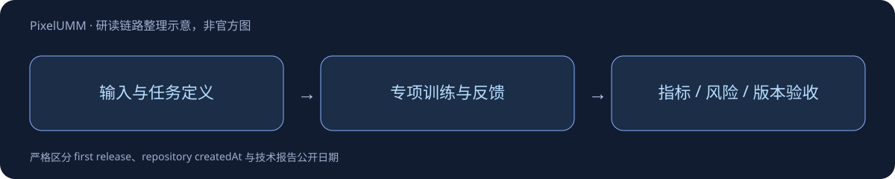

# PixelUMM

> [!tldr]
> encoder-free图像视频统一理解/生成；9月29日UTC报告首次公开，对应北京时间9月30日。 以pixel patches/tubelets经单层线性投影接共享主干，Mixture-of-Transformers用共享attention与任务特定参数兼容文本自回归和pixel-space flow matching。不以独立预训练视觉encoder作为唯一表示入口。

## 一页速览

| 项目 | 当前证据 |
|---|---|
| 日期 | 2026-09-30  |
| 归属 | nvidia · 专项支线 |
| 关键事实1 | 约15.20B |
| 关键事实2 | Qwen3-8B语言主干 |
| 关键事实3 | RGB 16×16patch；迭代去噪 |

## Pixel-space 统一的目标与代价

image用空间patch，video用时空tubelet，经线性projection进入共享backbone；共享attention加任务专用参数，同时支持自回归文字与flow-matching像素生成。model card给出15199672064参数和固定Qwen3-8B revision。RGB16×16patch是卡中图像规格，不能机械推广为所有视频tubelet规格。

encoder-free不等于完全没有视觉映射，而是不依赖单独的预训练视觉encoder。是否节省视觉上下文，必须比较相同分辨率/帧数/质量与真实计算预算，不能仅从结构示意推导端到端速度。

## 日期与证据

报告v1为2026-09-29 21:59:07 UTC，即北京时间9月30日。这一日期代表研究报告首次公开；HF10月1日createdAt是权重仓库创建时间，不能据此断言权重提前公开。

> [!warning] 未完成全文精读
> 已读官方model card及报告摘要，尚未逐节读31页技术报告/源码，不能达到GLM-5.3-Flash的实验与消融分析深度。当前不报未经亲读核验的benchmark数值。权重采用NVIDIA非商业研究授权，代码Apache2.0，两者不能混写。模型未验证生产或高风险用途。

## 对 Agent Training 的判断

> [!insight]
> 统一表示的优势需与上下文token数、时空patch大小和计算预算一起评估。分别测视频时序、图像理解与生成质量，不用一张demo证明所有任务迁移一致。

以上是基于已读材料的研究判断，未在本机复现模型推理或训练结果。

## 官方来源与导航

- [S1] [HF Model Card](https://huggingface.co/nvidia/PixelUMM)
- [S2] [Tech Report](https://arxiv.org/abs/2609.38597)

- [[src/retrieval_manifest.json|原始抓取记录]]
- [[pixelumm_poster_zh.html|中文Poster]]
- [[Topics/13_base_model/Base Model MOC|基模主题索引]]

> 📊 相关可视化: [[pixelumm_poster_zh.html|中文研究Poster]]
