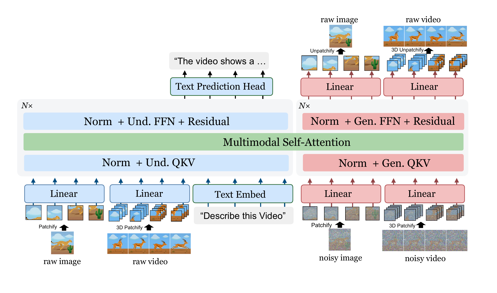

# PixelUMM

**PixelUMM: Encoder-Free Unified Image and Video Understanding and Generation**

PixelUMM is an NVIDIA-developed, encoder-free unified multimodal model for joint
understanding and generation across text, images, and video directly in pixel
space.

> PixelUMM is released for non-commercial research or evaluation purposes only.

## Overview

Images are represented as pixel patches instead of embeddings from a separate pretrained
vision encoder, allowing understanding and generation to share a Transformer-based
representation.

PixelUMM supports:

- text-to-image generation;
- image-conditioned text generation;
- video-conditioned understanding; and
- video generation.

## Model Architecture

- **Architecture:** Decoder-only Transformer with raw-pixel patch embeddings and
  an iterative pixel-generation head.
- **Language backbone:**
  [Qwen/Qwen3-8B](https://huggingface.co/Qwen/Qwen3-8B), revision
  `b968826d9c46dd6066d109eabc6255188de91218`.
- **Image representation:** RGB images divided into 16-by-16 pixel patches.
- **Generation:** Iterative denoising for image and video generation.
- **Parameters:** 15,199,672,064.

## Inputs and Outputs

PixelUMM accepts text, RGB images, and video frames. It produces text, RGB images,
and video frames.

## Installation

PixelUMM requires Linux, an NVIDIA GPU, a CUDA build of PyTorch, and
FlashAttention. Install PyTorch and FlashAttention for your CUDA environment, then
install the remaining dependencies.

## Intended Use

PixelUMM is intended for researchers and developers studying unified multimodal
modeling, pixel-space representation learning, multimodal understanding, and image
or video generation. Example uses include:

- studying shared representations across text, images, and video;
- evaluating encoder-free multimodal architectures;
- generating images or video from text prompts; and
- producing text conditioned on images or video.

PixelUMM has not been validated for production or high-stakes use.

## Limitations and Safety

PixelUMM may produce inaccurate, offensive, or otherwise inappropriate content.
It may not follow prompts reliably and may produce semantically or temporally
inconsistent outputs. Performance may vary across languages, visual domains,
video duration, resolution, aspect ratio, and hardware.

Users should implement appropriate safety measures, including content filtering,
abuse monitoring, and access controls. Users are responsible for model inputs and
outputs, for obtaining the rights and permissions required for input content, and
for complying with applicable laws and regulations.

## License

The PixelUMM source code is licensed under the
[Apache License 2.0](LICENSE). Third-party notices are provided in
[THIRD_PARTY_LICENSES.md](THIRD_PARTY_LICENSES.md).

The PixelUMM model checkpoint is a separate artifact licensed under the
[NVIDIA One-Way Noncommercial License](https://developer.download.nvidia.com/licenses/NVIDIA-OneWay-Noncommercial-License-22Mar2022.pdf).
Its use is limited to non-commercial research or evaluation purposes.

PixelUMM uses the [Qwen3-8B](https://huggingface.co/Qwen/Qwen3-8B) base model,
which is licensed under Apache-2.0, and includes modified code derived from
[BAGEL](https://github.com/ByteDance-Seed/Bagel). Users are responsible for
complying with all applicable upstream licenses and terms.

## References

- [Qwen3-8B model repository](https://huggingface.co/Qwen/Qwen3-8B)
- [BAGEL source repository](https://github.com/ByteDance-Seed/Bagel)
