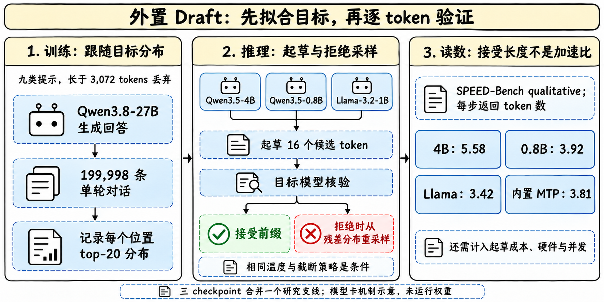

> [!tldr]
> NVIDIA把三个完整小语言模型训练成Qwen3.8-27B的外置drafter，目标是贴近目标模型的实际采样分布，减少昂贵target的解码步。4B、0.8B与跨词表Llama三款合并一个推理专项family，不是Qwen新正代。最有价值的研究点是**训练分布与服务分布对齐**，以及更长接受序列能否抵消额外起草成本；卡中没有足够wall-clock数据支持“5.58倍更快”。

> [!warning] 日期、范围与未复现
> 三卡均明确Release Date 11/17/2026；官方HF活动type=publish为UTC11/17 15:53:22.696–24.344，即北京11/17 23:53:22–24，可相互核对。11/11仓库创建日不是首发。已读三卡、三组config/generation_config、ModelOpt external文档与recipe；没有下载权重、语料或执行官方训练/推理脚本，未审所有实现。当前main文档的参考配方不等于全部发布checkpoint的不可变run配置。

## 一个目标、三个完整起草模型

> [!tldr]
> 外置draft保留自己的层、embedding和输出head；它与EAGLE/DFlash等接在target上的head不同。最终文本由target核验产生。

|起草底座|Embedding B|非Embedding B|总量 B|层/hidden|最大位置配置|
|---|---:|---:|---:|---|---:|
|Qwen3.5-4B|0.64|3.57|4.21|32 /2560|262144|
|Qwen3.5-0.8B|0.25|0.50|0.75|24 /1024|262144|
|Llama3.2-1B|0.51|0.97|1.48|16 /2048|131072|
|Qwen3.8-27B内置MTP|0（共享）|0.42|0.42|依赖target|不能独立运行|

三份发布config均BF16、tie_word_embeddings=true、vocab_size=248320。参数表只算一份共享输入/输出矩阵；MTP不自行存embedding/head，却依赖target中另2.54B共享参数。Llama迁到Qwen词表后大于原1B底座，不是凭空更大hidden；Qwen两卡训练长度为12288，配置的262144不等于已经验证那么长，长上下文测试仅33k–46k prompts。

ModelOpt文档把外置模式与head模式区分：target冻结且不改，在推理时不依赖它的hidden来驱动draft。模型卡声明基于Llama3.2-1B，参考训练示例写Llama3.2-1B-Instruct；本文保留两种来源表述，不擅自认定实际初始化完全一致。许可为NVIDIA Open Model Agreement，并分别保留Qwen Apache与Llama3.2 Community License义务，不能统一写成Apache2.0。

## 数据、词表迁移和训练目标

> [!tldr]
> 这里学习的是目标自身生成路径上的软分布，不是原数据集已有的assistant回答。截断策略决定teacher到底是什么。

三卡给199998条单轮对话，Nemotron-Post-Training-Dataset-v2只取prompt：STEM、code、math、chat，以及德/西/法/意/日五语言，固定seed近等份；超过3072token的prompt丢弃。由Qwen3.8-27B合成回答，每个response位置记录target部署策略下top20输出分布。固定温度1、top-k20、top-p0.95；不是不受限原始softmax。卡上的宽泛“1B–10T text training data size”标签，不可替代这批199998条的精确说明，也不推算每条都达到长度上限。

跨tokenizer时先按target词表尺寸新建embedding；相同拼写token的旧行迁到新位置，其余从draft embedding统计分布随机初始化；untied输出head也对应重建，并重映射特殊tokens，再做分布对齐。迁移匹配率衡量词表重合，不是模型质量；对小draft，词表矩阵占比很大。推理时因此直接共享token ID空间，无需逐token再翻译。

记target与draft**实际服务**分布为p、q。精确拒绝采样接受y的概率为min(1,p(y)/q(y))，拒绝后从归一化的正残差[p−q]+重采样。在相同条件、正确实现下：

$$
P(\mathrm{accept})=\sum_y\min(p(y),q(y))=1-\tfrac12\sum_y|p(y)-q(y)|.
$$

这是单token推导，不是卡中“每target步返回token数”的另一个名字；目标输出分布不变依赖核验/残差采样、温度与截断一致，并非draft自己生成的文本质量得到保证。

|ModelOpt当前目标|teacher / draft所见分布|条件与不能混用的地方|
|---|---|---|
|soft_ce|teacher软分布交叉熵|dense hidden-state路径；与sparse_data_path配对为硬错误|
|tvd|总变差距离|draft未施加服务截断；稀疏teacher仍是截断分布|
|tvd_deploy|两侧都施加同一服务top-k/top-p后的TVD|只有这一路直接对应实际拒绝概率|
|tvd_ce|tvd加teacher argmax交叉熵|示例权重0.9/0.1；加了CE后不是纯拒绝率|

当前recipe默认tvd；说明文档推荐先试tvd_deploy，但其Open Items说dense/soft_ce/tvd_deploy仅测试覆盖、未完整端到端run；已经完整跑通的是sparse+tvd/tvd_ce和跨词表迁移。不能把“推荐”写成发布者已验证全部路径。保存dump没有记录top-p，top-p不匹配不会自动发现；仅top-k部分有warning。温度不等于1时，训练温度1分布也不再等同部署分布。

Llama→Qwen参考配置给8GPU、2epoch、seq12288、每设备batch1×accum2=effective16、LR5e-5、warmup250、clip1、seed42、vocab_swap=true、tvd_ce。它是明确标为reference configuration的当前main说明，不补写为三个HF权重实际run全部如此。不同LR/loss经过接受长度sweep；实际checkpoint的完整学习率、校准、训练算力和数据hash仍不足。

离线dump必须只score assistant spans；chat template的generation标签要逐片段解码核对，不能只数token。producer会跳过超长整段对话，collator按seq_len padding；过长配置浪费padding、过短丢样本。首轮建memmap成本高，cache_dir与shard列表必须固定；多个并发任务不能误复用另一份teacher缓存。这些是文档中的数据与harness约束，本文没有执行它们。

## 完整接受长度表与硬件边界

> [!tldr]
> 小模型有反例：0.8B在长上下文平均低于内置MTP，Llama在两套平均均低。4B全部分类接受长度较长，也没有由此得到已测的端到端加速。

卡把acceptance rate定义成每个target步骤返回的token数，以下按该单位保留，不写成百分比。draft block size=16；同一target、数据和harness，按类别平均。qualitative为1138 conversation turns，throughput-32k为1536条33k–46k单轮prompt，三种entropy各512条。

|qualitative分类|4B draft|0.8B draft|Llama draft|target MTP|
|---|---:|---:|---:|---:|
|coding|5.22|3.79|3.29|3.78|
|humanities|5.39|3.79|3.29|3.61|
|math|5.61|3.79|3.10|3.63|
|multilingual|6.55|4.67|3.55|4.38|
|qa|5.39|3.88|3.65|3.75|
|rag|6.58|4.78|4.19|4.68|
|reasoning|5.98|4.12|3.50|3.93|
|roleplay|4.41|3.10|3.02|3.16|
|stem|5.44|3.72|3.10|3.61|
|summarization|6.19|4.26|4.03|4.13|
|writing|4.59|3.22|2.91|3.29|
|Overall Average|5.58|3.92|3.42|3.81|

|throughput-32k分类|4B draft|0.8B draft|Llama draft|target MTP|
|---|---:|---:|---:|---:|
|low_entropy|5.80|4.17|3.55|4.73|
|mixed|5.53|3.80|3.12|3.85|
|high_entropy|4.01|2.84|2.54|3.00|
|Overall Average|5.11|3.60|3.07|3.86|

“throughput-32k”是子集名，表格仍为接受长度，不能误写成tokens/s。卡没有完整延迟、并发、功率、方差或逐任务原始run，bonus token计数细节也未在这份卡充分展开。小draft省计算但接受较少，4B接受较多但起草更贵；prefill、target验证成本、KV缓存及batch不同都可能改变最优点。

硬件说明同时列vLLM / Blackwell、测试硬件“NVIDIA Groq3 LPU”，并说明意图在LPU编译和运行；又称标准HF包可加载vLLM、SGLang、TRT-LLM。这是作者部署说明的不同层次，未提供可复核GPU端到端速度；本文不把LPU接受长度推成GB300上的加速比。标准HF external draft不需要把head再export，head-export脚本对它应拒绝；是否需要特定serving版本仍要独立核验。

## 对 Agent Training 的判断与资料地图

> [!insight]
> 这是把“训练数据构造”对齐“推理时真实状态分布”的小而清楚案例。先固定target、截断、温度、tokenizer和上下文，再从其自身rollout蒸馏，优化实际拒绝率，并以每个成功Agent任务的时间/成本选draft。不能只追top1 agreement或接受长度，也不能把精确拒绝采样的分布保证扩成最终Agent行为等价已实测。

可以做三个区分实验：词表匹配与跨词表但同预算；tvd与tvd_deploy/tvd_ce但同teacher dump；短上下文与长上下文专项数据但同目标任务。必须固定核验协议与失败样本分母，记录输出分布检查、真实延迟和worker资源。当前无原始run/多种子CI，也未对Agent终态收益做直接评估，所有实验均为建议而非完成。

- 三份[4B模型卡](https://huggingface.co/nvidia/Qwen3.5-4B-Qwen3.8-27B-Draft)、[0.8B模型卡](https://huggingface.co/nvidia/Qwen3.5-0.8B-Qwen3.8-27B-Draft)、[Llama模型卡](https://huggingface.co/nvidia/Llama-3.2-1B-Qwen3.8-27B-Draft)
- [ModelOpt external说明](https://github.com/NVIDIA/Model-Optimizer/blob/main/examples/speculative_decoding/doc/external_draft.md)、[当前recipe](https://github.com/NVIDIA/Model-Optimizer/blob/main/modelopt_recipes/general/speculative_decoding/external_draft.yaml)
- [官方发布活动](https://huggingface.co/organizations/nvidia/activity/all)；只用publish动作，不用仓库创建或lastModified。
- src中保留三卡/六配置、ModelOpt文档/recipe、publish证据；没有独立本family专属技术报告或官方机制图，手绘图是机制解释，不替代原始实验。
- [[Topics/13_base_model/NVIDIA_Nemotron/Variants/2611_Sigma/Sigma]]、[[Topics/13_base_model/Alibaba_Qwen/2608_Qwen3_8/Qwen3.8-Family]]
- 中文Poster：[[Topics/13_base_model/NVIDIA_Nemotron/Variants/261117_Qwen3_8_27B_External_Drafts/external_draft_poster_zh.html]]
