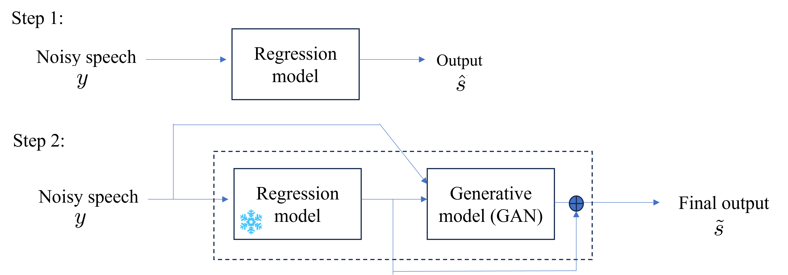
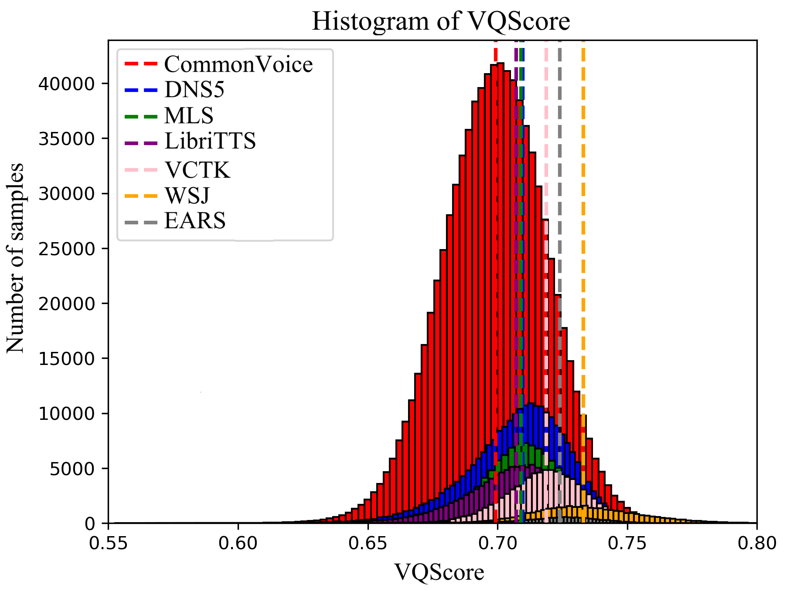
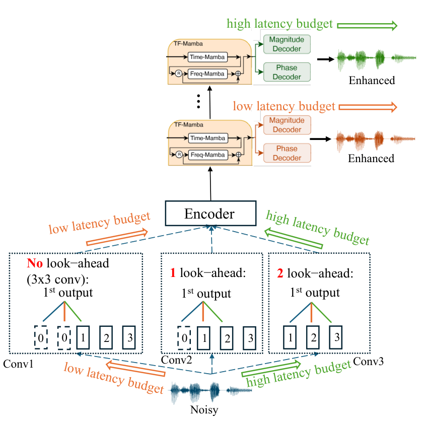

# RE-USE Family：让语音更清楚，不能把丢失的信息当成恢复的真相

> [!summary] TL;DR
> RE-USE 是约 9.6M 参数的语音增强模型，不是新的聊天基模。旧官方卡明确记载 **2026-03-18** 发布；**2026-10-22** 的 NemotronLabs 标准版及 laughter 版在同一 family 下记录为发布/变体更新。它处理噪声、混响和带宽等损伤，但双向时间建模并不支持据此宣称实时流式；更清晰的语音也不等于文字、说话人和情绪完全不变。

> [!warning] 原始资料不足：未达到完整版本技术报告精读的证据深度
> 已有两篇原论文，而不是“没有论文”：本笔记阅读了原卡、配置、推理/模型源码和论文相关方法、实验与限制，保存了官方原图。然而旧卡明确说发布 checkpoint 与论文版本不同；新卡也没有逐权重映射到论文各阶段，没有 laughter 专门的笑声保留测试、完整训练可复现链或部署延迟表。**因此当前笔记不能达到“把论文每个结论都归属于这两个 10/22 权重”的完整精读标准**。本轮没有下载 PDF、模型权重或音频，没有运行官方代码及本地复测。

## 🧭 先把时间、模型与许可分开

| 对象 | 明确日期与用途 | 本图谱处理 | 不能据此推出 |
|---|---|---|---|
| `nvidia/RE-USE` | 原卡写 Hugging Face 2026/03/18；旧版本名 `30USEMamba_peak+GAN_tel_mic_1134k` | family 首发保留 3/18，补回历史叶子 | 不能把 10 月创建的新仓库当首发 |
| `NVIDIA-NemotronLabs-RE-USE` | 新卡写 10/22/2026，标准语音增强 | 同 family 新发布阶段 | 不能断言与旧权重逐位相同，也不能断言重训了一代 |
| `…-RE-USE-laughter` | 新卡同为 10/22；额外涉及 VocalSound、笑声保留用途 | 同 family 的 laughter 变体，不拆正代 | 不能只靠整体分数证明笑声保真 |
| `Real-time_RE-USE` | 原卡链接的另一实时工作，用于机制对照 | 本篇背景来源，不替换双向 checkpoint | 不能把其因果/延迟设计移植成标准版已有能力 |

三月旧卡为 NVIDIA One-Way Noncommercial 条款；十月新卡与仓库主 LICENSE 写 **OpenMDW-1.1**，新代码文件也有对应标记。但新仓库的 Explainability / Safety 子卡仍链接 NVIDIA Open Model License。这里如实保留这处来源不一致，不能把旧卡自动重授权，也不提供商业使用的法律结论。实际使用应按选定仓库 revision 核对完整条款及依赖；本轮只阅读、归档，没有接受协议或运行权重。

## 🎯 为什么语音增强不只是“降噪”

录音的退化往往叠加：环境噪声、房间反射、削波、电话带宽、编码失真、丢包、麦克风响应都会影响可懂度。模型希望恢复听感，同时保留语言内容、身份、口音、情绪。这两个目标存在张力：回归输出容易平滑，生成性补偿则可能制造听起来合理却不真实的音素。

对语音 Agent，风险不止 WER：笑声、犹豫和第二个说话人的话可能具有任务含义。新卡的重叠说话人设定是突出主说话人、抑制其他声音，**不是分离并完整保留所有发言的会议档案工具**。本笔记不把增强音频当事实原件；原音应在授权范围内单独保留。

## 🧩 当前发布代码真正能确认什么

当前配置的 `num_tfmamba=30`、hidden feature 64、state 16、conv 4、expand 4。幅度与相位两个通道进入卷积编码器，经过时频 Mamba 块，再由幅度与相位 decoder 重建。源码中时间与频率各使用前向、反向 Mamba，并拼接投影；时间方向显式 `flip`，因此不是因果单遍流式。

默认 STFT 基准是 8 kHz、FFT/window 320、hop 40，即 **40 ms 窗、5 ms 帧步**。采样率适配代码按实际采样率缩放窗口与步长。不要把 5 ms hop 当端到端延迟：反向时间上下文、`center=True`、整段或重叠分块、GPU 计算都会贡献等待。

| 环节 | 源码/配置证据 | 工程判断 |
|---|---|---|
| 输入 | 原卡列 mono WAV 与 8/16/22.05/24/32/44.1/48 kHz | 脚本虽逐通道循环，不等于验证过空间/多通道保真 |
| 映射 | `mapping=True`，幅度及相位分别解码 | 不是只滤去噪声的固定线性滤波器 |
| 分块 | `inference_chunk.py` 使用 Hann 重叠、`window_sum` 归一化 | 是离线显存/长音频处理方法，不自动变实时 |
| 长度 | 输出 pad/trim 对齐输入，保存 FLAC | 文件长度对齐不代表事件边界或音素完全不变 |
| 频带 | 可选 `--BWE` 先重采样至目标率再增强 | 超出原始频带部分为推断，不是恢复可验证原始信号 |
| 设备 | 推理脚本在无 CUDA 时直接报 CPU 不支持 | 配置的 8 GPU 是训练设置，不是每次推理必需 8 卡 |

特别注意：分块脚本把 `from_pretrained` 仓库 ID 写死为标准版，命令行虽有 `--checkpoint_file`，主加载路径并未使用它。**不能仅替换文件名就声称已验证 laughter 推理**；应先审查具体版本的加载代码。此处只做静态审阅，不修改或执行原始材料。

## 📐 原论文的三个判断，与当前权重不要混为一谈

*官方原图，来自 2603.02641v4。它解释论文方案，不是 10/22 两个 checkpoint 的结构认证。*

第一，**“干净目标”本身决定学习问题**。论文比较早期反射与消声目标，主张保留直接路径的时间偏移，而不让模型额外学习把声音强行提前。侵入式指标依赖 clean reference，早期反射参考和原始消声参考不可混排；同样一段输出可因参考定义改变而得出不同结论。

第二，**回归与生成分工**。论文先用回归保留稳定内容，再以冻结的回归结果为基础做 GAN 残差修正，而不是让一套模型为听感整体改写信号。论文报告残差相关性与小规模听测支持这种分工，但这不是逐样本保证。当前公开主路径是 30 块 SEMamba 单次调用，不能只凭论文插图补写“该路径还加载了完整 6 层第二阶段 GAN”。

第三，**“clean”训练数据也可能不干净**。论文用 VQScore 做质量筛选，阈值提高会减少数据覆盖；情绪性、耳语等表达可能与质量评分偏好冲突。样本越多并不必然越好，筛选越严也不必然不损失多样性。新卡列的约 2500 小时是近似来源规模，不是本轮重新核对的去重训练账本。

*官方原论文数据质量图；不是 laughter 版的新评测，也不是本地画的实验结果。*

卡片列举 LibriVox/DNS5、LibriTTS、VCTK、WSJ、MLS、CommonVoice、内部 Riva，以及噪声、RIR、麦克风响应和模拟退化。约数不能直接相加得到精确总时长；laughter 卡额外提到 VocalSound，却未披露完整混合比、笑声标注分布或逐条件胜率。旧卡也明确提醒：发布模型加入麦克风/codec 等退化并在更高质量子集微调，区别于论文评测版本。

## 📊 新模型卡的结果：读完整，不只挑赢的指标

以下逐项转录模型卡 **URGENT 2025 non-blind** 表，数值是官方报告，非本轮复测；表中指标均按原卡名称。`Spk` 为 speaker similarity，`CAcc` 为 ASR character accuracy。论文的 ESTOI 和卡的 STOI 标签不擅自统一；不同 clean reference 或测试子集不能跨行当严格公平消融。

| 全采样率集合 | 参数 | DNSMOS | NISQA | UTMOS | PESQ | STOI | SBERT | LPS | Spk | CAcc |
|---|---:|---:|---:|---:|---:|---:|---:|---:|---:|---:|
| Noisy | — | 1.84 | 1.69 | 1.56 | 1.34 | .50 | .74 | .61 | .73 | 81.29 |
| Sidon | 250M | **3.34** | 3.87 | **3.21** | 1.73 | .62 | .85 | .80 | .74 | 84.68 |
| UniPASE | 500M | 3.21 | 4.03 | 2.96 | 2.17 | .76 | **.89** | **.85** | .81 | 87.28 |
| RE-USE 标准 | 9.6M | 3.29 | **4.33** | 2.94 | 2.57 | **.78** | .88 | **.85** | .86 | 89.17 |
| RE-USE laughter | 9.6M | 3.26 | 4.27 | 2.93 | **2.60** | **.78** | .88 | **.85** | **.87** | **89.21** |

| 16 kHz 子集 | DNSMOS | NISQA | UTMOS | PESQ | STOI | SBERT | LPS | Spk | CAcc |
|---|---:|---:|---:|---:|---:|---:|---:|---:|---:|
| Noisy | 1.84 | 1.59 | 1.41 | 1.29 | .53 | .70 | .58 | .63 | 76.54 |
| UniSE | 3.23 | 3.71 | 2.77 | 1.46 | .62 | .77 | .60 | .57 | 54.82 |
| RE-USE 标准 | 3.19 | 4.20 | 2.64 | 2.47 | .82 | .87 | .84 | .82 | 87.09 |

| 44.1 kHz 子集 | DNSMOS | NISQA | UTMOS | PESQ | STOI | SBERT | LPS | Spk | CAcc |
|---|---:|---:|---:|---:|---:|---:|---:|---:|---:|
| Noisy | 1.91 | 1.79 | 1.52 | 1.30 | .52 | .76 | .61 | .80 | 83.65 |
| Resemble Enhance | 3.13 | 3.68 | 2.11 | 1.33 | .41 | .69 | .46 | .57 | 47.22 |
| RE-USE 标准 | 3.36 | 4.44 | 2.80 | 2.47 | .80 | .89 | .86 | .90 | 91.54 |

| 48 kHz 子集 | DNSMOS | NISQA | UTMOS | PESQ | STOI | SBERT | LPS | Spk | CAcc |
|---|---:|---:|---:|---:|---:|---:|---:|---:|---:|
| Noisy | 2.04 | 1.83 | 1.99 | 1.28 | .55 | .77 | .77 | .78 | 90.64 |
| ClearVoice | 2.97 | 3.38 | 3.01 | 2.09 | .70 | .84 | .87 | .77 | 89.92 |
| RE-USE 标准 | 3.33 | 4.49 | 3.63 | 2.59 | .77 | .89 | .91 | .86 | 91.05 |

我的判断：标准版的 NISQA、PESQ 等显示出较强修复能力，但并非所有听感和语义指标最优。全集合 CAcc 从 81.29 到 89.17 是 **+7.88 个百分点**，不是在任意 ASR 或下游 Agent 上保证提升 7.88%。laughter 的总体微小差异也不能回答“笑声有没有保留”，还需要对应类别、身份与时长测试。

## ⏱️ 为什么另一个实时报告不能拿来给本模型背书

*官方原图来自 2606.25621v3，描述另一实时设计。它作为阅读对照保留，不冒充当前标准版结构。*

实时工作讨论 lookahead、early-exit 与多 decoder 等延迟/质量权衡。关键不是文件分成几块，而是需要多少未来音频、每步计算是否赶得上输入。当前卡的双向设计、长音频分块说明以及缺少实测延迟表，都不支持将其写成“零延迟流式”。训练片段短于 10 秒、长片段建议分块，也意味着跨块说话人/情绪一致性值得独立验收。

## 🧪 如果用于 Agent Training，该怎么设计实验

> [!insight] 我对这条支线的判断
> 它更适合当作改变观察分布的数据处理组件，而不是自动提升策略能力的奖励器。增强让 ASR 更容易，不等于 Agent 的推理、工具使用或长期 credit assignment 变好了；必须把感知收益和策略收益拆开。

| 问题 | 控制变量 | 需要留下的证据 |
|---|---|---|
| 是否真的减少听错 | 相同原音、ASR、prompt、语种、噪声分层 | 原音/标准/laughter 三路 WER、实体与数字准确率 |
| 是否改写原意 | 关键口令、否定词、人名、长丢包 | 人工逐段核验与不可恢复区标记，不只听感分 |
| 是否保留副语言 | 笑声/耳语/犹豫/重叠发言分层 | 身份、事件时长、第二说话人删除比例 |
| 是否提升任务成功 | 固定策略、环境、工具及 token 预算 | 最终状态验收、失败类型、成功任务成本 |
| 是否可部署 | 固定 GPU/采样率/时长/chunk/hop | p50/p95 延迟、峰值显存、跨块边界，不用 hop 代替延迟 |

采用独立的任务 verifier，不把生成器自己认为“更清晰”当 reward。训练集清洗还应记录每段音频输入哈希、处理版本、采样率与失败状态，避免把增强产生的伪音素固化成 SFT 标签。隐私子卡称使用了有同意的外部个人数据，但外部删除访问机制写 Unknown；这不是所有应用场景隐私合规已经完成的证明。Bias 子卡未给群体公平评测，不能写成已证实无偏。

## 🔗 一手资料与本地材料

- 🤗 [新标准版 Model Card](https://huggingface.co/nvidia/NVIDIA-NemotronLabs-RE-USE)；[laughter Model Card](https://huggingface.co/nvidia/NVIDIA-NemotronLabs-RE-USE-laughter)；[旧版 Model Card](https://huggingface.co/nvidia/RE-USE)。
- 📄 [Tech Report：训练目标、架构与数据质量](https://arxiv.org/abs/2603.02641)；[Tech Report：Real-time RE-USE](https://arxiv.org/abs/2606.25621)。报告 PDF 只保留链接，不下载。
- 本地原文：[[src/hf_model_card|标准卡]]、[[src/laughter_model_card|laughter 卡]]、[[src/original_model_card|三月原卡]]；`src/reference/` 为只读归档代码；`src/retrieval_manifest.json` 记录来源、日期与哈希。
- 相关研读：[[Granite-Speech-5|Granite Speech 5：识别组件与数据处理的边界]]、[[Flora|Flora：机器人标注与过程奖励同样需要独立验证器]]。

> 📊 相关可视化：[[reuse_poster_zh.html|RE-USE 中文研究 Poster]]；图谱对应同一个 family，10/22 阶段不重复创建正代叶子。
