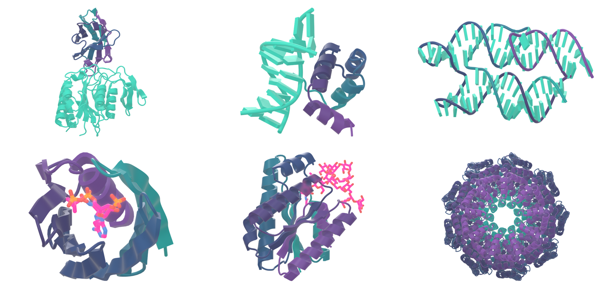
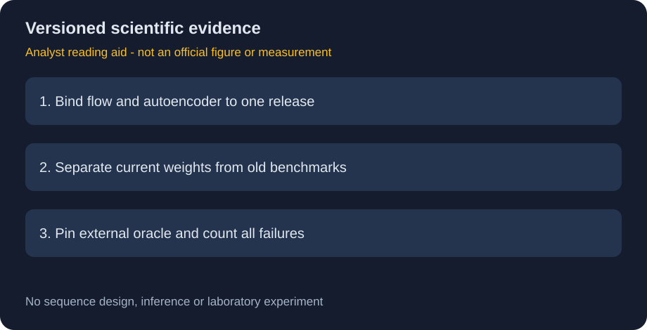

# RFD4-Proteína：成对潜空间模型与版本证据

> [!tldr] 我的判断
> 这是一套联合序列/全原子结构生成模型，不是三个新基模。理解重点是flow和autoencoder必须配对、移植不等于重训，以及旧checkpoint的benchmark不能移给当前版本。

> [!warning] 原始资料不足与日期边界
> 已读原生、Diffusers、prep模型卡及官方项目页的模型/评估说明；项目页仍标“Paper (soon)”，未核实完整报告。当前卡明确10月19日版本取代10月15日配对，但整个family最早首发日未证实。2026-10仅为归档月份线索，**不作为已核实首发月份**；10月19日单列版本更新而非新正代。未达到完整技术报告精读深度，未进行生物实验或本地复测。

## 一手资料与仓库去重

- [原生 Model Card](https://huggingface.co/nvidia/RFD4-Proteina)：原始成对权重。
- [Diffusers Model Card](https://huggingface.co/nvidia/RFD4-Proteina-Diffusers)：同权重重命名/拆分，无重训。
- [prep README](https://huggingface.co/nvidia/RFD4-Proteina-prep)：输入预处理/输出导出工具，不是另一模型。
- [官方项目页](https://rfd4-proteina.org/)、[代码](https://github.com/RosettaCommons/RFD4-Proteina)。原文在本地src，来源哈希见manifest。

## 模型的表示与版本变化

在共享化学/构象潜空间上做flow matching，autoencoder定义潜空间，生成器在这个空间工作。它们不是可以随意替换的独立附件。官方提醒混用不同release的flow和AE可能产生无意义输出而不报错。

| 项目 | 当前10月19日版本 | 前一个旧配对 |
|---|---|---|
| 潜变量维度 | 32 | 16 |
| residue词表 | 147 | 33 |
| 配对存储参数 | 435622465 | 434348737 |
| 当前释放形态 | 预训练base+合并LoRA，与匹配AE | 不可和当前组件交叉使用 |

10月15日pair与19日pair同架构；这和表中更旧16维pair不是同一个“previous”概念。目录名、训练step、checkpoint版本和模型family必须分层记录。EMA导出无优化器/调度器，不等于可恢复中断训练的完整状态。

## 不把生成示例当生物有效性证据

原卡的gallery展示计算设计，Diffusers示例也明确不是实验结合或催化活性结果。官方项目页还报道湿实验验证，但不能由此推断本轮10月19日pair在所有任务上重测，或把个例图当总体成功率。

本文只讨论机器学习表示、证据与版本治理，不提供目标选择、分子设计流程、序列或实验操作。对真实用途应独立开展相应结构与安全评估。

## Benchmark最关键的限定：旧版数据

原卡明确性能表取自**10月9日冻结项目benchmark、前一配对**，没有在当前checkpoint重测。指标为每目标“结构不同的计算通过样本/GPU-hour”再平均，包含生成与公共AF3评估，排除setup/编译/CPU评分/空闲；它既不是单样本延迟，也不是湿实验命中率。

| 任务 | 目标数 | 比较中的重要限制 |
|---|---|---|
| 蛋白相互作用 | 24 | 方法间conditioning并非完全一致 |
| 小分子相关 | 77 | 各方法固定条件不相同 |
| motif类任务 | 37 | oracle与通过标准影响结论 |
| DNA相关 | 3 | 样本很少，不宜泛化 |

项目页的旧算力档写110/185/295trunk评估，当前卡的档为120/180/300，也体现材料版本差异。本文不把它们拼成一套未存在的统一实验。

## 移植和数值精度的边界

官方Diffusers页给FP32输出约1e-7相对误差对齐；这验证实现一致性，不证明生物有效性。BF16和FP32同seed可走到不同样本，少量几何统计检验不能代替refolding或实验成功率比较。原卡权重存FP32、推理BF16和sampler/feature的FP32保留是不同概念。

10月20日是Diffusers合并支持日期，不是模型首发。代码/权重BSD3不覆盖可选第三方oracle、容器或数据许可。官方公开页面不代表所有附属资产都可无限制再分发。

> [!insight] 对 Agent Training 的启发
> 当reward/search依赖另一个oracle时，要固定oracle revision与通过标准；算“独立通过样本/总成本”比只报最好样本更可信。模型、表示编码器和验证器的版本关系应进入每条轨迹的provenance，不能在底层升级后继续沿用旧reward统计。

关联：[[Microsoft/Variants/2610_BioEmu_2/BioEmu-2]]（构象采样与联合设计不是同一任务）。

> 📊 中文 Poster：[[rfd4_proteina_poster_zh.html]]
