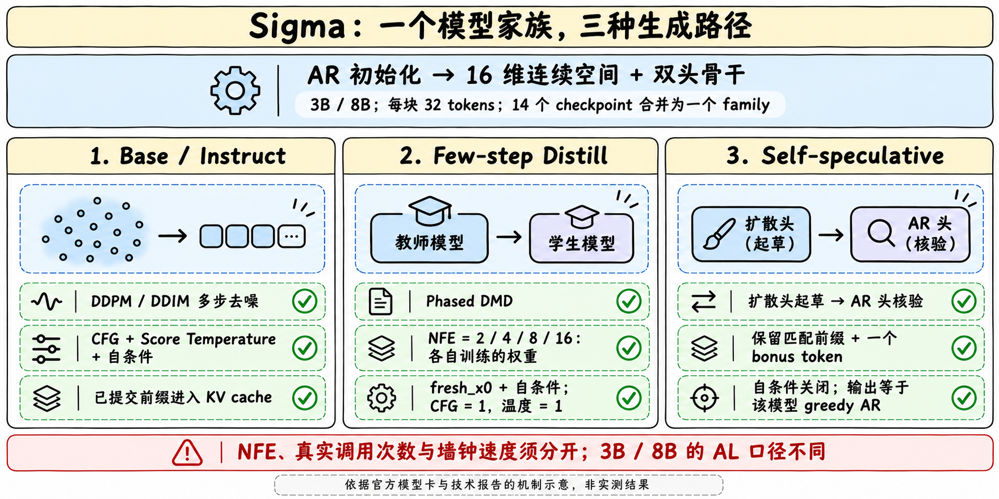
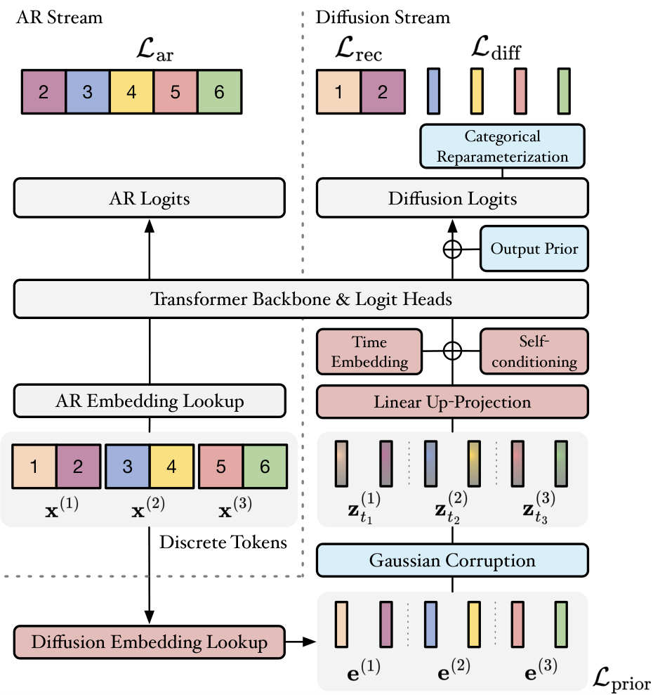
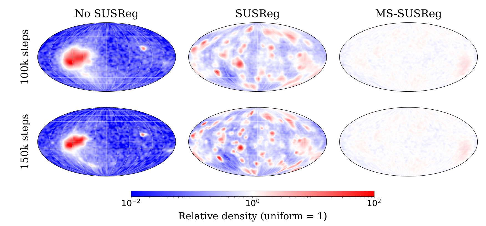

> [!tldr]
> Sigma 把语言生成放到可学习的 16 维连续嵌入空间：先从 AR 权重初始化，再联合训练块扩散和 AR 流；用球面几何正则改善少步可蒸馏性。Base/Instruct、固定 NFE 蒸馏与自推测共 14 个 checkpoint 合并为一个研究专项 family。对 Agent Training 的价值主要是低成本、多样的候选生成；论文把 RL 后训练留作未来方向，不能说已证明 Agent 任务提分。

> [!warning] 日期、成绩和发布实现不能混成一个口径
> HF 卡声明 11/12/2026 发布，报告 v2 日期也是 11/12；HF 官方活动却明确记录这 14 个仓库于北京时间 11/17 01:31:35–01:31:49 publish。本 Atlas 以 11/17 记录“HF 公开事件”，family 首次公开日仍待核，保留月份而不以仓库 createdAt/lastModified 补日期。已读 14 卡、报告正文与关键附录 C/E/F/G/H、代表配置/provenance 和推理代码；没有下载 PDF、权重或数据，也未运行远端代码或模型。未全审所有源码/附录、未独立复现。

## 家族、时间与三条推理路径

> [!tldr]
> 14 个仓库不是 14 个新正代；两尺寸、四种固定蒸馏预算和两种使用目标分开比较。研究专项并入 Nemotron 支线。

|类别|3B / 8B 发行物|数量|应怎样理解|
|---|---|---:|---|
|Base|Sigma-3B、Sigma-8B|2|预训练模型，适合 few-shot 与研究，不是对话助手|
|Instruct|Sigma-3B-instruct、Sigma-8B-instruct|2|同尺寸 Base 继续 SFT；必须用聊天模板|
|Distill|每尺寸 nfe2、nfe4、nfe8、nfe16|8|每个预算有单独训练权重；不是任意改同一个模型的步数|
|Distill-Spec|distill-spec-3B、distill-spec-8B|2|扩散头起草、同骨干 AR 头核验；SC 关闭|

许可是 NVIDIA Nemotron Open Model License，HF 声明可商用/非商用，不写成 MIT 或 Apache。主要为英语文本→文本；原生多模态、工具使用 RL、长程 Agent 成功率均未由本材料证明。HF 文档要求 CUDA GPU/BF16，CPU sampler 数值退化且不受支持；本轮仅记录要求，没有执行安装或推理。

时间证据分三层：论文方法公开、卡片声明发行日、HF publish 动作。报告 v2 说权重已公开，但这不是对 11/12 每个仓库 public 状态的独立回溯证明。官方 publish 动作证明 11/17 此次公开阶段，也不证明此前绝无其它渠道或受限分发；卡中提到 11/10 restricted-release handoff 更不能当公众可用日。

## 结构、训练与几何正则

> [!tldr]
> 训练与推理的连续空间是 16 维 token 几何，不是把整个 Transformer 隐层压成 16 维。保留 clean AR stream 才能 warm-start、缓存前缀并用于自推测核验。

|项|3B|8B|
|---|---:|---:|
|Transformer layers|26|34|
|hidden / FFN|3072 / 9216|4096 / 14336|
|query / KV heads|32 / 8|32 / 8|
|head dim / diffusion embedding|128 / 16|128 / 16|
|论文非 embedding / 总参|3.0B / 3.8B|7.4B / 8.5B|
|预训练长度 / 推理块长|4096 / 32|4096 / 32|
|连续训练 GPU-hours，GB200|约 9,600|约 19,200|

这些参数口径与发布的蒸馏双头包不完全相同；HF metadata 对 spec-8B 报约 9.03B，不能把 marketing “8B”、非嵌入参数、包含额外 AR head 的整包 tensor 数混为一个数。骨干采用 Ministral 风格 GQA/SwiGLU/RMSNorm/YaRN；新增 diffusion embedding、time 与 SC 投影等在论文中不到总参数 1%。

把序列按块分解，块间使用 AR 因子分解，块内从高斯噪声联合去噪：

$$p(x)=\prod_b p(x^{(b)}\mid x^{(<b)}),\qquad z_t=\alpha_t E[x]+\sigma_t\epsilon.$$

clean 流使用 AR embedding，noisy 流使用 16 维 embedding；块内双向、前缀因果。预训练联合目标包含 AR next-token loss 和块扩散 NELBO。重构项用概率 0.1 选择 t=0，否则选择随机噪声时间，以 Horvitz–Thompson 权重保证估计无偏；25% 序列做两次前向的 self-conditioning，只有后一次接收梯度，前一次预测 detach。推理则携带上一步 raw conditional prediction，不能把 CFG/ST 后的锐化向量误作 SC。

AR 初始化来自约 1T tokens，后续连续扩散约 300B tokens，150k steps、batch512、长度4096。主体 AdamW (0.9,0.95)、峰值 LR1e-5、weight decay0.1；1% warmup，120k 后 WSD 衰减。**来源有差异**：正文说采用开放的 Basant 等预训练数据、对齐 NLD；HF 卡写 internal NVIDIA corpus、数据不分发。此处保留两种原话口径，不能宣称已拿到完整 1.3T 开放训练集。

未正则 embedding 会塌缩到少数有效维度，少步时误差更难容忍。MS-SUSReg 用多个尺度的随机投影特征函数约束全局/局部均匀性，再用局部排斥拉开近邻 token；Riemannian Adam 让更新尊重单位球面，避免任意原始行范数改变实际学习率。两尺度 beta=1/16，权重1e-2/1e-4，repulsion20；每次512随机方向。嵌入 LR 从3e-3经余弦到1e-4，末段到1e-5；Sigma 主模型扩散权重全程1。该配方同时改变几何、优化器和 schedule，不把整包收益全归因于一个正则项。

## DMD、SFT 与接受率后训练

> [!tldr]
> Few-step Distill 匹配教师生成分布，不是直接用真实答案做普通 SFT；Distill-Spec 的接受率训练另有目标，且不等于用工具 reward 做 RL。

普通 Base 推荐 DDIM、log-SNR grid、32-token blocks；32/16/8/4 步的 CFG 为3/3/3/2、score temperature为0.3/0.4/0.6/0.8。低于约16步明显退化，因此少步权重值得单独训练。CFG 条件/无条件可在论文高效服务中打包；HF Python 参考实现却按两次调用计数，墙钟与 NFE 都要按实际执行记录。

DMD 使用 on-policy student rollout，随机抽一个 phase，仅通过当前 transition 反传，前缀 rollout detach。teacher、student、auxiliary、reference 的职责不同：reference 对教师生成 bank 预拟合，auxiliary 学学生分布，二者预测差作为 student 梯度方向。bank 为65,536个256-token前缀、每前缀四个32-token续写块；teacher 用高预算 DDPM256+CFG/ST。student/auxiliary/reference 的 AdamW 学习率分别3.6e-7/1.188e-5/1e-6、batch256，reference先拟合50步。正文伪代码每轮列四次auxiliary，附录实现说明还列四次reference更新；复现时不能只照简化伪代码。F.3 显示 batch64→256改善、teacher bank优于直接预训练数据，query当前phase区间更稳定，学生SC不能任意关闭。

SFT 使用 non-thinking 单轮语料848,087训练/1,200验证，NeMo-RL 作为训练框架，**不是因此已做RL**。仅监督assistant响应，prompt clean；冻结 diffusion embedding、noise schedule与端点。8000steps约2.4epochs、长度8192、block32、global/micro batch256/1；AdamW(0.9,0.98)、LR2.5e-6、50步warmup。答案对齐32-token块并监督EOS补齐；配置里 Instruct max_position=8192，而卡片泛写4096，按来源保留差异，不擅自把所有版本改成8K。generation_config 的聊天EOS=11，与模型config中2也需按实际生成路径核对。

自推测每轮一遍扩散起草32 tokens、一遍AR核验，保留最长一致前缀并补一个AR token；最终输出是该模型自身 greedy AR 输出，BF16近似相等的kernel tie仍需验证。接受率目标叠加 DMD、LK与AR retention KL；报告 LK系数0.25、retention基准12并按前轮梯度比封顶，训练600步、两run均权平均。HF当前3B X25与8B X3发布包的选择与成绩并不等于论文每一行的统一配方，provenance中许多训练/运行字段仍为null。

## 完整少步读数、基准反例与运行契约

> [!tldr]
> 同家族的步数、种子、题集、输出上限与 AL 定义不同。单种子8B-NFE16不能放进十种子六任务均值排行榜，接受长度也不能当准确率。

|尺寸/固定NFE|GSM8K|Minerva|HumanEval|HumanEval+|MBPP|MBPP+|六任务均值|
|---|---:|---:|---:|---:|---:|---:|---:|
|3B / 2|74.42 ± 0.46|49.71 ± 0.30|32.38 ± 1.34|30.55 ± 0.86|20.78 ± 1.00|30.87 ± 0.79|39.78 ± 0.57|
|3B / 4|82.23 ± 0.34|59.13 ± 0.19|52.13 ± 1.56|48.72 ± 1.20|40.62 ± 0.91|58.81 ± 1.22|56.94 ± 0.46|
|3B / 8|84.62 ± 0.44|61.17 ± 0.22|56.40 ± 1.82|51.71 ± 2.28|49.04 ± 0.45|67.70 ± 0.77|61.77 ± 0.67|
|3B / 16|83.42 ± 0.27|61.70 ± 0.21|58.54 ± 1.15|54.51 ± 1.48|52.08 ± 0.87|69.95 ± 0.69|63.37 ± 0.45|
|8B / 2|80.17 ± 0.55|55.72 ± 0.31|48.17 ± 0.91|45.24 ± 0.94|37.52 ± 1.12|51.30 ± 0.96|53.02 ± 0.52|
|8B / 4|86.86 ± 0.28|61.52 ± 0.20|60.61 ± 1.43|57.99 ± 1.20|57.50 ± 0.61|73.70 ± 1.07|66.36 ± 0.46|
|8B / 8|88.44 ± 0.22|64.40 ± 0.22|65.18 ± 1.13|62.07 ± 0.89|62.60 ± 0.59|79.37 ± 0.72|70.34 ± 0.43|

上表逐项保留 HF 原卡的 mean±2SE，10 generation seeds、CFG1、ST1、block32；3B明确42–51，8B卡称11/10 handoff。8B-NFE16单列：seed42的GSM8K89.61、HumanEval67.68、MBPP66.20，三任务均值74.50，标为 pending_ten_seed_six_task_validation，不能与六任务均值70.34比较成提升。

|论文读数|3B|8B|解释|
|---|---:|---:|---|
|Base Sigma DDPM256六任务均值|65.55|71.16|同尺寸NLD64.74/70.22；非所有子任务领先|
|Base Sigma DDIM32六任务均值|63.40|70.18|更省步但相对DDPM有质量损失|
|Instruct Sigma DDPM256十任务均值|53.31|59.14|NLD对应52.89/59.92，8B并未领先|
|Instruct Sigma DDIM32十任务均值|52.30|57.90|不是所有较少步设置都无损|
|Sigma AR Instruct十任务均值|50.46|58.67|与diffusion/SFT实际任务预算不同，非简单单变量因果比较|

正文强“超越”措辞必须与表5反例一起看：8B Sigma DDPM的Math50078.40、AIME2517.00、LCB20.09，均低于NLD84.60/23.33/21.15；其GPQA42.37与IFEval77.18则高于NLD33.33/73.02。Base是六任务、Instruct十任务，两种平均不可跨表比较。

|当前HF自推测卡|GSM8K|HumanEval|MBPP|口径|
|---|---:|---:|---:|---|
|3B AL|10.49|7.90|9.21|不含bonus；保留1303/158/499题，排除loop/cap|
|3B speedup|3.28×|2.61×|2.61×|SGLang BF16、单GB200、单请求，相对该模型自身AR|
|8B AL|11.86|7.91|13.37|含bonus；1319/164/500全题集，不能直接与3B比较|

3B另给SPEED-Bench703题、AL5.25、1.98×。8B卡的包含bonus数值与公开代码 generate_speculative 返回的 mean_accepted_length（不含bonus）不一致，必须记录原字段定义与receipt，不能从名字相同推断同一指标。论文表25的8B最高4.20×、结论平均3.46×也属于论文服务/筛选协议，不能贴到当前HF8B卡当现成速度保证。

Base六任务用lm-evaluation-harness：GSM8K8-shot/1319题/256生成tokens；Minerva4-shot/5000、HumanEval(+)0-shot/164、MBPP3-shot/500、MBPP+378，后五项512tokens。HumanEval用Markdown剥离与AST最长合法代码提取，MBPP无该后处理。Instruct使用更长、按任务/尺寸不同的预算，IFEval为instruction-level loose accuracy。10种子误差条描述采样方差，不覆盖训练run和评测集抽样全部不确定性。Self-spec speedup还剔除loop/cap样本，而accuracy用全题集；公平比较须同时报保留率。

|实际发布实现待对齐项|已读证据|后果|
|---|---|---|
|原生NFE4计数|generation_config写calls_per_block=5；源码循环steps+1，prefill另算|不能直接把32/4=8当端到端8×|
|默认参数不完全接入|generate默认ST0.75、time_schedule=edm_sigma；原生契约写ST1/log_snr；卡示例未显式传全|复现时显式传训练契约；未运行不称已验证bug结果|
|任意步数覆盖|源码对native_nfe不匹配直接ValueError|NFE2/4/8/16须用对应checkpoint|
|停止|代码不按token-ID EOS停；stop_strings逐块检查且限batch1|completion长度、stop成本及截断均需计入|
|精度与几何|provenance含BF16主体与3个FP32张量；报告另有FP64 schedule arithmetic|整模盲目转换为BF16可能破坏几何精度，需保留实际实现|
|RoPE/context|HF factor16与论文0.25/0.5计算不同，Instruct config8192而卡4096|未独立映射同一runtime，不声称长窗复现一致|

## 对 Agent Training 的判断与资料地图

> [!insight]
> 更值得验证的是“每个成功候选的总成本”：把fixed-NFE student和teacher的候选数、每条预算、编译/预填充、停止、执行验证、保留率全部记录，再比较pass@k与独立语义多样性。论文已用Vendi和NoveltyBench检查部分多样性；单凭pass@k上升不能证明所有分布保持。接收率训练也可能提升起草一致性却不提高AR准确率。若用于训练轨迹采样，必须另做固定Bench前后对比，不能从本论文推成已验证RL收益。

来源优先级：14份HF原卡与配置（发行物行为）；报告正文及C/E/F/G/H关键部分（方法与协议）；官方HF活动（本次public事件）。报告整篇原HTML已归档，但本文不是全部附录逐行审计，训练bank/完整run仍未随当前provenance给齐。来源内冲突原样记录，不用第三方排行榜补空。

- [官方Collection](https://huggingface.co/collections/nvidia/nemotron-labs-sigma-6aed16ae59cfa91daa36c53b)
- [官方Base 8B卡](https://huggingface.co/nvidia/Nemotron-Labs-Sigma-8B)
- [官方HF活动，publish阶段证据](https://huggingface.co/organizations/nvidia/activity/all)
- [技术报告HTML，v2](https://arxiv.org/html/2610.02665v2)
- [[sigma_poster_zh.html|中文Poster]]
