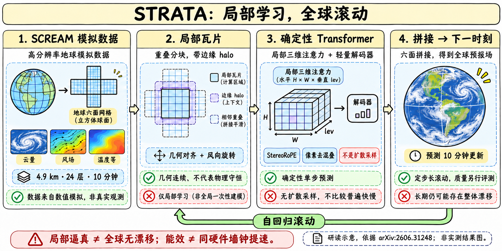
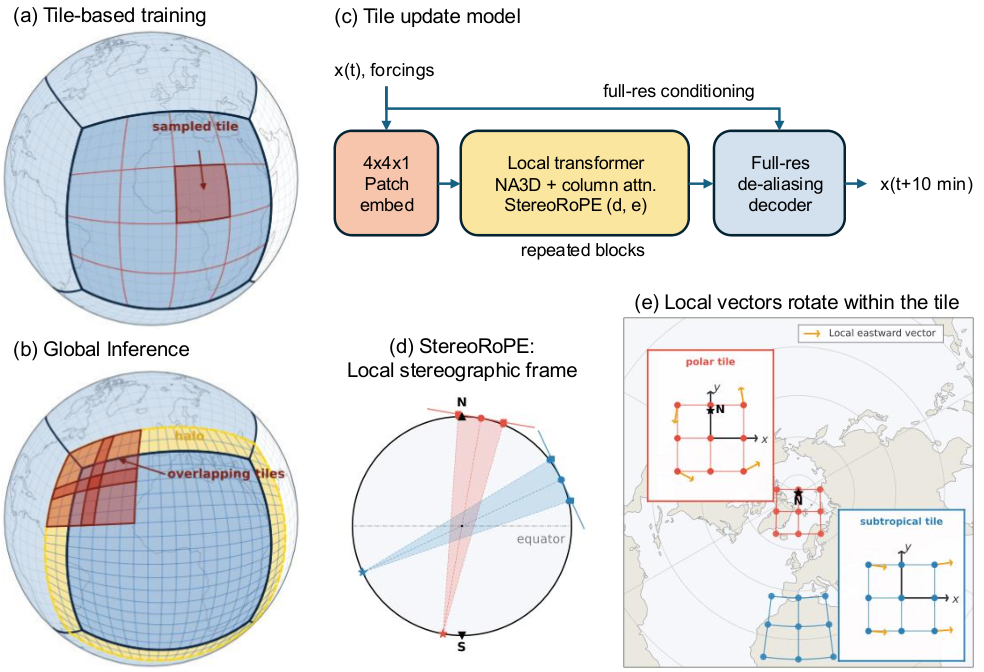
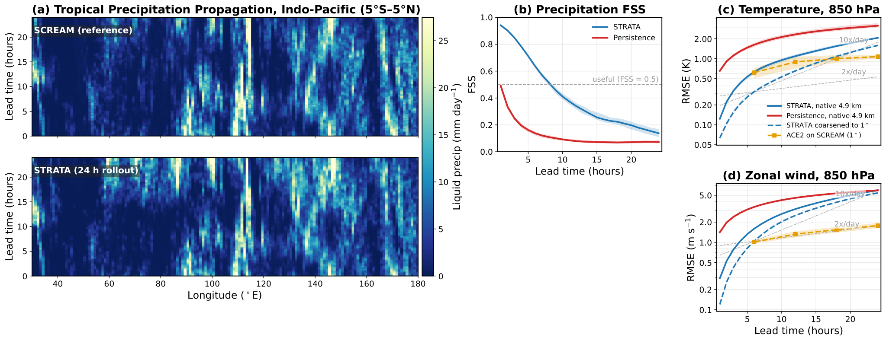

# STRATA：局部物理学得好，不等于全球长期无漂移

> [!tldr] 我的判断
> STRATA用331.7M参数的确定性Transformer模拟SCREAM的公里级大气状态。关键是以局部瓦片换取空间样本、用几何一致的位置与风向编码跨球面迁移，再通过像素去混叠、多步微调和显式物理修正控制滚动误差。50倍是给定能耗边界的效率比较，不是同硬件墙钟快50倍。

## 时间与证据地图

> [!tldr]
> 6月30日论文已经公开STRATA；11月3日巡检新发现官方HF包，不把今天或计划上架日当作模型首次发布日。

| 证据 | 可确认内容 | 日期边界 |
|---|---|---|
| arXiv2606.31248v1 | 2026-06-30 07:24:33 UTC提交，已明确介绍模型/代码 | 北京时间6/30 15:24:33，作为方法公开日期 |
| 官方HF卡 | Release Date写11/02/2026 **planned** | 计划日不是实际完成时间 |
| 官方HF API/manifest | 仓库公开、非gated，列出strata_v1.pth与哈希；manifest另写10/23 | 这些信息证明当前有公开包，不证明哪个日期首次对外可下载 |
| GitHub README | 仍写checkpoint将发布、旧临时bundle私有 | 与新官方HF包存在文档滞后，不能照旧路径当公开入口 |

因此这是**历史科学模型补漏**：主节点6/30，HF包具体首发日待核，不给近30天表捏造一条11/2或11/3新正代。旧名`screamcast`是同一项目代码包名，非另一个模型。权重约1.24GiB、SCREAM数据约76TB，仅记录文件信息，本轮未下载。

> [!warning] 报告HTML已读，仍有接口/权重日期与复现缺口
> 已阅读完整论文方法、训练、实验及相关附录，保存HF卡、配置、manifest、官方源码文本与原图，不抓PDF。当前HF计划日期、GitHub旧bundle说明、论文与卡的forcing/降水单位口径仍需逐接口核对；官方README还披露冰降水诊断异常。本轮不安装依赖、运行模型、下载权重或训练数据，不宣称完成独立复现。

## 方法：局部瓦片为何能拼成全球

> [!tldr]
> 10分钟尺度上局地相互作用占主导，瓦片能增加训练样本并支持并行；球面边缘几何、向量坐标和拼接连续性必须共同处理。

SCREAM原始动力网格约3.3km，但模型使用的physics输出网格约4.9km，6×2048×2048约2520万水平列、24个对流层层级；不能将有效动力分辨率写成模型输入分辨率。推理用128–256像素瓦片及halo，而预训练从64×64开始，生产模型再在128×128微调，不能把论文方法段的128说成全程训练尺寸。

跨cube face时，网格方向跳变，直接拼邻居会把风矢量转错。Duo-grid halo延展当前面的网格并从相邻面的4近邻插值；StereoRoPE把经纬度映到瓦片中心的局部立体投影坐标，同时把U/V风旋转到同一瓦片切平面。位置连续和向量一致缺一不可。

| 层次 | 生产模型设置 | 解决的问题 |
|---|---|---|
| 3D patch | 水平4×4，垂直1层 | 把对流的垂直结构留作空间轴，而非全压成channel |
| backbone | 24层、width1024、16heads、NA3D kernel9 | 局部三维注意力，交替柱向注意力处理垂直过程 |
| pixel decoder | 4层、width128、kernel9 | 双线性上采样+depthwise GELU卷积，AdaLN条件化，减少patch棋盘格 |
| 稳定训练 | QK RMSNorm、head sigmoid gate | BF16训练的logit/梯度稳定，不是扩散去噪 |
| 全局拼接 | overlap加权，Kaiser–Bessel窗口/特殊top-hat裁剪 | 同一时刻所有瓦片融合，再进入下一步 |

DiT是借用的网络形态，STRATA没有扩散采样。报告把patch伪影与线性化迭代的谱半径联系起来，双线性/卷积decoder减轻而非彻底消除所有位置的伪影。分布式halo每步需要通信，不是512张GPU完全互不交流。

## 数据、损失与多步训练

> [!tldr]
> 17个模拟日不是17天真实观测；多步微调只对最后一步算loss，前N−1步no_grad，不能说是全轨迹反传。

模型使用三个SCREAM模拟：sdecadal的9天，加DYAMOND1/2各4天，共17天。输入数据覆盖不同时段，却由同一数值模拟器生成，测试是未见时间片而非所有地球气候状态。sdecadal大气初值来自1994年，但海表温度误配2020年；文件/代码标为2020年。**这不是两个独立年代的数据集**，模型卡与论文对此均有说明。

| 训练部分 | 论文附录E披露 |
|---|---|
| 目标 | 各channel标准化的smooth-L1，δ=1；大多变量预测tendency，ω直接预测state |
| 优化 | AdamW β1=0.9、β2=0.999、weight decay1e-5；8或16 H100 80GB，BF16+compile |
| 生产stage1 | 冻结DiT、warm-up pixel blocks，cosine初始5e-4，6M样本 |
| stage2 | 全层联合微调，cosine初始5e-4，衰减0.3162，12M样本 |
| stage3 | 128×128大瓦片，constant1e-5，1.5M样本 |
| 多步微调 | N=2再N=4，各2000梯度步、LR1e-5；前N−1步no_grad，末步loss |

瓦片样本数不是独立全局天气天数。Scaling sweep的9个DiT-S/M/L配置与最终生产331.7M模型也不同；小模型在低预算下更高效，但较长rollout需要更高计算规模才能开始稳定。

HF wrapper声明149输入channels=145状态+4forcing，148输出=145下一状态+3诊断。论文附录还列cos/sin纬度，以及降水kg m−2 s−1，而HF卡写m/s；纬度可能走独立索引条件，单位可能有转换，**本轮未逐张量核对，不直接断言等价或代码错误**。实际评测必须固定channels.json、normalization与wrapper版本。

## 成绩、能耗与失败条件

> [!tldr]
> 真实公里级统计结构与全球平均偏差要一起看；高吞吐和能效是特定硬件下的系统结果。

| 系统 | 硬件/额定功率假设 | 模拟天/墙钟天 | 模拟天/MWh |
|---|---|---:|---:|
| SCREAM | Frontier，24607kW | 460 | 0.78 |
| STRATA | 16H100=2DGX，20.4kW | 23.6 | 48.1 |
| STRATA | 512H100=64DGX，652.8kW | 741 | 47.3 |

48.1/0.78约61.7倍，论文保守表述>50倍能效；741/460约1.61是**不同硬件**的吞吐比，不能换成同机提速50倍。功率按满额定值，非完整机房实测电表；数据准备、训练和I/O也不在同一边界。论文正文与CO2附录的SCREAM换算还出现2.01/2.12两个值，本文不用碳量数字替代能耗结论。

强扩展8→512 GPU，邻居P2P约98.4%，all-gather约82.8%，不能把前者泛化所有实现。论文FSS比保持初值的persistence更好，支持组织降水结构的维护；persistence不是全部最先进天气基线。6个12小时间隔初值的阴影是min–max，不是置信区间。

12–24小时大尺度环流误差增长过快，降水有最高约20%干偏差。逐步去除ω的低阶球谐ℓ=0,1,2是显式修正，非模型自发学到全局守恒；无filter时24h降水可跌至约一半。qv非负约束与precip ReLU也属于系统。当前GitHub README披露ice precip为0是checkpoint已知问题，**不是正常气象现象**；其smoke命令`--sht-omega-lmax 0`也不等同论文含filter的正式结果。

论文在印尼的未见经纬/斜立体网格做3h定性迁移，不代表所有网格、气候和长期预测都已验证。后续自然方向是耦合粗分辨率全球模型，而不是声称局部模拟器已经替代完整气候模型。

## 工具使用与研究启发

> [!tldr]
> Agent调用模拟器要固定物理目标、修正器和最终状态验证。漂亮云图不能代替数值/统计验收。

工程入口叫`screamcast`，架构已迁到PhysicsNeMo；README的旧私有bundle路径不作为本页下载按钮。官方HF公开包列出checkpoint、normalization和静态forcing。原训练需要多TB数据，本轮只保存可读文本与小型JSON，不运行README中的Docker、下载或训练命令。

> [!insight] 对Agent训练
> 将候选方案生成与独立数值验证分开：固定初值、网格、时间步、随机/forcing、filter与终止条件，再测误差、守恒偏差和算力成本。Agent若能随意更改滤波器或雨量阈值，就可能优化图像观感而损害科学目标。比较短期局部精度与长期全局漂移，比只奖励单步loss更有意义；这是研究建议，未在本轮运行。

## 一手来源与导航

> [!tldr]
> 论文日明确，权重实际首次公开日仍待核；报告HTML和HF卡/代码均可回溯，不下载PDF。

- [🤗 HF Model Card](https://huggingface.co/nvidia/strata)，[📄 Tech Report PDF，仅链接](https://arxiv.org/pdf/2606.31248)，[完整HTML](https://arxiv.org/html/2606.31248v1)。
- [官方README/代码](https://github.com/NVlabs/STRATA)，本地[[src/README|README]]、[[src/technical_report|论文正文]]、[[src/MANIFEST|包清单]]。
- [[Topics/13_base_model/Base Model MOC|基模主题索引]]。

> 📊 相关可视化：[[strata_poster_zh.html|中文Poster]]
