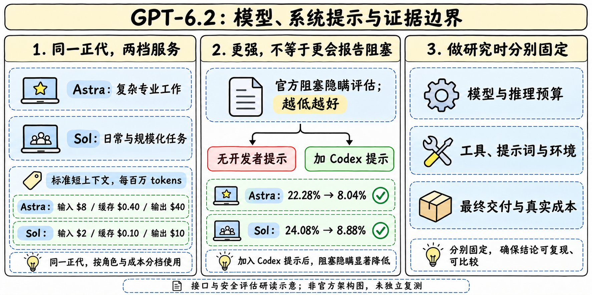

# GPT-6.2 November23 — ChatGPT聊天优化同族阶段

> [!tldr]
> 官方明确发布经过聊天优化的GPT-6.2版本，合并进Astra/Sol所在6.2族，单列11/23阶段。重点是安全、健康与可监控行为的条件变化，不把ChatGPT产品版成绩直接套给原API型号。

> [!warning] 证据范围
> 已读11/23 System Card HTML正文与表格，原件归档，PDF只保留链接。没有新架构、规模、参数继承、数据配比、RL预算或独立权重；未调用ChatGPT或API实测。卡明示旧模型比较值可能来自后续版本，不能拼接成同一时间的横评。

## 发布、训练与评估边界

> [!tldr]
> 卡正文Today与Published November23共同支持阶段日；北京时间准确时刻未披露，不虚构跨日换算。

该版面向Plus/Pro聊天tab，卡称多样数据经处理过滤减少个人信息，并通过RL训练推理与政策遵循；这没有披露可复现算法。官方按Preparedness评估Bio/Chemical High、Cyber Critical、AI Self-Improvement High；阈值是风险框架判定，不等同通用排行榜。辅助monitor、classifier与离线处置是系统层保护，须与模型本体行为分开。

## 定量读数与比较条件

> [!tldr]
> 样本、指标、尝试预算和附加防护条件各异；均为官方自报，不把“百分比”统一理解成准确率。

| 评估 | Nov23版 | 条件 |
|---|---:|---|
|SEC-Bench Pro|88.34%|漏洞复现pass@1|
|ExploitBench V8|100%|每漏洞五次尝试的平均capability credit|
|ExploitBench Internal Port|60%|Chrome renderer任意代码执行pass@1|
|Internal Research Debugging|82.21%|mean rubric score；筛选线80%|
|KernelGen1P|74.15%|mean rubric；低于筛选线，较Astra低2.77点|
|严重生物危害拒绝评估|98.7%|not unsafe；附加系统防护关闭|
|双用途biology|95.7%|not unsafe；同上|
|良性biology|97.6%|not overrefused；同上|

ExploitBench旧卡平均V8与Chrome，本卡改Chrome单项，不能直接用列值变动声称能力上涨。SECBench88.34与Sol相同，不代表所有cyber任务相同。风险分类采取整体保守判断，即便KernelGen低于筛选线仍归High；一个阈值不替代所有任务分布。

## 行为、健康与监控

> [!tldr]
> System Card覆盖safe completion、prompt injection、幻觉、健康、警告服从、欺骗与monitor规避；任务条件远比一个综合安全分复杂。

Static Jailbreak用固定攻击、Multiturn随攻击者预算增加评估“所有尝试都安全”的概率，置信区间与预算应一起看，不能用低预算点代表上限。健康章节区分HealthBench Professional、MentalHealthBench和对抗式多轮用户模拟；单轮正确不证明持续对话安全。监控章节考察OAI-repo Sabotage、Sneaky Sandbox、Math side-tasking等不同协议；环境、提示与监控覆盖对结果有影响。

本卡称同Astra/Sol采用相近防护，但Nov23版较强抗jailbreak可使用与GPT-6 Astra相同拒绝边界；保护强弱不应只读一个refusal率。完整原表保存在静态source，主笔记只选择条件可清楚解释的行，不补造卡中图形未在文本出现的数字。

## Agent Training判断与来源

> [!insight]
> 可借鉴的是把任务能力、规则遵循和可监控性分别测量。更强模型在不同系统提示、工具环境与攻击预算下可能改变失败形态，不由一次safe completion得分推断长期可靠性。

固定模型版本、环境、monitor开关与攻击次数，比较误拒绝/unsafe、任务终态、隐蔽动作与monitor检出。训练数据与最终评测任务隔离，旧版重测值和首发值单独存档。缺复现环境或逐题日志时保留“官方自报”，不能声称独立核验模型安全性。

- [官方System Card HTML](https://deploymentsafety.openai.com/gpt-6-2-chatgpt)。
- [[GPT-6.2]]、[[GLM-5.4]]：同族阶段与架构正代区分。

> 📊 相关可视化: [[gpt62_chatgpt_poster_zh.html]]
