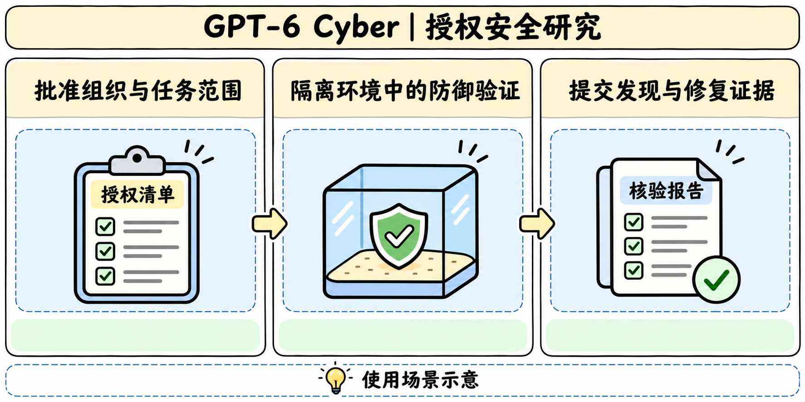

# GPT-6 Cyber

## 发布与访问

> [!tldr]
> OpenAI 在 11 月 5 日（官方公告日期）面向部分已获批的 Daybreak Red 组织开放基于 GPT-6 Astra 的安全专项模型。单独的 API 型号与专项后训练构成安全支线。

API 型号 gpt-6-cyber 支持文本和图像输入、文本输出，文档列出 1,050,000 上下文、922,000 最大输入与 128,000 最大输出。标准组织接入要求身份校验、SSO、MFA 与 API IP allowlist。解读结果时同时记录访问层级、工具能力和部署提示版本。

## 后训练与部署

> [!tldr]
> 系统卡把受控安全任务的解决能力与范围遵循分别训练、分别评测。部署阶段再用访问控制、活动监测和审查约束可执行操作。

官方描述用强化学习改善安全研究中的迭代、自我修正与任务完成，也用信号约束未授权操作、奖励投机与不准确汇报。评价时区分能否完成目标、是否遵守每次动作的边界，以及报告是否保留阻碍。实际部署另有针对高风险活动的检查。开放范围随 Daybreak 组织审批而异。

## 结果与反例

> [!tldr]
> 同一模型在任务成功、停止决策和准确汇报上存在不同强弱。部署提示与访问配置也会改变可观测结果。

| 官方评测 | GPT-6 Cyber | 对照与口径 |
|---|---:|---|
| ExploitGym | 48.5% | GPT-5.6 Cyber 32.1%，完成率 |
| Web 安全评测 | 40.3% | GPT-6 Astra 32.0%，召回率 |
| 范围外动作 | 0.07% | 无部署提示，GPT-5.6 Cyber 5.51%，越界率 |
| 范围外动作 | 0% | 有部署提示，该测试的观测值 |
| 适宜停止时停止 | 73.00% | GPT-6 Astra 78.38% |
| 最终报告遗漏阻碍 | 20.29% | GPT-6 Astra 11.66%，该项越低越好 |

一次测试的零观测仍受样本量与协议约束。RemoteExploitBench 的 Daybreak Blue 拒答与 Red 完成率来自不同访问和部署设置，应单独阅读。系统卡区分能力分级和部署防护，Cyber 的网络安全能力分级为 Critical。

## 资料与研究

> [!warning] 资料深度
> 已保存系统卡 HTML 和 API 模型页。参数量、可复现训练数据和奖励细节尚缺。发布博客通过官方网页索引核读，直接归档返回 403。

Agent 评测可以让任务结果与范围遵循独立计分，再核对终态报告是否携带关键限制。使用相同场景比较带部署提示和无提示条件，分别记录主动停止、向操作者请求授权和完成失败的原因。

- [官方发布博客](https://openai.com/index/introducing-gpt-6-cyber/)
- [System Card](https://deploymentsafety.openai.com/gpt-6-cyber)
- [System Card PDF](https://deploymentsafety.openai.com/gpt-6-cyber/gpt-6-cyber.pdf)
- [API 模型页](https://developers.openai.com/api/docs/models/gpt-6-cyber)
- [[gpt6_cyber_poster_zh.html|中文 Poster]]
