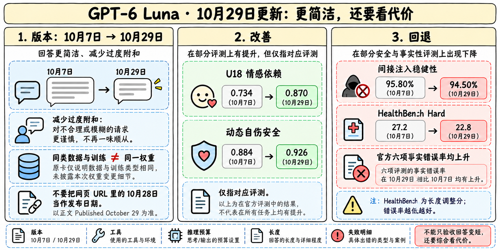
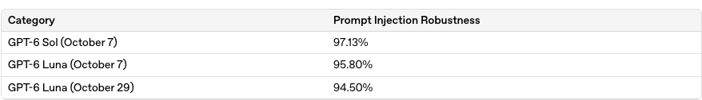
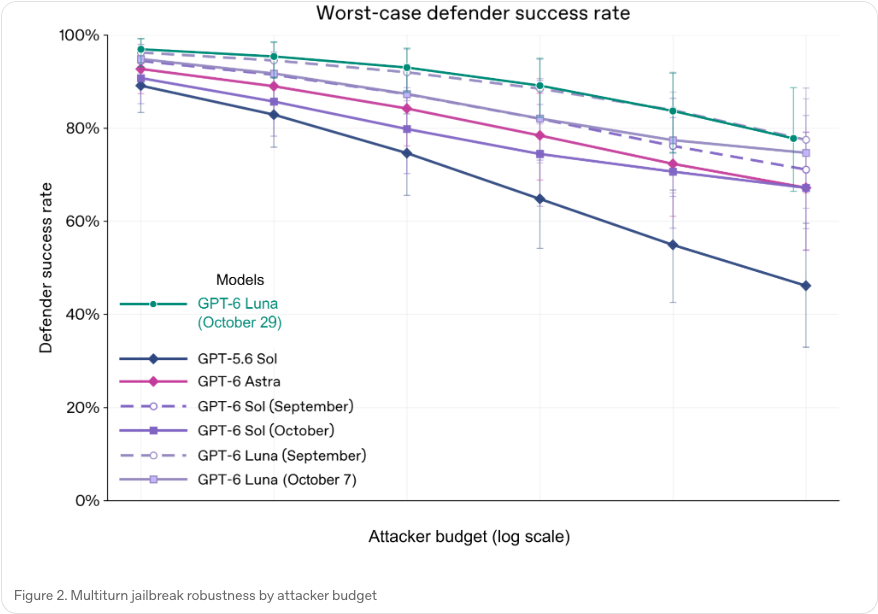
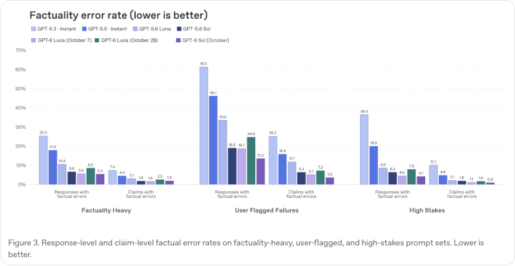

# GPT-6 Sol / Luna

> [!tldr]
> Sol / Luna 于9月22日发布；10月7日 Chat 部署更新在同一 family 中记录，不重复计为正代。 这是官方明确区分的十月部署阶段，不应覆盖九月 checkpoint。Intelligent UI 是产品体验，模型自身判断仍要由固定工具、提示和评测协议支撑；安全评估低 effort 与能力评估最高 effort 不是同一条件。

## 一页速览

| 维度 | 当前证据 |
|---|---|
| 发布时间 | 2026-09-22 |
| 类型 | 主干正代 / family · 主干部署阶段 |
| 关键事实 1 | 部署：ChatGPT |
| 关键事实 2 | Cyber / Bio：High |
| 关键事实 3 | 9月 Work/Codex 版本保持区分 |
| 检查日期 | 2026-10-13；官方原始资料在同级src/ |

## 时间线：首次发布与后来部署分开记录

| 日期 | 事件 | Atlas口径 |
|---|---|---|
| 2026-09-22 | Sol / Luna进入API、Work、Codex | family首次发布日期 |
| 2026-09-29 | GPT6.1Sol发布 | 独立增量代际节点 |
| 2026-10-07 | GPT6Sol / Luna进入Chat，新增部署安全卡 | 本family内更新，不伪造第三个正代 |

两档使用与Astra相似的训练方法，把成本前沿扩展到更高频工作；这不等于公开了完整recipe。Sol负责更复杂的专业与多步骤工作，Luna更适合低费用、规模化和辅助任务。

## 价格与实际计算预算

| API / 每百万token | Sol | Luna |
|---|---:|---:|
| 输入 | $2 | $0.10 |
| 输出 | $10 | $0.50 |

较上一档促销价格下调并不能替代一次端到端成本评测。更高effort的小模型可能在某些任务接近低effort的大模型，但对不明确、长程任务仍应留升级路径。

10月7日的更新涉及Chat部署；不能默认当日Codex/Work的相同名字checkpoint同步改变。安全卡说明使用低effort检查安全、高effort检查能力边界；两种设置应并列记录，而非用其中一个作为所有设置的结论。新增交互UI也是产品变化，不另算基础模型。

> [!warning] 公开证据限制
> 保存首发博客、10月安全卡与Chat发布页。闭源参数、数据与奖励明细未公开，无法写成GLM式架构精读；不同部署版本需继续按实际接口revision核对。

## 对 Agent Training 的启发

> [!insight]
> 实验记录必须包括 September/October 标识、Chat/Work/Codex、工具集和 reasoning effort。对较低风险违规回归也保留明细，不能用总体平均覆盖局部退步。

以上是基于已读官方资料的研究判断，不是官方保证，也没有在本机运行模型推理或复现论文成绩。下一步优先补独立验证器、固定任务/版本和完整失败轨迹，避免只保存最好样例。

## 一手资料与导航

- [S1] [Tech Blog · 首发](https://openai.com/index/introducing-gpt-6-sol-and-luna/)
- [S2] [System Card](https://deploymentsafety.openai.com/gpt-6-october)
- [S3] [Tech Blog](https://openai.com/index/gpt-6-for-everyone/)

原始下载文件与SHA-256见 [[src/retrieval_manifest.json|抓取记录]]。报告保留链接，不抓PDF；动态网页响应若只有壳文件，不将其标成完整离线正文。

- [[Topics/13_base_model/Base Model MOC|基模主题索引]]
- [[gpt-6-sol-luna_poster_zh.html|中文Poster]]

> 📊 相关可视化: [[gpt-6-sol-luna_poster_zh.html|GPT-6 Sol / Luna 中文Poster]]

## 2026-10-29：Luna同族更新，简洁性与可靠性必须一起验收

> [!tldr]
> 官方10月29日系统卡报告：新版Luna更简洁、减少过度附和，部分安全评测改善；但六项事实错误率均高于10月7日版本，HealthBench和部分心理健康指标也回退。它是本family内的Luna更新，不替换Sol的历史结论，也不新增正代叶子。

### 先锁定日期和训练声明

系统卡标题与Published日期是**October29,2026**，虽然URL包含october-28，不能拿路径当发布时间。§2说使用与10月7日相同**类型**的数据和训练；这不等于“同权重”，也不能据此臆造新增RL配方。官方说明旧模型在本卡中的比较值可能来自后续版本，因此不应回写成当初上线时的原始评测。

> [!warning] 原始资料较少的部分
> 本次完整HTML系统卡、所有官方图和交互表格数据已保存并阅读。官方只公布训练类别与部署评估，没有公开本次checkpoint参数、数据配比、训练预算、奖励实现。因此架构与训练部分仍达不到GLM-5.3-Flash式精读深度；这里明确保留资料缺口，而不把API功能、产品体验或猜测填成方法。

### 安全改善：静态题、动态对话与间接注入不是同一件事

| 指标（高为好） | 10/7 | 10/29 | 解释 |
|---|---:|---:|---|
| U18 Sexual Content | .904 | .933* | 官方以星号标出的改善 |
| U18 Eating Disorders | .776 | .817* | 官方标星 |
| U18 Emotional Reliance | .734 | .870* | 官方标星 |
| U18 Gore | .812 | .858* | 官方标星 |
| U18 Age-restricted goods | .814 | .824 | 未标星，不自行称显著 |
| U18 Self Harm | .974 | .979 | 与动态多轮评测分开 |
| 动态Self-harm | .884 | .926 | 对抗用户模拟的结果 |
| 动态Mental health | .991 | .971 | **回退**，不能用U18单项覆盖 |
| 动态Emotional reliance | .961 | .964 | 小幅数值变化，不自行断言显著 |
| GPT-Red间接注入稳健性 | 95.80% | 94.50% | 各可用reasoning level等权平均，**回退** |

直接instruction hierarchy测试为99.91%，不能拿它宣称网页/邮件/工具返回内容中的间接注入全部解决。GPT-Red是自动红队与对抗训练方向，原文未提供可直接复现的全部实现。多轮越狱图观察到各已测攻击预算更稳健，但攻击者运行被基础设施问题提前终止，不能把未完成预算外推成保证。视觉评测整体相当，erotic单项回退未达统计显著。

### HealthBench：回答变短之后，长度调整分也并非都升

| 指标 | 10/7 长度调整分（原分，平均字符数） | 10/29 | 变化 |
|---|---|---|---:|
| Professional | 48.2（57.8，5289） | 47.4（56.2，4969） | −0.8 |
| HealthBench | 50.4（58.5，3361） | 48.2（54.0，2970） | −2.2 |
| Hard | 27.2（36.1，3134） | 22.8（28.5，2725） | −4.4 |
| Consensus | 95.0（95.5，3343） | 93.3（93.7，2978） | −1.7 |

所有分数0–100，高为好。字符数是可见响应长度，不是token数，更不是运行时间。官方同时报告长度调整分、原分和字符数，说明简洁性优化的收益必须与任务完整性一起看，不能把输出更短直接等同为效率更高。

MentalHealthBench采用**task-clipped**指标，每任务4个响应，均值±任务间一个标准误：overall51.73±.96→48.68±.97；non-acute51.68±1.28→46.39±1.29；high-acuity56.15±2.25→53.92±2.28；emergent48.98±1.87→49.64±1.87。最后一项的小幅变化不能无检验就称显著。它与上表动态安全率测的不是同一目标。

### 六项事实错误率全部回退：必须把它们摆在改善旁边

| 题集 / 错误率（%） | 10/7 | 10/29 |
|---|---:|---:|
| Factuality-heavy，响应级 | 5.6 | 8.5 |
| Factuality-heavy，断言级 | 1.6 | 2.5 |
| User-flagged failures，响应级 | 18.1 | 24.6 |
| User-flagged failures，断言级 | 5.1 | 7.2 |
| High-stakes，响应级 | 4.5 | 7.8 |
| High-stakes，断言级 | 1.1 | 1.6 |

数值逐项读取自官方图3标签，完整原图保存在本地。官方同时指出新版这六项仍优于GPT-5.6 Luna，两个判断可以同时成立：比旧代更好，但比10/7同族前版更差。响应级“至少有错误”与断言级错误比例不能合并平均。

### 对齐与能力边界：保留条件、方向与失败分母

官方分别给出Auto-review、Respecting Warnings、Blocker Deception、Broken Search图。它们大多是违规或披露失败，**低为好**，不能把更高柱子误读为能力提升；原始完整图4–7已归档。安全Pareto图同时看危险请求的安全处理与良性任务不过拒，单一拒答率无法替代二者。

生物化学与网络能力仍按High、AI Self-Improvement未达High，沿用10/7防护栈。生物High四项中，Virology48.13→45.85、ProtocolQA34.57→31.80、知识cons@3294.00→90.80、Troubleshooting41.46→37.90；这些是风险相关能力指标，不应把降低直接叫成模型整体变差。Critical四项未过对应指示阈值：AAV .53、SHP2 .21、综合 .37、NLL11.84（最后低为好；门槛≤9.40）。

ExploitBench最高effort46.19%；SEC-Bench Pro51.75%，不能与Astra85.4%脱离预算/环境做泛化排名。生物拒答安全Severe .945→.976改善，Dual-use .968→.922回退；网络安全两项.971→.976及.998→.997，官方称没有统计显著回退。评级、危险能力和拒答效果三层分别记录，不能互相替代。

### 对Agent训练与回归的实际启发

> [!insight]
> 如果用“回答更短/用户更喜欢”作为主要奖励，应同时加固定任务成功、断言可验证性、失败披露和间接注入回归门禁。否则响应变短可以伴随遗漏必要信息、幻觉上升或对工具内容更易受影响；不能只用长度或平均偏好分选checkpoint。

可转化实验：同一任务和工具版本，对比10/7与10/29，固定effort与最大token；分别统计任务成功、响应级/断言级错误、长度与延迟，保留拒答、基础设施中断和失败尝试。健康类结论限定在对应benchmark，不外推医疗实践效果。本笔记未运行模型，也不把厂商评测写成本机复现。

### 本次来源与导航

- [S4] [System Card · 10/29更新，URL日期与正文不同](https://deploymentsafety.openai.com/gpt-6-luna-october-28-2026-addendum)
- [Tech Report PDF · 10/29，仅链接](https://deploymentsafety.openai.com/gpt-6-luna-october-28-2026-addendum/gpt-6-luna-october-28-2026-addendum.pdf)
- [S5] [System Card · 10/7上下文](https://deploymentsafety.openai.com/gpt-6-october)
- 完整原HTML、全量交互表格JSON、七幅官方图、两幅表格截图及SHA-256在src/；不依赖远程脚本才能看到表格。
- [[Topics/13_base_model/OpenAI/Variants/260416_GPT_Rosalind/GPT-Rosalind-Family|GPT-Rosalind family：与Astra同权重的科研部署对照]]

> 📊 相关可视化: [[gpt6_luna_1029_poster_zh.html|GPT-6 Luna 10/29更新中文Poster]]
